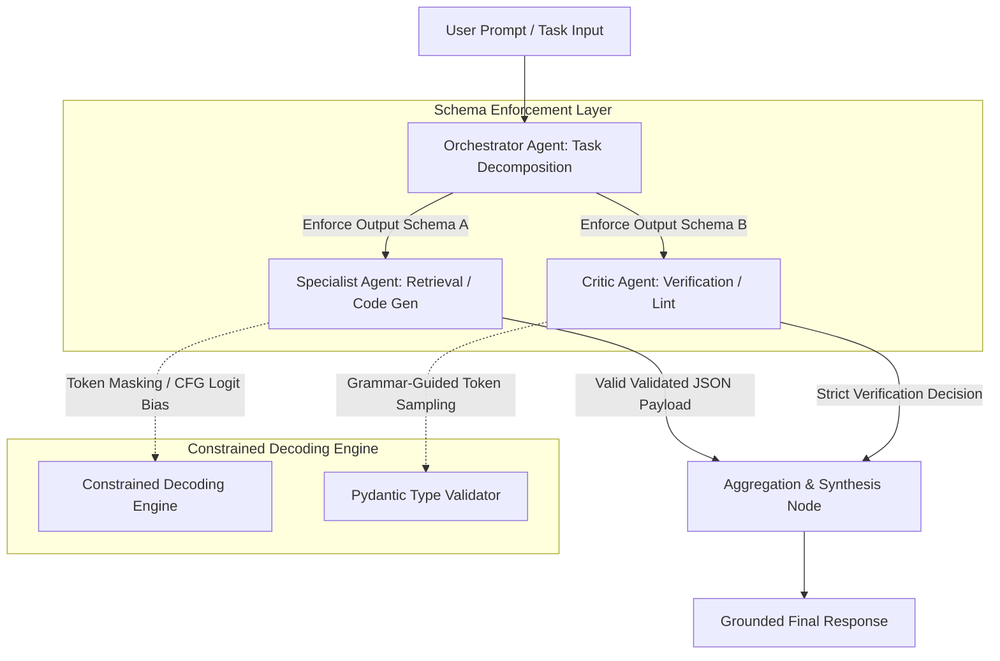
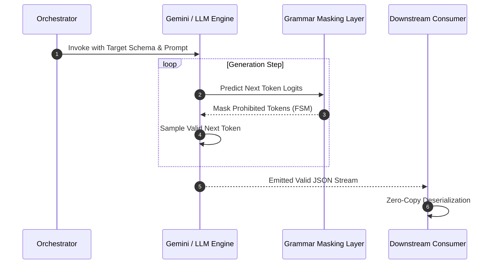

## Why Do Unconstrained Prompts Break Multi-Agent Coordination?

When multi-agent systems interact, prompt engineering ceases to be an exercise in stylistic coaxing and becomes a strict interface contract. In single-agent setups, ambiguous prose or soft formatting failures can often be tolerated or self-corrected. In complex multi-agent architectures, however, an upstream agent that outputs conversational preamble, irregular markdown delimiters, or missing keys causes immediate serialization failures in downstream consumers.

To ensure deterministic communication, agent harnesses enforce structured inputs and schema-governed outputs. Rather than relying on soft system prompts asking the model to "output only valid JSON without backticks," production architectures leverage constrained decoding mechanisms such as context-free grammar (CFG) masking, Pydantic model validation, and provider-level structured decoding (such as Google Gemini API structured outputs and OpenAI JSON Schema modes).

Understanding how constrained sampling alters model probability distributions is critical for architecting reliable agentic pipelines.

## How Schema Constraints and Structured Input (SI) Work in Agent Architectures

Structured Input (SI) templates and grammar-constrained decoding transform arbitrary natural language prompts into typed, machine-readable representations before execution. In modern agent orchestrations, schemas govern three critical junctions:

1. **Input Boundary Parameterization**: Translating free-form user intents into typed state representations (e.g., separating instructions, background context, tool schemas, and operational constraints).
2. **Inter-Agent Communication Interfaces**: Defining strict Remote Procedure Call (RPC)-like payloads between collaborating agents, ensuring that field names, enums, and data types remain stable across context shifts.
3. **Tool Dispatch and State Updates**: Guaranteeing that tool arguments match the function definitions expected by external APIs or database runtimes.

| Mechanism | Implementation Level | Failure Mode Handled | Overhead & Limitations |
| :--- | :--- | :--- | :--- |
| **System Prompt Prompting** | Context Level (Token level instructions) | Soft formatting guidance | High token overhead; frequent syntax and escape errors |
| **Pydantic Validation Loop** | Application Layer (Post-hoc regex/parsing) | Syntax errors, missing required keys | Requires retries on validation failure; increases latency |
| **CFG Logit Masking / Schema Decoding** | Inference Engine (Grammar constraint during sampling) | Syntax and structural invalidity impossible | Slightly constrained reasoning capacity on complex math |
| **Hybrid Structured Input (SI)** | Typed Pipeline (State machine + JSON Schema) | State desynchronization, routing divergence | Requires pre-defined message schemas across graph nodes |

In platforms like Google Gemini API and vLLM grammar engines, schema-guided generation operates at the logit level. By pre-building a finite state machine (FSM) from a JSON schema, the inference engine dynamically masks out tokens that would violate the schema syntax during autoregressive generation. Consequently, tokens representing illegal characters or unauthorized fields receive a logit value of $-\infty$, guaranteeing zero schema violations.

## What Changed Since 2024 in Agent Prompt Engineering

During 2024, prompt engineering for agent systems relied heavily on heuristics: long chains of few-shot examples, verbose negative constraints ("do not include markdown tags"), and recursive retry loops running LLM parsers to fix broken JSON. This approach incurred substantial latency penalties and token costs.

By 2026, the paradigm shifted from heuristic prompting to compiler-style interface contracts:

- **Native Schema Decoding**: Engine-level constrained decoding (via Outlines, Guidance, and vendor APIs) replaced post-generation JSON extraction, rendering formatting retries obsolete.
- **Graph-Governed State**: Frameworks like LangGraph and semantic kernel engines enforce typed state stores, treating agent interactions as deterministic state transitions rather than conversational message streams.
- **Micro-Prompt Optimization**: Massive omnibus system prompts were abandoned in favor of localized micro-prompts tailored to single-purpose specialist agents with strict input/output boundaries.

For a deeper dive into how state and memory management integrate with agentic workflows, explore our analysis on [multi-agent systems architecture](/posts/multi-agent-systems/) and [context engineering and agent memory design](/posts/context-engineering-agent-memory-design/).

## Empirical Trade-Offs: Schema Enforcement vs. Reasoning Flexibility

While grammar-constrained decoding ensures syntactic safety, it introduces distinct behavioral trade-offs that systems engineers must account for:

1. **Reasoning Distortion**: If an LLM is forced to emit a structured key immediately without preceding scratchpad or "chain-of-thought" tokens, reasoning performance on multi-step logic drops noticeably. Modern best practices enforce an internal thinking block before the structured JSON envelope is closed.
2. **Context Window Efficiency**: Structured JSON schemas increase prompt token consumption when schemas are injected repeatedly into every sub-agent invocation. Employing shared reference registries mitigates this context bloat.
3. **Latency Profile**: While eliminating parsing retry round-trips dramatically reduces p99 latency, building complex FSM graphs at initialization time introduces a minor initial compile delay per unique schema.

## Key Takeaways

- Unconstrained natural language prompts create fragile inter-agent pipelines; production multi-agent systems require typed interface boundaries.
- Constrained decoding engines use finite state machines to mask token logits, guaranteeing structural compliance without post-hoc parsing retries.
- Schema enforcement should always permit an internal reasoning/scratchpad field prior to structured payload output to avoid cognitive degradation.
- Modern prompt engineering treats prompts as typed functional interfaces rather than artistic linguistic suggestions.

## Open Questions

- What is the precise quantitative impact of logit-level schema masking on deep mathematical reasoning compared to free-form generation followed by typed extraction?
- How can dynamically evolving ontologies be efficiently compiled into low-latency grammar masks without restarting agent inference engines?
- In high-throughput distributed swarms, what is the optimal caching strategy for inter-agent schema registries across heterogeneous model providers?

## References

- Willard, B. T., & Louf, R. (2023). *Efficient Guided Generation for Large Language Models*. arXiv:2307.09702v2. Read on 2026-10-17 from https://arxiv.org/abs/2307.09702
- Google DeepMind. (2024). *Gemini 1.5: Unlocking Multimodal Understanding Across Millions of Tokens*. arXiv:2403.05530v1. Read on 2026-10-17 from https://arxiv.org/abs/2403.05530
- Outlines Development Team. (2024). *Outlines: Structured Text Generation with Regular Expressions and Context-Free Grammars*. GitHub release v0.0.46. Read on 2026-10-17 from https://github.com/dottxt-ai/outlines
- Pydantic Team. (2024). *Pydantic V2: Fast Data Validation Using Rust and Python Type Hints*. Read as of 2026-10-17 from https://docs.pydantic.dev/2.8/
