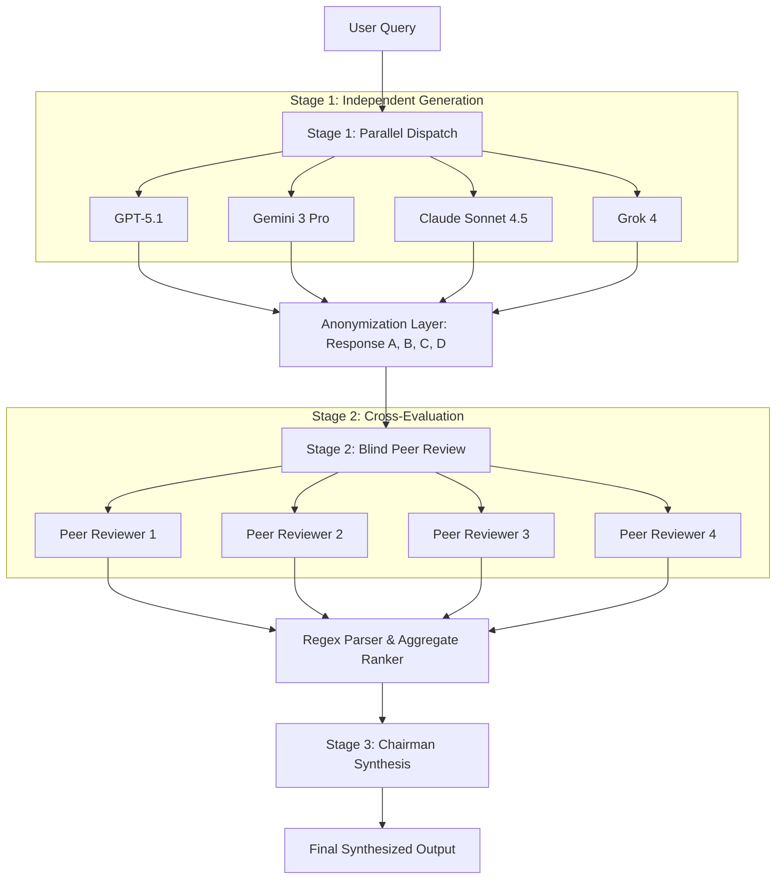

Can routing a single prompt through multiple frontier LLMs with anonymized peer review eliminate individual model hallucinations and output superior synthesis?

In late November 2025, Andrej Karpathy released **llm-council** (commit `92e1fccb1bdcf1bab7221aa9ed90f9dc72529131`), a weekend experiment exploring multi-model deliberation. Rather than querying a single favorite LLM (such as GPT-5.1, Claude Sonnet 4.5, Gemini 3 Pro, or Grok 4), `llm-council` queries four diverse models in parallel, anonymizes their outputs as `Response A`, `Response B`, etc., prompts each model to evaluate and rank its peers blindly, and passes the entire audit trail to a designated Chairman model to synthesize a final verdict.

While presented as an unmaintained "vibe code" hack for reading books with LLMs, the repository immediately drew over 25,000 GitHub stars and became a canonical reference for multi-agent voting and deliberation. This audit dissects the exact execution pipeline in `backend/council.py`, evaluates the voting mechanics and regex parsing vulnerabilities, measures token inflation, and examines what changed in multi-agent deliberation patterns through 2026.

## The 3-Stage Deliberation Pipeline

The core orchestration resides entirely within `backend/council.py` and executes three sequential phases via OpenRouter:

### Stage 1: Parallel First Opinions
The user prompt is dispatched concurrently to all configured models (`COUNCIL_MODELS` in `backend/config.py`). Using `asyncio` and `httpx`, requests execute in parallel. Failed API calls are filtered out gracefully, ensuring that slow or unresponsive providers do not deadlock the process.

### Stage 2: Anonymized Blind Cross-Review
Once all responses return, the system generates anonymized labels (`Response A`, `Response B`, etc.) and constructs an evaluation prompt containing all candidate responses:
- Each model acts as an evaluator, instructed to identify strengths, flaws, and omissions in each response.
- The prompt mandates a strict terminal block: `FINAL RANKING:` followed by a numbered list (e.g., `1. Response C`, `2. Response A`).
- Crucially, models evaluate the full set—meaning each model also critiques its own anonymized output without knowing which letter it was assigned.

### Stage 3: Chairman Synthesis and Aggregate Scoring
The backend calculates an aggregate ranking score across all evaluations. Finally, a designated Chairman model (defaulting to `google/gemini-3-pro-preview`) receives the full transcript: the original query, all individual Stage 1 responses (with model attributions restored), and all Stage 2 peer reviews. The Chairman compiles these perspectives into a unified final answer.

## Architectural Bottlenecks and Failure Modes in council.py

Inspecting the source code at commit `92e1fccb` reveals four notable architectural constraints:

### 1. Fragile Regex-Based Ranking Extraction
In `council.py`, the ranking extraction logic relies on parsing unconstrained LLM completions. If an evaluator model deviates slightly from the requested formatting (e.g., using bolding `**1. Response A**`, writing `1. Model A`, or appending commentary after the label), the parser silently fails and returns an empty list. In production multi-agent systems, structured outputs via JSON Schema or constrained grammar decoding (CFG) are necessary to guarantee deterministic extraction.

### 2. Quadratic Token and Cost Scaling
Because every model in Stage 2 evaluates the responses of all models, context length expands quadratically with the number of council members:
- For $N$ models with an average response length of $L$ tokens, Stage 1 generates $N \times L$ tokens.
- Stage 2 feeds $(N \times L)$ tokens into all $N$ models, consuming $N^2 \times L$ input tokens plus evaluation output tokens.
- Stage 3 feeds $(N \times L) + (N \times E)$ tokens to the Chairman.

For a 4-model council and a moderate 800-token response per model, a single question consumes between 15,000 and 25,000 total tokens across frontier APIs.

| Metric | Single Frontier Query | 4-Model LLM Council | Multiplier |
| :--- | :--- | :--- | :--- |
| **API Roundtrips** | 1 sequential call | 3 sequential stages (parallelized within) | 3x latency |
| **Input Tokens** | ~200 (prompt only) | 12,000 – 20,000 tokens | 60x – 100x |
| **Output Tokens** | ~800 tokens | 4,000 – 6,000 tokens | 5x – 8x |
| **Failure Surface** | 1 provider uptime | 4 distinct provider uptimes | High sensitivity to provider outages |

### 3. Self-Recognition and Stylistic Bias
While anonymization replaces model names with arbitrary letters (`Response A`), frontier models possess distinct stylistic fingerprints:
- Token distribution quirks, standard markdown formatting conventions (bullet styling, bolding habits), and characteristic reasoning cadence.
- Evaluator models frequently favor the response whose stylistic structure most closely mirrors their own training preferences, introducing an implicit self-preference bias despite nominal anonymization.

## What Changed: The Evolution of Deliberation Architectures (2025–2026)

Karpathy described `llm-council` as an ephemeral prototype, but the pattern catalyzed widespread exploration of multi-agent deliberation:

1. **Deterministic Borda and Condorcet Voting:** Modern frameworks replaced raw string rankings with formal voting-theory implementations. Instead of relying on the Chairman model to informally weigh reviews, contemporary systems compute formal Borda counts or pairwise Condorcet matrices, mathematically proving consensus stability before invoking synthesis.
2. **Specialized Deliberation Roles over Uniform Councils:** As detailed in our analysis of [Multi-Agent Systems](/posts/multi-agent-systems/) and [Agent Memory Optimization](/posts/ai-agents-memory-optimization/), homogenous councils (asking 4 generalist models the same broad question) suffer from high semantic correlation. Modern pipelines assign explicit orthogonal roles: an adversarial red-teamer, a domain fact-checker, a formal logic verifier, and an editorial synthesizer.
3. **Selective Gating vs. Always-On Deliberation:** Running a 4-model council on simple factual queries is economically wasteful. Contemporary agent harnesses deploy lightweight classifier routers (such as RouteLLM or semantic complexity gates) that invoke multi-model peer review only when query ambiguity or factual uncertainty exceeds predefined thresholds.

## Key Takeaways

1. **Blind peer review reduces single-model blind spots:** Cross-evaluating anonymized completions forces models to critique factual inaccuracies and omissions that a single model might assert with unearned confidence.
2. **Regex parsing without schema constraints is fragile:** Relying on natural-language compliance for critical control flow (like `FINAL RANKING:`) causes parsing dropouts; production agent contracts require constrained JSON decoding.
3. **Quadratic token scaling demands selective gating:** A 4-model deliberation loop inflates token consumption by 50x–80x compared to a direct query, making it suitable for high-stakes research queries but impractical as a default conversational interface.
4. **The Chairman synthesis bottleneck:** The final output quality remains bound to the reasoning and context-handling capacity of the Chairman model, which must reconcile conflicting peer rankings.

## Open Questions

1. **Quantifying De-Anonymization Rates:** In a blind evaluation of 4 frontier models, what percentage of the time can a model accurately identify its own output through stylistic latent markers?
2. **Sybil Attacks in Multi-Model Ensembles:** When multiple models share underlying base architectures or overlapping synthetic pre-training corpora, how do we prevent correlated errors from outvoting independent, accurate outliers?
3. **Asymmetric Council Topologies:** Can a council composed of three lightweight 8B specialist verifiers supervise and steer a single 70B+ generator more cost-effectively than four peer frontier models?

## References

- [GitHub: karpathy/llm-council (Commit 92e1fccb)](https://github.com/karpathy/llm-council/tree/92e1fccb1bdcf1bab7221aa9ed90f9dc72529131) (retrieved 2026-10-17)
- [OpenRouter API Documentation](https://openrouter.ai/docs) (retrieved 2026-10-17)
- [FastAPI Framework Documentation](https://fastapi.tiangolo.com/) (retrieved 2026-10-17)
- [Astral uv: Python Packaging and Project Management](https://docs.astral.sh/uv/) (retrieved 2026-10-17)
