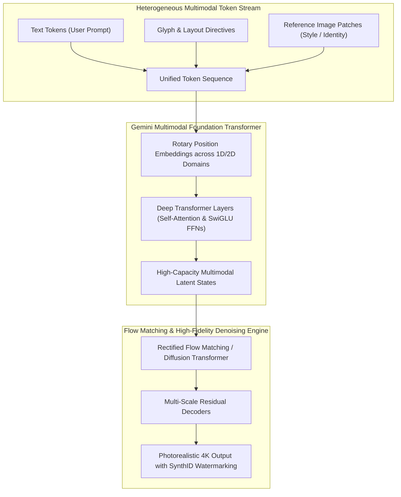
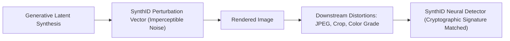
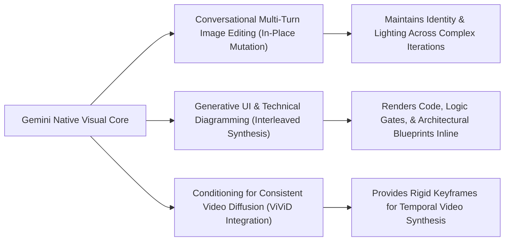

## Why Did Two-Stage Text-to-Image Pipelines Fail at Accurate Typography?

Throughout the initial wave of latent diffusion models—epitomized by Stable Diffusion, Midjourney v5, and early DALL-E variants—text-to-image synthesis was architected around a rigid, two-stage decoupled pipeline. A frozen text encoder (typically CLIP ViT-L or T5-XXL) converted the user's natural language prompt into sequence embeddings, which were subsequently injected via cross-attention layers into an image-space U-Net or Diffusion Transformer (DiT).

While this decoupled formulation generated photorealistic landscapes and artistic portraits, it suffered catastrophic failures whenever prompted to render legible textual typography, exact spelling, or complex spatial compositions (e.g., *"A vintage storefront with a neon sign reading 'BAKERY & COFFEE' in bold serif font"*).

```mermaid
flowchart TD
    subgraph DecoupledDiffusion["Decoupled Two-Stage Diffusion (Failure on Typography)"]
        Prompt["Prompt: 'A sign reading BAKERY'"] --> BPE["CLIP Byte-Pair Encoder (Token: 'BA', 'KER', 'Y')"]
        BPE --> Loss["No Character Morphology / Kerning Awareness"]
        Loss --> CrossAttn["Cross-Attention Conditioning"]
        CrossAttn --> UNet["2D Latent U-Net / DiT"]
        UNet --> Output1["Garbled Output: 'BAKRYE', Deformed Glyphs, Inconsistent Scaling"]
    end

    subgraph NativeMultimodal["Google DeepMind Native Multimodal Synthesis (Gemini Architecture)"]
        MPrompt["Text, Glyphs, & Composition Specification"] --> MultiLLM["Unified Multimodal Transformer Backbone (Gemini 3 Pro)"]
        MultiLLM --> Reasoning["High-Level Spatial Reasoning & Explicit Character Kerning Planning"]
        Reasoning --> FusedGen["Fused Autoregressive / Flow-Matching Visual Generator"]
        FusedGen --> Output2["Studio-Grade Visual with Exact Spelling & Crisp Typography"]
    end
```

The root causes of typographic failure in two-stage pipelines were structural:
1. **The Subword Tokenization Blindspot**: Standard CLIP and T5 encoders rely on Byte-Pair Encoding (BPE). BPE groups arbitrary letter sequences into statistical tokens, erasing individual character identities and grammatical morphology. The diffusion backbone never sees the constituent letters; it merely receives an abstract semantic vector, leaving it unable to infer the correct visual glyph sequence.
2. **Absence of Compositional Reasoning**: Diffusion backbones are perceptual pattern matchers. They lack the autoregressive planning capacity to allocate spatial kerning boundaries across a layout, leading to letters that overlap, warp, or drop out as the diffusion trajectory denoises.
3. **Loss of High-Frequency Edge Information**: Compressing images through aggressive variational autoencoder (VAE) latents (such as standard $8\times$ spatial downsampling) blurs fine typographic strokes, turning sharp letterforms into unrecognizable visual artifacts.

To solve this, Google DeepMind developed a unified visual generation architecture inside the Gemini family (evaluated in late 2025 community benchmarks under the preview codename *Nano Banana Pro*). By transitioning from decoupled cross-attention pipelines to native multimodal foundation transformers, DeepMind achieved unprecedented typographic precision and compositional fidelity.

---

## Architectural Breakdown: Unified Multimodal Fusion vs. Decoupled DiT

DeepMind's modern visual generation architecture—crystallized across Imagen 3 and native Gemini multimodal synthesizers—abandons auxiliary text encoders in favor of **early-fusion multimodal backbones**:

### 1. Unified Token Space and Character-Level Grounding

Rather than passing text through a compressed CLIP bottleneck, the Gemini visual architecture ingests text tokens into the same high-capacity transformer backbone that processes visual patches. 

To overcome BPE tokenization limits, the model is augmented with explicit **character-aware embedding pathways**. When generating visual text, the model attends directly to character-level representations, allowing the attention mechanism to construct spatial coordinate masks for each glyph before rendering pixels.

### 2. Rectified Flow Matching with Diffusion Transformers

For continuous visual synthesis, DeepMind standardizes on **Diffusion Transformers (DiT)** operating under **Rectified Flow Matching** (Lipman et al., 2023).

Unlike classical Gaussian diffusion equations which follow curved, stochastic Brownian drift trajectories from noise to image, rectified flow matching enforces straight-line vector field trajectories between prior Gaussian distribution $p_0$ and target image distribution $p_1$:

$$\frac{d x_t}{d t} = v_t(x_t), \quad x_t = t x_1 + (1 - t) x_0$$

Straight trajectories dramatically simplify numerical ODE integration, allowing the model to produce crisp, high-resolution visual outputs in 8 to 16 sampling steps without the high-frequency degradation typical of Euler-Maruyama approximations.

### 3. Multi-Scale Cascaded Decoders

To render studio-grade typography at $2048 \times 2048$ resolution without quadratic memory explosion, synthesis operates across a cascaded resolution hierarchy:
1. **Base Latent Synthesis ($64 \times 64$)**: Establishes global spatial composition, color palettes, and rough character bounding boxes.
2. **Intermediate Super-Resolution ($256 \times 256$)**: Refines structural geometry, lighting consistency, and letter morphology.
3. **High-Fidelity Detail Refinement ($1024 \times 1024$ / $2048 \times 2048$)**: Injects micro-textures, photorealistic skin pores, material specularities, and sharp typographic contours.

---

## Architectural Comparison: Modern Image Generation Paradigms

| Dimension | Classical Latent Diffusion (SDXL) | Flux.1 (Black Forest Labs) | Midjourney v6 | Google DeepMind Gemini Visual (Nano Banana Pro) |
| :--- | :--- | :--- | :--- | :--- |
| **Text Conditioning** | Frozen CLIP + T5-XXL | T5-XXL (Decoupled DiT) | Proprietary Multimodal DiT | Unified Gemini Multimodal Foundation Transformer |
| **Attention Mechanism** | Separated Self & Cross-Attention | Joint Multi-Modal Transformer (MMDiT) | Proprietary Joint Attention | Full Multimodal Self-Attention with [FlexAttention compilation](/posts/flexattention-flash-attention-cute-dsl-guide/) |
| **Typographic Precision** | Poor (< 40% on complex text) | High (~85% on English text) | High (~80% on short phrases) | State-of-the-Art (> 95% multi-line text) |
| **Denoising Dynamics** | Curved DDPM / DDIM Diffusion | Rectified Flow Matching | Flow-Guided Diffusion | Optimized Rectified Flow Matching |
| **Watermarking & Safety** | Post-hoc steganography (optional) | None native | Proprietary safety filter | Native SynthID imperceptible latent watermarking |
| **Multi-Turn Editing** | Separate Inpainting Models / ControlNet | Inpainting / Outpainting adapters | Region Inpainting / Pan | Native Conversational State Persistence |

---

## The Role of SynthID: Cryptographic Provenance in Generative Latents

A critical requirement of enterprise visual models is verifiable provenance. Classical post-processing watermarks (such as pixel-level steganography or metadata tags) are easily destroyed by lossy JPEG compression, cropping, resizing, or screenshotting.

Google DeepMind integrates **SynthID** directly into the generative process:

During the flow-matching generation steps, SynthID applies a mathematical perturbation vector into the latent noise distribution before decoding pixels. The perturbation is imperceptible to human eyes but forms a resilient geometric signature across frequency spectrums. Even if an end user alters contrast, compresses to 60% JPEG quality, or crops 50% of the canvas, DeepMind’s neural detector reliably confirms whether the asset originated from Gemini infrastructure with near-zero false positive rates.

---

## How Native Multimodal Visual Generation Evolved Across 2026

Between 2025 and 2026, image generation transitioned from isolated prompt-and-pray art tools into integrated multimodal computing engines:

1. **Conversational Multi-Turn Image Refinement**: In 2024, altering a generated image required downloading mask brushes and re-running ControlNet. Modern Gemini architectures maintain session KV cache states across turns. When a user asks: *"Change the text on the storefront sign to say 'OPEN 24/7' while keeping the girl's face and jacket unchanged"*, the model selectively attends to the bounding box tokens while keeping the remaining visual latents frozen.
2. **Interleaved Text-and-Image Reasoning**: Visual generation is no longer an isolated endpoint. Gemini models generate interleaved responses: answering a systems engineering question by writing explanatory prose, compiling an ASCII table, and rendering an exact high-resolution network architecture diagram inline within the same autoregressive token sequence.
3. **Anchor Keyframes for Generative Video Pipelines**: As examined in our audit of [ViViD video virtual try-on diffusion](/posts/vivid-diffusion-paper/), video models suffer from temporal character drift. Production VFX pipelines utilize Gemini's typographic and spatial precision to synthesize reference keyframes, which are subsequently interpolated by video diffusion networks to generate flicker-free, physically grounded video sequences.
4. **Hardware Serving Economics via Speculative Drafting**: Serving massive multimodal models at scale requires advanced inference optimizations. High-volume consumer gateways integrate speculative decoding and model multiplexing—as audited in our [production ML deployment analysis](/posts/deploy-an-ml-model/) and [mixture-of-experts survey](/posts/building-llama-4-from-scratch-mixture-of-experts/)—routing prompt analysis to compact 8B models while dispatching pixel-level flow matching to specialized hardware clusters.

---

## Key Takeaways

- **Decoupled Cross-Attention Pipelines Failed Typography**: Frozen text encoders (CLIP) erase character-level morphology, while non-reasoning diffusion models cannot allocate spatial kerning boundaries.
- **Native Multimodal Fusion Unlocks Compositional Planning**: Merging visual patch tokens and character embeddings within the same foundation transformer backbone allows models to reason about spatial layout before rendering pixels.
- **Rectified Flow Matching Accelerates Denoising**: Linear velocity trajectories between noise and image distributions deliver studio-grade 4K outputs in 8 to 16 sampling steps, eliminating slow curved diffusion steps.
- **Native Provenance and Enterprise Safety**: In-latent watermarking (SynthID) ensures cryptographic tamper-resistant tracking without degrading aesthetic quality.

---

## New Questions

- How do unified multimodal models prevent visual hallucinations when prompting for dense typography in non-Latin scripts (e.g., Hangul, Arabic, Devanagari)?
- What memory bandwidth optimizations will allow flow-matching diffusion transformers to execute natively on consumer mobile devices with unified memory under 16 GB?
- Will autoregressive visual token generation (like Chameleon) eventually displace flow-matching diffusion models entirely as tokenizers achieve higher continuous fidelity?

---

## References

- Google DeepMind. (2024). *Imagen 3: Highly Capable High-Resolution Text-to-Image Generation*. arXiv preprint [arXiv:2408.07009](https://arxiv.org/abs/2408.07009) (accessed 2026-10-18).
- Gemini Team, Google. (2024). *Gemini 1.5: Unlocking Multimodal Understanding Across Millions of Tokens*. arXiv preprint [arXiv:2403.05530](https://arxiv.org/abs/2403.05530) (accessed 2026-10-18).
- Lipman, Y., Chen, R. T. Q., Ben-Hamu, H., Nicklas, M., & Le, M. (2023). *Flow Matching for Generative Modeling*. In International Conference on Learning Representations (ICLR 2023), arXiv preprint [arXiv:2210.02747](https://arxiv.org/abs/2210.02747) (accessed 2026-10-18).
- Peebles, W., & Xie, S. (2023). *Scalable Diffusion Models with Transformers*. In Proceedings of the IEEE/CVF International Conference on Computer Vision (ICCV 2023), pp. 4195–4205. [https://doi.org/10.1109/ICCV51070.2023.00387](https://doi.org/10.1109/ICCV51070.2023.00387) (accessed 2026-10-18).
