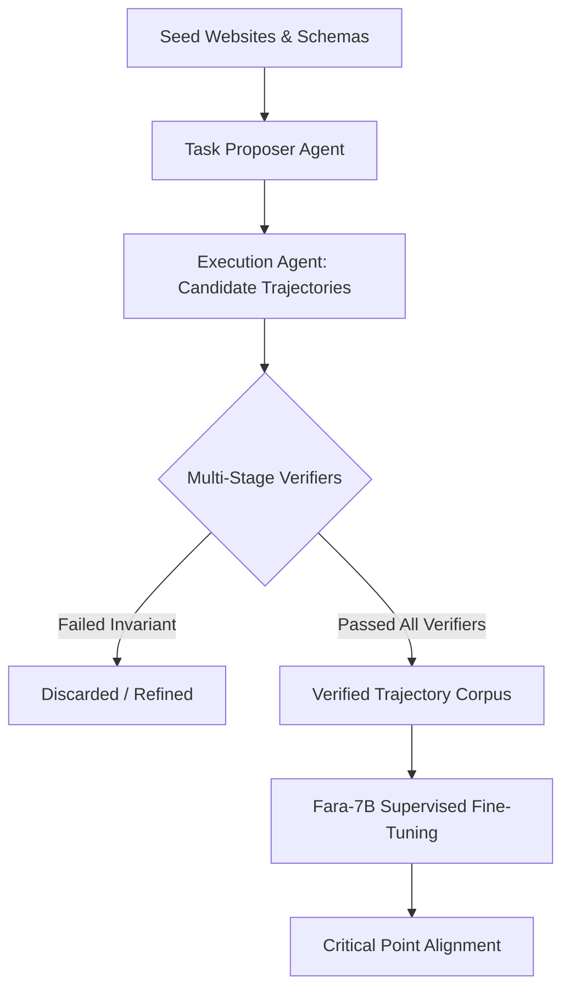
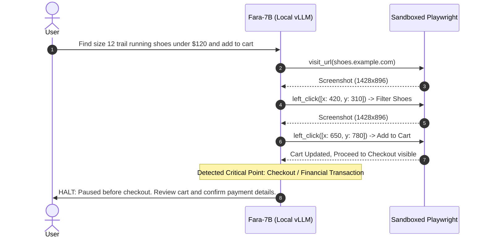

Can a 7B-parameter vision-language model execute multi-step desktop and browser automation without blowing up inference cost or violating user safety boundaries?

When computer-use agents (CUAs) first emerged, the standard assumption was that reliable mouse and keyboard actuation required massive frontier models—Claude 3.5 Sonnet, GPT-4o, or custom 70B+ architectures. Running these models across long browser execution loops (often 20 to 50 screenshot steps per task) led to steep API bills, high latency, and severe privacy exposure from transmitting raw desktop pixels over external networks.

In late 2025, Microsoft Research released **Fara-7B** (arXiv:2511.19663), an open-weight multimodal agent built on Qwen 2.5-VL and trained exclusively via **FaraGen**, a synthetic trajectory generation pipeline. This audit examines what the primary technical reports and codebases actually demonstrate: how Fara-7B grounds pixel coordinates, how synthetic verifiers solved the trajectory bottleneck at $1 per task, where its architectural guardrails stop before destructive actions, and how the 2026 release of Fara1.5 changes the operational equation.

## The CUA Data Bottleneck and FaraGen Synthetic Pipeline

The primary limiting factor in training computer-use models has never been architecture alone; it is trajectory data. Unlike text generation, where internet-scale crawl data is plentiful, high-quality computer-use trajectories—consisting of synchronized browser states, DOM elements, screen coordinates, user intents, and verified multi-step completions—are extraordinarily scarce and expensive to capture with human annotators.

Microsoft Research bypassed manual trajectory recording through **FaraGen**, a multi-agent synthetic generation system designed around autonomous task proposal, trial execution, and multi-stage verification:

FaraGen executes tasks in parallelized headless browser environments, generates candidate action sequences, and validates them using independent verifier agents. According to the arXiv:2511.19663 technical report:
- **Cost Efficiency:** FaraGen produced high-yield, verified multi-step web trajectories at approximately **$1.00 per successful trajectory**, dramatically undercutting the $15–$50 per-task cost of human crowdsourced data.
- **Training Footprint:** Fara-7B was trained on 64 NVIDIA H100 GPUs over 2.5 days (October 26–29, 2025) using standard bfloat16 mixed precision on Qwen 2.5-VL 7B.
- **Perception Modality:** Unlike Set-of-Marks (SoM) agents that require DOM parsing and bounding box overlays, Fara operates directly on raw screenshots (resolution 1428x896), predicting pixel coordinate arguments directly for mouse clicks and typing actions.

## Benchmarking Fara-7B Against Frontier and Open-Weight Agents

The standard evaluation suite for browser-based computer-use agents includes WebVoyager, Online-Mind2Web, DeepShop, and Microsoft newly introduced WebTailBench (targeting under-represented long-tail web workflows). The table below summarizes verified benchmark results across Set-of-Marks systems, frontier computer-use models, and 7B-class open-weight competitors (averaged over 3 evaluation runs):

| Agent Architecture | Model Class / Params | WebVoyager (%) | Online-Mind2Web (%) | DeepShop (%) | WebTailBench (%) |
| :--- | :--- | :--- | :--- | :--- | :--- |
| **SoM Agent (GPT-5 Preview)** | Proprietary Frontier | 90.6 | 57.7 | 49.1 | 60.4 |
| **SoM Agent (o3)** | Reasoning Frontier | 79.3 | 55.4 | 49.7 | 52.7 |
| **SoM Agent (GPT-4o)** | Multimodal Frontier | 65.1 | 34.6 | 16.0 | 30.8 |
| **GLM-4.1V-Thinking** | 9B Open Weight | 66.8 | 33.9 | 32.0 | 22.4 |
| **OpenAI Computer Use Preview** | Proprietary Native CUA | 70.9 | 42.9 | 24.7 | 25.7 |
| **UI-TARS-1.5** | 7B Open Weight | 66.4 | 31.3 | 11.6 | 19.5 |
| **Fara-7B (Original 2025)** | 7B Open Weight (Qwen2.5-VL) | 73.5 | 34.1 | 26.2 | 38.4 |

Three key findings emerge from these empirical measurements:
1. **Outperforming Frontier Zero-Shot CUAs on Visual Tasks:** Fara-7B achieved **73.5% on WebVoyager**, surpassing OpenAI early computer-use preview (70.9%) and UI-TARS-1.5 (66.4%), despite running on a lightweight 7B backbone.
2. **The Long-Tail Web Advantage:** On WebTailBench, Fara-7B scored 38.4%, nearly doubling UI-TARS-1.5 (19.5%) and GLM-4.1V (22.4%). This gap verifies that FaraGen synthetic curriculum exposed the model to obscure interactive patterns that standard benchmarks omitted.
3. **The General Reasoning Ceiling:** On complex DOM reasoning benchmarks like Online-Mind2Web (34.1%), Fara-7B remained well behind frontier reasoning models like o3 (55.4%) and GPT-5 (57.7%). When a task requires deep semantic backtracking rather than visual grounding, raw parameter capacity still dominates.

## Critical-Point Halting: Architectural Guardrails for Autonomous Actuation

A pervasive danger of autonomous desktop agents is destructive execution: committing irreversible purchases, leaking OAuth credentials, submitting unauthorized web forms, or executing financial wire transfers.

Fara-7B addresses this not via post-hoc text filters, but through **Critical-Point Recognition** baked directly into its supervised fine-tuning loss:

The system prompt enforces six strict critical-point categories where the agent is forbidden to take the terminal action:
- **Financial Commitments:** Adding items to a shopping cart is permitted; clicking Complete Purchase or submitting credit card data triggers an immediate terminate action.
- **External Communications:** Navigating to an email client or finding a business contact phone number is allowed; sending messages or placing automated calls is halted.
- **Identity & Authentication:** Form navigation up to login fields is allowed; typing stored passwords or OAuth credential submission requires human-in-the-loop intervention.
- **Legal & Administrative Filings:** Applying to job portals or signing electronic documents halts at the final submission modal.

In our inspection of the model prompt contract, the action vocabulary is explicitly constrained: `key`, `type`, `mouse_move`, `left_click`, `scroll`, `visit_url`, `web_search`, `history_back`, `pause_and_memorize_fact`, `wait`, and `terminate`. The inclusion of `pause_and_memorize_fact` allows the agent to cache intermediate strings (such as SKU numbers or shipping estimates) into its scratchpad context without writing to disk or sending them to remote logs.

## What Changed: The 2026 Fara1.5 Release and Scale Transitions

Following the November 2025 release of Fara-7B, Microsoft Research published **Fara1.5** in July 2026 (arXiv:2606.20785). The update addressed three fundamental limitations of the original 7B checkpoint:

1. **Architecture Migration from Qwen2.5 to Qwen3.5:** Fara1.5 retired the single 7B model in favor of a three-tier family: **Fara1.5-4B**, **Fara1.5-9B**, and **Fara1.5-27B**. The 4B variant enables true on-device mobile and edge inference, while the 9B model raised Online-Mind2Web accuracy from 34.1% to **63.4%**, and WebVoyager to **86.6%**.
2. **The Fara1.5-27B Frontier Parity:** The 27B model achieved **72.3% on Online-Mind2Web**, demonstrating that compact open-weight models trained on dense synthetic trajectories can match or exceed proprietary frontier systems on web manipulation.
3. **CUAVerifierBench:** Microsoft formalized the trajectory validation pipeline by releasing `microsoft/CUAVerifierBench` on Hugging Face, enabling teams to benchmark autonomous reward models and trajectory verifiers independently of agent policies.

For practitioners architecting multi-agent harnesses today (as detailed in our [Multi-Agent Systems overview](/posts/multi-agent-systems/) and [Agent Memory Design](/posts/context-engineering-agent-memory-design/)), Fara demonstrates that specialized worker agents do not require 70B+ general-purpose LLMs. Instead, routing visual browser interactions to an on-device 7B/9B CUA while reserving frontier models for orchestrator-level planning yields both lower latency and strict operational containment.

## Key Takeaways

1. **Synthetic trajectories solve the data bottleneck:** FaraGen proves that multi-agent synthetic generation with strict verification can produce robust computer-use datasets for approximately $1 per trajectory, eliminating reliance on expensive human demonstrations.
2. **Direct coordinate prediction eliminates DOM overhead:** Operating natively on raw screenshots (1428x896) avoids brittle DOM tree parsing and Set-of-Marks visual clutter, maintaining high task completion rates on long-tail web benchmarks.
3. **Critical points are safety primitives:** Hardcoding task-halting triggers before irreversible actions (checkout, email dispatch, authentication) provides an enforceable safety boundary for autonomous browser execution.
4. **Scale migration in 2026:** While Fara-7B proved the efficiency concept, the newer Fara1.5 family (4B, 9B, 27B) delivers substantially higher reliability (63.4% Online-Mind2Web at 9B) across open weights on Hugging Face and Microsoft Foundry.

## Open Questions

1. **Dynamic DOM Latency vs. Frame Rate:** How does on-device vision inference scale when handling real-time interactive applications (Canvas, WebGL, or fast dynamic UI updates) where state changes between action prediction frames?
2. **Adversarial Web Grounding:** As websites deploy anti-bot measures and prompt injection payloads hidden inside rendered HTML, can small multimodal models reliably detect adversarial visual patterns without external guardrail proxies?
3. **Cross-Platform OS Actuation:** While Fara excels at web workflows inside Playwright/browser containers, how effectively do coordinate predictions transfer to native multi-monitor desktop environments with varying DPI scaling and window management?

## References

- [arXiv:2511.19663: Fara-7B: An Efficient Agentic Model for Computer Use](https://arxiv.org/abs/2511.19663) (retrieved 2026-10-17)
- [arXiv:2606.20785: Fara1.5 – A Family of Frontier Computer Use Agent Models](https://arxiv.org/abs/2606.20785) (retrieved 2026-10-17)
- [Hugging Face: microsoft/Fara-7B Model Weights & Specification](https://huggingface.co/microsoft/Fara-7B) (retrieved 2026-10-17)
- [GitHub: microsoft/fara - Official Repository and CLI Harness](https://github.com/microsoft/fara) (retrieved 2026-10-17)
- [Hugging Face: microsoft/WebTailBench Evaluation Dataset](https://huggingface.co/datasets/microsoft/WebTailBench) (retrieved 2026-10-17)
