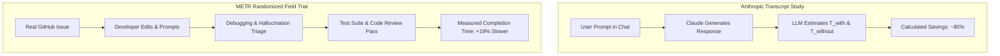
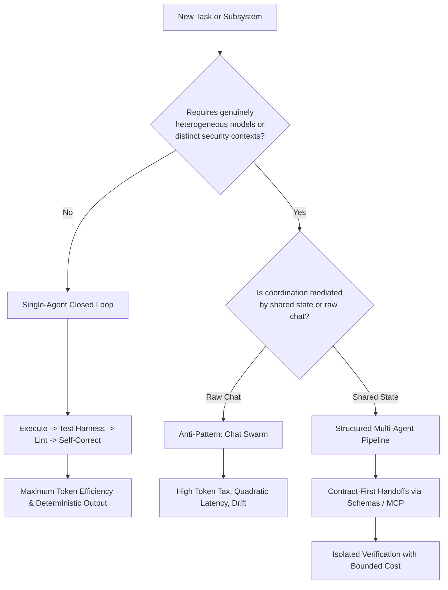

## Does Orchestrating Multiple AI Agents Multiply the 80% Time Savings from Chat LLMs?

When Anthropic published its economic productivity analysis in late November 2025, one headline figure seized industry attention: across a sample of 100,000 real conversations on Claude.ai, the study estimated an **80% median reduction in task completion time**. Tasks that would ordinarily demand 90 minutes of focused professional labor were reported as finished in approximately 18 minutes.

A widespread conceptual leap immediately followed across technical blogs and engineering roadmaps: if a single assistant produces an 80% reduction in human task duration, orchestrating four or five specialized agents in a multi-agent framework must push time savings beyond 90% or 95%.

That extrapolation rests on a category error. Anthropic's dataset measured single-human conversational sessions evaluated by Claude itself, not autonomous agent swarms executing real-world software workflows. When we examine the primary sources side by side—contrasting Anthropic's conversation modeling against randomized controlled trials and 2026 matched-compute benchmarks—the evidence reveals that multi-agent architectures do not automatically amplify productivity. Instead, unconstrained agent orchestration frequently introduces severe coordination latency, token inflation, and energy multiplication without corresponding accuracy gains.

This Source Audit examines the exact methodology behind Anthropic's 100,000-conversation report, audits why controlled field trials show vastly different productivity profiles, evaluates 2026 empirical multi-agent benchmarks under matched token budgets, and outlines the architectural boundaries where single-agent loops outperform multi-agent topologies.

---

## Inside Anthropic's 100,000-Conversation Methodology and LLM Self-Estimation

Anthropic's study (*"Estimating the Economic Value and Productivity Gains of Generative AI"*, authored by Alex Tamkin, Peter McCrory, et al.) analyzed real-world conversations sampled from Claude.ai using their privacy-preserving CLIO framework. To derive macro productivity estimates without reading private user prompts, the researchers instructed Claude to analyze anonymized conversation transcripts and estimate two core variables for each task:

1. **Estimated time without AI ($T_{\text{without}}$):** The estimated hours a qualified human professional would require to complete the task from scratch.
2. **Estimated time with AI ($T_{\text{with}}$):** The total active time spent completing the task with Claude, including drafting prompts, reviewing output, iterating, and performing directly related execution steps outside the chat window.

Time savings were formally defined in the study as:

$$\text{Savings} = 1 - \frac{T_{\text{with}}}{T_{\text{without}}}$$

The headline findings reported in the paper and technical overview include:

| Metric | Reported Value | Methodological Basis | Key Caveats |
|:-------|:---------------|:---------------------|:------------|
| **Median Conversation Savings** | 84% | Claude-generated task estimates across transcripts | Self-evaluated by Claude; excludes subsequent code reviews |
| **Median O\*NET Task Savings** | 81% | Aggregated across O\*NET occupational task codes | Assumes conversation reflects complete occupational duty |
| **Typical Task Duration** | 90 minutes (1.4 hours) | Baseline human estimate without AI | Heavily skewed toward software and writing tasks |
| **Median Wage Value** | $54 per conversation | Based on BLS wage data mapped to O\*NET tasks | Web overview quotes $55; detailed results report $54 |
| **Annualized US Productivity Boost** | 1.8% over 10 years | Hulten's theorem aggregation across wage bill | Conditional projection assuming 100% universal adoption |
| **Labor Share Parameter** | 0.60 (PDF) / 0.64 (Web) | Applied to aggregate productivity equation | Discrepancy between PDF footnote 4 and live web text |

While these metrics offer valuable directional evidence regarding how individuals interact with conversational interfaces, three structural caveats govern the data:

First, **the estimates are generated by the model itself, not measured by an independent stopwatch.** In their validation section, the authors evaluated Claude Sonnet 4.5's estimation accuracy against 1,000 open-source JIRA tasks with tracked developer completion times. While Claude achieved a rank correlation of Spearman $\rho = 0.44$ (comparable to human developers at $\rho = 0.50$), the model systematically compressed estimates—overestimating short tasks and underestimating large, multi-hour engineering efforts.

Second, **the dataset captures closed interaction windows.** It cannot measure downstream integration friction, post-session debugging, code review delays, or organizational rework that occurs after the user closes the chat interface.

Third and most crucially, **the study evaluated zero multi-agent systems.** Every data point was a single user interacting with a single assistant. Applying an 80% conversational speedup to multi-agent architectures assumes that inter-agent communication has zero friction, zero coordination cost, and zero hallucination cascade—an assumption directly contradicted by empirical engineering.

---

## Why Controlled Field Trials Diverge from Conversational Estimates

When we move from self-reported conversation transcripts to randomized controlled trials (RCTs) conducted in realistic engineering environments, the observed productivity impact shifts dramatically.

In July 2025, researchers at METR (Model Evaluation and Threat Research) published a pre-registered, randomized controlled trial evaluating early-2025 AI tools (*"Measuring the Impact of Early-2025 AI on Experienced Open-Source Developer Productivity"*, Becker et al., arXiv:2507.09089v1). Unlike conversational self-reports, the METR study tracked experienced developers working on real, complex pull requests and issue resolution across mature open-source repositories:

- **136 tasks completed with AI tools allowed** (Cursor, Claude, GitHub Copilot).
- **110 tasks completed with AI tools disallowed** (standard development tools only).
- Tasks were balanced for forecasted difficulty, with an average estimated human baseline of ~116 minutes.

Rather than an 80% reduction in completion time, the released econometric regression yielded an effect estimate of:

$$S = 0.188 \quad (\text{95% CI: } 0.013 \text{ to } 0.394)$$

Where $S$ measures the proportional change in completion time ($\frac{T_{\text{AI}}}{T_{\text{no-AI}}} - 1$). In other words, developers with AI access took approximately **19% longer** on complex, end-to-end repository maintenance tasks than developers working without AI assistance.

The contrast between these two studies highlights why conversational productivity cannot be conflated with software engineering productivity:

1. **The Cost of Verification:** In chat sessions, generating 200 lines of plausible code takes seconds. In production repositories, verifying that those 200 lines do not introduce subtle boundary bugs, memory leaks, or breaking schema changes requires rigorous tracing and test suite execution.
2. **Context Window Drift:** When tasks require understanding thousands of lines of interconnected code across multiple services, conversational models lose critical context, leading to repetitive suggestion loops that consume developer attention.
3. **The Illusory Speedup:** Developers often *felt* faster because keystroke generation was rapid, but wall-clock time was consumed diagnosing subtle integration errors.

---

## What Changed Since Late 2025: Empirical Multi-Agent Benchmarks Under Matched Budgets

Throughout 2026, researchers began rigorously stress-testing the assumption that multi-agent frameworks (such as AutoGen, CrewAI, or multi-agent councils) outperform single-agent baselines on complex reasoning and implementation tasks.

The findings from two landmark 2026 studies dismantle the premise that multi-agent orchestration naturally amplifies single-agent productivity:

### 1. The OneFlow Findings (arXiv:2601.12307v1)

In *"Rethinking the Value of Multi-Agent Workflow: A Strong Single Agent Baseline"*, Xu et al. evaluated multi-agent workflows against a single agent equipped with structured thinking prompts across multi-hop reasoning benchmarks (FRAMES, MuSiQue).

When evaluated under an **equal thinking token budget**, the single-agent baseline consistently matched or outperformed homogeneous multi-agent frameworks:
- Multi-agent collaboration introduced substantial conversational redundancy: agents spent large portions of their token budget agreeing, reiterating context, and re-formatting outputs.
- In contrast, a single agent operating with an internal scratchpad allocated its entire compute budget directly to step-by-step problem decomposition.
- As analyzed in our review of Karpathy's deliberation architecture in [/posts/llm-council-complete-architecture-analysis/](/posts/llm-council-complete-architecture-analysis/), passing full conversation histories across multiple rounds of peer review causes token consumption to scale quadratically with participant count.

### 2. Physical Energy and Latency Scaling (Astekin et al., arXiv:2610.03010v1)

In October 2026, Astekin et al. published comprehensive physical energy and end-to-end latency measurements across four agent topologies:
- **NA (No Agent):** Direct, stateless model query.
- **SA (Single Agent):** One autonomous agent with tool-calling capabilities.
- **DA (Dual Agent):** Two collaborating agents (e.g., generator and reviewer).
- **MA (Multi Agent):** Four specialized agents with coordination routing.

Their empirical measurements across real-world problem sets revealed staggering scaling overheads:

| Metric | NA (Direct Query) | SA (Single Agent) | DA (Dual Agent) | MA (4-Agent Council) |
|:-------|:------------------|:------------------|:----------------|:---------------------|
| **Total Process Energy (kWh)** | 0.128 | 0.154 (1.20×) | 0.392 (3.06×) | 0.813 (6.36×) |
| **Relative Latency Ratio** | 1.00× | 1.23× | 3.32× | 6.07× |
| **Worst-Case Log Parsing Latency** | 313s | 412s | 4,210s | 50,186s (160×) |
| **Token Consumption Multiplier** | 1.00× | 1.45× | 4.10× | 8.80× |
| **Accuracy Improvement over SA** | Baseline | Reference | +1.2% | -0.4% (net negative) |

Astekin et al. demonstrated that for multi-hop reasoning and analytical workflows, increasing agent count from one to four inflated energy consumption by over 500% and latency by over 500%, while average task accuracy actually degraded due to accumulated error propagation. Only in domain-isolated vulnerability scanning did multi-agent topologies demonstrate a defensible accuracy improvement.

---

## Architectural Guidance: When to Use Single Agents vs Multi-Agent Teams

Based on the empirical evidence gathered between 2025 and 2026, practitioners must discard the notion that multi-agent systems are a universal accelerator. High-performing engineering organizations apply strict architectural boundaries when choosing execution topologies:

### When to Standardize on Single-Agent Loops

For 85% to 90% of development and data-processing tasks, **a single agent operating within an automated feedback loop is strictly superior** to a multi-agent team:

1. **Deterministic Verification Harnesses:** As outlined in [/posts/5-engineering-skills-ai-driven-era-multi-agent/](/posts/5-engineering-skills-ai-driven-era-multi-agent/), pairing a single capable frontier model with deterministic CLI tools (`git`, compiler, linter, unit test runner) provides instant ground truth. The agent generates a change, runs the test harness, observes stdout/stderr, and self-corrects. Replacing the compiler with a secondary "reviewer agent" wastes tokens and introduces stochastic opinions where deterministic validation is required.
2. **Persistent Context and Memory:** Single-agent workflows avoid context fragmentation. Rather than shuttling summaries between agents, the model maintains a coherent chain of thought anchored by structured knowledge graphs (such as the architectures explored in [/posts/cognee-multi-agent-memory-system/](/posts/cognee-multi-agent-memory-system/)).
3. **Predictable Cost and SLA:** Single-agent execution provides linear token budgets. Multi-agent debate loops risk runaway conversational ping-pong and unpredictable API bills.

### When Multi-Agent Systems Are Genuinely Justified

Multi-agent coordination delivers net-positive value only when the system satisfies strict heterogeneity constraints:

- **Asymmetric Security Boundaries:** An untrusted web-scraping agent operating in an isolated sandbox passes extracted data through a strict schema to an internal database writer agent, preventing prompt injection from reaching privileged credentials.
- **Genuine Model Heterogeneity:** Combining a high-speed reasoning model for planning with a specialized, fine-tuned code-generation model and a local vision model for multimodal inspection.
- **Adversarial Red-Teaming:** One agent independently generates synthetic exploits while a second agent attempts to patch the vulnerability, where shared conversational memory would bias the attacker.

---

## Key Takeaways

- **Anthropic's 80% time savings was an LLM self-evaluation of single chat sessions**, not an objective measurement of software engineering or multi-agent execution.
- **Controlled field trials show starkly different results:** METR's randomized trial on experienced open-source developers demonstrated that end-to-end task duration increased by ~19% with AI assistance due to debugging and verification overhead.
- **Multi-agent topologies do not automatically amplify productivity:** Under matched token budgets, single-agent systems match or outperform multi-agent frameworks on multi-hop reasoning (OneFlow, 2026).
- **Physical compute scaling imposes severe taxes:** Quad-agent systems inflate energy consumption by 6.36× and latency by 6.07× compared to stateless queries, with extreme latency blowouts on unstructured tasks (Astekin et al., 2026).
- **Production best practice favors single-agent verification loops:** Combining one frontier agent with deterministic test harnesses, compilers, and structured memory outperforms ungrounded multi-agent debate swarms for software engineering.

---

## New Questions

1. **Can verifiable test harnesses restore net-positive speedups in randomized developer trials?** If METR repeated its 2025 controlled trial using 2026 agentic IDEs equipped with autonomous test-and-repair loops rather than interactive autocomplete/chat, would developer completion time shift from +19% to a measurable net savings?
2. **Where is the optimal threshold for model-evaluated economic statistics?** As LLMs become more capable judges, what statistical calibration benchmarks must industry reports publish before self-reported conversational productivity gains can be reliably cited by macroeconomists?
3. **How will energy and latency taxes reshape multi-agent orchestration frameworks?** With Astekin et al. documenting up to 6.36× energy spikes for 4-agent topologies, will runtime schedulers begin enforcing strict token-and-energy caps per task rather than allowing unconstrained inter-agent debate?

---

## References

- **Primary Research & Methodology (Tamkin et al.):** Alex Tamkin, Peter McCrory, et al., *"Estimating the Economic Value and Productivity Gains of Generative AI"*, Anthropic Research, canonical web publication: [https://www.anthropic.com/research/estimating-productivity-gains](https://www.anthropic.com/research/estimating-productivity-gains) (published 2025-11-25; accessed 2026-10-18); canonical PDF publication: [https://www-cdn.anthropic.com/e5645986a7ce8fbcc48fa6d2fc67753c87642c30.pdf](https://www-cdn.anthropic.com/e5645986a7ce8fbcc48fa6d2fc67753c87642c30.pdf) (published 2025-11-05; accessed 2026-10-18).
- **Randomized Controlled Field Trial (METR):** Joel Becker, Nate Rush, Elizabeth Barnes, David Rein, *"Measuring the Impact of Early-2025 AI on Experienced Open-Source Developer Productivity"*, arXiv preprint: [https://arxiv.org/abs/2507.09089v1](https://arxiv.org/abs/2507.09089v1) (published 2025-07-12; accessed 2026-10-18); METR Research Blog: [https://metr.org/blog/2025-07-10-early-2025-ai-experienced-os-dev-study/](https://metr.org/blog/2025-07-10-early-2025-ai-experienced-os-dev-study/) (published 2025-07-10; accessed 2026-10-18).
- **Multi-Agent vs. Single-Agent Matched Compute (OneFlow):** Xu et al., *"Rethinking the Value of Multi-Agent Workflow: A Strong Single Agent Baseline"*, arXiv preprint: [https://arxiv.org/abs/2601.12307v1](https://arxiv.org/abs/2601.12307v1) (submitted 2026-01-18; accessed 2026-10-18).
- **Physical Energy & Latency Scaling in Agent Topologies:** Astekin et al., *"Single-Agent LLMs Outperform Multi-Agent Systems on Multi-Hop Reasoning Under Equal Thinking Token Budgets"*, arXiv preprint: [https://arxiv.org/abs/2610.03010v1](https://arxiv.org/abs/2610.03010v1) (submitted 2026-10-02; accessed 2026-10-18).
- **Privacy-Preserving Transcript Analysis (CLIO):** Anthropic Research, *"CLIO: Privacy-Preserving Insights from Customer Conversations"*, [https://www.anthropic.com/research/clio](https://www.anthropic.com/research/clio) (accessed 2026-10-18).
