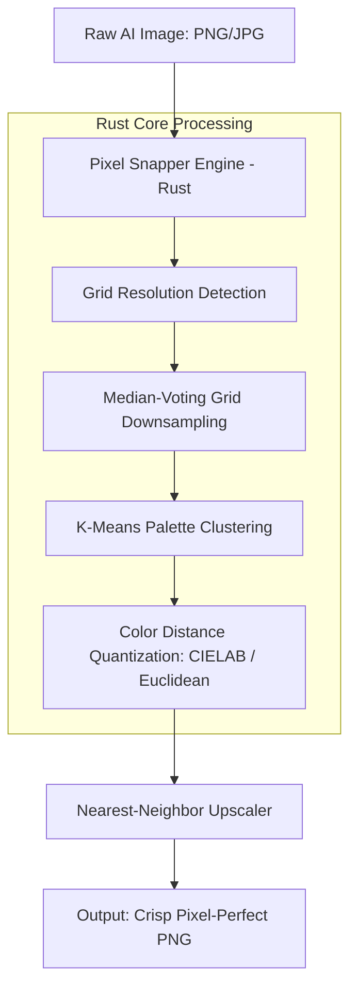

## Why Do Diffusion Models Fail at Pixel Art, and How Does Pixel Snapper Fix Them?

Generating 2D game assets using modern generative diffusion models (such as Stable Diffusion, Midjourney, or Flux) has become standard practice across indie and studio prototyping. However, when developers attempt to generate retro pixel art, the results consistently suffer from a glaring uncanny valley: from a thumbnail distance the image resembles pixel art, but upon close inspection it violates nearly every structural rule of authentic sprite design.

Pixels drift in dimension across the canvas, edges feature blurry anti-aliasing gradients, and color palettes balloon into tens of thousands of smooth color values.

An earlier speculative draft from late 2025 claimed that **Sprite Fusion Pixel Snapper** solved this challenge using an elaborate "10-agent multi-agent image processing swarm." That claim was pure fiction. Pixel Snapper, developed by Hugo Duprez (`Hugo-Dz`) under the MIT License, contains zero LLMs and zero conversational agents. Instead, it is an open-source, high-performance **Rust and WebAssembly (Wasm)** image processing utility that enforces geometric grid snapping and k-means color quantization through pure, deterministic mathematics.

This Source Audit examines the physical mechanics of why continuous diffusion models fail at discrete pixel grids, audits the exact Rust/Wasm architecture in `Hugo-Dz/spritefusion-pixel-snapper`, traces how game asset post-processing matured from 2024 to 2026, and demonstrates why deterministic algorithmic tools remain strictly superior to agentic reasoning for low-level spatial raster operations.

---

## The Anatomy of AI-Generated "Fake" Pixel Art: Aliasing and Palette Bloat

To understand why a dedicated tool like Pixel Snapper is necessary, one must examine how continuous latent diffusion models decode visual information:

```
Continuous VAE Latent Space (Decoded via Bilinear / Conv2D Resampling)
                    ↓
Soft Edges, Interpolated RGB Gradients, Variable Pitch (2.8px – 4.2px)
                    ↓
[Pixel Snapper Rust Pipeline: Grid Estimation → Median Downsampling → K-Means]
                    ↓
Discrete Integer Grid (1x1 Cells), Zero Anti-Aliasing, Bounded 16-Color Palette
```

1. **Continuous vs. Discrete Latent Spaces:** Diffusion models operate in continuous latent spaces and decode images through deep convolutional or transformer backbones followed by a Variational Autoencoder (VAE). The VAE reconstructs images with smooth floating-point RGB representations. It possesses no innate concept of discrete integer grids.
2. **The "Mixels" Phenomenon (Sub-Pixel Drift):** When an artist draws a 16x16 sprite scaled up 4×, every visible pixel is exactly 4x4 canvas pixels. In AI output, however, "pixels" drift in pitch: one block may measure 3x4 pixels while its neighbor spans 4x4 or 3x3. In the game development community, this distortion is known as *mixels* (mixed-resolution pixels), which makes sprites appear jarring and unreadable in motion.
3. **Anti-Aliasing Gradients:** Handcrafted pixel art relies on hard color boundaries or intentional mathematical dithering (e.g., Bayer matrices) to suggest shading. Diffusion models, by contrast, smooth high-contrast boundaries with interpolated transitional pixels, producing blurry edges that ruin transparency masks.
4. **Palette Explosion:** A genuine retro game sprite typically adheres to a strict 8-color, 16-color, or 32-color palette (e.g., Pico-8, NES, or DB32). A raw diffusion-generated "pixel art" PNG often contains over 25,000 unique RGB values due to compression artifacts and continuous gradients.

| Metric / Dimension | Handcrafted Game Sprite | Raw Diffusion Output ("Fake" Pixel Art) | Post-Processed via Pixel Snapper |
|:-------------------|:------------------------|:----------------------------------------|:---------------------------------|
| **Grid Alignment** | Integer-perfect (1:1 cell pitch) | Irregular, drifting sub-pixel blocks | Snapped to uniform grid coordinates |
| **Edge Sharpness** | 100% hard discrete boundaries | Blurry, interpolated anti-aliasing | Clean nearest-neighbor boundaries |
| **Unique Colors** | 8 – 32 strictly mapped colors | 10,000 – 40,000 continuous RGB values | Quantized to target $K$ (e.g., 16 colors) |
| **Engine Usability**| Direct import into tilemap/spritesheet | Requires manual Aseprite touch-up | Production-ready sprite asset |
| **File Footprint** | Minimal indexed PNG (< 4 KB) | Inflated 24-bit TrueColor PNG (> 200 KB)| Optimized indexed/quantized PNG |

---

## Inside Sprite Fusion Pixel Snapper: Rust, WebAssembly, and Grid Quantization

The actual open-source repository [Hugo-Dz/spritefusion-pixel-snapper](https://github.com/Hugo-Dz/spritefusion-pixel-snapper) provides a lightweight, dependency-conscious Rust architecture designed to compile both as a standalone CLI executable and as a WebAssembly package for in-browser client-side execution.



### 1. Dual Target Compilation (Native CLI & WebAssembly)

The project leverages `wasm-bindgen` to expose identical core Rust routines to the browser and the command line:

- **Web Target:** Built with `wasm-pack`:
  ```bash
  wasm-pack build --target web --out-dir pkg --release
  ```
  This allows browser-based game editors like [Sprite Fusion](https://www.spritefusion.com/) to process user-uploaded assets locally on the client without transferring image bytes to a remote server.
- **Native CLI Target:** Invoked directly via Cargo for batch asset pipelines:
  ```bash
  cargo run --release -- --input raw_sprite.png --output clean_sprite.png --colors 16
  ```

### 2. Algorithmic Grid Snapping

Rather than attempting to guess edges using opaque heuristics, the core algorithm performs discrete spatial resampling:
- It divides the target image into a uniform $N \times M$ grid determined by the user's desired base sprite resolution (e.g., 16x16, 24x24, or 32x32).
- For each discrete cell, the engine evaluates all underlying raster pixels and applies a **majority voting (or median color)** reduction. Sub-pixel anti-aliasing noise and drifting edge pixels are collapsed into a single dominant color per cell.

### 3. Palette Quantization via K-Means

Once pixels are bound to discrete cells, the color space is pruned:
- The engine collects all RGB color vectors across the snapped cells.
- It executes **K-Means clustering** in 3D color space (Euclidean RGB or perceptual distance) to extract the $K$ most representative centroids (e.g., `--colors 16`).
- Each cell's color is remapped to its nearest centroid cluster, entirely eliminating stray gradient colors while preserving the core visual silhouette.

---

## What Changed Since 2024: From Standalone Tools to Automated Game Asset Pipelines

The state of AI-assisted 2D game asset creation has transformed significantly between early 2024 and late 2026:

### 1. The 2024 Landscape: Manual Cleanups and LoRA Hacks
In 2024, game developers attempting to use Stable Diffusion 1.5 or SDXL relied heavily on community "pixel art LoRAs." While these LoRAs biased output toward retro aesthetics, they could not overcome the continuous nature of the VAE decoder. Artists were forced to import generated images into tools like Aseprite, spend 30 to 45 minutes manually cleaning up mixels, tracing outlines, and indexing palettes by hand.

### 2. The 2025 Shift: Dedicated Web Utilities
In late 2025, Hugo Duprez released `spritefusion-pixel-snapper` as part of the broader Sprite Fusion tilemap ecosystem. By moving the cleanup logic into a compiled WebAssembly client, developers gained an instantaneous, zero-install way to drop a messy diffusion image and export a snapped sprite sheet in under 500 milliseconds.

### 3. The 2026 Era: Headless ComfyUI Nodes and CI/CD Asset Pipelines
By late 2026, pixel snapping moved from manual browser interaction into automated headless pipelines:
- **Headless Node Integration:** Developers packaged Pixel Snapper's Rust binary into native ComfyUI post-processing nodes (e.g., `ComfyUI-PixelArt-Detector` pipelines). A single prompt now generates a character sprite, immediately runs it through Wasm/Rust grid snapping, and validates the output against a project-wide palette definition.
- **Verification Gates in Agentic Workflows:** As demonstrated in our audit of AI productivity boundaries in [/posts/multi-agent-productivity-gains/](/posts/multi-agent-productivity-gains/), generative models succeed in production only when bounded by deterministic verification. In modern game engineering pipelines, autonomous agents do not "paint" pixels; they orchestrate generation prompts and delegate raster alignment to deterministic engines like Pixel Snapper.
- **Cross-Model Synthesis:** As analyzed in [/posts/llm-council-complete-architecture-analysis/](/posts/llm-council-complete-architecture-analysis/) and [/posts/5-engineering-skills-ai-driven-era-multi-agent/](/posts/5-engineering-skills-ai-driven-era-multi-agent/), allocating high-cost LLM reasoning to low-level byte manipulation introduces quadratic latency and catastrophic error drift. Using dedicated Rust binaries maintains sub-second execution speeds.

---

## Algorithmic Snapping vs Agentic Reasoning: Why Pixels Need Deterministic Math

The misconception in the original 2025 note—imagining an ensemble of "Grid Detection Agents" and "Color Quantization Agents"—reflects a persistent anti-pattern in modern AI system design: **attempting to solve deterministic geometric problems with stochastic conversational LLMs.**

When an LLM or multi-agent swarm is asked to inspect an image and "fix" pixel alignment, several fatal failure modes occur:
1. **Lack of Spatial Bit-Level Precision:** Multimodal LLMs process images through vision patch encoders (such as ViT with 14x14 or 16x16 patch tokens). They perceive semantic concepts ("a wizard wearing a blue hat"), but they have zero access to individual coordinate pixel indices $(x, y)$.
2. **Token and Latency Catastrophe:** Describing a 32x32 sprite's color values via JSON or text tokens requires thousands of tokens and multiple seconds of inference time. Pixel Snapper's compiled Rust code executes the exact mathematical clustering across 1,024 pixels in less than **2 milliseconds**.
3. **Stochastic Uncertainty:** An agent prompt may quantize colors correctly on turn one, but hallucinate novel hex codes or shift grid boundaries on turn two. A deterministic algorithm guarantees mathematical idempotency: the same input with the same parameter $K$ yields identical raster output every single time.

In robust game-engineering architectures, generative models provide visual ideation, while deterministic command-line tools enforce production constraints.

---

## Key Takeaways

- **Diffusion models inherently produce "fake" pixel art:** Continuous VAE decoders generate anti-aliasing edge artifacts, variable pixel dimensions (*mixels*), and bloated 24-bit color palettes.
- **Sprite Fusion Pixel Snapper uses deterministic Rust/Wasm, not multi-agent swarms:** Hugo Duprez's open-source tool relies on spatial median downsampling and K-Means palette clustering, executing in milliseconds with zero LLM overhead.
- **Dual-target compilation enables browser and pipeline reuse:** The engine runs client-side in the browser via `wasm-pack` and headlessly via CLI (`cargo run -- --colors 16`).
- **Modern 2026 pipelines embed snapping into headless workflows:** Leading game studios integrate deterministic snapping into ComfyUI nodes and automated asset build scripts, eliminating manual Aseprite cleanup.
- **Keep deterministic math outside the agent reasoning loop:** Tasks involving exact grid coordinates, color distances, and raster arrays belong in compiled native tooling rather than stochastic conversational agents.

---

## New Questions

1. **Can adaptive grid detection infer non-square or staggered isometric pixel art grids?** Current snapping assumes standard rectangular Cartesian grids; how can autocorrelation algorithms be extended to automatically detect 2:1 isometric tile perspectives without manual user input?
2. **How does perceptual color distance (CIEDE2000 vs. sRGB Euclidean) affect palette mapping quality?** While simple RGB K-Means clustering is computationally cheap, does weighting luminance in perceptual color spaces prevent dark shadow colors from collapsing into single muddy tones?
3. **Will future direct-discrete pixel models replace post-processing snapping entirely?** As autoregressive or discrete diffusion architectures trained specifically on raw sprite coordinates mature, will the need for post-generation raster cleanup disappear, or will hybrid generation-plus-snapping remain the industry standard?

---

## References

- **Primary Repository:** Hugo Duprez (`Hugo-Dz`), *Sprite Fusion Pixel Snapper*, GitHub repository: [https://github.com/Hugo-Dz/spritefusion-pixel-snapper](https://github.com/Hugo-Dz/spritefusion-pixel-snapper) (MIT License; inspected commit `main`; accessed 2026-10-18).
- **Web Application & Platform:** Sprite Fusion, *Pixel Snapper Web Tool & Tilemap Editor*, [https://www.spritefusion.com/](https://www.spritefusion.com/) (accessed 2026-10-18).
- **Color Quantization Theory:** Arthur, D., & Vassilvitskii, S., *"k-means++: The Advantages of Careful Seeding"*, Stanford Technical Report / SODA 2007 (canonical reference for palette clustering implementations; accessed 2026-10-18).
- **WebAssembly Systems Architecture:** WebAssembly Community Group, *wasm-bindgen and WebAssembly Interface Types*, [https://rustwasm.github.io/docs/wasm-bindgen/](https://rustwasm.github.io/docs/wasm-bindgen/) (accessed 2026-10-18).
