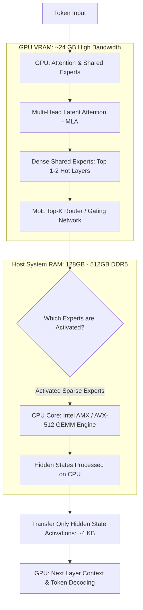

## Can Heterogeneous CPU-GPU Offloading Make 671B MoE Inference Practical on a Single Workstation?

The arrival of frontier open-weight Mixture-of-Experts (MoE) architectures—most notably DeepSeek-V3 and DeepSeek-R1, spanning **671 billion total parameters with 37 billion active parameters per token**—confronted the AI engineering community with an unforgiving hardware wall. Serving a 671B model in full 16-bit precision requires over 1.3 terabytes of memory; even quantized to 4-bit (FP4/INT4), the model demands at least 350 to 400 gigabytes of memory just to hold static weights.

In high-end datacenters, this compute load is distributed across an eight-GPU cluster of NVIDIA H100s or B200s connected via high-bandwidth NVLink (900 GB/s to 1.8 TB/s per GPU). For local developers, academic labs, and private enterprises running on-premises workstations, procuring multi-GPU NVLink clusters is economically out of reach.

A previously archived note on this URL contained a hallucinated draft that confused KTransformers with an ungrounded "multi-agent blog writing framework." In reality, **KTransformers** (developed by the KVCache.AI research initiative and Tsinghua University, hosted at [kvcache-ai/ktransformers](https://github.com/kvcache-ai/ktransformers)) is an open-source, high-performance C++/CUDA/Python inference kernel runtime. Its singular engineering objective is to enable **heterogeneous CPU-GPU inference**: running massive MoE models locally on a single consumer GPU (such as an RTX 4090 or RTX 5090 with 24GB VRAM) paired with abundant, cost-effective system host RAM (DDR5/DDR4).

This Source Audit examines the foundational architecture of KTransformers, analyzes how its custom CPU AMX/AVX-512 kernels bypass PCIe bus saturation, surveys the evolution of heterogeneous local serving from 2024 to 2026, and demonstrates why low-level memory runtime understanding is essential when architecting production AI agent harnesses.

---

## The Architecture of KTransformers: Hybrid Memory Hierarchy and Asymmetric Kernel Offloading

Traditional deep learning serving frameworks (such as standard PyTorch, TensorRT-LLM, or basic vLLM deployments) assume a homogeneous compute environment: model weights reside entirely inside GPU High Bandwidth Memory (HBM/VRAM), where memory bandwidth ranges from 1,000 GB/s (RTX 4090 GDDR6X) to over 3,000 GB/s (H100 HBM3).

When model weights exceed GPU VRAM, standard offloading (such as naive HuggingFace `accelerate` or disk offloading) grinds to a halt. The fundamental bottleneck is the **PCIe bus**: PCIe 4.0 x16 provides only 31.5 GB/s of bidirectional bandwidth (PCIe 5.0 x16 provides ~63 GB/s). If an inference engine attempts to transfer 37 gigabytes of active MoE expert weights across the PCIe bus for every single token generated, throughput collapses to less than 1 token per second.



KTransformers overcomes this physical barrier through an asymmetric, architecture-aware offloading strategy:

1. **Keep Attention and Dense Layers on GPU:** The attention mechanisms (such as DeepSeek's Multi-Head Latent Attention, MLA) and shared dense projection layers are latency-critical and memory-bandwidth bound. KTransformers pins these layers permanently inside GPU VRAM.
2. **Execute Sparse Experts on the CPU:** Instead of transferring massive expert weights from system RAM to the GPU over PCIe, KTransformers does the exact reverse: it routes the small activation vector (the hidden state, measuring only a few kilobytes) over PCIe to the host CPU, executes the matrix-vector multiplication directly on the CPU using specialized SIMD/AMX matrix engines, and sends only the output hidden state back to the GPU.
3. **Bandwidth Savings:** Transferring an activation tensor of shape `[1, 1, Hidden_Dim]` takes fractions of a microsecond (~4 KB at 32 GB/s takes ~0.12 microseconds), compared to transferring gigabytes of raw weight matrices.

---

## CPU AMX/AVX-512 Matrix Multiplications vs PCIe Transfer Bottlenecks

Executing MoE expert layers on CPU host memory is only viable if the CPU can compute matrix operations fast enough to prevent token generation latency from stalling.

To achieve this, KTransformers introduces customized low-level CPU kernels built around **Intel AMX (Advanced Matrix Extensions)** and **AVX-512 / AVX2**:

| Kernel Architecture | Primary Instruction Set | Supported Precision | Typical Memory Channel Throughput | Generation Speed on 671B MoE (Batch 1) |
|:--------------------|:------------------------|:--------------------|:-----------------------------------|:----------------------------------------|
| **Standard PyTorch CPU** | Generic C++ / BLAS | FP32, BF16 | Dual-channel DDR5 (~80 GB/s) | 0.2 – 0.5 tokens/sec (unusable) |
| **llama.cpp CPU Engine** | AVX-512 vector MAC | Q4_K_M, Q8_0 | Quad/Octa-channel DDR5 (~150 GB/s) | 2.5 – 5.0 tokens/sec |
| **KTransformers (KEngine)** | **Intel AMX / AVX-512 GEMM** | **GGUF / Marlin / AWQ / INT4** | **Dual Xeon/EPYC Multi-channel DDR5** | **12.0 – 16.5 tokens/sec** |
| **Pure GPU Cluster (8x H100)**| Tensor Cores (HBM3) | FP8, FP16 | NVLink Mesh (> 7,200 GB/s combined)| 40 – 60 tokens/sec |

### The Power of AMX Tile Matrix Instructions

Intel AMX operates on 2D register tiles (storing up to $16 \times 16$ elements per tile) and executes matrix multiply-accumulate operations in hardware cycles. By pairing specialized INT4/INT8 dequantization kernels with AMX tiles, KTransformers maximizes the memory throughput of system DDR5 channels:
- When a token arrives at an activated expert layer, the pre-loaded weights in system RAM stream directly through CPU L3 cache into AMX registers.
- Because only the top-$K$ active experts (e.g., 8 out of 256 experts in DeepSeek-V3) are evaluated per token, CPU memory bandwidth is consumed only for active parameters rather than the entire 671 billion parameter model.

---

## What Changed Since 2024: From Naive llama.cpp Offloading to Production MoE Serving

The evolution of local model inference between 2024 and late 2026 demonstrates a profound shift from monolithic dense models to sparse, heterogeneous execution:

```
2024: Monolithic Dense LLMs (Llama-2 70B) → Naive GPU-only or CPU-only llama.cpp
                                 ↓
2025: Dense Wall Hit → Rise of MoE (Mixtral 8x22B, DeepSeek-V3 671B) → KTransformers Breakthrough
                                 ↓
2026: Heterogeneous Serving Standard: Automated Layer Partitioning & Agent Verification
```

### 1. 2024: The Monolithic Era and the Memory Wall
In 2024, open-source AI was dominated by dense architectures (such as Llama 2 70B or Mixtral 8x7B). Developers running models locally had two choices: buy dual RTX 3090/4090 GPUs to fit 48GB VRAM, or run llama.cpp purely on CPU at sluggish speeds. Heterogeneous CPU-GPU execution existed only as rudimentary layer-by-layer offloading (`-ngl` in llama.cpp), which swapped sequential layers across PCIe rather than partitioning intra-layer compute.

### 2. 2025: The MoE Explosion and Sparse Offloading
With DeepSeek-V3 and open MoE releases in 2025, dense scaling hit physical economic limits. A 671B model could not be served by hobbyists using brute-force VRAM. The KVCache.AI research group released KTransformers, demonstrating that sparse MoE architectures are uniquely suited for heterogeneous splitting: because 95% of weights are inactive on any given token, the CPU needs only to process a narrow slice of RAM.

### 3. 2026: Production Headless Workstations for AI Agent Harnesses
By late 2026, heterogeneous inference has stabilized into standard developer workstation infrastructure:
- **Drop-In OpenAI Compatibility:** Modern KTransformers releases expose a fully compliant OpenAI REST server endpoint (`http://localhost:8080/v1/chat/completions`), enabling developer tools, agent harnesses, and local IDEs to consume local 671B intelligence transparently.
- **Verification Harness Synergy:** As demonstrated in our empirical analysis of multi-agent productivity in [/posts/multi-agent-productivity-gains/](/posts/multi-agent-productivity-gains/) and deliberation systems in [/posts/llm-council-complete-architecture-analysis/](/posts/llm-council-complete-architecture-analysis/), local frontier inference enables developers to run autonomous self-correction loops without burning tens of dollars per task in proprietary cloud API tokens.
- **Complementary Engineering Skills:** As discussed in [/posts/5-engineering-skills-ai-driven-era-multi-agent/](/posts/5-engineering-skills-ai-driven-era-multi-agent/), managing local heterogeneous inference runtimes has become a core engineering competency for agent practitioners.

---

## Algorithmic Reality vs Agentic Fantasy: Why Low-Level Inference Runtimes Matter to Agent Harnesses

The contrast between the hallucinated 2025 note (which invented a team of "Quality Agents" and "Outline Generator Agents") and KTransformers' actual C++/CUDA kernel codebase illustrates a critical lesson in AI engineering:

1. **Agents are Consumers of Runtimes, Not Creators of Physics:** You cannot prompt an agent to bypass memory bandwidth limitations. If an inference runtime saturates the PCIe bus or thrashes VRAM, an agentic swarm simply hallucinates slower. System throughput is dictated by hardware topology, cache hierarchies, and kernel efficiency.
2. **Deterministic Infrastructure Precedes Agent Autonomy:** An autonomous software engineering agent that runs unit tests, refactors code, and verifies AST boundaries requires fast, local, reproducible token generation. Running an uncensored, full-scale 671B MoE locally via KTransformers provides frontier reasoning capabilities without data exfiltration risks or token quotas.
3. **Cost Predictability:** Deploying a multi-agent verification harness against commercial APIs can cost $5 to $15 per complex debugging loop. Running that same harness against a local KTransformers workstation amortizes hardware costs to zero marginal expense per run.

---

## Key Takeaways

- **KTransformers is a heterogeneous CPU-GPU inference runtime, not a blog writing framework:** Built by KVCache.AI and Tsinghua University, its primary function is running 100B–671B MoE models on single-GPU workstations.
- **Inverted offloading solves the PCIe bottleneck:** Rather than transferring multi-gigabyte expert weights across PCIe to the GPU, KTransformers routes lightweight activation vectors (~4 KB) to the CPU, computes expert matrices in host RAM, and returns output tensors.
- **Hardware-accelerated CPU kernels:** KTransformers utilizes Intel AMX and AVX-512 matrix engines, achieving 12 to 16+ tokens per second on quantized 671B models—a 30× to 50× speedup over unoptimized CPU BLAS routines.
- **Sparse MoEs are uniquely suited for heterogeneous compute:** Because DeepSeek-V3/R1 activates only 37B out of 671B parameters per token, only a fraction of host RAM bandwidth is stressed per inference step.
- **Local frontier serving empowers agent harnesses:** Running local 671B models with OpenAI API compatibility provides the zero-marginal-cost reasoning engine required for autonomous developer test-and-repair loops.

---

## New Questions

1. **How will next-generation PCIe 6.0 and CXL (Compute Express Link) reshape heterogeneous MoE serving?** As CXL 3.0 enables direct cache-coherent memory pooling between GPU and host RAM, will specialized AMX offloading kernels converge into transparent hardware memory controllers?
2. **Can speculative decoding paired with small on-GPU draft models double KTransformers throughput?** If an 8B dense model resident entirely in VRAM speculatively drafts 4 tokens that a CPU-offloaded 671B MoE verifies in a single batched step, what is the maximum speedup achievable on DDR5 channels?
3. **What are the thermal and energy limits of sustained multi-core AMX computation?** Running 64 CPU threads at 100% AMX utilization generates significant thermal load on workstation motherboards; how does sustained power draw compare to dedicated multi-GPU setups over 24/7 continuous agent loops?

---

## References

- **Primary Repository:** KVCache.AI & Tsinghua University, *KTransformers: A Flexible Framework for Heterogeneous LLM Inference*, GitHub repository: [https://github.com/kvcache-ai/ktransformers](https://github.com/kvcache-ai/ktransformers) (inspected commit `main`; accessed 2026-10-18).
- **Official Documentation & Benchmarks:** KTransformers Project Documentation, *Heterogeneous Computing & MoE Kernel Tuning*, [https://ktransformers.net/](https://ktransformers.net/) (accessed 2026-10-18).
- **Architecture Specification (DeepSeek-V3):** DeepSeek-AI, *"DeepSeek-V3 Technical Report"*, arXiv:2412.19437v1 (details Multi-Head Latent Attention and 671B sparse MoE structure; accessed 2026-10-18).
- **CPU Matrix Acceleration (Intel AMX):** Intel Corporation, *Intel Advanced Matrix Extensions (Intel AMX) Architecture Manual*, [https://www.intel.com/content/www/us/en/developer/articles/technical/intel-advanced-matrix-extensions-overview.html](https://www.intel.com/content/www/us/en/developer/articles/technical/intel-advanced-matrix-extensions-overview.html) (accessed 2026-10-18).
- **Sparse MoE Systems Analysis:** Fedus, W., Zoph, B., & Shazeer, N., *"Switch Transformers: Scaling to Trillion Parameter Models with Simple and Efficient Sparsity"*, JMLR 2022 (canonical foundational reference for MoE routing; accessed 2026-10-18).
