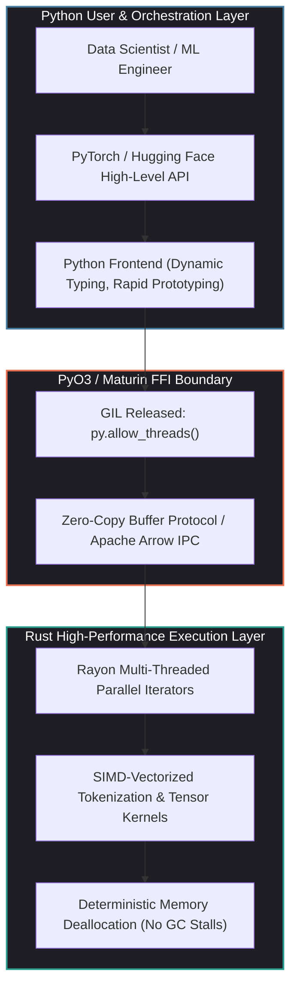
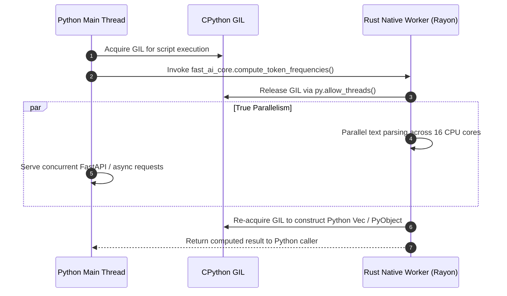

## Why Did the Hybrid Rust-Python Architecture Become the Standard for Production AI Systems?

Python is the undisputed lingua franca of machine learning research. Its rich ecosystem—anchored by PyTorch, JAX, Hugging Face Transformers, and scikit-learn—enables rapid iteration, interactive exploration, and intuitive model prototyping. However, when prototype pipelines transition to production serving environments, Python's runtime constraints create severe performance and scaling bottlenecks:

1. **The Global Interpreter Lock (GIL)**: Standard CPython relies on a global mutex that prevents multiple native OS threads from executing Python bytecode simultaneously. For I/O-bound tasks, `asyncio` or thread pools provide adequate concurrency. But for CPU-intensive data preparation—such as tokenization, image augmentation, vector parsing, and JSON serialization—the GIL causes thread contention, forcing engineers to deploy bloated multi-process worker pools (`multiprocessing` or Celery) that consume massive amounts of memory.
2. **Dynamic Typing and Interpreter Overhead**: Python's dynamic object model requires continuous pointer chasing, boxing, and type introspection. An element-wise transformation on millions of strings or complex nested structures incurs dramatic latency compared to compiled code.
3. **Memory Safety and Production Crashes**: While C++ has historically served as Python's backend for performance-critical extensions, writing raw C-API or pybind11 modules exposes systems to memory leaks, dangling pointers, buffer overflows, and segmentation faults that can crash the entire Python worker process.

Rust bridges this divide. By providing C/C++-level runtime performance, compile-time memory safety without a garbage collector, and fearless multithreading through its strict ownership and type system, Rust has become the backend of choice for modern AI infrastructure. The pattern is now ubiquitous across production libraries: Python exposes the ergonomic user interface, while Rust executes high-throughput CPU kernels beneath an optimized Foreign Function Interface (FFI).



---

## Architectural Mechanics: PyO3, Maturin, and the C-API Boundary

Building native extensions historically required deep expertise in CPython internals, manual reference count manipulation (`Py_INCREF`/`Py_DECREF`), and complex build scripts. The modern Rust-Python bridge centers on two foundational open-source tools: **PyO3** (the Rust bindings for Python) and **Maturin** (the build system and wheel generator).

### 1. Safe Abstraction Over the CPython C-API

PyO3 leverages Rust's compile-time ownership semantics to model Python's reference counting safely:

- **The `Python<'py>` Token**: PyO3 requires a GIL token `Python<'py>` to interact with Python objects. This token acts as a compile-time proof that the current thread holds the GIL. When an operation requires Python heap allocation or object access, it borrows this token.
- **Reference Management**: Types like `Bound<'py, PyAny>` represent managed references tied directly to the lifetime of the Python GIL token, preventing use-after-free bugs and eliminating manual reference tracking.

```rust
use pyo3::prelude::*;
use rayon::prelude::*;

/// Parallel token length counter across a batch of text strings
#[pyfunction]
fn compute_token_frequencies(py: Python<'_>, corpus: Vec<String>) -> PyResult<Vec<(String, usize)>> {
    // 1. Release the Global Interpreter Lock (GIL)
    let results = py.allow_threads(|| {
        // 2. Execute CPU-bound computation across native OS threads via Rayon
        corpus
            .par_iter()
            .map(|text| {
                let token_count = text.split_whitespace().count();
                (text.clone(), token_count)
            })
            .collect::<Vec<_>>()
    });

    // 3. Re-acquire GIL automatically upon exit to construct Python return objects
    Ok(results)
}

#[pymodule]
fn fast_ai_core(m: &Bound<'_, PyModule>) -> PyResult<()> {
    m.add_function(wrap_pyfunction!(compute_token_frequencies, m)?)?;
    Ok(())
}
```

### 2. Bypassing the GIL with `py.allow_threads`

The decisive advantage of Rust over native Python threading is the ability to temporarily release the GIL using `Python::allow_threads`. 

When `allow_threads` is invoked, the calling thread notifies the CPython runtime that it is relinquishing the interpreter lock. While Rust runs compute-heavy Rayon pipelines, matrix factorizations, or token encoding loops across all available CPU cores, the main Python thread remains free to handle asynchronous network I/O, accept incoming HTTP requests, or schedule GPU compute kernels.



---

## Zero-Copy Memory Sharing and Data Transfer Pipelines

The primary source of latency in naive FFI implementations is memory copying across the language boundary. Serializing a million text records into JSON, copying byte arrays, or converting nested Python lists into C arrays completely negates the performance benefits of native code.

High-performance AI systems avoid data movement by utilizing shared memory representations:

### 1. NumPy C-API Integration via `numpy` and PyO3

Python machine learning applications rely heavily on NumPy arrays and PyTorch tensors. PyO3 integrates with the NumPy C-API through the `numpy` crate, exposing raw pointers to contiguous memory buffers without intermediate allocation:

```rust
use pyo3::prelude::*;
use numpy::{PyArrayDyn, PyReadonlyArrayDyn};
use ndarray::ArrayViewD;

#[pyfunction]
fn normalize_embeddings(
    _py: Python<'_>,
    input_array: PyReadonlyArrayDyn<'_, f32>,
) -> PyResult<Py<PyArrayDyn<f32>>> {
    // View underlying contiguous memory without copying
    let view: ArrayViewD<'_, f32> = input_array.as_array();
    
    // Perform SIMD-vectorized in-place or parallel transformation
    let norm = (view.mapv(|x| x * x).sum()).sqrt();
    let normalized = &view / (norm + 1e-12);

    // Return new NumPy array back to Python with zero redundant staging
    Python::with_gil(|py| {
        Ok(PyArrayDyn::from_array(py, &normalized).to_owned())
    })
}
```

### 2. Apache Arrow IPC and Polars

When processing massive tabular datasets or multi-modal feature stores for training, the state-of-the-art solution is the **Apache Arrow format**. 

Libraries like **Polars** use Arrow's columnar memory layout. Because Arrow defines a language-agnostic in-memory standard, a Rust engine can construct, filter, and aggregate multi-gigabyte datasets and pass pointers directly to Python via PyCapsule or the Arrow C Data Interface without copying a single byte.

---

## Production Case Studies: Rust-Powered AI Foundations

The hybrid Rust-Python architecture powers the core building blocks of modern AI infrastructure:

| Library / Tool | Core Functionality | Performance Impact Over Pure Python |
| :--- | :--- | :--- |
| **Hugging Face `tokenizers`** | Byte-Pair Encoding (BPE), WordPiece, Unigram | **10x to 25x faster**; saturates multi-gigabyte training text pipelines |
| **Polars** | Vectorized columnar data processing & ETL | **5x to 30x faster** than pandas; operates within strict memory limits |
| **Pydantic v2** | Data validation and JSON parsing | **5x to 15x faster** via `pydantic-core` Rust engine |
| **Qdrant / LanceDB** | Vector similarity search and index construction | Native disk I/O concurrency; essential for [vector database selection](/posts/choice-vector-database-for-llm/) |
| **Candle / Burn** | Modular deep learning frameworks & edge inference | Minimal binary footprint; zero Python runtime dependency in production |

In our architectural analysis of [production ML model deployment](/posts/deploy-an-ml-model/), serving engines like vLLM and TensorRT-LLM rely heavily on high-throughput C++ and Rust coordinators to manage continuous batching queues, PagedAttention memory maps, and HTTP streaming without incurring interpreter stalls.

Similarly, in [RAG workflows and pipeline orchestration](/posts/rag-workflow-with-llamaindex/), document parsing, chunking, and embedding generation frequently become CPU bottlenecks. Moving chunking heuristics and regex parsing to a Rust PyO3 module reduces ingestion latency from hours to minutes on enterprise document repositories.

---

## How Rust-Python Ecosystems Evolved Across 2026

Across 2026, the boundary between Python and systems programming experienced major transformations:

1. **Free-Threaded Python (PEP 703 / Python 3.13+)**: The CPython community introduced experimental builds that completely disable the Global Interpreter Lock. PyO3 adapted rapidly, allowing Rust extensions to run concurrently even when interacting with Python objects, eliminating historical lock synchronization overheads.
2. **PyO3 `Bound<'py, T>` Paradigm Shift**: PyO3 modernized its entire API to enforce smart pointer semantics at compile time, completely removing deprecated untyped reference patterns (`&PyAny`) and preventing memory safety hazards in high-concurrency environments.
3. **Decoupled Edge and Serverless Serving**: Modern production deployments increasingly train models in Python using PyTorch and export weights directly to Rust-native inference runtimes like Hugging Face's **Candle** or **Burn**. This enables serverless deployments with sub-50ms cold starts, zero Python environment setup, and drastically reduced cloud infrastructure costs.
4. **Rust in Fine-Tuning and Data Ingestion**: As covered in our guide on [fine-tuning LLMs for production](/posts/explained-fintune-llm/), preparing multi-gigabyte instruction datasets requires deterministic token alignment, padding, and masking. Rust data loaders integrated into PyTorch pipelines eliminate GPU starvation, ensuring compute clusters operate at peak utilization.

---

## Key Takeaways

- **Strategic Division of Labor**: High-performance AI systems adopt a bifurcated architecture—Python handles model architecture declarations, experimentation, and public APIs, while Rust manages CPU-bound preprocessing, serialization, and high-concurrency serving.
- **PyO3 and Maturin Maturity**: Modern tooling has eliminated the historical complexity of writing native extensions. Safe abstractions and automated wheel compilation allow teams to build and distribute production-grade native modules seamlessly.
- **True Parallelism via GIL Release**: Releasing the GIL with `py.allow_threads` allows Rust libraries to utilize all CPU cores via Rayon without the memory bloat of multi-process architectures.
- **Zero-Copy Efficiency**: Leveraging NumPy C-APIs and Apache Arrow memory layouts ensures that high-throughput numerical pipelines incur zero data duplication penalties across language boundaries.

---

## New Questions

1. As free-threaded CPython (no-GIL) matures into default production standard, how will PyO3's memory safety guarantees adapt to lock-free concurrent modifications of Python objects?
2. Will pure Rust deep learning frameworks (such as Candle and Burn) eventually displace PyTorch in research environments, or will the Python-first developer experience maintain its dominance indefinitely?
3. How can distributed training frameworks best balance Rust-level network communication (RDMA/NCCL) with PyTorch dynamic autograd graphs?

---

## References

1. PyO3 Developers. *PyO3 User Guide: Rust Bindings for the Python Interpreter*. https://pyo3.rs/ (accessed 2026-10-18).
2. Hugging Face Team. *Hugging Face Tokenizers: Fast State-of-the-Art Tokenization in Rust*. https://github.com/huggingface/tokenizers (accessed 2026-10-18).
3. Polars Development Team. *Polars: Lightning-fast DataFrame Library Powered by Rust and Apache Arrow*. https://pola.rs/ (accessed 2026-10-18).
4. Python Software Foundation. *PEP 703: Making the Global Interpreter Lock Optional in CPython*. https://peps.python.org/pep-0703/ (accessed 2026-10-18).
