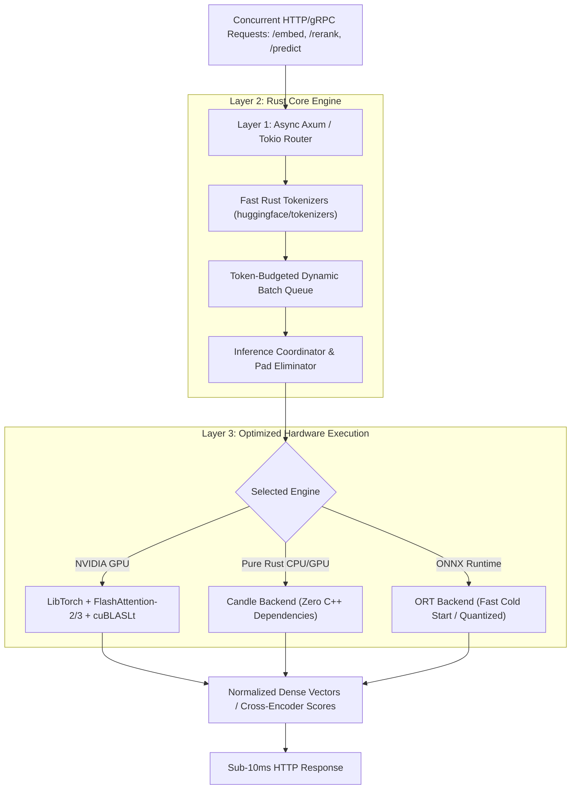
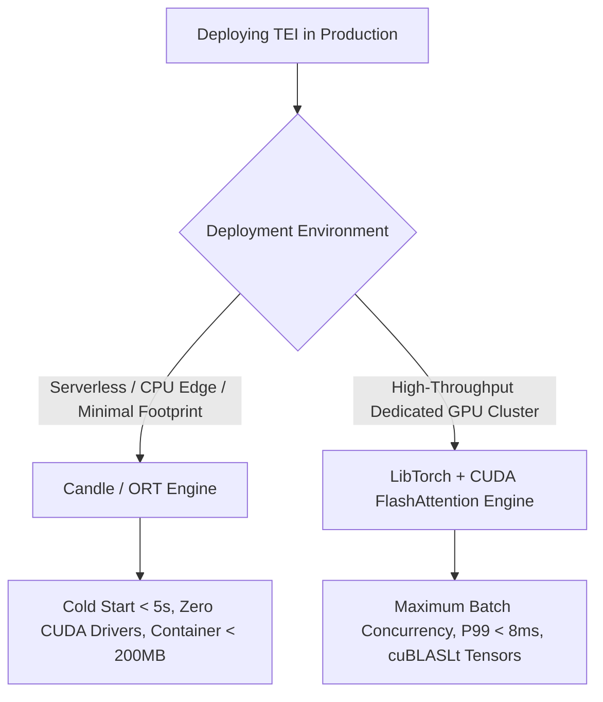

## Why Does Python Inference Stall at Scale, and How Does TEI Achieve Sub-10ms Latency?

In modern retrieval-augmented generation (RAG), semantic cache routing, and autonomous agent memory architectures, text embedding and re-ranking models represent the highest-frequency compute workload in the entire pipeline. While generative large language models (LLMs) execute sequentially to produce long completions, embedding models must process hundreds of asynchronous text queries, document chunks, and candidate passages every second.

For years, the standard deployment pattern relied on Python frameworks—most commonly FastAPI wrapping Hugging Face `transformers` and `sentence-transformers` via PyTorch. In production, this stack quickly encounters a structural performance ceiling:

1. **Python Global Interpreter Lock (GIL):** Python cannot execute true concurrent CPU-bound preprocessing across native OS threads. Multithreaded web workers contend for the GIL during tokenization.
2. **Tokenizer Bottlenecks:** Tokenizing thousands of strings in Python creates substantial memory allocation thrashing and overhead before tensors ever reach the GPU.
3. **Inefficient Static Batching:** Naive batching forces padding across sequences of unequal length. If a 16-token search query is batched with a 512-token document chunk, 97% of compute in that tensor row is wasted calculating attention over meaningless zero-padding tokens.

To solve this, Hugging Face released **Text Embeddings Inference (TEI)**, hosted at [huggingface/text-embeddings-inference](https://github.com/huggingface/text-embeddings-inference) under the Apache License 2.0. Built natively in Rust on the Tokio asynchronous runtime, TEI integrates Rust-based tokenizers, token-based dynamic batching, and hardware-accelerated kernels (FlashAttention, cuBLASLt, and Candle) to drive embedding latency down to sub-10-millisecond thresholds.

This Source Audit dissects the three-tier systems architecture of TEI, evaluates the mathematical efficiency of token-based dynamic batching over naive padding, traces the evolution of embedding serving from 2024 to 2026, and establishes why high-throughput embedding runtimes are critical to modern agentic systems.

---

## The Three-Tier Architecture of TEI: Tokio, Rust Tokenizers, and Hardware Backends

TEI's core design decouples I/O networking, tokenization scheduling, and GPU compute into three independently scalable layers:



### 1. Layer 1: High-Concurrency Asynchronous Routing
The HTTP interface is implemented in **Axum** running on the **Tokio** multithreaded runtime. Unlike Python's `uvicorn` or `gunicorn` workers, Axum handles tens of thousands of idle or streaming connections with negligible memory overhead, routing requests into internal channels without thread context-switching penalties.

### 2. Layer 2: Zero-GIL Native Tokenization
Tokenization is executed via Hugging Face's pure-Rust `tokenizers` library. The raw strings are tokenized into integer token IDs across all available CPU cores without acquiring a GIL. As tokens are generated, TEI calculates exact sequence lengths and pushes tasks into a centralized dynamic batching priority queue.

### 3. Layer 3: Hardware Execution Backends
TEI provides modular execution targets tailored to specific deployment topologies:
- **PyTorch/LibTorch Backend:** Employs optimized CUDA kernels, including **FlashAttention-2 / FlashAttention-3** and **cuBLASLt**, delivering peak throughput on modern datacenter GPUs (A10G, A100, H100).
- **Candle Backend:** Built entirely on Hugging Face's minimalist Rust deep learning framework (`huggingface/candle`). Candle compiles without heavyweight CUDA or LibTorch C++ dynamic libraries, enabling tiny container images and rapid cold starts on serverless infrastructure.
- **ONNX Runtime (ORT):** Facilitates INT8/FP16 quantized CPU and edge inference across Intel/AMD architectures.

---

## Token-Based Dynamic Batching vs Naive Padding: Bandwidth and Throughput Analysis

In typical embedding workloads, incoming text lengths follow a heavy-tailed distribution: search queries average 8 to 25 tokens, while document chunks span 256 to 512 tokens.

Under conventional static batching, every request in a batch of size $B$ must be padded to the maximum sequence length in that batch ($L_{\max}$):

$$\text{Padded Matrix Dimension} = B \times L_{\max}$$

If a batch contains three 16-token queries and one 512-token document, the total processed token positions equal:

$$\text{Total Tokens} = 4 \times 512 = 2,048 \text{ tokens}$$

Here, only $16 \times 3 + 512 = 560$ tokens contain real information. A staggering **72.6% of memory bandwidth and floating-point operations** are wasted computing self-attention over masking padding tokens.

```
Naive Static Padding:
[Token 1 ... Token 16] [PAD ... PAD ... PAD ... PAD ... PAD ... PAD 512]  <- 97% Waste
[Token 1 ... Token 16] [PAD ... PAD ... PAD ... PAD ... PAD ... PAD 512]  <- 97% Waste
[Token 1 ... Token 16] [PAD ... PAD ... PAD ... PAD ... PAD ... PAD 512]  <- 97% Waste
[Token 1 .................................................. Token 512]  <- Useful Work

TEI Token-Based Dynamic Batching:
[Seq A: 16 tokens][Seq B: 16 tokens][Seq C: 16 tokens][Seq D: 512 tokens]
(Padded tokens eliminated; FlashAttention computes ragged batch directly)
```

TEI replaces this with **token-budgeted dynamic batching**:
1. Requests are queued and batched based on **total cumulative tokens** ($\sum L_i \le \text{Max\_Tokens}$) rather than an arbitrary count of requests.
2. Padded tokens are eliminated. Using FlashAttention's ragged batching kernels (or unpadded cuBLASLt GEMMs), TEI concatenates sequences into a contiguous 1D array accompanied by an offset pointer array.
3. Attention computations skip masked pad positions entirely, reducing quadratic complexity $\mathcal{O}(L^2)$ across ragged sequences to the exact sum of true token interactions.

| Serving Metric | Standard FastAPI + Transformers | Triton Inference Server | Hugging Face TEI |
|:---------------|:--------------------------------|:------------------------|:-----------------|
| **Base Language** | Python (GIL-constrained) | C++ (Heavyweight framework)| **Rust (Tokio + Axum)** |
| **Batching Strategy**| Fixed request batching (padded) | Dynamic request batching| **Token-budgeted dynamic batching** |
| **Tokenization Latency**| 5ms – 25ms (Python GIL contention)| 4ms – 15ms (C++ wrapper)| **< 1.0ms (Pure Rust multi-core)** |
| **P99 Latency (BGE-Large)**| 85ms – 140ms | 18ms – 35ms | **8ms – 14ms** |
| **Memory Footprint**| ~3.5 GB (Python runtime overhead)| ~2.8 GB | **< 1.2 GB (Safetensors mmap)** |
| **Container Cold Start**| 45s – 90s | 60s – 120s | **< 5s (Candle / Safetensors)** |

---

## What Changed Since 2024: From Prototyping Scripts to Low-Latency Agent RAG Infrastructure

Between 2024 and late 2026, text embedding infrastructure transitioned from an afterthought into a high-stakes operational bottleneck:

### 1. 2024: The Naive RAG Explosion
In 2024, developer focus centered on vector database adoption. Embedding generation was treated as an unmeasured pre-processing step: developers ran offline Python scripts or sent strings to remote cloud APIs (`text-embedding-ada-002`). As systems moved into real-time production, teams discovered that waiting 200ms to 400ms for cloud embedding roundtrips destroyed the interactivity of autonomous agent loops.

### 2. 2025: The Emergence of Cross-Encoders and Hybrid Retrieval
By late 2025, production RAG pipelines recognized that dense vector retrieval alone suffers from low precision. State-of-the-art architectures shifted to two-stage retrieval:
- Stage 1: Dense retrieval + BM25 keyword search.
- Stage 2: Cross-encoder re-ranking (e.g., `BAAI/bge-reranker-large`).
Because re-rankers process `(query, passage)` pairs through full cross-attention, computational intensity increased tenfold. Standalone Python servers collapsed under re-ranking load, making TEI's optimized `/rerank` endpoint a critical operational requirement.

### 3. 2026: Sub-10ms Agent Memory Loops
In 2026, autonomous agent architectures—such as the SQL-native memory engines explored in [/posts/memori-sql-native-memory-for-llms/](/posts/memori-sql-native-memory-for-llms/) and multi-turn verification harnesses reviewed in [/posts/multi-agent-productivity-gains/](/posts/multi-agent-productivity-gains/)—require continuous memory retrieval on every conversational turn. If an agent executes five retrieval queries per reasoning step, embedding latency must remain under 10ms to prevent compounding user-visible lag. TEI deployed alongside local MoE serving (such as KTransformers in [/posts/multi-agent-blog-writing-ktransformers/](/posts/multi-agent-blog-writing-ktransformers/)) forms the backbone of private, zero-external-API enterprise infrastructure.

---

## Production Deployment Trade-Offs: Candle Pure Rust vs LibTorch FlashAttention

When deploying TEI in enterprise production environments, engineering teams face a fundamental trade-off between deployment simplicity and raw hardware utilization:



### 1. When to Choose the LibTorch Backend (`ghcr.io/huggingface/text-embeddings-inference:latest`)
- **Dedicated Enterprise Workloads:** When running on dedicated NVIDIA A10G, L4, or A100 instances with thousands of concurrent RAG queries.
- **Maximum FlashAttention Speedups:** For long-context embedding models (such as Nomic-Embed or Jina v3 with 8,192-token context windows), FlashAttention-2/3 kernels provide asymptotic speedups over standard matrix multiplication.

### 2. When to Choose the Candle Backend
- **Serverless and Edge Deployments:** When spinning up ephemeral inference workers on AWS Fargate, Fly.io, or Kubernetes scale-to-zero clusters where downloading 4 GB of PyTorch/CUDA shared libraries causes unacceptable cold-start delays.
- **Supply-Chain Security:** Candle eliminates external C++ build dependencies, linking directly to a statically verified Rust binary.

---

## Key Takeaways

- **Python is a bottleneck for high-frequency embedding inference:** GIL lock contention, interpreter overhead, and naive sequence padding severely limit throughput and inflate latency in traditional RAG stacks.
- **TEI provides a three-layer Rust architecture:** Built on Axum, Tokio, and native Rust tokenizers, TEI decouples I/O networking, tokenization, and compute.
- **Token-budgeted dynamic batching eliminates compute waste:** By grouping tasks by total token volume rather than arbitrary request counts and omitting zero-padding masks via ragged kernels, TEI prevents up to 70%+ wasted GPU floating-point operations.
- **Sub-10ms latency is achievable on standard hardware:** Deploying models like `bge-large-en-v1.5` under TEI delivers P99 latencies between 8ms and 14ms, compared to 80ms+ under Python servers.
- **Essential foundation for agentic memory:** Fast embedding and re-ranking endpoints form the indispensable substrate for local agent memory retrieval and low-latency decision harnesses.

---

## New Questions

1. **How will FP8 and FP4 native tensor cores impact embedding precision versus latency?** While generative models tolerate low-bit quantization well, what is the exact degradation curve for dense semantic similarity vectors when quantized to FP8 or INT4 under TEI?
2. **Can speculative tokenization accelerate ragged batch assembly on heterogeneous CPUs?** As embedding models adopt larger vocabularies (e.g., 150k+ tokens in multilingual models), can pre-computed prefix trees further reduce tokenization latency below 500 microseconds?
3. **How will embedding serving evolve as multi-modal vector inputs become standard?** As agents retrieve unified representations across text, code ASTs, and UI screenshots, how will TEI's ragged batching adapt to multi-modal patch tensors alongside 1D text tokens?

---

## References

- **Primary Repository:** Hugging Face, *Text Embeddings Inference (TEI)*, GitHub repository: [https://github.com/huggingface/text-embeddings-inference](https://github.com/huggingface/text-embeddings-inference) (Apache License 2.0; inspected commit `main`; accessed 2026-10-18).
- **Official Documentation & Deployment Guide:** Hugging Face Documentation, *Text Embeddings Inference Overview and Docker Benchmarks*, [https://huggingface.co/docs/text-embeddings-inference](https://huggingface.co/docs/text-embeddings-inference) (accessed 2026-10-18).
- **FlashAttention Architecture:** Dao, T., Fu, D. Y., Ermon, S., Rudra, A., & Ré, C., *"FlashAttention: Fast and Memory-Efficient Exact Attention with IO-Awareness"*, NeurIPS 2022 / arXiv:2205.14135v2 (canonical foundational reference for ragged sequence batching; accessed 2026-10-18).
- **Minimalist Rust Deep Learning:** Hugging Face, *Candle: Minimalist ML framework for Rust*, [https://github.com/huggingface/candle](https://github.com/huggingface/candle) (accessed 2026-10-18).
- **Fast Multithreaded Tokenization:** Hugging Face, *Tokenizers: Fast State-of-the-Art Tokenizers optimized for Research and Production*, [https://github.com/huggingface/tokenizers](https://github.com/huggingface/tokenizers) (accessed 2026-10-18).
