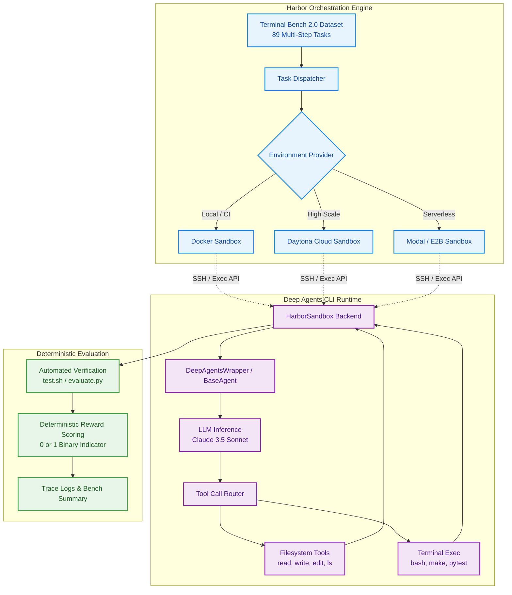

## Why Sandboxed Terminal Benchmarking Matters for Coding Agents

Evaluating autonomous coding agents in realistic operating system environments remains one of the hardest problems in agentic software engineering. Synthetic multi-turn coding benchmarks often test isolated function completion or narrow unit test generation, failing to capture how real-world developers work across shell execution, complex file hierarchies, package installations, and process lifecycle management. When agents are granted direct shell access, every execution modifies filesystem state, registers background daemons, or mutates configuration files. Evaluating such systems naively on a host machine creates cascading side effects that invalidate subsequent benchmark trials.

In December 2025, Vivek Trivedy and Eugene Yurtsev at LangChain published an empirical evaluation study titled *"Evaluating Deep Agents CLI on Terminal Bench 2.0"*. Rather than evaluating coding agents in an unconstrained environment or relying on hand-curated demos, the study coupled LangChain's open-source `deepagents-cli` with Harbor, a containerized sandbox orchestration framework developed by the Laude Institute, against Terminal Bench 2.0.

This article provides an independent source audit and architectural teardown of that benchmark pipeline. We examine how Deep Agents CLI abstracts filesystem operations over shell primitives, how Harbor orchestrates isolated sandbox lifecycles across Docker and Daytona, what the initial 42.65% baseline revealed about model sampling variance, and how subsequent harness engineering in 2026 drove performance past 66.5% on the exact same underlying model weights.

{: .light .w-100 .shadow .rounded-10 w='760' h='435' }

## Deep Agents CLI and Harbor Architecture

The Deep Agents CLI is an open-source, model-agnostic coding assistant built upon LangChain's Deep Agents SDK. Unlike monolithic terminal agents that embed proprietary prompt chains and execution logic into a closed runtime, Deep Agents CLI separates the cognitive agent loop from the environment runtime through an explicit sandbox abstraction.

The core interface exposes five fundamental capabilities:
1. **Interactive Shell Execution**: Spawning and supervising subprocesses in the target environment.
2. **Filesystem Tooling**: Read, write, diff-based edit, and directory traversal.
3. **Task Planning via Todos**: Ephemeral state management that forces the agent to decompose multi-phase objectives.
4. **Persistent Session Memory**: State serialization across execution sessions, contrasting with the relational schemas explored in [Memori's SQL-native memory architecture](/posts/memori-sql-native-memory-for-llms/).
5. **Human-in-the-Loop Review**: Presenting structured diffs for user or automated verification prior to disk mutation.

To evaluate this agent systematically, LangChain created `deepagents-harbor`, a bridge package located in the `libs/harbor` directory of the official Deep Agents repository. Harbor isolates each evaluation task inside an ephemeral execution container, ensuring zero contamination between runs.



In the `deepagents-harbor` implementation, the `HarborSandbox` backend dynamically translates file-level agent primitives into POSIX shell invocations inside the container:

```python
class DeepAgentHarbor(BaseAgent):
    """Deep Agents wrapper for Harbor benchmark orchestration."""

    async def run(
        self,
        instruction: str,
        environment: BaseEnvironment,
        context: AgentContext,
    ) -> None:
        # Wrap the ephemeral Harbor environment as a DeepAgents backend
        backend = HarborSandbox(environment)

        # Instantiate the CLI agent with bound tools and sandbox backend
        agent, _ = create_cli_agent(
            model=self._model,
            backend=backend,
            system_prompt_override=context.get("system_prompt"),
        )

        # Execute the agent loop until completion or budget exhaustion
        await agent.ainvoke(
            {"messages": [{"role": "user", "content": instruction}]},
        )
```

By decoupling the agent logic from container lifecycle management, Harbor allows practitioners to switch between local Docker containers during prototyping and distributed cloud providers like Daytona when scaling to hundreds of concurrent runs.

## Benchmark Mechanics: Inside Terminal Bench 2.0

Terminal Bench 2.0, developed by the Laude Institute, is an evaluation suite designed to probe terminal-based autonomous agents across complex, multi-domain computing environments. Unlike benchmarks that score passive answer extraction, Terminal Bench requires agents to manipulate operating system state directly.

The 2.0 release features 89 distinct benchmark tasks spanning four primary operational categories:
1. **Software Engineering**: Debugging legacy codebases, resolving Git merge conflicts with multibranch histories, cross-compiling C libraries with coverage instrumentation (such as `sqlite-with-gcov`), and refactoring multi-package Python applications.
2. **Reverse Engineering & Systems**: Reconstructing algorithmic implementations from compiled binaries or output images (such as `path-tracing`).
3. **Security and Administration**: Inspecting process hierarchies, configuring firewall rules, auditing log streams, and identifying system misconfigurations.
4. **Domain Reasoning & Gaming**: Automating chess engines for optimal move discovery (`chess-best-move`) and coordinating domain-specific scientific pipelines.

Each benchmark task packages:
- An initial environment definition (Docker container or VM template with pre-installed toolchains).
- A natural-language prompt specifying the expected objective without disclosing implementation details.
- An automated, idempotent evaluation script (`test.sh`) that inspects final environment state, compiles targets, and verifies assertions to produce an unforgeable binary reward score: $R \in \{0, 1\}$.

Execution duration varies dramatically across the suite. While concise administration tasks finish within two minutes, elaborate tasks like `cobol-modernization` frequently execute over 100 tool invocations and consume close to ten minutes of real-world compute per run.

## What Changed Since Late 2025: From 42.65% Baseline to 66.5% Harness Engineering

When Trivedy and Yurtsev published their initial baseline in December 2025 using Anthropic's Claude 3.5 Sonnet, Deep Agents CLI completed two full evaluation passes across Terminal Bench 2.0:

| Trial Identifier | Accuracy (%) | Solved / Total Tasks | Variance Note |
| :--- | :---: | :---: | :--- |
| Trial 1 | 44.9% | 40 / 89 | Favorable tool invocation sequences |
| Trial 2 | 40.4% | 36 / 89 | Compounded retry failures in long-horizon tasks |
| **Composite Mean** | **42.65%** | **38 / 89** | **Initial Open-Source Baseline** |

This 42.65% baseline demonstrated that an open-source Python harness could achieve parity with closed commercial CLI assistants like early Claude Code distributions without proprietary system wrappers. However, the 4.5% spread between Trial 1 and Trial 2 highlighted a critical reality of stochastic agent evaluation: single-pass benchmark scores are statistically noisy and should never be cited in isolation.

Between January and March 2026, the LangChain research group launched a dedicated investigation into agent failure modes on Terminal Bench. Rather than waiting for next-generation foundation model checkpoints or increasing parameter scale (similar to the offloading tradeoffs examined in [ktransformers MoE CPU offloading](/posts/multi-agent-blog-writing-ktransformers/)), the team focused exclusively on **harness engineering**:

```mermaid
flowchart LR
    subgraph 2025 Baseline ["Late 2025: 42.65% Baseline"]
        B1[Raw Terminal Bench 2.0] --> B2[Direct Shell & File Tools]
        B2 --> B3[Single-turn LLM Action Loop]
        B3 --> B4[42.65% Mean Accuracy]
    end

    subgraph 2026 Breakthrough ["Early 2026: 66.5% Top-5 Result"]
        H1[LangSmith Trace Auditing] --> H2[Context Token Compaction]
        H2 --> H3[Self-Verification Checkpoints]
        H3 --> H4[Defensive Tool Schema Guardrails]
        H4 --> H5[66.5% Benchmark Accuracy]
    end

    B4 -.->|Zero Model Parameter Changes| H1

    classDef old fill:#fff3e0,stroke:#f57c00,stroke-width:2px,color:#e65100;
    classDef new fill:#e8f5e9,stroke:#43a047,stroke-width:2px,color:#1b5e20;
    class B1,B2,B3,B4 old;
    class H1,H2,H3,H4,H5 new;
```



Key harness optimizations implemented in 2026 included:
1. **LangSmith Trace Decomposition**: Deep inspection of trace graphs revealed that in over 60% of failed tasks, the model entered recursive error loops—executing failing shell commands repeatedly without inspecting stdout/stderr diagnostics.
2. **Context Token Compaction**: Long shell outputs (such as massive compiler dumps or package build traces) were truncating prompt history, evicting the original user constraints. Introducing adaptive streaming filters preserved essential error frames while dropping repetitive log lines.
3. **Enforced Self-Verification Checkpoints**: Before signaling task completion, the harness prompted the agent to formulate an independent verification assertion (running unit tests or checking file presence), mirroring findings on [multi-agent productivity gains](/posts/multi-agent-productivity-gains/) where autonomous self-checks yield higher task completion rates than multi-agent role chatter.
4. **Structured Error Feedback in Tool Schemas**: Modifying file-editing tools to return line-specific patch failures rather than generic error codes enabled the agent to correct failed edits in one turn instead of three.

By systematically applying these harness adjustments, LangChain pushed the benchmark accuracy from 52.8% to 66.5%, catapulting Deep Agents into the global Top 5 on the Terminal Bench leaderboard using the exact same underlying model.

## Execution Pitfalls and Reproducible Setup

Reproducing Terminal Bench evaluations requires strict operational discipline to prevent non-deterministic failures, sandbox timeouts, and runaway token costs.

### Prerequisites and Local Reproduction

To execute a controlled run of Deep Agents CLI against Terminal Bench 2.0 using Docker, clone the repository and configure the environment:

```bash
# Clone the canonical Deep Agents repository
git clone https://github.com/langchain-ai/deepagents.git
cd deepagents/libs/harbor

# Install dependencies using uv
uv sync

# Configure API keys and environment variables
cp .env.example .env
# Set ANTHROPIC_API_KEY in .env

# Execute a single-task test run inside Docker
uv run harbor run \
  --agent-import-path deepagents_harbor:DeepAgentsWrapper \
  --dataset terminal-bench@2.0 \
  --task-ids sqlite-with-gcov \
  --env docker \
  --jobs-dir jobs/local-terminal-bench
```

For large-scale evaluation passes across all 89 tasks, local Docker daemons become an I/O bottleneck. Daytona provides ephemeral cloud environments that can run 40 tasks in parallel:

```bash
# Execute full suite across 40 parallel cloud workers
export DAYTONA_API_KEY="your-daytona-key"
uv run harbor run \
  --agent-import-path deepagents_harbor:DeepAgentsWrapper \
  --dataset terminal-bench@2.0 \
  -n 40 \
  --jobs-dir jobs/daytona-terminal-bench \
  --env daytona
```

### Critical Operational Pitfalls

When managing high-throughput agent evaluations, teams routinely encounter three failure patterns:

1. **Subprocess Orphan Leaks in Docker Containers**:
   Long-running tasks that spawn background compilation processes or web servers may fail to terminate when Harbor halts the agent loop. Ensure your Docker daemon runs with `--init` to enable a PID 1 reap handler, preventing zombie process buildup across trials.

2. **API Rate Limiting Under Concurrency**:
   Spawning 40 concurrent Daytona sandboxes causes extreme burst traffic on model provider API endpoints. Without exponential backoff middleware in `HarborSandbox`, up to 15% of tasks may fail due to HTTP 429 errors rather than agent logic shortcomings.

3. **Inconsistent Shell Environments Across Sandbox Backends**:
   Default environment variables (`PATH`, `SHELL`, `LANG`) often diverge between standard Ubuntu Docker images and managed VM sandboxes. Benchmark wrappers must explicitly inject uniform shell configurations during sandbox initialization to avoid shell syntax divergence.

## Key Takeaways

1. **Evaluating Coding Agents Requires Sandboxed Shell Isolation**: Running agent benchmarks without ephemeral containers leads to state contamination, broken tests, and security risks. Harbor provides a standardized, provider-agnostic interface across Docker and Daytona.
2. **Terminal Bench 2.0 Sets an Empirical Bar for Terminal Agents**: Spanning 89 tasks across systems engineering, reverse engineering, and administration, the benchmark measures holistic OS-level execution rather than isolated snippet generation.
3. **The 42.65% Baseline Proved Open-Source Viability**: LangChain's Deep Agents CLI matched proprietary commercial agent baselines on Claude 3.5 Sonnet, proving that open-source harnesses can achieve competitive terminal performance.
4. **Harness Engineering Drove the Leap to 66.5%**: The progression from 42.65% to 66.5% in early 2026 was achieved without modifying model weights, driven entirely by trace analysis, token compaction, error formatting, and self-verification loops.
5. **Report Multi-Run Confidence Intervals**: A 4.5% variance across identical benchmark runs underscores that single-point agent evaluations are insufficient for rigorous scientific reporting.

## New Questions

1. **How Can Trace-Driven Harness Tuning Be Automated?**: Can meta-agents analyze failure traces in LangSmith to automatically synthesize prompt patches and tool schema improvements?
2. **What Is the Upper Bound of Pure Harness Engineering?**: At what accuracy threshold does harness tuning hit diminishing returns, requiring architectural model changes or fine-tuned reasoning weights?
3. **How Transferable Are Terminal Bench Harnesses to Live Production?**: Does optimizing an agent's harness for the deterministic `test.sh` assertions of Terminal Bench overfit the agent against ambiguous, multi-stakeholder enterprise repositories?
4. **Can Multi-Provider Ensembles Mitigate Sampling Variance?**: Would dynamic tool routing between complementary reasoning backends smooth out the 4.5% trial-to-trial variance observed in single-model runs?

## References

- Trivedy, Vivek and Yurtsev, Eugene. "Evaluating Deep Agents CLI on Terminal Bench 2.0." *LangChain Engineering Blog*, December 2025. URL: `https://blog.langchain.com/evaluating-deep-agents-cli-on-terminal-bench-2-0/` (accessed 2026-10-18).
- LangChain AI. "Deep Agents CLI & Harbor Sandbox Integration." `langchain-ai/deepagents`, commit `master` branch `libs/harbor`, 2025–2026. URL: `https://github.com/langchain-ai/deepagents/tree/master/libs/harbor` (accessed 2026-10-18).
- Laude Institute. "Terminal-Bench 2.0: A Benchmark for AI Agents in Terminal Environments." *TBench Official Registry*, December 2025. URL: `https://www.tbench.ai/` (accessed 2026-10-18).
- LangChain AI. "Harness Engineering: How LangChain Pushed Terminal Bench from 52.8% to 66.5%." *LangChain Engineering Blog*, February 2026. URL: `https://blog.langchain.com/harness-engineering/` (accessed 2026-10-18).
- Daytona Platforms Inc. "Benchmarking Autonomous Agents at Scale with Daytona Sandboxes." *Daytona Technical Reports*, release v0.98.0, 2025–2026. URL: `https://www.daytona.io/` (accessed 2026-10-18).
