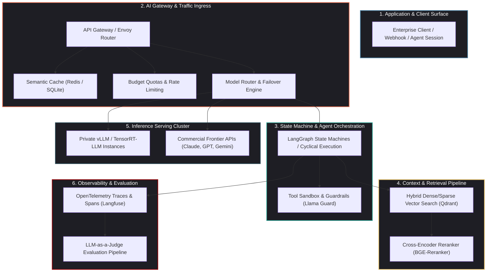
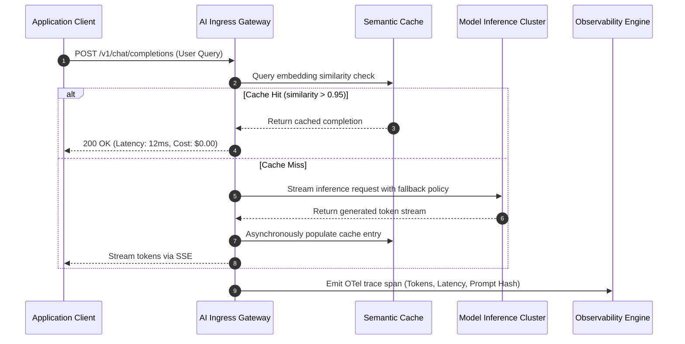

## Why Do Proof-of-Concept GenAI Architectures Fail Under Production Demands?

Building a functional demonstration of a generative AI application requires minimal code: a direct SDK call to an upstream model provider, a basic chunking script, and a local vector index. However, when these prototypes are deployed to real-world enterprise environments, they invariably break down under the pressures of production traffic:

1. **Unpredictable Latency and Upstream Rate Limits**: Third-party API providers impose stringent tokens-per-minute (TPM) and requests-per-minute (RPM) quotas. A sudden influx of end users triggers cascading HTTP 429 errors, bringing user-facing applications to a standstill.
2. **Exponential Infrastructure and Token Costs**: Unchecked multi-turn reasoning loops, redundant system prompts, and naive similarity searches that retrieve dozens of extraneous chunks cause token bills to scale superlinearly with user growth.
3. **Context Window Contamination and Silent Degradation**: As conversations extend, irrelevant history clutters the attention window, degrading response coherence and increasing susceptibility to hallucination.
4. **Lack of Governance, Tracing, and Auditability**: Without granular span tracing across tool calls, embedding transformations, and retrieval stages, diagnosing why a model generated an incorrect or toxic response becomes impossible.

A **Production Generative AI Stack** is not merely an API client wrapper; it is a distributed, fault-tolerant software architecture engineered around five core planes: compute serving, gateway routing, context retrieval, agent orchestration, and observability.

---

## The Five Functional Layers of Enterprise AI Infrastructure

To transition from brittle prototypes to resilient systems, software engineering teams organize production systems into decoupled, interchangeable layers.

### 1. The Serving Plane: Low-Latency Inference Engines

In private cloud or on-premise environments, raw model checkpoints must be served through high-throughput inference engines. As documented in our deep dive on [production ML model deployment](/posts/deploy-an-ml-model/), state-of-the-art inference engines like **vLLM** and **TensorRT-LLM** maximize GPU compute saturation through:

- **PagedAttention**: Eliminating KV cache memory fragmentation by allocating key-value states in non-contiguous virtual memory blocks, increasing serving concurrency by $2\times$ to $4\times$.
- **Continuous Batching**: Dynamically injecting newly arrived generation requests into running iteration steps rather than waiting for an entire batch to complete generation.
- **Prefix Caching**: Retaining KV cache blocks for shared system prompts, few-shot examples, and static document contexts across separate inference requests.

### 2. The Gateway Plane: Routing, Budgeting, and Semantic Caching

An AI Gateway sits between client applications and downstream model endpoints, serving as the system's operational control plane:

- **Dynamic Fallbacks and Retries**: If a primary frontier model returns a 5xx error or exceeds a 3000ms latency threshold, the gateway automatically falls back to an alternative model provider (e.g., routing from OpenAI to Anthropic or self-hosted vLLM).
- **Semantic Caching**: By embedding incoming user queries and calculating cosine similarity against a vector cache of prior queries (typically using an in-memory vector database), identical or near-identical prompts are resolved in under 15ms at zero LLM inference cost.
- **Token Budgeting and Policy Enforcement**: Enforcing user-level or tenant-level spending limits, stripping PII before requests exit corporate perimeters, and blocking prompt injection attempts using specialized guardrail classifiers.

### 3. The Context Plane: Hybrid RAG Topologies

Retrieval-Augmented Generation (RAG) is the primary mechanism for grounding models in enterprise facts. Naive vector similarity searches frequently retrieve semantically related but factually irrelevant documents. 

Production stacks deploy multi-stage retrieval pipelines:

- **Hybrid Search (Dense + Sparse)**: As explored in our benchmark on [vector database selection for LLMs](/posts/choice-vector-database-for-llm/), combining dense embeddings (which capture semantic themes) with sparse BM25/SPLADE lexical representations (which preserve exact part numbers, acronyms, and identifiers) prevents false-positive retrieval.
- **Payload Metadata Pre-Filtering**: Restricting vector space searches using deterministic metadata filters (e.g., `tenant_id == "corp_12"` and `timestamp >= "2026-01-01"`) before calculating distance metrics.
- **Two-Stage Cross-Encoder Reranking**: Re-scoring the top 50 retrieved documents using a cross-encoder model (such as BGE-Reranker-Large) to produce an authoritative top 5 context list, minimizing prompt token consumption and context bloat.

### 4. The Orchestration Plane: Cyclical Agent State Machines

While early workflows relied on linear chains, production agent architectures require cyclical state graphs capable of looping, branching, human-in-the-loop inspection, and error correction.

Frameworks like **LangGraph** represent agent workflows as directed cyclical graphs ($G = (V, E)$), where each node corresponds to a tool execution or LLM reasoning step, and state is preserved in persistent checkpoint storage. If an external API call fails or requires human approval, the execution graph pauses, persists state to Postgres, and resumes upon authorized signal delivery without losing session context.

### 5. The Observability and Evaluation Plane

Traditional application performance monitoring (APM) tools track CPU, RAM, and HTTP response codes. Generative AI stacks require semantic observability:

- **LLM-as-a-Judge Pipelines**: Implementing automated evaluation loops—such as the methodologies analyzed in our audit of [Spring AI and LLM-as-a-Judge patterns](/posts/spring-ai-llm-as-judge/)—to grade production samples on faithfulness, answer relevance, and context recall.
- **Span-Level Distributed Tracing**: Utilizing OpenTelemetry-compliant frameworks (such as Langfuse or Arize Phoenix) to visualize the entire causal tree of a request: prompt template expansion $\rightarrow$ retrieval query generation $\rightarrow$ vector search $\rightarrow$ reranker scoring $\rightarrow$ LLM completion.

---

## Architectural Comparison: Cloud-Managed vs. Self-Hosted Stacks

Engineering organizations must navigate the trade-off between managed hyperscaler platforms and open-source infrastructure:

| Dimension | Hyperscaler Managed (AWS Bedrock / Azure AI) | Open-Source Self-Hosted (vLLM + Qdrant + Langfuse) |
| :--- | :--- | :--- |
| **Operational Overhead** | Minimal; serverless provisioning and managed SLAs | High; requires dedicated Kubernetes and GPU cluster management |
| **Data Privacy & Compliance**| Governed by vendor enterprise agreements | Absolute; data never leaves private VPC boundaries |
| **Latency Optimization** | Subject to public cloud multi-tenant scheduling | Fully customizable; kernel tuning via CUDA Tile and Triton |
| **Cost at Scale** | Predictable per-token pricing; expensive at sustained high volume | High fixed hardware capital; dramatically cheaper at scale |
| **Vendor Lock-In** | High; proprietary SDKs, models, and retrieval APIs | Low; modular components swappable via open standards |

---

## How Production AI Stacks Evolved Across 2026

The enterprise generative AI landscape underwent significant maturation across 2026:

1. **Standardization of Agent Protocols**: Point-to-point bespoke integrations were replaced by standardized protocols such as the **Agent-to-Agent (A2A)** specification and the **Model Context Protocol (MCP)**, allowing agent runtimes to discover, negotiate, and execute enterprise tool schemas dynamically.
2. **Signal-Decision Architectural Routing**: Rather than passing full conversation histories through expensive frontier models, systems adopted multi-stage semantic routers—as demonstrated in our evaluation of [Signal-Decision Architecture](/posts/signal-decision-architecture/)—to classify query complexity and dispatch requests to quantized on-device SLMs (1B–3B parameters) whenever possible.
3. **Speculative Decoding at Scale**: Production inference clusters adopted speculative decoding natively, pairing small, fast draft models with massive target models. Draft models propose candidate token sequences that the target model verifies in a single forward pass, slashing per-token generation latency by $40\%$ to $60\%$.
4. **Continuous Offline Red-Teaming**: Evaluation transitioned from static benchmark suites to automated adversarial agents continuously querying production endpoints to detect safety jailbreaks, prompt injection, and regulatory compliance drift before vulnerabilities affect customers.

---

## Key Takeaways

- **Decoupled Layer Architecture**: A production GenAI system must separate inference serving, ingress routing, context retrieval, stateful orchestration, and observability into modular tiers to ensure maintainability and fault tolerance.
- **The Gateway Is Critical**: Direct client-to-LLM connections are an anti-pattern. An intelligent AI Gateway is required to enforce rate limiting, semantic caching, failover routing, and budget quotas.
- **Two-Stage Hybrid Retrieval**: Vector similarity alone is insufficient for enterprise RAG; hybrid dense/sparse search combined with cross-encoder reranking is mandatory to prevent context pollution and hallucination.
- **Semantic Observability**: Distributed tracing and automated LLM-as-a-judge pipelines are essential for measuring answer quality, latency, and token unit economics in production.

---

## New Questions

1. As small language models (SLMs) approach frontier model performance on specialized tasks, will enterprise stacks abandon monolithic cloud endpoints in favor of distributed edge clusters?
2. How can semantic caches preserve strict tenant isolation and security boundaries when caching embeddings derived from sensitive enterprise documents?
3. What governance architectures are required to audit autonomous multi-agent systems when agent decisions trigger irreversible financial or database transactions?

---

## References

1. Zaharia, M., et al. *The Shift from Models to Compound AI Systems*. Berkeley Artificial Intelligence Research (BAIR) Blog. https://bair.berkeley.edu/blog/2024/02/18/compound-ai-systems/ (accessed 2026-10-18).
2. Kwon, W., et al. *Efficient Memory Management for Large Language Model Serving with PagedAttention*. In Proceedings of the 29th ACM Symposium on Operating Systems Principles (SOSP 2023). https://arxiv.org/abs/2309.06180 (accessed 2026-10-18).
3. LangChain Team. *LangGraph: Building Stateful, Multi-Actor Applications with LLMs*. https://github.com/langchain-ai/langgraph (accessed 2026-10-18).
4. OpenTelemetry Governance Committee. *Semantic Conventions for Generative AI Operations and Spans*. https://opentelemetry.io/docs/specs/semconv/gen-ai/ (accessed 2026-10-18).
