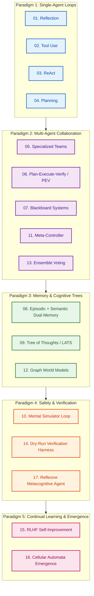
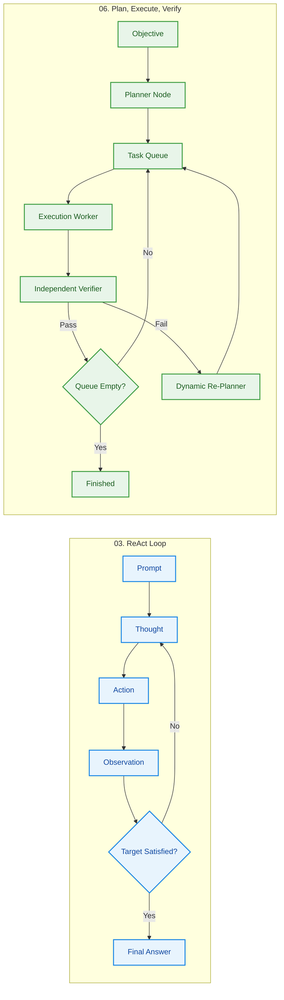

## The Taxonomy Problem in Modern AI Agent Architecture

Between 2023 and 2025, artificial intelligence development witnessed an explosion of architectural proposals for autonomous agents. Academic preprints and developer demonstrations introduced dozens of overlapping frameworks—ranging from early chain-of-thought prompting to multi-agent conversation swarms, tree search planning, and cognitive self-modeling. For practicing systems engineers, navigating this landscape proved frustrating: academic papers frequently demonstrated novel patterns on synthetic toy datasets, while enterprise framework vendors promoted bespoke abstractions that obscured underlying runtime dynamics.

In late 2025, machine learning researcher Fareed Khan published the open-source repository [`FareedKhan-dev/all-agentic-architectures`](https://github.com/FareedKhan-dev/all-agentic-architectures). Rather than treating agent design as an ambiguous collection of prompt templates, Khan systematized 17 state-of-the-art agent architectures into fully executable, reproducible Python implementations orchestrated through LangGraph and LangChain. Each architecture is formalized as an explicit state machine with measurable input-output contracts, state graphs, and evaluation loops.

This source audit deconstructs the 17 architectures cataloged in Khan's repository. We group these patterns into five architectural paradigms, examine how LangGraph formalizes cyclical agent graphs, trace the industry's shift from unconstrained multi-agent swarms toward deterministic single-agent harnesses, and identify the severe latency and cost tradeoffs that govern real-world deployments.

## The 17 Agentic Patterns Deconstructed Across Five Paradigms

Khan's catalog categorizes agentic behaviors into a progressive hierarchy, building from elementary single-pass critiques to distributed emergent systems. Across all implementations, LangGraph serves as the runtime substrate, enforcing explicit state schemas, typed transitions, and checkpointed memory.



### Paradigm 1: Foundational Single-Agent Loops (01–04)

1. **Reflection**: Replaces single-pass generation with an iterative generator-critic loop. A generator node produces a candidate draft, a critique node audits the draft against predefined rubrics (style, correctness, constraint adherence), and a conditional edge routes execution back to the generator until quality thresholds are satisfied.
2. **Tool Use**: Binds structured function schemas (Pydantic models) to model context, enabling external API calls, database queries, and deterministic calculator invocations.
3. **ReAct (Reasoning + Acting)**: Interleaves explicit natural language thoughts with tool invocations. The agent explains its intent, triggers a tool call, captures the environment's observation, and updates its reasoning before taking the next step.
4. **Planning**: Decouples plan synthesis from plan execution. Before issuing tool commands, a planner decomposes an ambiguous goal into an ordered task list, minimizing erratic backtracking during long-horizon workflows.

### Paradigm 2: Multi-Agent Coordination (05, 06, 07, 11, 13)

5. **Specialized Multi-Agent Teams**: Partitions responsibilities across distinct worker agents (e.g., Researcher, Coder, Reviewer) coordinated by a supervisor agent that passes execution tokens between specialized subgraphs.
6. **Plan, Execute, Verify (PEV)**: Extends standard planning by binding an independent Verifier node to every executed subtask. If verification fails, the orchestrator triggers dynamic re-planning rather than blindly proceeding to the next step.
7. **Blackboard Systems**: Adopts classical AI blackboard architecture. Multiple autonomous knowledge sources monitor a shared global state canvas (the blackboard) and asynchronously write observations or solution candidates when their triggering preconditions match.
8. **Meta-Controller**: Implements dynamic task routing. An upstream router classifies incoming user intents and selects an optimized specialist agent or subgraph, preventing generalist models from processing domain-specific queries inefficiently.
9. **Ensemble Aggregation**: Executes $N$ independent agent chains in parallel using varied system prompts or model families, feeding candidate outputs into a synthesizer node that resolves disagreements through majority voting or consensus distillation.



### Paradigm 3: Advanced Memory and Cognitive Trees (08, 09, 12)

10. **Episodic + Semantic Dual Memory**: Separates conversational trajectory recall from factual entity relationships. Vector embeddings store conversational logs (episodic memory), while relational tables or structured schemas store durable entity facts (semantic memory), contrasting with pure vector approaches as analyzed in [Memori's SQL-native memory architecture](/posts/memori-sql-native-memory-for-llms/).
11. **Tree of Thoughts (ToT / LATS)**: Formulates problem-solving as tree search. The agent generates multiple candidate reasoning branches at each decision point, scores branches using heuristic evaluators or LLM self-evaluations, and prunes unpromising paths via depth-first or Monte Carlo tree search.
12. **Graph World Models**: Maintains an explicit knowledge graph representing entity topologies, dependencies, and causal rules. Tool executions update graph edges, enabling multi-hop pathfinding queries over complex relational environments.

### Paradigm 4: Safety, Verification, and Metacognition (10, 14, 17)

13. **Mental Loop (Internal Simulator)**: Prompts the model to simulate expected environment outcomes inside a scratchpad before committing irreversible mutations to external APIs or disk.
14. **Dry-Run Verification Harness**: Inserts a mandatory sandboxed simulation phase where actions are executed against virtualized mock targets, requiring human or policy approval before live deployment.
15. **Reflexive Metacognitive Agent**: Equips the agent with a formal self-model. The agent tracks its own uncertainty, recognizes domains where its training is inadequate, and proactively halts execution to request human clarification or tool fallback.

### Paradigm 5: Continual Learning and Emergence (15, 16)

16. **RLHF-Style Self-Improvement Loop**: Records execution histories, passes final outputs to an automated judge to derive preference rewards, and synthesizes critique rubrics into few-shot prompt libraries for future executions.
17. **Cellular Automata Agent Grid**: Explores emergent decentralized coordination. Simple local agents operating on grid cells communicate strictly with neighboring cells, demonstrating how global spatial coordination emerges without centralized supervisors.

## What Changed Since Late 2025: From Swarm Hype to Production Determinism

In late 2025, when Khan published `all-agentic-architectures`, the AI engineering community was enamored with multi-agent swarms. Frameworks like early AutoGen, CrewAI, and ChatDev popularized architectures where dozens of specialized personas conversed in free-form chat rooms to write software or analyze data.

However, production reality in 2026 revealed severe empirical limitations with unconstrained swarms:
- **Error Compounding and Hallucination Cascades**: In unstructured multi-agent discussions, when Agent A introduces a subtle factual error, Agent B accepts the error as grounded truth and builds subsequent analysis upon it. By turn four, the entire conversational context is corrupted.
- **Token Inflation and Runaway Costs**: Running multi-agent debates easily consumes 50,000 to 200,000 prompt tokens per user turn, resulting in 10x higher operational costs compared to single-agent workflows without corresponding quality improvements.
- **Empirical Evaluation Evidence**: Large-scale empirical evaluations, including Anthropic's analysis of 100,000 multi-turn coding sessions and METR's randomized developer trial (detailed in [multi-agent productivity gains](/posts/multi-agent-productivity-gains/)), proved that complex multi-agent chatter underperforms single-agent loops equipped with rigorous verification harnesses.

```mermaid
flowchart LR
    subgraph Swarm Era ["Late 2025 Swarm Trend"]
        S1[User Goal] --> S2[Agent Swarm Chat Room]
        S2 --> S3[Free-form Multi-Agent Debate]
        S3 --> S4[High Latency, Compounding Errors]
    end

    subgraph Deterministic Era ["2026 Production Standard"]
        D1[User Goal] --> D2[Single-Agent StateGraph]
        D2 --> D3[Sandboxed Tool Execution]
        D3 --> D4[Deterministic Test Harness]
        D4 --> D5[Bounded Retry & Verification]
    end

    S4 -.->|Industry Migration| D1

    classDef swarm fill:#ffebee,stroke:#c62828,stroke-width:2px,color:#b71c1c;
    classDef det fill:#e8f5e9,stroke:#2e7d32,stroke-width:2px,color:#1b5e20;
    class S1,S2,S3,S4 swarm;
    class D1,D2,D3,D4,D5 det;
```



As demonstrated in recent evaluations of [evaluating Deep Agents CLI on Terminal Bench 2.0](/posts/evaluating-deepagents-cli-on-terminal-bench-2-0/), real performance gains in 2026 come not from adding more conversational agents, but from **harness engineering**:
1. Replacing unconstrained natural-language handoffs with rigid LangGraph state schemas.
2. Isolating execution environments in containerized sandboxes (Harbor/Docker).
3. Utilizing deterministic test scripts (`pytest`, `make`, compiler linters) rather than subjective LLM evaluators to verify completion.
4. Implementing targeted Reflection and PEV (Plan-Execute-Verify) loops with strictly bounded retry budgets ($N \le 3$).

## Architectural Tradeoffs and Implementation Pitfalls

Deploying any of Khan's 17 architectures into production requires balancing four competing engineering constraints: reasoning depth, execution latency, token expenditure, and determinism.

| Architectural Pattern | Latency Overhead | Token Cost Multiplier | State Complexity | Recommended Production Role |
| :--- | :---: | :---: | :---: | :--- |
| **01. Reflection** | Medium ($2\times$) | $2\times$ | Low | Code syntax review, schema validation |
| **03. ReAct** | Low ($1\times$) | $1\times$ | Low | Fast interactive CLI tooling, API fetching |
| **06. PEV (Plan-Execute-Verify)** | Medium-High ($3\times$) | $2.5\times$ | Medium | Multi-step devops automation, data pipelines |
| **07. Blackboard System** | High ($4\times$) | $4\times$ | High | Ambiguous medical/legal diagnostics |
| **09. Tree of Thoughts** | Extreme ($10\times+$) | $15\times+$ | Extreme | Offline combinatorial logic, math optimization |
| **11. Meta-Controller** | Low ($1.1\times$) | $1.2\times$ | Medium | Gateway triage, enterprise multi-tenant routing |
| **14. Dry-Run Harness** | Medium ($1.5\times$) | $1.5\times$ | Medium | Database mutations, destructive infrastructure |

### Common Implementation Pitfalls in LangGraph

When translating notebook implementations into high-availability services, engineers frequently encounter three systemic pitfalls:

1. **Unbounded Cyclical Deadlocks**:
   In naive Reflection and PEV implementations, if the generator fails to satisfy the critic's exact rubric, the graph loops endlessly until API limits or budget ceilings are breached. Every cyclical edge must enforce a hard counter:

   ```python
   def should_continue(state: AgentState) -> str:
       if state["iteration_count"] >= 3:
           return "escalate_to_human"
       if state["verification_passed"]:
           return "finalize_output"
       return "regenerate_draft"
   ```

2. **Context Window Pollution in Blackboard Systems**:
   When multiple agents write shared state into a monolithic LangGraph context, total token length increases quadratically with turn count. Production systems must implement state partitioning, persisting intermediate working memory into external relational stores while passing only minimal typed diffs through the graph.

3. **LLM-as-a-Judge Evaluation Drift**:
   Using an LLM judge to evaluate candidate answers in Reflection or RLHF architectures introduces self-reinforcement bias: models consistently score verbose, stylistic answers higher than concise, accurate answers. Production verification must ground evaluation in deterministic tests (exit codes, schema validators, unit tests) whenever possible.

## Key Takeaways

1. **Systematic Catalog Over Hype**: Fareed Khan's `all-agentic-architectures` establishes an empirical baseline for 17 distinct agent designs, mapping theoretical concepts directly into runnable LangGraph stategraphs.
2. **The Five Core Paradigms**: Agent patterns naturally segregate into single-agent loops, multi-agent collaboration, structured memory systems, safety verification harnesses, and continual learning loops.
3. **From Swarms to Determinism**: Production systems in 2026 have shifted away from unconstrained multi-agent conversation swarms toward deterministic, bounded single-agent harnesses equipped with PEV and sandboxed tool execution.
4. **Harness Verification Over Model Swapping**: Improving real-world task success is primarily driven by error formatting, context compaction, and deterministic verification checkpoints rather than adding additional conversational agents.
5. **Enforce Hard Execution Bounds**: Any cyclical agent architecture (Reflection, PEV, ReAct) must implement strict retry ceilings and fallback escalation paths to prevent catastrophic token drain.

## New Questions

1. **Can Meta-Controllers Dynamically Select Cognitive Depth?**: Rather than hardcoding ReAct versus Tree of Thoughts, can a lightweight router accurately predict which tasks require multi-branch search versus single-turn execution?
2. **What Is the Optimal Boundary Between Graph State and External Memory?**: As episodic memories scale to millions of interactions, how can LangGraph state schemas seamlessly integrate relational and vector stores without context degradation?
3. **How Can Metacognitive Confidence Scores Be Calibrated?**: Can LLMs reliably quantify their own epistemic uncertainty to trigger human escalation without under- or over-triggering fallback routines?
4. **Will Micro-Models Replace Multi-Agent Specialists?**: Does routing tasks to specialized fine-tuned 7B/14B models yield lower latency and cost than prompting a single frontier model with different multi-agent role instructions?

## References

- Khan, Fareed. "All Agentic Architectures: 17+ State-of-the-Art Agentic AI Patterns in LangGraph." `FareedKhan-dev/all-agentic-architectures`, commit `main` branch, 2025–2026. URL: `https://github.com/FareedKhan-dev/all-agentic-architectures` (accessed 2026-10-18).
- Yao, Shunyu, et al. "ReAct: Synergizing Reasoning and Acting in Language Models." *arXiv preprint arXiv:2210.03629*, v2, 2023. URL: `https://arxiv.org/abs/2210.03629` (accessed 2026-10-18).
- Yao, Shunyu, et al. "Tree of Thoughts: Deliberate Problem Solving with Large Language Models." *arXiv preprint arXiv:2305.10601*, v2, 2023. URL: `https://arxiv.org/abs/2305.10601` (accessed 2026-10-18).
- Shinn, Noah, et al. "Reflexion: Language Agents with Verbal Reinforcement Learning." *arXiv preprint arXiv:2303.11366*, v2, 2023. URL: `https://arxiv.org/abs/2303.11366` (accessed 2026-10-18).
- LangChain AI. "LangGraph: Multi-Agent Orchestration Framework Documentation." Release v0.2.x, 2025–2026. URL: `https://langchain-ai.github.io/langgraph/` (accessed 2026-10-18).
- Anthropic. "Evaluating Complex Multi-Turn Agentic Workflows." *Anthropic Research Notes*, 2025–2026. URL: `https://www.anthropic.com/research` (accessed 2026-10-18).
