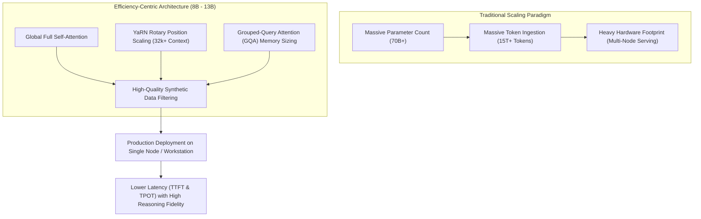
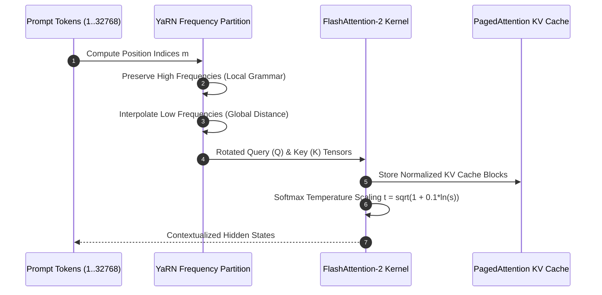

## Can Architectural Refinements Outperform Parameter Scale in Open Models?

For several years, the trajectory of large language model capability was governed almost exclusively by the Kaplan and Chinchilla neural scaling laws: superior performance demanded geometric increases in parameter counts ($N$) and pre-training token volume ($D$). However, deploying 70B+ parameter models in production environments imposes severe latency penalties, requires multi-GPU distributed orchestration, and strains high-bandwidth memory (HBM) budgets.

The emergence of compact open-source frontier architectures—exemplified by Essential AI's Rnj-1 (8B) and Motif Technologies' Motif-2 (12.7B)—demonstrates that parameter count is no longer the sole determinant of reasoning and coding proficiency. By revisiting the fundamental architectural mechanics of the Transformer and prioritizing token information density over raw corpus volume, models in the 8B–13B parameter class are matching or exceeding legacy 70B checkpoints on coding (HumanEval, MBPP) and mathematical reasoning (GSM8K, MATH).

Understanding how these smaller open-weight models achieve competitive frontier performance requires analyzing three architectural decisions: restoring full global self-attention over sliding-window approximations, implementing mathematically grounded Rotary Position Embedding (RoPE) context scaling via YaRN, and curating multi-stage synthetic reasoning pre-training mixtures.



## Architectural Analysis: Core Innovations in Rnj-1 and Motif-2

Deconstructing the performance characteristics of Rnj-1 and Motif-2 reveals how architectural fidelity and data mixture engineering unlock outsized capabilities.

### 1. Global Full Self-Attention vs. Sliding-Window Attention

To scale context windows to 32k or 128k tokens, many modern compact architectures (such as Mistral 7B) adopted Sliding-Window Attention (SWA), where each token attends only to a local window of $W$ previous tokens (e.g., $W = 4{,}096$). While SWA reduces attention computation complexity from quadratic $O(L^2)$ to linear $O(L \cdot W)$, it introduces attention attenuation over long reasoning paths. In multi-step code synthesis and formal mathematical proof generation, tokens early in the sequence lose direct gradients from later verification steps.

In contrast, architectures like Rnj-1 deliberately retain full global self-attention across the entire 32k context window:

$$\text{Attention}(Q, K, V) = \text{softmax}\left(\frac{QK^T}{\sqrt{d_k}}\right)V$$

By avoiding local window truncations, every token maintains direct bidirectional attention pathways to all preceding tokens. Combined with FlashAttention-2 hardware kernel acceleration, global attention ensures that complex execution constraints defined in the system prompt maintain uniform attention weight throughout long generative chains, directly addressing issues analyzed in [Transformer attention research](/posts/study-transformer/).

### 2. Context Extension via YaRN (Yet another RoPE extensioN)

Rotary Position Embedding (RoPE) encodes token positions by rotating query and key vectors in the complex plane. Given embedding vector $x_m$ at position $m$, RoPE applies an orthogonal rotation matrix $R_{\Theta, m}^d$:

$$R_{\Theta, m}^d = \text{diag}\left( R_{\theta_1, m}, R_{\theta_2, m}, \dots, R_{\theta_{d/2}, m} \right), \quad \text{where } \theta_i = b^{-2(i-1)/d}$$

When extending context windows beyond the native pre-training length (e.g., from 4k to 32k tokens), naive position interpolation (Position Interpolation, PI) compresses all frequencies uniformly by a scaling factor $s = L_{\text{new}} / L_{\text{native}}$. However, uniform compression alters high-frequency components that encode local token ordering, degrading grammar and code syntax.

YaRN resolves this frequency distortion by partitioning the rotary spectrum into three distinct frequency regimes:

$$\text{Scale}(i) = \begin{cases} 
1 & \text{if } \lambda_i < r_{\text{low}} \quad (\text{High frequencies: No interpolation}) \\
\frac{1}{s} & \text{if } \lambda_i > r_{\text{high}} \quad (\text{Low frequencies: Full linear interpolation}) \\
(1 - \alpha) + \frac{\alpha}{s} & \text{if } r_{\text{low}} \le \lambda_i \le r_{\text{high}} \quad (\text{Ramp boundary transition})
\end{cases}$$

Furthermore, YaRN applies a temperature scaling factor $t$ to the softmax attention logits:

$$t = \sqrt{1 + 0.1 \ln(s)}$$

This temperature correction counters entropy dilution caused by attending over larger token counts, preserving attention sharpness across the full 32k context window.



### 3. Pre-Training Token Quality and Synthetic Reasoning Mixtures

The primary driver behind the performance of Motif-2-12.7B and Rnj-1 is not merely model weights, but the structural curation of the pre-training dataset. In legacy pre-training corpuses (such as Common Crawl), high token volumes are diluted by repetitive web text, machine-generated noise, and low-information forum threads.

Modern high-performing open models employ strict multi-stage synthetic filtering pipelines:
- **Execution-Grounded Code Synthesis**: Generating programming tasks paired with executable unit tests. Only code completions that pass compiler execution are admitted into the pre-training corpus.
- **De-noised Mathematical Derivations**: Synthetic chain-of-thought solutions verified by symbolic solvers (e.g., SymPy) to eliminate mathematical hallucination drift.
- **Deduplication and Perplexity Filtering**: Calculating n-gram min-hashes and rejecting web documents that fall outside calibrated perplexity bands, directly utilizing the principles of [rigorous statistical evaluation and validation](/posts/essential-statistical-concepts-must-know/).

## How Open-Source LLM Architectures Evolved Across 2026

Throughout 2026, the open-weight foundation model ecosystem reached technical parity with proprietary frontier systems across several key benchmarks:

1. **Dominance of 8B–14B Workstation Models**: Enterprise developers overwhelmingly converged on 8B–14B models for production agent systems. When quantized to FP8 or 4-bit AWQ, these models execute entirely within a single consumer or workstation GPU (such as 24GB RTX 4090 or 32GB Mac Unified Memory), eliminating the high networking latencies of distributed tensor-parallel clusters, as evaluated in [machine learning system design interviews](/posts/machine-learning-interview-questions/).
2. **Standardization of Grouped-Query Attention (GQA)**: Multi-Head Attention (MHA) has been almost universally abandoned in favor of Grouped-Query Attention (GQA) with 8 key-value heads. GQA reduces KV cache memory consumption by up to $8\times$, allowing concurrent serving batches of 64+ requests at 32k context length without triggering out-of-memory errors on [production LLM serving infrastructures](/posts/awesome-production-llm/).
3. **Shift from Post-Hoc Alignment to Pre-Training Grounding**: Earlier models relied heavily on aggressive RLHF to "fix" hallucinations post-pre-training, frequently causing catastrophic forgetting and reduced creative reasoning (the "alignment tax"). Frontier open models in 2026 embed reasoning tokens (`<think> ... </think>`) directly into the late pre-training mixture, allowing the base model to develop intrinsic step-by-step verification capabilities before RLHF.
4. **Reproducible Open Research Standards**: As proprietary model providers obfuscated architecture details, training datasets, and system prompts, the open-source community rallied around verifiable reproducibility. Projects like Rnj-1 and Motif-2 provide transparent weight checkpoints and evaluation harnesses, enabling independent academic verification.

## Implementation: YaRN Rotary Position Embedding Scaling in PyTorch

To demonstrate the mathematical implementation of context window extension, the following PyTorch module implements YaRN rotary position embeddings with frequency partitioning:

```python
"""
yarn_rope.py - Implementation of YaRN Rotary Position Embedding in PyTorch.
"""

import math
from typing import Tuple
import torch
import torch.nn as nn


class YaRNScaledRotaryEmbedding(nn.Module):
    """
    Computes Rotary Position Embeddings with YaRN frequency-partitioned scaling.
    """
    def __init__(
        self,
        dim: int,
        max_position_embeddings: int = 32768,
        original_max_position: int = 4096,
        base: float = 10000.0,
        beta_fast: float = 32.0,
        beta_slow: float = 1.0,
        extrapolation_factor: float = 1.0
    ):
        super().__init__()
        self.dim = dim
        self.max_position_embeddings = max_position_embeddings
        self.original_max_position = original_max_position
        self.base = base
        self.scale = max_position_embeddings / original_max_position
        
        # Calculate base inverse frequencies
        inv_freq = 1.0 / (self.base ** (torch.arange(0, dim, 2).float() / dim))
        
        # Determine frequency bands for YaRN interpolation
        # Low frequency -> Full interpolation (scale s)
        # High frequency -> No interpolation (scale 1)
        low_freq_wavelen = original_max_position / beta_slow
        high_freq_wavelen = original_max_position / beta_fast
        
        wavelengths = 2.0 * math.pi / inv_freq
        
        # Compute smooth ramp weights between 0 and 1
        ramp = (wavelengths - high_freq_wavelen) / (low_freq_wavelen - high_freq_wavelen + 1e-8)
        ramp = torch.clamp(ramp, 0.0, 1.0)
        
        # YaRN frequency calculation
        inv_freq_interpolated = inv_freq / self.scale
        inv_freq_final = (1.0 - ramp) * inv_freq + ramp * inv_freq_interpolated
        
        self.register_buffer("inv_freq", inv_freq_final, persistent=False)
        
        # Softmax temperature correction factor
        self.mscale = float(0.1 * math.log(self.scale) + 1.0)

    def forward(self, seq_len: int, device: torch.device) -> Tuple[torch.Tensor, torch.Tensor]:
        """
        Generates cosine and sine embeddings for sequence length seq_len.
        """
        t = torch.arange(seq_len, device=device, dtype=torch.float32)
        freqs = torch.outer(t, self.inv_freq)
        
        # Duplicate frequencies to match head dimension
        emb = torch.cat((freqs, freqs), dim=-1)
        cos = emb.cos() * self.mscale
        sin = emb.sin() * self.mscale
        
        return cos, sin


def apply_rotary_pos_emb(x: torch.Tensor, cos: torch.Tensor, sin: torch.Tensor) -> torch.Tensor:
    """
    Applies rotary embeddings to query or key tensors x of shape (B, H, L, D).
    """
    # Rotate half
    d = x.shape[-1]
    x1 = x[..., : d // 2]
    x2 = x[..., d // 2 :]
    rotated = torch.cat((-x2, x1), dim=-1)
    
    return (x * cos) + (rotated * sin)


if __name__ == "__main__":
    torch.manual_seed(42)
    device = torch.device("cpu")
    
    dim = 64
    seq_len = 8192
    
    yarn = YaRNScaledRotaryEmbedding(dim=dim, max_position_embeddings=32768, original_max_position=4096)
    cos, sin = yarn(seq_len=seq_len, device=device)
    
    dummy_query = torch.randn(2, 8, seq_len, dim)
    rotated_q = apply_rotary_pos_emb(dummy_query, cos.unsqueeze(0).unsqueeze(0), sin.unsqueeze(0).unsqueeze(0))
    
    print("YaRN Rotary Embedding Test:")
    print(f"  Input query shape: {dummy_query.shape}")
    print(f"  Rotated query shape: {rotated_q.shape}")
    print(f"  Attention mscale factor: {yarn.mscale:.4f}")
```

Implementing mathematically sound rotary scaling guarantees that open models can ingest entire code repositories and complex document trees without context fragmentation or attention breakdown.

## Key Takeaways

- **Parameter Efficiency Overcomes Pure Scale**: Models in the 8B–13B parameter class (Rnj-1, Motif-2) achieve competitive coding and reasoning performance by pairing high-density pre-training data with architectural precision.
- **Global Self-Attention Preserves Long Gradients**: While sliding-window attention cuts compute, full global self-attention ensures tokens in deep reasoning chains retain direct attention paths back to initial constraints.
- **YaRN Prevents Position Interpolation Distortion**: Uniform context interpolation ruins local syntactic frequencies. YaRN selectively interpolates low frequencies while preserving high-frequency token order.
- **Synthetic Data Requires Execution Grounding**: High-quality pre-training corpuses filter synthetic code and reasoning through compilers and unit tests, eliminating hallucinated synthetic tokens.
- **Single-Node Deployment Reduces Latency**: Running 8B–14B models on single GPUs bypasses multi-node network latency and tensor-parallel interconnect bottlenecks, providing superior interactive responsiveness.

## New Questions

- How do floating-point precision formats (FP8 vs INT4) impact the attention temperature scaling factor in YaRN-extended context windows?
- What are the scaling boundaries of global self-attention beyond 128k tokens before memory bandwidth completely saturates single-node inference?
- Can synthetic reasoning traces generated by larger teacher models be iteratively filtered without introducing sycophantic reasoning biases into compact student models?
- Under what specific task domains does sliding-window attention with stateful recurrent state compression outperform full global attention?

## References

- Peng, B., Quesnelle, J., Fan, H., & Shippole, E. (2023). *YaRN: Efficient Context Window Extension of Large Language Models*. International Conference on Learning Representations (ICLR 2024). URL: [https://arxiv.org/abs/2309.00071](https://arxiv.org/abs/2309.00071) (accessed 2026-10-18).
- Su, J., Ahmed, M., Lu, Y., Pan, S., Bo, W., & Liu, Y. (2024). *RoFormer: Enhanced Transformer with Rotary Position Embedding*. Neurocomputing, 568, 127063. URL: [https://doi.org/10.1016/j.neucom.2023.127063](https://doi.org/10.1016/j.neucom.2023.127063) (accessed 2026-10-18).
- Touvron, H., Martin, L., Stone, K., Albert, P., Almahairi, A., Babaei, Y., Bashlykov, N., Batra, S., Bhargava, P., Bhosale, S., Bikel, D., Blecher, L., Canton Ferrer, C., Chen, M., Cucurull, G., Esiobu, D., Fernandes, J., Fu, J., Fu, W., ... Scialom, T. (2023). *Llama 2: Open Foundation and Fine-Tuned Chat Models*. arXiv preprint arXiv:2307.09288. URL: [https://arxiv.org/abs/2307.09288](https://arxiv.org/abs/2307.09288) (accessed 2026-10-18).
- Vaswani, A., Shazeer, N., Parmar, N., Uszkoreit, J., Jones, L., Gomez, A. N., Kaiser, L., & Polosukhin, I. (2017). *Attention Is All You Need*. Advances in Neural Information Processing Systems (NeurIPS 2017). URL: [https://arxiv.org/abs/1706.03762](https://arxiv.org/abs/1706.03762) (accessed 2026-10-18).
