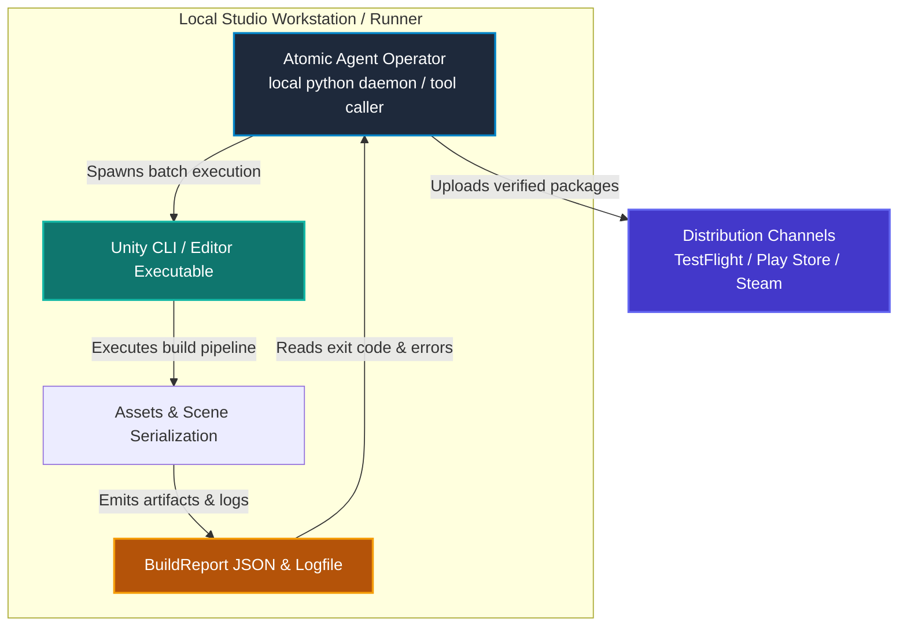

## Why Game Build Pipelines Resist Traditional Headless Automation

Game development teams face an operational bottleneck that web software engineering largely solved a decade ago: the reliance on massive, monolithic desktop client environments to execute routine integration tasks. In typical studio operations, preparing a release candidate requires manual coordination across multiple operating systems, asset compilation passes, texture compression matrices, and signing stages. When an urgent bug fix lands on the main branch, engineers frequently sit in front of local workstations manually triggering editor menus, verifying scene configurations, and inspecting build logs for unexpected fatal exceptions.

Traditional Continuous Integration (CI) systems struggle with game clients because game engines couple heavy graphical runtimes to asset serialization pipelines. Running the Unity Editor in batch mode without explicit process guards often leads to silent background hangs, unbounded memory leaks during shader compilation, and ambiguous exit statuses. 

Combining a local-first autonomous runtime like **Atomic Agent** with the **Unity CLI** provides an alternative architecture. Instead of routing build tasks through remote third-party cloud services that lack hardware acceleration or require expensive hosted runners, an agentic operator executes on local studio infrastructure with native filesystem and process control.



---

## Architectural Boundaries: Local AI Operators vs. Cloud CI Systems

Atomic Agent operates as a host-level execution agent that interacts directly with the operating system's terminal, file system, and process tree. Unlike cloud-only webhooks or proprietary continuous integration platforms, local-first operators provide several operational benefits for game production:

| Capability | Remote Cloud CI (e.g., Unity Cloud Build) | Local Atomic Agent + Unity CLI |
|---|---|---|
| **Asset Cache Access** | Requires multi-gigabyte cache upload/download over WAN | Direct access to local high-speed SSD / NVMe Accelerator cache |
| **Hardware Acceleration** | Expensive GPU-enabled cloud runner instances | Utilizes local workstation GPUs for texture/shader baking |
| **Failure Introspection** | Static log dumps; fails whole job on ambiguous errors | Agent parses `build.log`, retries transient failures, inspects diffs |
| **Security & Secrets** | Credentials uploaded to hosted third-party servers | Signing keys and store credentials remain confined to local vaults |

By leveraging the machine-readable contracts explored in [our analysis of Unity CLI production workflows](/posts/unity-cli-production-workflows/), the local operator treats the editor as a deterministic subprocess rather than an interactive GUI application.

---

## Headless Execution Contract with Unity Batchmode

To drive Unity programmatically without GUI interaction, the execution harness must supply explicit command-line flags that govern process lifecycle, log routing, and target platforms. Omitting `-quit` or `-batchmode` causes the process to block indefinitely waiting for user window dismissal.

```bash
#!/usr/bin/env bash
# scripts/headless-build.sh
set -euo pipefail

UNITY_BIN="/Applications/Unity/Hub/Editor/6000.2.10f1/Unity.app/Contents/MacOS/Unity"
PROJECT_DIR="$(pwd)"
LOG_PATH="${PROJECT_DIR}/Builds/build_android.log"

echo "Starting headless Unity build..."

"${UNITY_BIN}" \
  -projectPath "${PROJECT_DIR}" \
  -batchmode \
  -nographics \
  -quit \
  -buildTarget Android \
  -executeMethod StudioBuildAutomation.BuildAndroid \
  -logFile "${LOG_PATH}"

BUILD_STATUS=$?
if [ ${BUILD_STATUS} -ne 0 ]; then
  echo "Unity exited with non-zero status: ${BUILD_STATUS}" >&2
  exit ${BUILD_STATUS}
fi

echo "Build completed successfully."
```

The fundamental command-line flags required for dependable CI operations include:

- `-batchmode`: Suppresses all user interface dialogs and modal windows.
- `-nographics`: Initializes the engine without initializing a GPU graphics device, essential for headless server runners.
- `-quit`: Instructs the Unity process to terminate cleanly immediately after `-executeMethod` finishes.
- `-logFile <path>`: Redirects all diagnostic output away from standard output into an inspectable log file.

---

## Programmatic Build Pipeline Implementation in C#

To decouple build logic from editor UI menus, projects implement static methods exposed to `-executeMethod`. The method configures player settings, resolves active scenes, executes `BuildPipeline.BuildPlayer`, and serializes a structured JSON receipt for external consumers.

```csharp
// Assets/Editor/StudioBuildAutomation.cs
using System;
using System.IO;
using UnityEditor;
using UnityEditor.Build.Reporting;
using UnityEngine;

public static class StudioBuildAutomation
{
    public static void BuildAndroid()
    {
        string outputDir = Path.Combine(Directory.GetCurrentDirectory(), "Builds");
        Directory.CreateDirectory(outputDir);
        string apkPath = Path.Combine(outputDir, "game-release.apk");
        string reportPath = Path.Combine(outputDir, "build_receipt.json");

        var scenes = EditorBuildSettingsScene.GetActiveScenes();
        if (scenes.Length == 0)
        {
            throw new InvalidOperationException("No scenes enabled in EditorBuildSettings.");
        }

        BuildPlayerOptions options = new BuildPlayerOptions
        {
            scenes = scenes,
            locationPathName = apkPath,
            target = BuildTarget.Android,
            options = BuildOptions.None
        };

        BuildReport report = BuildPipeline.BuildPlayer(options);
        BuildSummary summary = report.summary;

        bool isSuccess = (summary.result == BuildResult.Succeeded);
        string receiptJson = $"{{\"status\":\"{(isSuccess ? "success" : "failed")}\",\"total_errors\":{summary.totalErrors},\"total_time_sec\":{summary.totalTime.TotalSeconds},\"size_bytes\":{summary.totalSize}}}";

        File.WriteAllText(reportPath, receiptJson);

        if (!isSuccess)
        {
            EditorApplication.Exit(1);
        }
    }
}
```

By generating `build_receipt.json`, the build task produces verifiable evidence that external Python agents can inspect without parsing thousands of unstructured log lines.

---

## Local Operator Control Plane and Verification Loop

The Python-based Atomic Agent monitors the build workspace, invokes the headless command, verifies output receipts, and orchestrates downstream distribution steps.

```python
# scripts/atomic_build_driver.py
import json
import subprocess
import sys
from pathlib import Path

class LocalGameBuildOperator:
    def __init__(self, unity_bin: str, project_dir: str):
        self.unity_bin = unity_bin
        self.project_dir = Path(project_dir)
        self.receipt_file = self.project_dir / "Builds" / "build_receipt.json"

    def run_android_build(self) -> bool:
        # Clean previous receipt
        if self.receipt_file.exists():
            self.receipt_file.unlink()

        cmd = [
            self.unity_bin,
            "-projectPath", str(self.project_dir),
            "-batchmode",
            "-nographics",
            "-quit",
            "-buildTarget", "Android",
            "-executeMethod", "StudioBuildAutomation.BuildAndroid",
            "-logFile", str(self.project_dir / "Builds" / "build.log"),
        ]

        print(f"Executing: {' '.join(cmd)}")
        result = subprocess.run(cmd, capture_output=True, text=True)

        if result.returncode != 0:
            print(f"Process execution failed with code {result.returncode}", file=sys.stderr)
            return False

        if not self.receipt_file.exists():
            print("Build receipt was not generated; check build.log for fatal crash.", file=sys.stderr)
            return False

        with open(self.receipt_file, "r", encoding="utf-8") as f:
            data = json.load(f)

        if data.get("status") != "success":
            print(f"Build failed according to receipt: {data}", file=sys.stderr)
            return False

        print(f"Build verified: {data['size_bytes']} bytes compiled in {data['total_time_sec']:.1f}s")
        return True
```

This architecture pairs directly with modern agent protocols like MCP to provide structured tool calls, as discussed in [MCP infrastructure and developer interfaces](/posts/mcp-roadmap-agentic-infrastructure/).

---

## What Changed Since the August 2026 Exploration

When local-first agent operators and headless Unity scripts were first benchmarked in August 2026, several operational friction points emerged that have since evolved:

1. **Receipt Serialization over Log Grepping**: Initial implementations relied on pattern-matching regex over `build.log` to determine success. Current pipelines require explicit C# `BuildReport` JSON receipts, avoiding false positives caused by benign engine warnings.
2. **Asset Database v2 Cache Sharing**: Operating local agents on local workstations allows leveraging shared Unity Accelerator instances across parallel worktrees, eliminating redundant texture compression passes across branches.
3. **Decoupling CI Pipelines from Interactive Prompts**: Modern Unity CLI versions allow non-interactive licensing via environment tokens (`UNITY_CLI_CHANNEL` and service-account keys), eliminating GUI login timeouts on headless nodes.

---

## Key Takeaways

- **Headless Unity Requires Strict Flags**: Always specify `-batchmode`, `-nographics`, `-quit`, and explicit `-logFile` parameters to prevent silent GUI blocking.
- **Emit Machine-Readable Receipts**: Do not parse text logs to verify build completion. Have your custom `BuildScript` serialize a typed JSON receipt from `BuildReport`.
- **Local-First Agents Maximize Hardware Reuse**: Local agents leverage workstation NVMe storage and discrete GPUs for texture compression and asset serialization, avoiding the high cost and latency of cloud GPU runners.
- **Fail-Closed Execution**: Verify both the OS process exit code and the presence of a valid build receipt before triggering downstream deployment actions.

---

## Open Questions

- How can local build agents efficiently coordinate shader compilation caching when multiple git worktrees run simultaneous batch builds on a single multi-core machine?
- What sandboxing mechanisms best protect local signing keys and release keystores from unconstrained agent code modifications during build runs?
- When does local agent orchestration reach its ceiling, requiring hybrid migration to distributed on-premise build clusters?

---

## References

- [Unity Editor Command Line Arguments Manual](https://docs.unity3d.com/Manual/EditorCommandLineArguments.html) — official reference for `-batchmode`, `-quit`, `-nographics`, and `-executeMethod` parameters (accessed 2026-10-17).
- [Unity ScriptReference: BuildPipeline.BuildPlayer](https://docs.unity3d.com/ScriptReference/BuildPipeline.BuildPlayer.html) — programmatic build API and options specification (accessed 2026-10-17).
- [Unity ScriptReference: BuildReport](https://docs.unity3d.com/ScriptReference/Build.Reporting.BuildReport.html) — data schema for build summaries, step timings, and file size distributions (accessed 2026-10-17).
- [Google Play Store Bundletool Documentation](https://developer.android.com/studio/command-line/bundletool) — command-line specification for generating and verifying Android App Bundles (accessed 2026-10-17).
