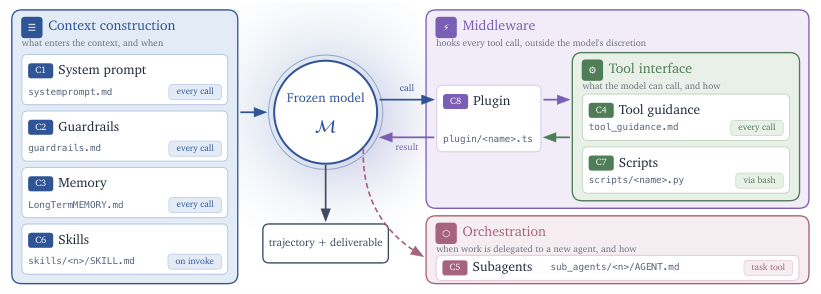

What should an evaluation system do when an agent exits unsuccessfully but leaves a document behind? Throwing the document away loses potentially useful work. Treating its presence as proof of success can be just as misleading. The interesting problem is not choosing one rule for every task; it is keeping enough evidence to make that choice deliberately.

In the pinned Harness² JobBench implementation, an executor's exit, the presence of output, and the view shown to an adapter are distinct pieces of evidence. A regression test describes a visible file surviving a timeout or crash and being reported as delivered. The runner also records a `RunnerExit` event. Neither fact establishes that the file meets the task's requirements. [Pinned runner](https://github.com/google-research/harness2/blob/6868817518876de8fd170c6a8354daca273b6191/harness2/benchmarks/jb_opencode_runner.py#L242-L268); [regression test](https://github.com/google-research/harness2/blob/6868817518876de8fd170c6a8354daca273b6191/tests/test_jobbench_killed_rollout.py#L99-L130).

The tests discussed here were reviewed as source; they were **not run for this article**. They use a fake `bun` executor, so they are not evidence of the frequency or correctness of artifacts in live deployments.

## A useful artifact is not a verdict

The [Harness² paper](https://arxiv.org/html/2610.14224v1) describes recursive harness improvement through propose, probe, and compose. That makes evaluation evidence especially consequential: a probe is useful only insofar as the evidence it presents supports the decision made from it. A trajectory can tell an operator what occurred; a deliverable can be inspected for usefulness. They answer different questions.

<figure class="source-image">
  
  <figcaption>Ruiyao Xu et al., Harness², Figure 2, CC BY 4.0; re-encoded without metadata. This contextual diagram does not show the exit behavior. Source: https://arxiv.org/html/2610.14224v1. License: https://creativecommons.org/licenses/by/4.0/.</figcaption>
</figure>

A nonzero exit is evidence about the executor's termination, not a semantic review of a document. Conversely, a file's existence tells us something was written, not that the process finished successfully or that the result satisfies a rubric. The pinned runner records the exit rather than making it disappear; the reviewed regression test shows why retaining output can also be intentional. Those facts should not be compressed into a single success flag.

**[INFERENCE]** For an evaluation consumer, the useful abstraction is a pair of independent questions: “What happened to the execution?” and “What can we establish about this artifact?” A failed execution with a valid partial artifact may warrant review or recovery. It should not automatically become either a completed task or an unusable run. What counts as acceptable depends on a task's actual contract, not on a generic file-presence check.

## The directory check has edges

The runner's `_nonempty` check counts **direct children** of an output directory. That includes hidden entries and directories, not just visible regular files. Transfer skips dot-prefixed top-level entries; it does not separately filter hidden files nested in a moved visible directory. See the [pinned runner](https://github.com/google-research/harness2/blob/6868817518876de8fd170c6a8354daca273b6191/harness2/benchmarks/jb_opencode_runner.py) for both sides of this boundary.

That distinction matters because “the source directory has an entry” is not equivalent to “a usable deliverable was transferred.” A directory containing only a hidden top-level entry satisfies the direct-child check, while that entry is excluded from transfer. In that case the exit message can say output was kept based on the pre-transfer check, even though nothing is transferred and the runner returns false. A directory can also be counted as a direct child without itself being a deliverable file. The downstream [JobBench adapter's `delivered()` predicate](https://github.com/google-research/harness2/blob/6868817518876de8fd170c6a8354daca273b6191/harness2/benchmarks/jobbench.py#L748-L758) checks recursively for a file. [Other adapter checks](https://github.com/google-research/harness2/blob/6868817518876de8fd170c6a8354daca273b6191/harness2/benchmarks/jobbench.py#L835-L854) have different conditions; this predicate is not identical to the runner's direct-child condition.

These are different predicates at different stages, not proof that a particular real task was incorrectly scored. **[INFERENCE]** They are a reason to check the final transferred tree and its contents rather than assume that an earlier directory signal has already proved the downstream acceptance condition. A useful audit records which stage made each observation and what it actually examined.

<figure class="explanatory-image">
  
  <figcaption>AI-generated illustration by OpenAI Codex image generation; not source evidence</figcaption>
</figure>

## A rendered trace is a window, not the archive

The pinned [adapter rendering code](https://github.com/google-research/harness2/blob/6868817518876de8fd170c6a8354daca273b6191/harness2/benchmarks/jobbench.py#L877-L888) selects the newest attempt and applies a character limit. Older attempts can therefore be absent from that view, and a long trajectory may lose tail content. The runner can append a structured exit event while a particular rendered view does not display it. That is a visibility distinction, not evidence that every failure is omitted or that the original record is necessarily lost.

The [OpenCode substrate](https://github.com/google-research/harness2/blob/6868817518876de8fd170c6a8354daca273b6191/harness2/substrate/opencode.py) is part of the pinned implementation context; the finding above is specifically about the JobBench view's selection and limit. An operator inspecting a short rendering should ask what was selected and truncated before interpreting silence as a clean exit.

**[INFERENCE]** Treat the rendered trajectory as a reading aid, not the sole source of execution provenance. Preserve access to attempt identity and the fuller record when deciding whether to retry, accept, or investigate. This is not a claim that a new logging mechanism has been implemented or that any specific renderer failure has been measured.

## Three gates before calling work complete

The following are proposed operational gates, not descriptions of checks already provided by Harness². They apply the source observations to a decision that a team can adapt to its own task.

1. **Record gate.** Preserve the attempt identity, termination status, and an accessible full trajectory or explicit indication that it is unavailable. If the process exits nonzero, keep that fact attached to the artifact even when a file exists. **[INFERENCE]** This makes partial work reviewable without relabeling the execution as healthy.
2. **Artifact gate.** Inspect the actual transferred output, not merely the originating directory. Require the expected files and validate their format and task-specific content. Check hidden-only and directory-only cases as distinct inputs. **[INFERENCE]** The direct-child, transfer, and recursive-file predicates make this separation useful; they do not themselves establish semantic quality.
3. **Acceptance gate.** Apply the task's rubric or an explicit human decision to the retained artifacts. A result can be classified as accepted, partial and recoverable, rejected, or not yet assessed. Record why. **[INFERENCE]** A separate disposition prevents the existence of a file or a visible trace from silently becoming a quality judgment.

For a game-production pipeline, imagine an agent asked to prepare a design document. A saved draft could be valuable after an interrupted run, while missing sections could still make it unsuitable for the next production step. That is a hypothetical example, not a reported game project or a test result. Preserving the draft and rejecting automatic completion are compatible choices.

This distinction also matters for retries. **[INFERENCE]** Before replacing a failed attempt, preserve its provenance and decide whether the new attempt is a continuation or a separate candidate; otherwise a newest-only view can make it harder for a reviewer to understand which artifact came from which execution. The source audit does not establish that such a mix-up occurred.

## What the evidence does and does not establish

The cited code and tests are pinned to commit `6868817518876de8fd170c6a8354daca273b6191`; the paper link is version 1. The reviewed fake-executor test demonstrates a specified test scenario in source, not a result independently reproduced here. No live benchmark, production run, artifact-quality assessment, exploit, or benchmark improvement was measured for this article. In particular, the existence of a `RunnerExit` event does not prove that every possible failure is captured, and a truncation limit does not prove that every rendered view hides the exit.

The practical point is narrower and more useful: evidence can survive a failed process without being sufficient for acceptance. Conversely, an abbreviated view can omit information without proving the underlying run was successful. Keep those decisions separate.

## Key Takeaways

- The runner records a structured exit event; the reviewed fake-executor regression test describes retaining and reporting a visible artifact after a timeout or crash. Neither observation proves artifact quality.
- Direct-child existence, hidden-entry transfer behavior, and recursive file discovery are different checks. Inspect the output actually available at the acceptance boundary.
- The newest, length-limited rendered attempt is not necessarily a complete view of all attempts or of the final events.
- **[INFERENCE]** Record, artifact, and acceptance gates offer a way to preserve useful partial work without calling an unsuccessful execution complete.

## New Questions

- Which task contracts permit a partial artifact to advance, and who is authorized to make that decision?
- How should a consumer expose an unavailable full trajectory or a truncated view without turning absence into an implied success?
- Which tests would distinguish hidden-only, directory-only, partial-file, and fully validated outputs in a specific deployment?

For a related execution-boundary question, read [HarnessRouter's execution contract](/posts/harnessrouter-execution-contract/): local cancellation and remote termination are separate concerns. For a wider view of evidence provenance, see the [Moli benchmark provenance audit](/posts/moli-benchmark-provenance-audit/).

## References

- [Harness² paper, version 1](https://arxiv.org/html/2610.14224v1).
- [JobBench OpenCode runner at the pinned commit](https://github.com/google-research/harness2/blob/6868817518876de8fd170c6a8354daca273b6191/harness2/benchmarks/jb_opencode_runner.py).
- [Killed-rollout regression tests at the pinned commit](https://github.com/google-research/harness2/blob/6868817518876de8fd170c6a8354daca273b6191/tests/test_jobbench_killed_rollout.py).
- [JobBench adapter at the pinned commit](https://github.com/google-research/harness2/blob/6868817518876de8fd170c6a8354daca273b6191/harness2/benchmarks/jobbench.py).
- [OpenCode substrate at the pinned commit](https://github.com/google-research/harness2/blob/6868817518876de8fd170c6a8354daca273b6191/harness2/substrate/opencode.py).
