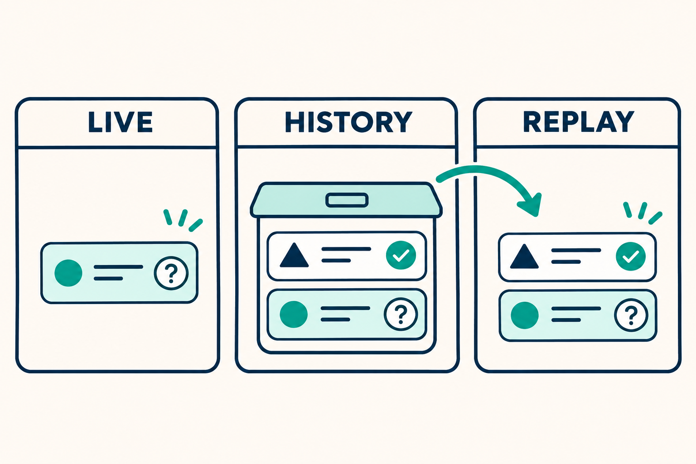
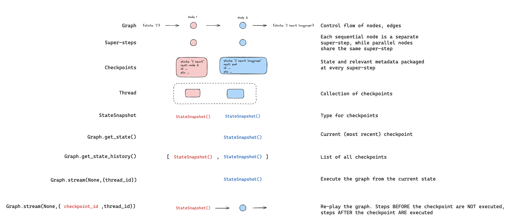

## Why can an answered LangGraph question appear beside a pending one?

Suppose two parallel tasks ask questions: A asks for one decision, B asks for another. A receives its answer and finishes. B still needs input. A dashboard reads the state and shows only B. A debugger reads what looks like the same state through the returned snapshot's configuration and finds both questions. Has the answer disappeared? Will continuing the graph execute A again?

The pinned implementation supports a more precise answer: **a live state projection and a checkpoint-specific historical record are different views, and neither view alone determines what execution will replay.** Historical questions are not automatically pending approvals. Equally important, an explicit checkpoint identifier is not automatically an instruction to rerun every completed sibling.

This **Source Audit** examines LangGraph commit `3c916d750575b22c464790e9774494d810ccd322`, with documentation pinned separately to `0c93ead98d5c82c77b057800dcc37e8cbf85e447`. Its evidence consists of implementation branches and upstream test assertions inspected as source. **No runtime tests, application experiments, or external-effect measurements were performed for this article.** A test assertion below describes the upstream contract, not a locally observed execution result.

<figure class="explanatory-image">
  
  <figcaption>Three concepts to keep separate: questions actionable in a live projection, questions recorded in history, and execution from a selected checkpoint. AI-generated illustration by OpenAI Codex built-in image generation; not source evidence.</figcaption>
</figure>

## The read selector changes the projection

In the inspected revision, `get_state` and `aget_state` select the live projection when `CONFIG_KEY_CHECKPOINT_ID` is absent from the configuration's `configurable` mapping. The relevant expression in [the state-read implementation](https://github.com/langchain-ai/langgraph/blob/3c916d750575b22c464790e9774494d810ccd322/libs/langgraph/langgraph/pregel/main.py#L1455-L1503) is:

```python
live=CONFIG_KEY_CHECKPOINT_ID not in config[CONF]
```

That is a key-presence test. The distinction is not whether the caller thinks the checkpoint is recent, whether the dashboard has refreshed, or whether an identifier happens to describe the head. A checkpoint-addressed read follows the historical projection even when its identifier came from the latest returned snapshot.

The next branch explains why the distinction matters. In [task snapshot projection](https://github.com/langchain-ai/langgraph/blob/3c916d750575b22c464790e9774494d810ccd322/libs/langgraph/langgraph/pregel/debug.py#L212-L264), the selected interrupt collection is `status.pending_interrupts` for a live view and `status.interrupts` for a historical view. The historical collection can retain recorded questions from a task that has already finished. Calling that collection a pending queue would erase the reason the two projections exist.

The strongest evidence is the regression assertion rather than an imagined dashboard failure. In [`test_finished_task_does_not_report_answered_interrupt`](https://github.com/langchain-ai/langgraph/blob/3c916d750575b22c464790e9774494d810ccd322/libs/langgraph/tests/test_interrupt_state.py#L93-L146), the live snapshot has `snapshot.next == ('b',)`. Reading `graph.get_state(snapshot.config)` instead produces the recorded-task view: `sorted(record.next) == ['a', 'b']`, with interrupt values `['A1', 'B']` in the test's helper projection.

Here A1 is a recorded question from completed A; B is still pending. The live and checkpoint-addressed read assertions above are unconditional within this parametrized test. A separate, later `get_state_history` assertion is guarded by `durability != "exit"`; that guard does not qualify the two reads above. A historical `next` value is not sufficient evidence that the corresponding task remains an actionable approval item now.

## An answer is not the same marker as task completion

It would be tempting to implement pending-state filtering by asking whether an answer has been saved. The source uses a different boundary. In [`TaskStatus`](https://github.com/langchain-ai/langgraph/blob/3c916d750575b22c464790e9774494d810ccd322/libs/langgraph/langgraph/pregel/_task_status.py#L1-L97), `finished` is determined by output writes, and `pending_interrupts` returns an empty tuple for a finished task. A saved resume answer alone is not a completion marker.

That distinction prevents another shortcut: “answered” and “finished” cannot simply be treated as synonyms. An answer concerns an interruption; completion concerns the task's output bookkeeping. The module also documents cache, partial-output-with-error, and older-checkpoint exceptions. Its rules should be read together, not reduced to a universal one-line description of every possible task state.

There is a separate boundary around what resumes. The [`interrupt` implementation and contract](https://github.com/langchain-ai/langgraph/blob/3c916d750575b22c464790e9774494d810ccd322/libs/langgraph/langgraph/types.py#L866-L1049) describe restarting the interrupted node and re-executing its logic. Previously stored answers are matched by a task-local positional index. If no positional answer matches, the implementation checks for a current resume value, validates and appends it when available, and returns it. Only when neither route supplies an answer does it raise `GraphInterrupt`. This is not restoration of the Python stack at the exact source line where the function paused.

**Integration inference:** treat the distinction between restarting an interrupted node and rerunning a completed sibling as two separate review questions. Code before an interrupt deserves its own repeat-execution analysis. That does not justify claiming that every finished parallel task will also run again. Likewise, runtime completion bookkeeping is not proof that an external transaction committed exactly once.

## An explicit head resume does not automatically rerun A

The read selector does not provide the execution rule. This is the finding most easily lost when explanations collapse “checkpoint ID” and “time travel” into one phrase.

The upstream test [`test_resume_at_the_latest_checkpoint_does_not_rerun_finished_task`](https://github.com/langchain-ai/langgraph/blob/3c916d750575b22c464790e9774494d810ccd322/libs/langgraph/tests/test_interrupt_state.py#L203-L234) covers ordinary resume with `checkpoint_id: None` and with an explicit current-head ID. Its `none` variant includes a null-valued key; it does not omit the key. The final assertion is `calls == {'a': 2, 'b': 3}`: answering B does not rerun the finished A task in either variant. The earlier A/B test separately resumes using the original configuration without that key.

Those numbers count node entries, including entries that interrupt. They are not counts of external writes, successful business operations, or performance measurements. Their role is narrower and more useful: they reject the claim that supplying the current-head identifier necessarily replays completed A.

A separate [subgraph regression](https://github.com/langchain-ai/langgraph/blob/3c916d750575b22c464790e9774494d810ccd322/libs/langgraph/tests/test_time_travel.py#L1100-L1180) asserts that resume with an explicit current-head checkpoint calls `['ask_human', 'step_b']`, not `step_a`, while final values retain `sub_a`. The assertions matter more than reading older explanatory wording as a universal rule about addressed checkpoints.

The careful formulation is therefore not “checkpoint IDs are safe” or “checkpoint IDs trigger replay.” It is: **at the pinned revision, ordinary `Command(resume=...)` addressed to the current head preserves the completed sibling in the inspected regression coverage.** That statement has a specific operation, checkpoint relationship, revision, and evidentiary limit.

## Actual replay has a different execution boundary

The execution loop makes a richer decision than the read projection. Its [replay branch](https://github.com/langchain-ai/langgraph/blob/3c916d750575b22c464790e9774494d810ccd322/libs/langgraph/langgraph/pregel/_loop.py#L958-L989) sets `is_replaying` from actual time travel or an addressed checkpoint that has been superseded. The time-travel handling removes cached `RESUME` writes so that questions can fire again.

The [supersession helpers](https://github.com/langchain-ai/langgraph/blob/3c916d750575b22c464790e9774494d810ccd322/libs/langgraph/langgraph/pregel/_checkpoint.py#L170-L202) compare the saved checkpoint's identifier with the latest checkpoint's identifier after clearing the addressed ID for that lookup. Their documented boundary includes an abandoned branch leaf. This is not merely an ancestry test, and it is not an application authorization check.

There is direct coverage for the behavior that ordinary head resume does *not* imply. In [`test_subgraph_replay_reasks_answered_parallel_interrupt`](https://github.com/langchain-ai/langgraph/blob/3c916d750575b22c464790e9774494d810ccd322/libs/langgraph/tests/test_time_travel.py#L1182-L1211), A has already received `yes`. An actual replay invocation with `None` and the selected subgraph checkpoint produces both interrupt values, `['a', 'b']`, again, including the answered question. The test covers this even where an update checkpoint preserves task IDs. It is deliberate replay coverage, not evidence that ordinary resume forgot a completed sibling.

Replay also has a stopping boundary. The [basic replay tests](https://github.com/langchain-ai/langgraph/blob/3c916d750575b22c464790e9774494d810ccd322/libs/langgraph/tests/test_time_travel.py#L67-L140) assert that nodes after the selected checkpoint execute again, whereas replay from a completed final checkpoint is a no-op. These tests use list-append call markers. They do not measure repeated network requests or prove an external system's delivery semantics.

The [pinned time-travel documentation](https://github.com/langchain-ai/docs/blob/0c93ead98d5c82c77b057800dcc37e8cbf85e447/src/oss/langgraph/use-time-travel.mdx) separately describes history inspection, replay, and forking. Its text warns that nodes after the selected checkpoint execute again and identifies the completed-final-checkpoint no-op. The illustration below provides replay context only; it does not establish the live-versus-historical interrupt claim.

<figure class="source-image">
  
  <figcaption>Publisher: LangChain. Replay context from <a href="https://github.com/langchain-ai/docs/blob/0c93ead98d5c82c77b057800dcc37e8cbf85e447/src/oss/langgraph/use-time-travel.mdx">the pinned time-travel documentation</a>, not evidence of pending-question projection. <a href="https://github.com/langchain-ai/docs/blob/0c93ead98d5c82c77b057800dcc37e8cbf85e447/LICENSE">MIT License</a>. LangChain documentation illustration, reused under the MIT License; Copyright (c) 2025 LangChain.</figcaption>
</figure>

<details>
<summary>Full MIT notice for the LangChain documentation illustration</summary>
<pre>MIT License

Copyright (c) 2025 LangChain

Permission is hereby granted, free of charge, to any person obtaining a copy
of this software and associated documentation files (the "Software"), to deal
in the Software without restriction, including without limitation the rights
to use, copy, modify, merge, publish, distribute, sublicense, and/or sell
copies of the Software, and to permit persons to whom the Software is
furnished to do so, subject to the following conditions:

The above copyright notice and this permission notice shall be included in all
copies or substantial portions of the Software.

THE SOFTWARE IS PROVIDED "AS IS", WITHOUT WARRANTY OF ANY KIND, EXPRESS OR
IMPLIED, INCLUDING BUT NOT LIMITED TO THE WARRANTIES OF MERCHANTABILITY,
FITNESS FOR A PARTICULAR PURPOSE AND NONINFRINGEMENT. IN NO EVENT SHALL THE
AUTHORS OR COPYRIGHT HOLDERS BE LIABLE FOR ANY CLAIM, DAMAGES OR OTHER
LIABILITY, WHETHER IN AN ACTION OF CONTRACT, TORT OR OTHERWISE, ARISING FROM,
OUT OF OR IN CONNECTION WITH THE SOFTWARE OR THE USE OR OTHER DEALINGS IN THE
SOFTWARE.</pre>
</details>

## Choose the read and the action independently

The following decision table is an original synthesis of the inspected branches and assertions, not a new runtime experiment. Its final column is **integration inference**, not a framework-provided approval policy.

| Reader or operator intent | Operation and evidence boundary | What the inspected contract establishes | Integration inference |
|---|---|---|---|
| Display questions still pending now | `get_state` with no `checkpoint_id` key | Live projection uses pending interrupts; completed A is absent in the A/B regression | Use this projection as input to a current-question panel, not as authorization to execute an action |
| Inspect what a checkpoint recorded | `get_state(snapshot.config)` with its checkpoint ID | Historical projection can show answered A1 alongside pending B | Label the panel as history and avoid turning every recorded question into an enabled approval button |
| Answer B at the current head | Ordinary `Command(resume=...)`, with a null-valued ID or the explicit head ID in the dedicated regression | Inspected tests preserve completed A rather than rerunning it; the earlier A/B test also covers the original configuration without the key | Make “continue current work” distinct from a replay action in the interface |
| Revisit earlier execution | Actual replay from a selected nonfinal checkpoint | Later nodes can execute again; covered subgraph replay re-asks answered A | Require an explicit replay intent and inspect repeatable effects in those nodes |
| Replay an already completed final checkpoint | Final-checkpoint replay in the inspected tests | No nodes are called | Do not promise a fresh run merely because an operator selected replay |

**Integration inference:** separate three questions in an approval interface: “What needs an answer now?”, “What was recorded then?”, and “What execution am I requesting?” Keeping those questions separate is more precise than applying a blanket warning to every saved configuration.

There is a trade-off. A current-question panel deliberately omits historical context that may be useful during an investigation. A history panel deliberately retains information that must not automatically become actionable. Neither panel replaces the other. The boundary should remain visible rather than forcing one data view to serve both purposes.

**Integration inference:** after choosing the current-question projection, review freshness and authorization independently. A current interrupt is not, by itself, permission to approve a business action. Continue with [LangGraph approval freshness](/posts/langgraph-approval-freshness/) for that separate approval-design question. For the wider conceptual distinction between resumption and durable execution, use [Twelve agent concepts for durable execution](/posts/twelve-agent-concepts-durable-execution/) as the companion reading.

## Key Takeaways

- A state read without the checkpoint-ID key selects the live projection in the inspected Python implementation; an addressed snapshot selects the historical projection.
- Historical interrupt records can include answered A beside pending B. That difference is intentional projection behavior, not sufficient evidence of lost answers or corrupted state.
- Ordinary resume at the current head, including an explicit head ID, does not automatically replay completed A in the inspected upstream assertions.
- Actual replay is a separate execution decision. Later nodes can run again, and answered interrupts can be re-asked; completed-final-checkpoint replay is a covered no-op.
- The practical interface separation is an inference from these contracts, not a tested dashboard implementation or a guarantee of external exactly-once effects.

## New Questions

Would the same selector boundary hold through the specific remote or server API used by an application? How should a pending-question panel behave if the head changes between display and submission? What would repeat-execution checks reveal about application code before an interrupt or after a selected replay checkpoint?

Those are follow-up verification questions, not results established here. This audit is limited to the pinned implementation, inspected upstream assertions, and separately pinned documentation. It does not establish behavior across other revisions, every durability mode, every checkpointer, remote APIs, or external services. A production claim needs evidence from the actual integration rather than treating this source audit as a substitute for running it.

## References

### Code and implementation

- [State-read live selector: `get_state` and `aget_state`](https://github.com/langchain-ai/langgraph/blob/3c916d750575b22c464790e9774494d810ccd322/libs/langgraph/langgraph/pregel/main.py#L1455-L1503).
- [Task snapshot interrupt projection](https://github.com/langchain-ai/langgraph/blob/3c916d750575b22c464790e9774494d810ccd322/libs/langgraph/langgraph/pregel/debug.py#L212-L264).
- [Task completion and pending-interrupt bookkeeping](https://github.com/langchain-ai/langgraph/blob/3c916d750575b22c464790e9774494d810ccd322/libs/langgraph/langgraph/pregel/_task_status.py#L1-L97).
- [Interrupt restart contract and answer indexing](https://github.com/langchain-ai/langgraph/blob/3c916d750575b22c464790e9774494d810ccd322/libs/langgraph/langgraph/types.py#L866-L1049).
- [Replay selection and cached resume handling](https://github.com/langchain-ai/langgraph/blob/3c916d750575b22c464790e9774494d810ccd322/libs/langgraph/langgraph/pregel/_loop.py#L958-L989).
- [Checkpoint supersession helpers](https://github.com/langchain-ai/langgraph/blob/3c916d750575b22c464790e9774494d810ccd322/libs/langgraph/langgraph/pregel/_checkpoint.py#L170-L202).

### Upstream test assertions inspected, not executed

- [Live and historical A/B state assertions](https://github.com/langchain-ai/langgraph/blob/3c916d750575b22c464790e9774494d810ccd322/libs/langgraph/tests/test_interrupt_state.py#L93-L146).
- [Latest-checkpoint resume preserves a finished task](https://github.com/langchain-ai/langgraph/blob/3c916d750575b22c464790e9774494d810ccd322/libs/langgraph/tests/test_interrupt_state.py#L203-L234).
- [Explicit-head subgraph resume](https://github.com/langchain-ai/langgraph/blob/3c916d750575b22c464790e9774494d810ccd322/libs/langgraph/tests/test_time_travel.py#L1100-L1180).
- [Actual subgraph replay re-asks an answered interrupt](https://github.com/langchain-ai/langgraph/blob/3c916d750575b22c464790e9774494d810ccd322/libs/langgraph/tests/test_time_travel.py#L1182-L1211).
- [Replay after a checkpoint and completed-final-checkpoint no-op](https://github.com/langchain-ai/langgraph/blob/3c916d750575b22c464790e9774494d810ccd322/libs/langgraph/tests/test_time_travel.py#L67-L140).

### Documentation and image rights

- [Pinned LangGraph time-travel documentation](https://github.com/langchain-ai/docs/blob/0c93ead98d5c82c77b057800dcc37e8cbf85e447/src/oss/langgraph/use-time-travel.mdx), including replay and fork context.
- [Pinned LangChain documentation MIT License](https://github.com/langchain-ai/docs/blob/0c93ead98d5c82c77b057800dcc37e8cbf85e447/LICENSE); full notice reproduced above for the reused illustration.

### Related articles

- [LangGraph approval freshness](/posts/langgraph-approval-freshness/).
- [Twelve agent concepts for durable execution](/posts/twelve-agent-concepts-durable-execution/).
