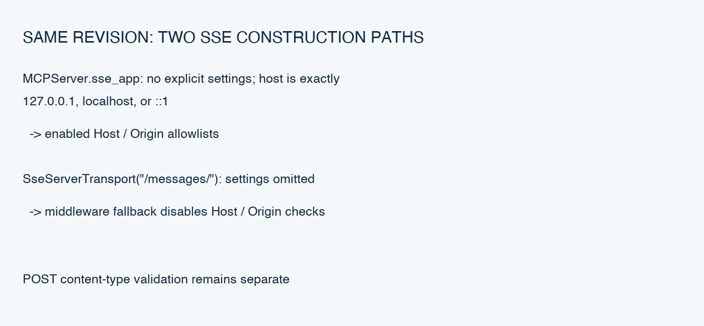

## When does a local MCP HTTP server validate request headers?

The answer depends on how the server is built, not just on whether someone calls it local. In one pinned Python SDK change, the high-level FastMCP constructor enables DNS rebinding checks automatically for `127.0.0.1`, `localhost`, and `::1` when no transport security settings are supplied. Explicit settings are not replaced, and `0.0.0.0` does not trigger that automatic behavior. A separately pinned middleware snapshot disables Host and Origin checks when settings are absent. These are historical source observations, not a finding that a particular current deployment is protected or vulnerable. [C1, C2]

The distinction matters because the construction path decides which default a reader can even consider. A protocol security requirement, an SDK constructor default, and a middleware response are related but not interchangeable facts. The useful question is therefore not “Does MCP have protection?” but “Which transport did this application construct, which settings reached it, and what boundary does that protection cover?”

The generated hero is conceptual art, not source evidence. The following original illustration maps the SSE construction paths examined at one revision:

<figure class="explanatory-image">
  
  <figcaption>Original illustration by jeo using Pillow; interpretation of source paths, not source evidence</figcaption>
</figure>

Neither illustration is a screenshot of the implementation or evidence that a request was blocked. The findings below come from the pinned sources listed in References.

## The FastMCP default depends on the host and settings

The constructor and tests in the cited Python SDK commit describe a conditional default. When transport security settings are absent, FastMCP enables DNS rebinding checks for exactly `127.0.0.1`, `localhost`, and `::1`. That statement is narrower than “all local-looking addresses are protected,” and it does not establish the behavior of every address or deployment configuration. [C1]

Two exceptions are central. First, explicit settings are not overridden by that automatic default. Supplying settings makes those settings a separate thing to inspect; their mere presence does not prove that the DNS rebinding checks are enabled. Second, `0.0.0.0` is not one of the hosts for which this automatic enabling occurs. The constructor behavior does not, on its own, tell us what a particular application's explicit configuration does. [C1]

This creates a practical review boundary: record both the host passed to the high-level constructor and whether the application supplies transport security settings. Then follow the actual settings rather than treating “uses FastMCP” as a complete answer. That is a decision procedure drawn from the conditional behavior, not a test performed against a live service.

## Missing middleware settings and missing Origin are different cases

A different pinned Python source snapshot describes the transport security middleware. With absent settings, Host and Origin checks are disabled, but the POST content-type check still runs. When those header checks are enabled, an invalid `Host` returns HTTP 421; after Host validation, an invalid `Origin` returns HTTP 403. A missing `Origin` is accepted. For POST requests, the content-type check occurs before the Host and Origin checks. [C2]

These details should not be compressed into “missing headers are rejected.” The source observation distinguishes a missing Origin from an invalid Origin, and it distinguishes missing *settings* from a missing request header. The POST ordering also limits what a response tells an investigator: a request can encounter the content-type check before later header validation. The evidence here establishes the order, not the result of an imagined request with a particular combination of headers.

The constructor commit and middleware file are pinned to different revisions. They are not a demonstrated single release, and this audit does not assume that their defaults can be composed without checking the application's installed version and wiring. The comparison is useful precisely because it exposes an audit question: does the application use the high-level path that establishes settings under its stated conditions, or does the relevant middleware receive no settings? The provided historical snapshots alone cannot answer that question for a deployment.

## A same-revision SSE construction trace

The comparison can go further without mixing Python revisions. At revision `dd52713517d88541f9233cb2af62012ad65bb993`, `MCPServer.sse_app` conditionally creates loopback transport security settings when settings are absent and the configured host is exactly `127.0.0.1`, `localhost`, or `::1`. It passes the resulting settings to `SseServerTransport`. For a different host with no supplied settings, the argument remains `None`. [C5]

At that same revision, the SSE transport passes its optional settings to `TransportSecurityMiddleware`; the module's direct example constructs `SseServerTransport` without settings. The middleware's no-settings default disables Host and Origin checks, while preserving the POST content-type check. [C2, C6]

[INFERENCE] Following these source paths, the direct example reaches a different Host/Origin-check default from the helper's automatically configured exact-loopback path, unless settings are supplied through the relevant construction path. This is a source-level implication, not an observed exploit, a live request test, or a claim about authentication. The example is not evidence that anyone deployed it. These SSE observations do not establish the behavior of other transports or revisions.

## The protocol requires Origin validation but recommends additional controls

The MCP transport specification dated 2025-11-25 requires servers to validate any present `Origin` header and return HTTP 403 for an invalid Origin. It recommends local loopback binding and authentication in its Streamable HTTP security warning. Those words carry different force: the validation requirement is not the same as the two recommendations. [C3]

The specification also should not be treated as a substitute for inspecting a particular implementation. A requirement expresses what the protocol calls for; the pinned Python middleware observation tells us what that snapshot does with invalid or missing Origin values and absent settings. The evidence supplied here does not establish how every implementation reconciles those details, nor does it establish conformance for a current server.

Authentication is a separate question from header validation. It is not enough to observe an invalid Host or Origin rejection and then conclude that the server has authenticated a caller. Conversely, a statement that authentication is recommended does not reveal whether an application's authentication is enabled or adequate. Review each boundary on its own terms: binding, transport header validation, and authentication. The evidence supports making those distinctions; it does not provide a complete authentication design or a deployment-specific verdict. [C2, C3]

## The TypeScript advisory describes a separate affected path

The official TypeScript SDK advisory identifies versions below 1.24.0 and describes unauthenticated localhost HTTP with DNS rebinding protection not enabled. For custom Express applications using unauthenticated localhost HTTP, it recommends updating the SDK and applying `hostHeaderValidation()` middleware. It says stdio is unaffected. This is a TypeScript advisory, not evidence that the Python snapshots have the same affected-version range or the same construction defaults. [C4]

Its value in this comparison is the emphasis on transport and construction. A result about HTTP does not automatically transfer to stdio, and a high-level framework choice does not settle what a custom Express construction has installed. Likewise, the advisory's version boundary must remain attached to its own package and circumstances. It is not a general safe-version claim for Python, nor a current inventory of all TypeScript deployments.

No exploitation, live requests, or security tests were performed for this article. The advisory and snapshots are historical source evidence; determining exposure for an actual service requires its version, transport, construction path, settings, and authentication configuration. Those inputs are not present in the evidence pack.

## A configuration decision matrix for the audit

| Evidence context | What the source establishes | What remains to check |
| --- | --- | --- |
| FastMCP at the cited commit, settings absent | DNS rebinding checks are automatically enabled for `127.0.0.1`, `localhost`, and `::1`, but not automatically for `0.0.0.0`. [C1] | The installed version, actual host, and construction path. |
| FastMCP at the cited commit, settings explicit | Automatic behavior does not override explicit settings. [C1] | The supplied settings and their effect in the installed version. |
| SSE at revision `dd527135`, settings absent | The helper conditionally supplies loopback settings; the direct module example omits settings, leading to middleware with Host/Origin checks off. POST content-type validation still runs. [C2, C5, C6] | The actual transport, host, supplied settings, and independently configured authentication. |
| Middleware at revision `dd527135`, checks running | Invalid Host returns 421 before Origin validation; invalid Origin returns 403, a missing Origin is accepted, and POST content type is checked first. [C2] | The actual request and configuration; this table is not a live test. |
| Streamable HTTP specification | A present Origin must be validated and an invalid Origin must receive 403; loopback binding and authentication are recommended. [C3] | Whether the specific implementation and deployment meet the relevant requirements. |
| TypeScript advisory | The affected circumstances include unauthenticated localhost HTTP without DNS protection; stdio is unaffected. For custom Express on unauthenticated localhost, update and use `hostHeaderValidation()`. [C4] | Whether that advisory applies to the specific TypeScript application. |

The matrix keeps C1's constructor revision separate from the same-revision C2/C5/C6 SSE trace. It turns the evidence into a review sequence: identify the transport and version, locate its construction path, inspect the settings it actually receives, and then assess authentication separately. A result is only as current as the implementation and deployment evidence behind it.

## Key Takeaways

- A high-level FastMCP DNS rebinding default is conditional on absent settings and the exact hosts `127.0.0.1`, `localhost`, and `::1`; explicit settings and `0.0.0.0` must not be treated as covered by that default. [C1]
- At `dd527135`, the SSE helper and direct example pass settings differently; absent middleware settings disable Host/Origin checks, not POST content-type validation. This source trace does not establish an exploit or authentication state. [C2, C5, C6]
- The protocol's Origin validation requirement and its recommendations for loopback binding and authentication are distinct from an implementation's actual configuration. [C3]
- The TypeScript advisory is transport- and construction-specific; do not transfer its version range to Python. [C4]

## New Questions

Which SDK version and transport does the deployment actually use? Does its construction path provide transport security settings, and if so, what do they do? How does the installed implementation handle requests without Origin? What authentication is present independently of header checks? These questions are not answered by the historical evidence in this audit.

For the next layer of review, examine [the CAO trust boundary audit](/posts/cao-trust-boundary-audit/) to distinguish application-level trust decisions from transport protection. For broader context on how these transport decisions fit an agent infrastructure, continue with [the MCP roadmap for agentic infrastructure](/posts/mcp-roadmap-agentic-infrastructure/).

## References

### Python implementation snapshots

- **C1:** [FastMCP constructor and tests, commit `d3a184119e44`](https://github.com/modelcontextprotocol/python-sdk/commit/d3a184119e44). Historical constructor behavior and its conditions.
- **C2:** [Transport security middleware, revision `dd52713517d88541f9233cb2af62012ad65bb993`](https://raw.githubusercontent.com/modelcontextprotocol/python-sdk/dd52713517d88541f9233cb2af62012ad65bb993/src/mcp/server/transport_security.py). Separate historical snapshot; not assumed to be the same release as C1.
- **C5:** [MCPServer SSE helper, revision `dd52713517d88541f9233cb2af62012ad65bb993`](https://raw.githubusercontent.com/modelcontextprotocol/python-sdk/dd52713517d88541f9233cb2af62012ad65bb993/src/mcp/server/mcpserver/server.py). Conditional settings construction and transport handoff.
- **C6:** [SSE transport and module example, revision `dd52713517d88541f9233cb2af62012ad65bb993`](https://raw.githubusercontent.com/modelcontextprotocol/python-sdk/dd52713517d88541f9233cb2af62012ad65bb993/src/mcp/server/sse.py). Direct construction and middleware settings handoff.

Sources in the evidence pack were retrieved on 2026-11-02 UTC; the code references are historical snapshots, not a current-version deployment audit.

### Protocol specification

- **C3:** [MCP transports, 2025-11-25 specification](https://modelcontextprotocol.io/specification/2025-11-25/basic/transports). Streamable HTTP security warning.

### Security advisory

- **C4:** [TypeScript SDK advisory GHSA-w48q-cv73-mx4w](https://github.com/modelcontextprotocol/typescript-sdk/security/advisories/GHSA-w48q-cv73-mx4w). Separate SDK and affected-version context.
