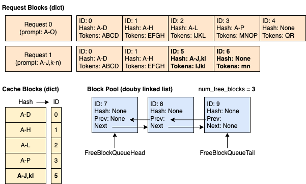
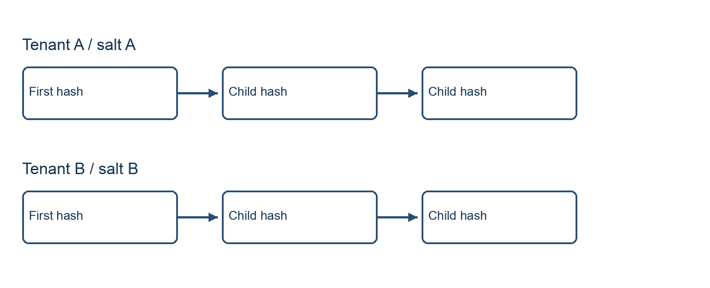

## What does the salt change in prefix caching?

A shared agent-serving system can reuse previously computed key-value (KV) cache entries when requests have matching prefixes. That reuse can improve efficiency, but it also makes cache-key construction a security-relevant operational detail: operators need to decide which requests are allowed to benefit from the same cached prefix.

The cover is an AI-generated conceptual illustration created with OpenAI Codex's built-in image generation tool; it is not source evidence.

<figure class="source-image">
  
  <figcaption>vLLM project contributors, https://raw.githubusercontent.com/vllm-project/vllm/254a2a33908a9bd974e9656f05592f83de604298/docs/design/prefix_caching.md — vLLM prefix caching example, Apache License 2.0; flattened onto white, metadata stripped and PNG re-encoded. License: https://raw.githubusercontent.com/vllm-project/vllm/254a2a33908a9bd974e9656f05592f83de604298/LICENSE. The illustration shows prefix reuse, not tenant isolation.</figcaption>
</figure>

The [Apache License 2.0 text](/assets/img/posts/2026-11-03-vllm-prefix-cache-salt-boundary/APACHE-2.0.txt) accompanies the modified upstream image.

In the pinned vLLM source examined here, an optional `cache_salt` changes the hash namespace for a request’s cached prefix. The salt is included as an extra key for the first hash-sized chunk. Subsequent hashes incorporate their parent hash, so the effect propagates down the chain. The relevant implementation is in [`generate_block_hash_extra_keys` and `hash_block_tokens`](https://raw.githubusercontent.com/vllm-project/vllm/254a2a33908a9bd974e9656f05592f83de604298/vllm/v1/core/kv_cache_utils.py).

Conceptually, if two otherwise matching requests use different salts, their first chunk hashes and later chained hashes normally differ, assuming no hash collision. If they use the same salt, the salt itself does not prevent matching blocks from sharing a cache entry. Other inputs to the block hash still matter, so sharing a salt is not a guarantee of a hit.

The [prefix-caching design document](https://raw.githubusercontent.com/vllm-project/vllm/254a2a33908a9bd974e9656f05592f83de604298/docs/design/prefix_caching.md) describes caching full blocks, but that is not the whole implementation: [`cache_partial_block`](https://raw.githubusercontent.com/vllm-project/vllm/254a2a33908a9bd974e9656f05592f83de604298/vllm/v1/core/block_pool.py) registers a prefix entry inside an existing physical block at a hash-sized boundary. The pinned code enables fine-grained hits for certain aligned Mamba configurations. A hash-sized chunk is not necessarily a physical cache block. The document describes SHA-256 as the default hash and cautions about collisions with noncryptographic alternatives such as xxhash. A salt does not eliminate collision risk.

**Inference:** First-block salting provides a useful cache-partitioning mechanism, not a complete tenant-isolation boundary. Its effectiveness depends on how requests get their salts, which requests can reach the cache, hash selection, and controls outside this mechanism.

<figure class="explanatory-image">
  
  <figcaption>Original illustration by jeo using Pillow; not source evidence</figcaption>
</figure>

## What does the source test establish?

The pinned [`test_cache_key_salting`](https://raw.githubusercontent.com/vllm-project/vllm/254a2a33908a9bd974e9656f05592f83de604298/tests/v1/core/test_prefix_caching.py) constructs a comparison involving three 16-token blocks. In its same-salt case, the test checks for 48 cached tokens; in its different-salt case, it checks for none.

That is a focused and useful distinction. The same-salt case checks that adding a salt need not disable reuse among requests assigned to the same partition. The different-salt case checks that an otherwise matching prefix does not produce a cache hit across the two salt values in that test.

It is not evidence that every deployment is isolated, that every API route applies the same policy, or that an attacker has successfully exploited a cache. This audit is based on inspection of the pinned source and test; the test was not executed for this article, and no deployment behavior was measured.

**Inference:** Operators should treat the test as evidence of intended behavior at the tested cache layer, then separately examine their own request routing, salt assignment, event exposure, and configuration. A correct block-hash test cannot establish those deployment properties on its own.

## Which salt values will the chat API accept?

The chat API presents a potentially confusing validation boundary. Its `cache_salt` field declares a maximum length of 1,024 characters, but its before-validator calls a stricter common validator. See the [chat protocol field and validator](https://raw.githubusercontent.com/vllm-project/vllm/254a2a33908a9bd974e9656f05592f83de604298/vllm/entrypoints/openai/chat_completion/protocol.py) and the [common `validate_cache_salt` implementation](https://raw.githubusercontent.com/vllm-project/vllm/254a2a33908a9bd974e9656f05592f83de604298/vllm/entrypoints/generate/base/protocol.py).

The common validator accepts `None`, but rejects non-strings, empty strings, strings longer than 128 characters, and values containing `@`, `/`, backslash, or NUL. Thus, the field’s 1,024-character declaration should not be taken as a usable 1,024-character allowance on this path.

**Recommendation:** Generate a compact random value and encode it with **URL-safe base64**, keeping the resulting string within the 128-character limit. Do not use ordinary base64: its alphabet can contain `/`, which the validator rejects. Check the encoded value against the actual validator constraints rather than relying only on the field declaration. Since `None` is accepted, validation alone also does not require a request to carry a salt.

This is a compatibility recommendation, not evidence that URL-safe encoding supplies authentication. Randomness, tenant assignment, storage, and enforcement remain separate responsibilities.

## Who should choose the salt?

A salt is an input to cache-key construction; it is **not authentication**. A client-provided string does not prove which tenant sent a request or whether that tenant is entitled to use a particular cache partition. If clients can choose the same value, the salt alone does not distinguish their requests.

**Recommendation:** At a trusted gateway, authenticate the request using the operator’s separate identity controls, determine its tenant, strip any client-supplied cache salt, and assign a trusted random tenant-specific salt. Ensure that requests cannot bypass that gateway and reach the serving path with an untrusted or missing salt. Apply the same policy to every relevant route and backend that can participate in the shared cache.

The mapping should be consistent for the period in which reuse within a tenant is desired. Different tenants should receive independently generated values. Protect the mapping and salt values as sensitive operational configuration: knowledge of a salt is not a credential, but exposing a value can undermine an arrangement that relies on tenants not being able to select another tenant’s cache namespace.

There is an operational tradeoff. Tenant-specific values intentionally give up cache reuse across tenants, even when their prefixes match. Conversely, changing a tenant’s salt changes its cache namespace and can reduce reuse until matching blocks are cached under the new value. These are consequences of partitioning, not evidence of measured performance in a particular deployment.

The broader serving layout also matters when deciding where enforcement belongs. The discussion of [LLM inference parallelism and layout](/posts/llm-inference-parallelism-layout/) is useful context for reasoning about serving boundaries; it does not establish that this salt policy is enforced in any particular topology. Likewise, a [routing decision that hinges on a price ratio](/posts/typesafe-routing-verdict-hinges-on-price-ratio/) illustrates why routing choices deserve explicit operational analysis, rather than an assumption that a cache-key setting governs all request paths.

## Where can the salt appear outside the request?

The source exposes another boundary worth reviewing: KV event conversion. The pinned [`to_event_extra_keys` implementation](https://raw.githubusercontent.com/vllm-project/vllm/254a2a33908a9bd974e9656f05592f83de604298/vllm/v1/core/kv_cache_utils.py) emits extra key values without tags identifying their types, including a salt when present.

That observation is about conversion in the inspected source. It does not, by itself, establish that a particular deployment publishes events, who receives them, or that a salt was exposed to an unauthorized party. The lack of tags nevertheless makes blanket assumptions about “harmless metadata” unsafe: an event consumer may receive a salt value among other extra-key values without an explicit salt label.

**Recommendation:** Inventory whether KV events are enabled and where they travel. Restrict event-consumer access, retention, and onward sharing according to the sensitivity of the values those events may contain. Include the event path when protecting tenant salt mappings; protecting only the gateway’s configuration is insufficient if another authorized system distributes the same values more broadly.

**Inference:** Salt confidentiality and access control are defense-in-depth measures, not substitutes for gateway enforcement. Even an undisclosed salt is not an identity check, and controlling event access does not prove complete isolation.

## Key Takeaways

- The first hash-sized chunk includes the optional salt as an extra key; later hashes chain through their parent. Partial entries inside physical blocks are possible in certain configurations.
- The inspected test checks 48 cached tokens for the same salt and none for a different salt across three 16-token blocks. It was not executed for this audit.
- The chat field declares 1,024 characters, but the before-validator applies a 128-character limit and rejects specified characters. Use URL-safe, not ordinary, base64 for encoded random salts.
- **Recommendation:** Have a trusted gateway strip client salts, assign random tenant-specific values, and prevent bypass. Treat salts and KV event access as sensitive, while recognizing that a salt is not authentication.
- SHA-256 is the documented default; noncryptographic hashes carry collision caveats. None of these findings proves complete isolation or an observed exploit.

## New Questions

- Can any serving route or backend be reached without the trusted gateway’s salt policy?
- Which systems can consume or retain KV events, and can those events include tenant salts?
- How will salt consistency, rotation, and the loss of cross-tenant cache reuse be managed operationally?
- Which hash configuration is actually deployed, and have its collision tradeoffs been accepted?

## References

- [Pinned KV cache implementation: block hashing and event conversion](https://raw.githubusercontent.com/vllm-project/vllm/254a2a33908a9bd974e9656f05592f83de604298/vllm/v1/core/kv_cache_utils.py)
- [Pinned partial-entry implementation](https://raw.githubusercontent.com/vllm-project/vllm/254a2a33908a9bd974e9656f05592f83de604298/vllm/v1/core/block_pool.py)
- [Pinned chat completion protocol](https://raw.githubusercontent.com/vllm-project/vllm/254a2a33908a9bd974e9656f05592f83de604298/vllm/entrypoints/openai/chat_completion/protocol.py)
- [Pinned common salt validator](https://raw.githubusercontent.com/vllm-project/vllm/254a2a33908a9bd974e9656f05592f83de604298/vllm/entrypoints/generate/base/protocol.py)
- [Pinned prefix-caching tests](https://raw.githubusercontent.com/vllm-project/vllm/254a2a33908a9bd974e9656f05592f83de604298/tests/v1/core/test_prefix_caching.py)
- [Pinned prefix-caching design](https://raw.githubusercontent.com/vllm-project/vllm/254a2a33908a9bd974e9656f05592f83de604298/docs/design/prefix_caching.md)
