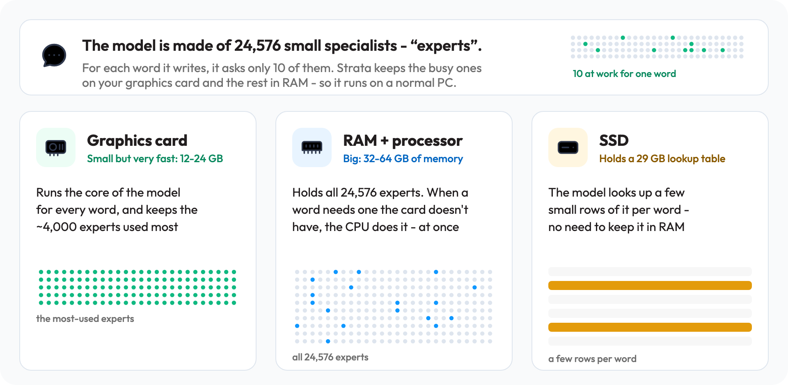
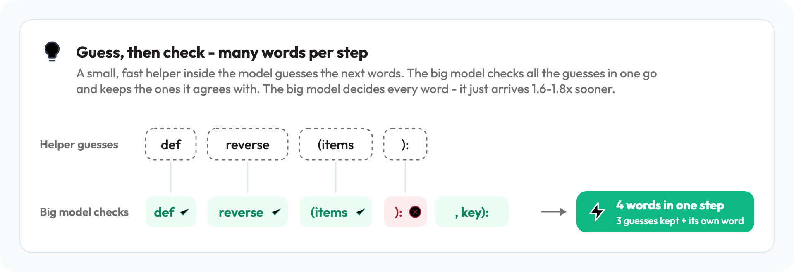
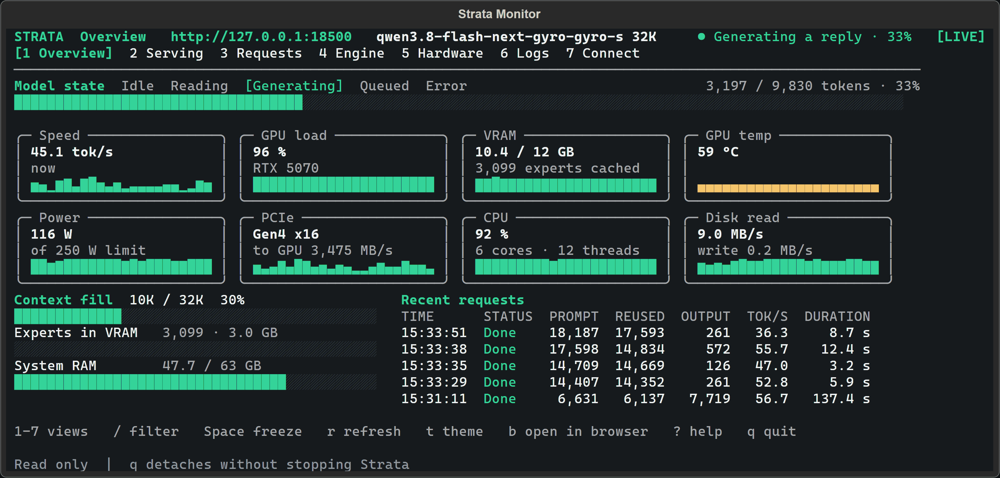
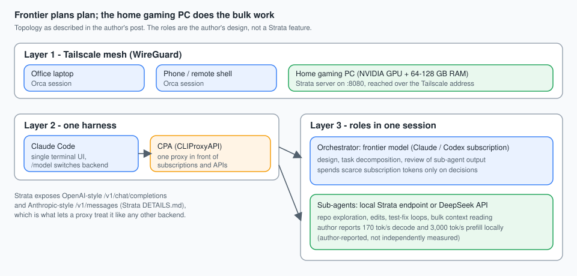

<style>
  .lang-switch { display: flex; gap: .5rem; align-items: center; margin: 0 0 1.25rem; }
  .lang-switch button { border: 1px solid var(--main-border-color, #ccc); background: transparent; color: inherit; border-radius: 999px; padding: .25rem .9rem; font-size: .9rem; cursor: pointer; }
  .lang-switch button[aria-pressed="true"] { background: var(--link-color, #2a6df4); border-color: var(--link-color, #2a6df4); color: #fff; }
  .lang-switch .lang-hint { font-size: .8rem; opacity: .7; }
  [data-lang-pane][hidden] { display: none !important; }
</style>

<div class="lang-switch" role="group" aria-label="Language / 언어">
  <button type="button" data-lang="en" aria-pressed="true">English</button>
  <button type="button" data-lang="ko" aria-pressed="false">한국어 번역</button>
  <span class="lang-hint">Same article, translated. 같은 글의 한국어 번역입니다.</span>
</div>

## Can a 200B-class model really answer at 170 tok/s on a gaming PC?

Around 2026-11-03, Matthew (Hyungseop Kim), CTO at Imweb, posted [a short Velog note](https://velog.io/@480/%EC%A7%91%EC%97%90%EC%9E%88%EB%8A%94-%EA%B2%8C%EC%9D%B4%EB%B0%8D-PC%EB%A5%BC-%EC%B4%88%EA%B3%A0%EC%86%8D-%EB%A1%9C%EC%BB%AC-LLM-%EB%A8%B8%EC%8B%A0%EC%9C%BC%EB%A1%9C) with a bold claim. An old desktop with 128 GB of RAM and one RTX 4090, running the open-source inference engine [Strata](https://github.com/Niko1221/Strata), serves Qwen 3.8 Flash Next (3-bit pack) at **170 tok/s decode and 3,000 tok/s prompt reading with a 512k context**. He says the quality is good enough for real coding work, and that this beats his two NVIDIA DGX Spark machines tied together with `tp=2` running DeepSeek 4.1 Flash. A 16 GB card such as an RTX 3080 and 64 GB of RAM, he says, should still reach "100+ tok/s".

The note is a few hundred words and gives no logs. This article checks it against Strata's own documentation, pinned to commit [`ffa80d7`](https://github.com/Niko1221/Strata/tree/ffa80d73133ea5c548aefe57889a16e8085a938f) (MIT license), read on 2026-11-05. Throughout, **verified** means a Strata document states it, **author-reported** means only the Velog post states it, and **inferred** is my own reading.

The short version: the mechanism in the post is real and well documented, the 170 tok/s figure is plausible but is the author's alone, and the comparison with the DGX Spark mixes two different models.

## Why do slow RAM and an SSD not wreck the speed?

Servers like vLLM or SGLang want the whole model in GPU memory. A card with 12-24 GB cannot hold a model that normally lives on hundreds of gigabytes of graphics memory, and naive offloading over PCIe is slow. Strata's answer, per its [How it works](https://github.com/Niko1221/Strata/blob/ffa80d73133ea5c548aefe57889a16e8085a938f/docs/HOW_IT_WORKS.md) page (verified), is to split the work across the whole PC:

<figure class="source-image">
  
  <figcaption>Strata's "who does what" diagram. Source: <a href="https://github.com/Niko1221/Strata/tree/ffa80d73133ea5c548aefe57889a16e8085a938f">Niko1221/Strata at commit ffa80d7</a>, <code>docs/media/how-it-works.svg</code>, rasterized to PNG at 2x without other changes. Creator: Niko1221 and the Strata contributors. License: <a href="https://github.com/Niko1221/Strata/blob/ffa80d73133ea5c548aefe57889a16e8085a938f/LICENSE">MIT</a>.</figcaption>
</figure>

| Tier | What lives there | Who computes | Documented detail |
| :--- | :--- | :--- | :--- |
| GPU VRAM | Attention and DeltaNet mixers, routers, shared experts, output head, MTP draft layer, the hot part of the KV cache, and a cache of the most-used experts | GPU | Every extra GB of VRAM holds about 700 more experts, so VRAM size matters more than GPU speed |
| System RAM | All 24,576 experts, pinned | CPU computes, in place, the experts the GPU does not hold, at the same time as the GPU works | Low-RAM mode exists for big card plus little RAM |
| NVMe SSD | The 28.8 GB n-gram lookup table | Nobody computes; a few rows are read per token through the OS cache | The second shard (about 29 GB) stays on disk |

The key fact is sparsity. The model is a team of 24,576 small experts and **each generated token needs only 10 of them** (verified). The GPU keeps the busiest experts and keeps re-learning which ones those are as the conversation moves. The CPU handles cache misses without copying them over PCIe and waiting. The n-gram table is a lookup, not matrix math, so it can sit on an SSD. The author adds that DDR4 and DDR5 feel almost the same in practice (author-reported). That fits a design where the CPU and GPU work in parallel, but Strata's only measurement ran on DDR5-5200, and its tuning notes say a CPU that reads missed experts slowly (DDR3 or DDR4 in few channels) gains from more expert swaps, so DDR4 is not documented as identical.

## Where do the extra tokens per pass come from?

Two techniques explain the decode and prompt-reading speeds, both documented on the same page (verified):

<figure class="source-image">
  
  <figcaption>Strata's "guess, then check" diagram. Source: <a href="https://github.com/Niko1221/Strata/tree/ffa80d73133ea5c548aefe57889a16e8085a938f">Niko1221/Strata at commit ffa80d7</a>, <code>docs/media/guess-and-check.svg</code>, rasterized to PNG at 2x without other changes. Creator: Niko1221 and the Strata contributors. License: <a href="https://github.com/Niko1221/Strata/blob/ffa80d73133ea5c548aefe57889a16e8085a938f/LICENSE">MIT</a>.</figcaption>
</figure>

- **Guess, then check (decode).** The model's built-in MTP layer drafts up to 3 tokens; one pass over all 48 layers checks them and yields 2.4-3.2 tokens per pass on average, so answers arrive 1.6-1.8x sooner at the same quality, because the big model decides every token. When a reply repeats the context, as in code edits, prompt lookup drafts up to 5 tokens from the earlier text and makes code edits 6-11% faster.
- **Big-piece reading (prefill).** Long prompts are read in pieces of up to 8,192 tokens, while the experts for the next layer stream to the GPU over PCIe as the current layer's attention runs. After the first message Strata keeps the conversation and reads only what is new, so follow-ups start in seconds.

This matters for coding agents because every agent turn re-sends a large repository context. Fast prompt reading and cheap follow-ups are what make a local model usable as a sub-agent, not just the decode rate.

## Which of the speed numbers does Strata's own documentation support?

This is the part the Velog post does not give you. I collected every speed figure I could find in the pinned docs next to the author's.

| Setup | Model | Decode | Prompt reading | Status |
| :--- | :--- | :--- | :--- | :--- |
| RTX 4090 + 128 GB RAM, 512k context | Qwen3.8-Flash-Next, 3-bit pack | 170 tok/s | 3,000 tok/s | author-reported |
| RTX 5070 12 GB, Ryzen 5 7600, 64 GB DDR5-5200 | Qwen3.8-Flash-Next Q2_0 | 93.0 tok/s (73.7 at 128K) | 2,171 tok/s (32K prompt) | Strata maintainers, engine 0.1.26 |
| same PC | Qwen3.8-Flash-Next IQ2_XS | 78.6 tok/s (62.7 at 128K) | 2,092 tok/s | Strata maintainers, engine 0.1.26 |
| same PC | Qwen3.8-Flash-Next IQ3_XXS | 61.6 tok/s (49.0 at 128K) | 1,745 tok/s | Strata maintainers, engine 0.1.26 |
| same PC | Qwen3.8-Flash-Next IQ3_S | 53.3 tok/s (45.5 at 128K) | 1,624 tok/s | Strata maintainers, engine 0.1.26 |
| same PC | DeepSeek V4.1-Flash | about 4-6 tok/s | about 110 tok/s (4K) | Strata README |

Source for the Qwen rows: the "Speed (measured)" section of [`docs/DETAILS.md`](https://github.com/Niko1221/Strata/blob/ffa80d73133ea5c548aefe57889a16e8085a938f/docs/DETAILS.md). Each is one code-agent prompt per length with 256 generated tokens and MTP speculative decoding on; short-prompt output is the 4K column. The DeepSeek row is from the [README](https://github.com/Niko1221/Strata/blob/ffa80d73133ea5c548aefe57889a16e8085a938f/README.md) hardware table.

Three findings follow from the table.

1. **The ranking is plausible.** A faster card, more RAM, and a lighter 3-bit pack move the same engine from 53-93 tok/s on a 12 GB card to the author's 170 tok/s on a 24 GB card. I could not verify that last step; a 24 GB card holding more hot experts is the documented mechanism for it (inferred).
2. **"100+ tok/s" is not shown for 16 GB cards in these documents.** The only measured 12 GB machine reaches 93 tok/s with the fastest pack and falls to 53 with the best-quality one, and the DDR5 box it ran on is not the DDR4 machine many readers own.
3. **The headline does not transfer across models.** The same RTX 5070 machine runs DeepSeek V4.1-Flash at about 4-6 tok/s. The author's DGX Spark comparison runs DeepSeek on the Sparks and Qwen on the gaming PC, so it compares two models and two engines at once. Strata's documents mention a DGX Spark only in DeepSeek correctness and load-time tests, not in any speed comparison with a gaming PC (inferred from the pages I read), so "faster than two Sparks" stays an author-reported impression about a different workload.

<figure class="source-image">
  
  <figcaption>Strata's terminal monitor, the surface where speed, memory and recent requests can be watched live. Source: <a href="https://github.com/Niko1221/Strata/tree/ffa80d73133ea5c548aefe57889a16e8085a938f">Niko1221/Strata at commit ffa80d7</a>, <code>docs/media/terminal-monitor.png</code>. Creator: Niko1221 and the Strata contributors. License: <a href="https://github.com/Niko1221/Strata/blob/ffa80d73133ea5c548aefe57889a16e8085a938f/LICENSE">MIT</a>. Unmodified.</figcaption>
</figure>

## How much RAM does each pack need?

The Strata model guide ([`docs/MODELS.md`](https://github.com/Niko1221/Strata/blob/ffa80d73133ea5c548aefe57889a16e8085a938f/docs/MODELS.md), verified) gives the sizing rule: a pack fits when **RAM is at least the experts in shard 1 plus about 10 GB** for the operating system and other programs. Numbers are estimates for RAM plus VRAM, and "a given context may still not fit".

| Pack (ISTA-DASLab) | RAM + VRAM for the model | Experts in shard 1 | Documented trade-off |
| :--- | ---: | ---: | :--- |
| Q2_0 | 37.6 GB | 34 GB | fastest, good quality |
| IQ2_XS | 39.2 GB | 35.5 GB | fast, better quality |
| IQ3_XXS | 47.0 GB | 43 GB | slower, great quality |
| IQ3_S | 54.8 GB | 50 GB | slowest; matches the full model on the published tests |
| Coder (IQ1_M) | not listed | 29.6 GB | half the experts, code only; its authors report 91% of SWE-bench Verified and 99% of LiveCodeBench of the full model |

With 64 GB every size fits (IQ3_S only with little else open); with 48 GB, Q2_0 and IQ2_XS fit. The Coder pack targets about 32 GB of RAM, is weaker outside code, and the guide says to take a full-expert size whenever RAM allows. "3Q or 2Q" in the Velog post most likely means the 3-bit (IQ3_*) and 2-bit (Q2_0, IQ2_XS) packs in this table (inferred; the post does not name them).

## How does the author wire the gaming PC into a coding harness?

The second half of the Velog post is about plumbing, and it is the part that turns a benchmark into a workflow (author-reported):

- **[Tailscale](https://tailscale.com/)** joins the author's machines into one private network, so the home PC can serve its local LLM API to every other device without exposing a port to the internet.
- **[Orca](https://github.com/stablyai/orca)** lets him move between machines and agent sessions.
- **[Claude Code](https://github.com/anthropics/claude-code)** is his single harness, with **[CPA (CLIProxyAPI)](https://github.com/router-for-me/CLIProxyAPI)** in front so that Claude, Codex, the DeepSeek API and the local model are all reachable through one `/model` switch.
- **Role split inside one session:** a frontier model orchestrates, and sub-agents run on the DeepSeek API or the local Strata server, saving subscription tokens and time.

<figure class="explanatory-image">
  
  <figcaption>Original diagram of the topology the author describes. The role split is his design, not a Strata feature.</figcaption>
</figure>

One documented fact makes the routing practical: Strata serves both OpenAI-style `/v1/chat/completions` and Anthropic-style `/v1/messages` ([DETAILS.md](https://github.com/Niko1221/Strata/blob/ffa80d73133ea5c548aefe57889a16e8085a938f/docs/DETAILS.md), verified), and the AI setup guide tells Anthropic-compatible clients to use the server root. By default the server listens on `127.0.0.1:8080`, so reaching it from another device means configuring another address; binding it only to a Tailscale address instead of a public one is the safer choice (inferred, not tested here).

<figure class="source-image">
  
  <figcaption>Strata's desktop app, chat with live code preview. Source: <a href="https://github.com/Niko1221/Strata/tree/ffa80d73133ea5c548aefe57889a16e8085a938f">Niko1221/Strata at commit ffa80d7</a>, <code>docs/media/app-chat.png</code>. Creator: Niko1221 and the Strata contributors. License: <a href="https://github.com/Niko1221/Strata/blob/ffa80d73133ea5c548aefe57889a16e8085a938f/LICENSE">MIT</a>. Unmodified.</figcaption>
</figure>

The author's setup is one sentence to Claude Code: "set up Qwen 3.8 ultra-fast inference on my machine with Strata, 512k context". The repository supports that path with an [AI setup guide](https://github.com/Niko1221/Strata/blob/ffa80d73133ea5c548aefe57889a16e8085a938f/docs/AI_SETUP.md) written for agents. Doing it by hand uses commands from the [install guide](https://github.com/Niko1221/Strata/blob/ffa80d73133ea5c548aefe57889a16e8085a938f/docs/INSTALL.md) and the model guide; I did not run them, because I have no suitable GPU here:

```bash
# Linux / macOS installer (INSTALL.md)
curl -fsSL https://github.com/Niko1221/Strata/releases/latest/download/install.sh -o install.sh && sh install.sh

# Print the plan for a pack without downloading or changing anything (MODELS.md)
strata launch --plan --family qwen --model iq2_xs
```

## Key Takeaways

- The mechanism is documented: 24,576 experts, 10 per token, hot experts on the GPU, all experts in RAM computed in place by the CPU, and a 28.8 GB lookup table on the SSD.
- 170 tok/s and 3,000 tok/s are the author's measurements on an RTX 4090 with 128 GB of RAM. Strata's own measurements reach 93 tok/s on a 12 GB card, so the number is believable but not independently verified here.
- The same engine runs DeepSeek V4.1-Flash on that 12 GB machine at about 4-6 tok/s. Pick the model before trusting the hardware claim.
- The DGX Spark comparison is not like for like, and Strata's documents contain no speed comparison against a DGX Spark.
- Check RAM against the sizing rule (experts plus about 10 GB) before downloading a pack; the three smaller sizes are 66 to 76 GB.

## New Questions

- What do decode and prompt-reading speeds look like for the same Qwen pack on RTX 3080, 3090 and 4090 cards, measured on the current engine rather than 0.1.26, and with DDR4 as well as DDR5?
- How does Strata's local Qwen compare with a metered frontier plan once electricity and hardware are counted? A reader asked exactly this in the Velog comments (4090 plus 64 GB, why not just subscribe?), and the post does not answer it.
- Does the 6-11% prompt-lookup gain survive real agent traffic, where context is mostly tool output rather than quoted code?
- What does a Tailscale-only Strata endpoint need so that a leaked key on one device does not hand out the GPU?

## References

**Primary sources (read 2026-11-05)**

- [Matthew (Hyungseop Kim), "Turning your home gaming PC into an ultra-fast local LLM machine", Velog](https://velog.io/@480/%EC%A7%91%EC%97%90%EC%9E%88%EB%8A%94-%EA%B2%8C%EC%9D%B4%EB%B0%8D-PC%EB%A5%BC-%EC%B4%88%EA%B3%A0%EC%86%8D-%EB%A1%9C%EC%BB%AC-LLM-%EB%A8%B8%EC%8B%A0%EC%9C%BC%EB%A1%9C) (Korean original, posted about 2026-11-03; its three screenshots are not reproduced here because the page grants no reuse license)
- [Strata repository at commit ffa80d7](https://github.com/Niko1221/Strata/tree/ffa80d73133ea5c548aefe57889a16e8085a938f) (MIT)
- [Strata: How it works](https://github.com/Niko1221/Strata/blob/ffa80d73133ea5c548aefe57889a16e8085a938f/docs/HOW_IT_WORKS.md)
- [Strata: Which model? Sizes, versions and what fits](https://github.com/Niko1221/Strata/blob/ffa80d73133ea5c548aefe57889a16e8085a938f/docs/MODELS.md)
- [Strata: Details and API reference](https://github.com/Niko1221/Strata/blob/ffa80d73133ea5c548aefe57889a16e8085a938f/docs/DETAILS.md)
- [Strata: AI setup guide](https://github.com/Niko1221/Strata/blob/ffa80d73133ea5c548aefe57889a16e8085a938f/docs/AI_SETUP.md) and [install guide](https://github.com/Niko1221/Strata/blob/ffa80d73133ea5c548aefe57889a16e8085a938f/docs/INSTALL.md)

**Tools named in the workflow**

- [Tailscale](https://tailscale.com/), [Orca](https://github.com/stablyai/orca), [Claude Code](https://github.com/anthropics/claude-code), [CLIProxyAPI](https://github.com/router-for-me/CLIProxyAPI)

**Related articles on this site**

- [Why the TypeSafe routing verdict hinges on price ratio](/posts/typesafe-routing-verdict-hinges-on-price-ratio/), on when sending work to a cheaper model actually saves money
- [vLLM prefix cache salt is not tenant authentication](/posts/vllm-prefix-cache-salt-boundary/), on the security side of sharing a model server

**Limitations.** I did not run Strata and have no RTX 3080/4090 here, so no speed figure above is mine. The Velog post was read in full, but its screenshots were not reproduced for licensing reasons. Strata's documentation can change after commit `ffa80d7`.

<div id="ko-start" hidden></div>

**한국어 번역** · 영문 원본과 동일한 내용을 번역한 판입니다. 제목: *Strata로 200B급 MoE 모델을 게이밍 PC에서 돌린다: 무엇이 사실로 확인되는가*

<h2 id="ko-section-1" data-toc-skip>200B급 모델이 게이밍 PC에서 정말 170 tok/s로 답할 수 있을까?</h2>

2026-11-03경 아임웹 CTO 김형섭(Matthew) 님이 [짧은 벨로그 글](https://velog.io/@480/%EC%A7%91%EC%97%90%EC%9E%88%EB%8A%94-%EA%B2%8C%EC%9D%B4%EB%B0%8D-PC%EB%A5%BC-%EC%B4%88%EA%B3%A0%EC%86%8D-%EB%A1%9C%EC%BB%AC-LLM-%EB%A8%B8%EC%8B%A0%EC%9C%BC%EB%A1%9C)에서 대담한 주장을 했습니다. 128GB RAM과 RTX 4090 한 장이 달린 오래된 데스크탑에서 오픈소스 추론 엔진 [Strata](https://github.com/Niko1221/Strata)로 Qwen 3.8 Flash Next(3비트 팩)를 구동하면 **디코드 170 tok/s, 프롬프트 읽기(프리필) 3,000 tok/s, 컨텍스트 512k**가 나온다는 내용입니다. 실무 코딩에 충분한 품질이며, `tp=2`로 묶은 NVIDIA DGX Spark 2대에서 DeepSeek 4.1 Flash를 돌리는 것보다 낫다고 합니다. RTX 3080 같은 16GB 카드와 64GB RAM이면 "100+ tok/s"는 나온다고도 합니다.

원문은 몇백 단어짜리 짧은 글이고 로그는 없습니다. 이 글은 Strata 공식 문서(커밋 [`ffa80d7`](https://github.com/Niko1221/Strata/tree/ffa80d73133ea5c548aefe57889a16e8085a938f)에 고정, MIT 라이선스, 2026-11-05 열람)로 원문을 대조합니다. **verified**는 Strata 문서가 직접 밝힌 사실, **author-reported**는 벨로그 글에만 있는 주장, **inferred**는 제 추론입니다.

요약하면, 글이 설명하는 메커니즘은 실제로 문서화되어 있고, 170 tok/s는 그럴듯하지만 저자 본인의 수치이며, DGX Spark와의 비교는 서로 다른 두 모델을 섞은 것입니다.

<h2 id="ko-section-2" data-toc-skip>느린 RAM과 SSD를 쓰는데 왜 속도가 무너지지 않을까?</h2>

vLLM이나 SGLang 같은 서버는 모델 전체를 GPU 메모리에 올리길 원합니다. 원래 수백 GB의 그래픽 메모리가 필요한 모델은 12~24GB 카드에 들어가지 않고, PCIe로 단순 오프로딩하면 느립니다. Strata의 [How it works](https://github.com/Niko1221/Strata/blob/ffa80d73133ea5c548aefe57889a16e8085a938f/docs/HOW_IT_WORKS.md) 문서(verified)는 작업을 PC 전체에 나눠 맡기는 방식으로 해결합니다. 위의 다이어그램(영문 판의 그림 1)이 그 구조입니다.

| 계층 | 올라가는 것 | 연산 주체 | 문서에 적힌 세부 사항 |
| :--- | :--- | :--- | :--- |
| GPU VRAM | Attention·DeltaNet 믹서, 라우터, 공유 전문가, 출력 헤드, MTP 드래프트 레이어, KV 캐시의 자주 읽는 부분, 가장 많이 쓰이는 전문가 캐시 | GPU | VRAM 1GB가 늘 때마다 전문가 약 700개를 더 담을 수 있어, GPU 속도보다 VRAM 용량이 더 중요 |
| 시스템 RAM | 전문가 24,576개 전부(pinned) | GPU에 없는 전문가는 CPU가 제자리에서 계산하고, GPU와 동시에 작업 | 큰 카드 + 적은 RAM을 위한 low-RAM 모드 존재 |
| NVMe SSD | 28.8GB n-gram 룩업 테이블 | 연산 없음. 토큰당 몇 개 행만 OS 캐시로 읽음 | 두 번째 샤드(약 29GB)는 디스크에 머무름 |

핵심은 희소성입니다. 모델은 작은 전문가 24,576개로 이루어져 있고 **토큰 하나를 만들 때 필요한 전문가는 10개뿐**입니다(verified). GPU는 가장 바쁜 전문가를 들고 있으면서 대화가 흘러가는 동안 어떤 전문가가 바쁜지 계속 다시 학습합니다. CPU는 캐시에 없는 전문가를 PCIe로 복사해 기다리지 않고 직접 처리합니다. n-gram 테이블은 행렬 연산이 아니라 조회이므로 SSD에 있어도 됩니다. 저자는 DDR4와 DDR5의 체감 차이가 거의 없다고 덧붙입니다(author-reported). CPU와 GPU가 병렬로 일하는 설계와 맞아떨어지지만, Strata의 유일한 측정은 DDR5-5200에서 이뤄졌고 튜닝 문서는 캐시에 없는 전문가를 느리게 읽는 CPU(채널이 적은 DDR3/DDR4)는 전문가 교체를 더 자주 할수록 이득이라고 말하므로, DDR4가 동일하다고 문서화된 것은 아닙니다.

<h2 id="ko-section-3" data-toc-skip>토큰당 속도는 어디서 나올까?</h2>

디코드와 프리필 속도는 같은 문서에 적힌 두 기법으로 설명됩니다(verified). 영문 판의 그림 2가 "추측 후 검증" 구조입니다.

- **추측 후 검증(디코드).** 모델에 내장된 MTP 레이어가 토큰을 최대 3개 초안으로 만들고, 48개 레이어 전체를 한 번 통과하며 검증합니다. 패스당 평균 2.4~3.2개 토큰이 나오므로 같은 품질로 답이 1.6~1.8배 빨리 나옵니다. 모든 토큰은 큰 모델이 결정하기 때문입니다. 코드 수정처럼 답이 컨텍스트를 반복할 때는 prompt lookup이 이전 텍스트에서 최대 5개 토큰을 초안으로 가져와 코드 수정이 6~11% 빨라집니다.
- **큰 덩어리 읽기(프리필).** 긴 프롬프트는 최대 8,192 토큰 단위로 읽고, 현재 레이어의 attention이 도는 동안 다음 레이어의 전문가가 PCIe로 GPU에 스트리밍됩니다. 첫 메시지 이후에는 대화를 유지하고 새로 추가된 부분만 읽으므로 후속 질문은 몇 초 안에 시작됩니다.

코딩 에이전트는 매 턴마다 큰 저장소 컨텍스트를 다시 보내므로, 디코드 속도만이 아니라 빠른 프롬프트 읽기와 저렴한 후속 요청이 로컬 모델을 서브에이전트로 쓸 수 있게 만듭니다.

<h2 id="ko-section-4" data-toc-skip>Strata 공식 문서는 어떤 속도 수치를 뒷받침할까?</h2>

벨로그 글이 알려 주지 않는 부분입니다. 고정한 문서에서 찾을 수 있는 속도 수치를 저자의 수치와 나란히 정리했습니다.

| 환경 | 모델 | 디코드 | 프롬프트 읽기 | 상태 |
| :--- | :--- | :--- | :--- | :--- |
| RTX 4090 + 128GB RAM, 512k 컨텍스트 | Qwen3.8-Flash-Next 3비트 팩 | 170 tok/s | 3,000 tok/s | author-reported |
| RTX 5070 12GB, Ryzen 5 7600, 64GB DDR5-5200 | Qwen3.8-Flash-Next Q2_0 | 93.0 tok/s (128K에서 73.7) | 2,171 tok/s (32K 프롬프트) | Strata 메인테이너, 엔진 0.1.26 |
| 동일 PC | Qwen3.8-Flash-Next IQ2_XS | 78.6 tok/s (128K에서 62.7) | 2,092 tok/s | Strata 메인테이너, 엔진 0.1.26 |
| 동일 PC | Qwen3.8-Flash-Next IQ3_XXS | 61.6 tok/s (128K에서 49.0) | 1,745 tok/s | Strata 메인테이너, 엔진 0.1.26 |
| 동일 PC | Qwen3.8-Flash-Next IQ3_S | 53.3 tok/s (128K에서 45.5) | 1,624 tok/s | Strata 메인테이너, 엔진 0.1.26 |
| 동일 PC | DeepSeek V4.1-Flash | 약 4~6 tok/s | 약 110 tok/s (4K) | Strata README |

Qwen 행의 출처는 [`docs/DETAILS.md`](https://github.com/Niko1221/Strata/blob/ffa80d73133ea5c548aefe57889a16e8085a938f/docs/DETAILS.md)의 "Speed (measured)" 절입니다. 길이별로 코드 에이전트 프롬프트 1개, 생성 토큰 256개, MTP 투기적 디코딩을 켠 측정이며 짧은 프롬프트 출력은 4K 열입니다. DeepSeek 행은 [README](https://github.com/Niko1221/Strata/blob/ffa80d73133ea5c548aefe57889a16e8085a938f/README.md)의 하드웨어 표입니다.

표에서 세 가지를 알 수 있습니다.

1. **순위는 그럴듯합니다.** 더 빠른 카드, 더 많은 RAM, 더 가벼운 3비트 팩이면 같은 엔진이 12GB 카드의 53~93 tok/s에서 저자의 24GB 카드 170 tok/s까지 올라갈 수 있습니다. 마지막 단계는 제가 검증하지 못했습니다. 24GB 카드가 더 많은 핫 전문가를 담는다는 것이 문서화된 메커니즘입니다(inferred).
2. **"100+ tok/s"는 16GB 카드에 대해서는 이 문서들에서 확인되지 않습니다.** 측정된 12GB PC는 가장 빠른 팩에서 93 tok/s, 품질이 가장 좋은 팩에서는 53 tok/s이며, 그 PC는 많은 독자가 쓰는 DDR4가 아니라 DDR5였습니다.
3. **헤드라인은 모델을 넘어 일반화되지 않습니다.** 같은 RTX 5070 PC에서 DeepSeek V4.1-Flash는 약 4~6 tok/s입니다. 저자의 DGX Spark 비교는 Spark에서 DeepSeek, 게이밍 PC에서 Qwen을 돌렸으므로 두 모델과 두 엔진을 한꺼번에 비교한 것입니다. Strata 문서에서 DGX Spark는 DeepSeek 정확성·로딩 시간 테스트에만 등장하고 게이밍 PC와의 속도 비교는 없으므로(제가 읽은 페이지 기준 inferred) "Spark 2대보다 빠르다"는 다른 워크로드에 대한 저자의 체감일 뿐입니다.

<h2 id="ko-section-5" data-toc-skip>팩마다 RAM은 얼마나 필요할까?</h2>

Strata 모델 가이드([`docs/MODELS.md`](https://github.com/Niko1221/Strata/blob/ffa80d73133ea5c548aefe57889a16e8085a938f/docs/MODELS.md), verified)의 기준은 **RAM이 샤드 1의 전문가 용량 + 약 10GB 이상**이면 들어간다는 것입니다. 수치는 RAM + VRAM 추정치이며 "특정 컨텍스트는 여전히 안 들어갈 수 있다"고 문서가 밝힙니다.

| 팩 (ISTA-DASLab) | 모델용 RAM + VRAM | 샤드 1 전문가 | 문서에 적힌 특성 |
| :--- | ---: | ---: | :--- |
| Q2_0 | 37.6 GB | 34 GB | 가장 빠름, 품질 양호 |
| IQ2_XS | 39.2 GB | 35.5 GB | 빠름, 더 나은 품질 |
| IQ3_XXS | 47.0 GB | 43 GB | 느린 편, 매우 좋은 품질 |
| IQ3_S | 54.8 GB | 50 GB | 가장 느림, 공개 테스트에서 전체 모델과 동일 |
| Coder (IQ1_M) | 표기 없음 | 29.6 GB | 전문가 절반, 코드 전용. 제작자는 전체 모델 대비 SWE-bench Verified 91%, LiveCodeBench 99%라고 보고 |

64GB면 모든 크기가 들어갑니다(IQ3_S는 다른 프로그램을 거의 띄우지 않을 때). 48GB면 Q2_0과 IQ2_XS가 들어갑니다. Coder 팩은 32GB RAM 안팎을 목표로 하고 코드 외 영역에서는 약하며, RAM이 허락하면 전문가를 모두 유지하는 크기를 고르라고 가이드가 말합니다. 벨로그 글의 "3Q/2Q"는 이 표의 3비트(IQ3_*)와 2비트(Q2_0, IQ2_XS) 팩을 가리키는 것으로 보입니다(inferred, 글에는 팩 이름이 없습니다).

<h2 id="ko-section-6" data-toc-skip>저자는 게이밍 PC를 코딩 하네스에 어떻게 연결할까?</h2>

벨로그 글의 후반부는 배관 이야기이며, 벤치마크를 실제 워크플로우로 만드는 부분입니다(author-reported).

- **[Tailscale](https://tailscale.com/)** 이 저자의 장비들을 하나의 사설망으로 묶어, 집 PC가 로컬 LLM API를 인터넷에 포트를 열지 않고도 다른 모든 장비에 제공합니다.
- **[Orca](https://github.com/stablyai/orca)** 로 장비와 에이전트 세션을 오가며 작업합니다.
- **[Claude Code](https://github.com/anthropics/claude-code)** 가 단일 하네스이고, 앞단의 **[CPA (CLIProxyAPI)](https://github.com/router-for-me/CLIProxyAPI)** 덕분에 Claude, Codex, DeepSeek API, 로컬 모델을 `/model` 하나로 전환합니다.
- **한 세션 안의 역할 분담:** 프론티어 모델이 오케스트레이션을 맡고, 서브에이전트는 DeepSeek API 또는 로컬 Strata 서버에서 돌려 구독 토큰과 시간을 아낍니다.

영문 판의 그림(저자가 설명한 구성을 직접 그린 도식)이 이 구조입니다. 역할 분담은 저자의 설계이지 Strata의 기능이 아닙니다.

라우팅이 실용적인 이유는 문서에 있습니다. Strata는 OpenAI 스타일 `/v1/chat/completions`와 Anthropic 스타일 `/v1/messages`를 모두 제공하며([DETAILS.md](https://github.com/Niko1221/Strata/blob/ffa80d73133ea5c548aefe57889a16e8085a938f/docs/DETAILS.md), verified), AI 설치 가이드는 Anthropic 호환 클라이언트에 서버 루트를 쓰라고 안내합니다. 서버는 기본적으로 `127.0.0.1:8080`에서 대기하므로 다른 장비에서 접속하려면 별도 주소를 설정해야 합니다. 공용 주소 대신 Tailscale 주소에만 바인딩하는 편이 안전합니다(inferred, 여기서 테스트하지 않음).

저자의 세팅은 Claude Code에게 "스트라타로 내 장비에 qwen 3.8 초고속 추론 셋업해줘 컨텍스트 512k로"라고 한 줄 시키는 것입니다. 저장소는 에이전트가 읽도록 쓴 [AI 설치 가이드](https://github.com/Niko1221/Strata/blob/ffa80d73133ea5c548aefe57889a16e8085a938f/docs/AI_SETUP.md)로 이 경로를 지원합니다. 직접 할 때의 명령은 [설치 가이드](https://github.com/Niko1221/Strata/blob/ffa80d73133ea5c548aefe57889a16e8085a938f/docs/INSTALL.md)와 모델 가이드에서 가져왔고, 여기에는 맞는 GPU가 없어 실행해 보지는 않았습니다. 명령은 영문 판의 코드 블록과 같습니다.

```bash
# Linux / macOS 설치 (INSTALL.md)
curl -fsSL https://github.com/Niko1221/Strata/releases/latest/download/install.sh -o install.sh && sh install.sh

# 다운로드나 변경 없이 팩의 실행 계획만 출력 (MODELS.md)
strata launch --plan --family qwen --model iq2_xs
```

<h2 id="ko-section-7" data-toc-skip>핵심 요약</h2>

- 메커니즘은 문서화되어 있습니다. 전문가 24,576개 중 토큰당 10개, 핫 전문가는 GPU, 전체 전문가는 RAM에서 CPU가 제자리 계산, 28.8GB 룩업 테이블은 SSD입니다.
- 170 tok/s와 3,000 tok/s는 RTX 4090 + 128GB RAM 환경에서의 저자 측정값입니다. Strata 자체 측정은 12GB 카드에서 93 tok/s이므로 믿을 만하지만 여기서 독립적으로 검증하지는 못했습니다.
- 같은 엔진이 그 12GB PC에서 DeepSeek V4.1-Flash는 약 4~6 tok/s로 돌립니다. 하드웨어 주장을 믿기 전에 모델부터 확인하세요.
- DGX Spark 비교는 동일 조건이 아니며, Strata 문서에는 DGX Spark와의 속도 비교가 없습니다.
- 팩(작은 세 가지 크기는 66~76GB)을 받기 전에 RAM이 크기 기준(전문가 용량 + 약 10GB)을 만족하는지 확인하세요.

<h2 id="ko-section-8" data-toc-skip>새로운 질문</h2>

- 같은 Qwen 팩을 RTX 3080, 3090, 4090에서 0.1.26이 아닌 현재 엔진에서, DDR5뿐 아니라 DDR4로도 측정하면 디코드와 프롬프트 읽기 속도는 어떨까요?
- 전기료와 하드웨어 비용까지 포함하면 Strata 로컬 Qwen은 종량제 프론티어 요금제와 비교해 어떨까요? 벨로그 댓글에서 독자가 정확히 이 질문(4090에 64GB면 그냥 구독하는 게 싸지 않나)을 했지만 글은 답하지 않습니다.
- prompt lookup의 6~11% 이득은 인용된 코드보다 도구 출력이 대부분인 실제 에이전트 트래픽에서도 유지될까요?
- 한 장비에서 키가 유출되어도 GPU가 공개되지 않으려면 Tailscale 전용 Strata 엔드포인트에 무엇이 필요할까요?

<h2 id="ko-section-9" data-toc-skip>참고 자료</h2>

참고 자료는 영문 판의 References 절과 동일합니다. 핵심 출처는 다음과 같습니다.

- [김형섭(Matthew), 「집에있는 게이밍 PC를 초고속 로컬 LLM 머신으로」, 벨로그](https://velog.io/@480/%EC%A7%91%EC%97%90%EC%9E%88%EB%8A%94-%EA%B2%8C%EC%9D%B4%EB%B0%8D-PC%EB%A5%BC-%EC%B4%88%EA%B3%A0%EC%86%8D-%EB%A1%9C%EC%BB%AC-LLM-%EB%A8%B8%EC%8B%A0%EC%9C%BC%EB%A1%9C) (한국어 원문, 2026-11-03경 게시. 재사용 라이선스가 없어 스크린샷 3장은 싣지 않았습니다)
- [Strata 저장소, 커밋 ffa80d7](https://github.com/Niko1221/Strata/tree/ffa80d73133ea5c548aefe57889a16e8085a938f) (MIT)
- [Strata 문서: HOW_IT_WORKS](https://github.com/Niko1221/Strata/blob/ffa80d73133ea5c548aefe57889a16e8085a938f/docs/HOW_IT_WORKS.md), [MODELS](https://github.com/Niko1221/Strata/blob/ffa80d73133ea5c548aefe57889a16e8085a938f/docs/MODELS.md), [DETAILS](https://github.com/Niko1221/Strata/blob/ffa80d73133ea5c548aefe57889a16e8085a938f/docs/DETAILS.md), [AI_SETUP](https://github.com/Niko1221/Strata/blob/ffa80d73133ea5c548aefe57889a16e8085a938f/docs/AI_SETUP.md), [INSTALL](https://github.com/Niko1221/Strata/blob/ffa80d73133ea5c548aefe57889a16e8085a938f/docs/INSTALL.md)
- 관련 글: [TypeSafe 라우팅 판단은 가격 비율에 달려 있다](/posts/typesafe-routing-verdict-hinges-on-price-ratio/), [vLLM prefix cache salt는 테넌트 인증이 아니다](/posts/vllm-prefix-cache-salt-boundary/) (영문)

**한계.** Strata를 직접 실행하지 않았고 RTX 3080/4090도 없으므로 위의 속도 수치는 제 측정이 아닙니다. 벨로그 글 전문은 읽었지만 스크린샷은 라이선스 문제로 싣지 않았습니다. Strata 문서는 커밋 `ffa80d7` 이후 바뀔 수 있습니다.

<script>
(function () {
  var marker = document.getElementById('ko-start');
  var bar = document.querySelector('.lang-switch');
  var buttons = document.querySelectorAll('.lang-switch button[data-lang]');
  if (!marker || !bar || !buttons.length) return;
  var root = marker.parentNode, en = [], ko = [], seen = false;
  Array.prototype.forEach.call(root.children, function (el) {
    if (el === marker) { seen = true; return; }
    if (el === bar || el.tagName === 'SCRIPT' || el.tagName === 'STYLE') return;
    (seen ? ko : en).push(el);
  });
  var intro = en;
  intro.forEach(function (el) { el.setAttribute('data-lang-pane', 'en'); el.setAttribute('lang', 'en'); });
  ko.forEach(function (el) { el.setAttribute('data-lang-pane', 'ko'); el.setAttribute('lang', 'ko'); });
  function apply(lang, push) {
    intro.forEach(function (el) { el.hidden = lang !== 'en'; });
    ko.forEach(function (el) { el.hidden = lang !== 'ko'; });
    buttons.forEach(function (b) { b.setAttribute('aria-pressed', String(b.dataset.lang === lang)); });
    if (push) history.replaceState(null, '', lang === 'ko' ? '#ko' : location.pathname + location.search);
  }
  buttons.forEach(function (b) { b.addEventListener('click', function () { apply(b.dataset.lang, true); }); });
  apply(location.hash === '#ko' ? 'ko' : 'en', false);
})();
</script>
