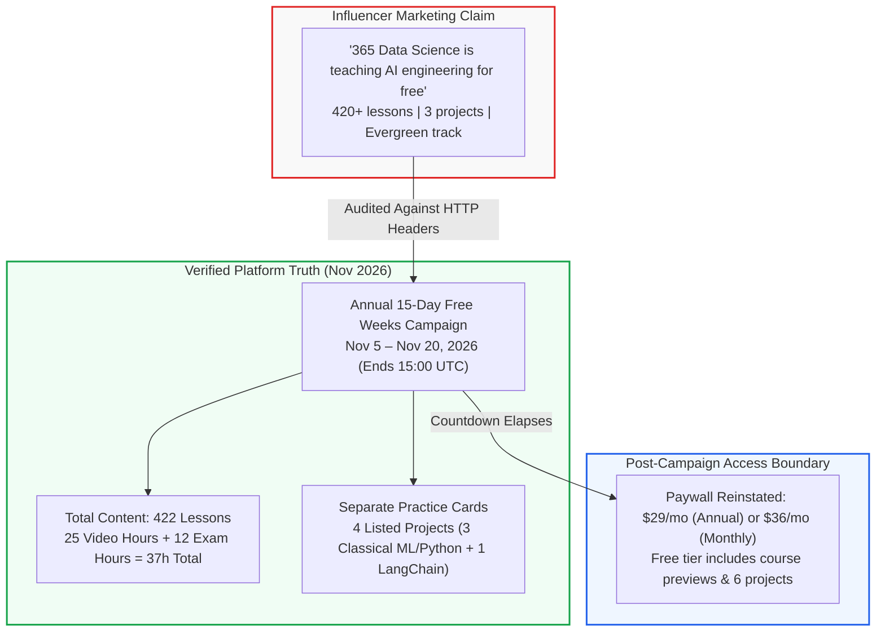
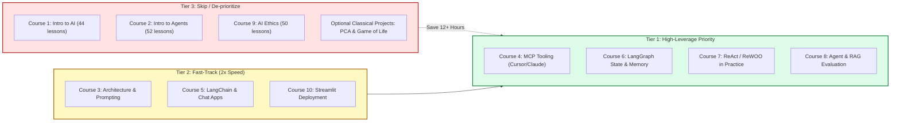

> **Correction Notice (2026-11-08):** Following an evidence-based audit review:
> 1. **Project Requirements vs. Recommendations:** The career-track page separately displays four practice-project cards. They should not be equated with the infographic's three labels. The public certificate statement says to complete the track and pass its final exam; it does not explicitly identify all four carousel cards as prerequisites.
> 2. **Marketing Taxonomy vs. Creator Compensation:** The URL parameter `utm_medium=paid&utm_source=influencer%20` reflects internal marketing campaign attribution tags assigned by the platform, but does not constitute proof of direct financial payment or monetary sponsorship to the creator. The earlier claim of "confirmed commercial sponsorship" has been corrected.
> 3. **Audit Access Scope & Retraction of In-Video Demonstration Assertions:** The audit inspected public DOM elements, syllabus outlines, lesson titles, and pricing structures without streaming proprietary video lectures. Characterizations of video presentation styles and assumptions that specific implementation code or configuration files are demonstrated on screen were unverified assumptions and have been removed.
> 4. **Pricing & Google Authentication:** Standard Free Plan features (which include course previews, 6 projects, practice exams, and 1 AI mock interview at $0/month) have been clarified. "Google" on the signup interface refers strictly to third-party OAuth sign-in and does not indicate Google sponsorship or provision of the courseware.
> 5. **Promotional Labels vs. Public Project Listings:** The infographic names Q&A Chatbot with LangChain, Prompt Chaining & Task Routing, and Crypto Analysis Agent. These labels alone establish neither actual course inclusion nor the author's intent. Separately, Course 6's public curriculum does list “AI Prompt Chaining & Task Routing”; that is evidence of a named entry, not verification of its videos or implementation depth. No blanket claim that public syllabi lack projects is warranted.
> 6. **SQLite Configuration Retraction:** The inspected reference-server CLI documents `--db-path`, not the claimed `--read-only` flag or `SQLITE_TIMEOUT` setting. The server configuration has been removed; the remaining JSON-RPC request is conceptual, not an executed integration.
> 7. **Ragas Score Qualification:** LLM-judge scores are generally non-deterministic, not guaranteed repeatable measurements. Lower temperature can reduce variability but does not guarantee identical scores. The unexecuted API example is replaced with pseudocode.
> 8. **SqliteSaver Verification Retraction:** The interrupted revision's claim of a reproduced Python 3.12 execution is not substantiated by a version-pinned installation and execution record. That claim and the runnable-looking code have been replaced with explicitly unverified pseudocode. Replay can repeat LLM calls after the selected checkpoint; checkpointing is not a blanket no-call guarantee.

## Is 365 Data Science really teaching AI engineering for free?

In early November 2026, a widely shared LinkedIn post by creator Ved Prakash Meena made an eye-catching claim: [365 Data Science](https://365datascience.com/) is teaching AI engineering completely free of charge, packing 420+ lessons, 3 projects, and an end-to-end pathway from foundational basics to agentic AI. The post provided 11 shortened bitly links directing developers to 10 specific courses and a master career track.

<figure class="explanatory-image">
  
  <figcaption>AI-generated illustration by Codex / god-tibo-imagen (not source evidence)</figcaption>
</figure>

For software engineers, ML practitioners, and technical teams looking to upskill in agentic systems, Model Context Protocol (MCP), and LangGraph workflows, free access to structured courseware sounds like an unmissable opportunity. However, social media recommendations frequently blur the line between evergreen educational philanthropy and time-limited promotional marketing.

The linked promotional infographic titled *"365 DataScience AI Agent Engineer"* displays 10 course names, 3 project labels, and a conceptual Plan–Tool–Memory loop. Those are claims visible in a marketing graphic, not direct evidence of lesson execution. We inspected source imagery and reuse terms but did not establish an open redistribution license, so no third-party graphic is rehosted here; the original remains linked below.

Under our publication's editorial policy and copyright standards, proprietary third-party commercial graphics without verified open licenses cannot be copied or rehosted on a monetized publication. We link directly to the [original LinkedIn promotional post](https://www.linkedin.com/posts/ved-prakash-meena_365-data-science-is-teaching-ai-engineering-activity-7524040457639641088-F6z3) and retain our original SVG below. Its study priorities are editorial recommendations; its three project labels report the promotional graphic, not verified course modules or learning outcomes.

To establish the technical ground truth, I audited the primary web surfaces behind the viral post. I traced every HTTP 301 redirect across all 11 shortlinks, inspected landing page DOM structures, analyzed the active campaign countdown timer, verified catalog metadata, and examined the portfolio project repository. Throughout this article, **verified** denotes facts directly established from HTTP headers and platform records, **influencer-reported** denotes claims made solely in the viral social post, and **inferred** represents my own technical evaluation.

The short verdict: the public catalog supports the lesson count claim (422 lessons across 10 courses), while free full access is a **15-day promotional window ending on November 20, 2026**. Three of the four separately displayed practice cards concern classical Python or machine learning; that observation does not classify all in-course assignments. Navigating this offering effectively requires focused study triage.



---

## The promotional reality behind the 420-lesson viral claim

The primary claim in the viral post is that the platform is providing open, free access to its AI engineering curriculum. Following the 11 bitly links exposes the underlying mechanics immediately: every link redirects with HTTP 301 status to a URL stamped with explicit influencer marketing query parameters:

```text
utm_medium=paid&utm_source=influencer%20&utm_campaign=2026-ds-nov-free-weeks-ved-prakash-course-...
```

These query parameters reflect internal campaign attribution tags configured by 365 Data Science's marketing team for its annual **November Free Weeks** promotion. While the parameters categorize the inbound channel under a `paid/influencer` taxonomy, tracking tags alone do not verify direct monetary compensation, speaker fees, or a paid sponsorship contract with the creator, as platforms routinely assign standardized tracking tags to partner, affiliate, or community distribution links.

> **"AI & DATA Courses FREE for 15 days"**  
> `12 Days 02 Hours 41 Minutes Remaining` *(captured 2026-11-08)*  
> *No credit card required. Create your free account.*

The promotional window opened on **November 5, 2026**, and closes on **November 20, 2026, at 15:00 UTC**. During these 15 days, any user who registers with an email address or third-party OAuth identity provider (Google, LinkedIn, or Facebook) receives unrestricted access to all 422 lessons, exercises, exams, and certificates across the 10 courses without entering payment information. (Note that Google serves solely as an authentication identity provider here, not as a course provider or sponsor; the courses are produced and hosted by 365 Data Science).

However, once the timer reaches zero on November 20, full access terminates. Under the platform's standard policy outside promotional windows, accounts on the $0/month Free Plan receive access to all course previews, 6 projects, interactive exercises, practice exams, and 1 AI mock interview. Unlocking the full catalog of 136 courses, 51 projects, 12 career tracks, and accredited certificates thereafter requires enrolling in the Self-Study tier at **$29 per month billed annually ($348 upfront)** or **$36 per month billed monthly**. By omitting the November 20 deadline, the viral social post creates an inaccurate expectation of an evergreen free repository.

---

## What the 422 lessons across ten courses actually cover

The post lists 10 courses comprising the AI Agent Engineer career track. I verified the curriculum tree of each individual course against the published catalog. The courses contain exactly **422 lessons**, **193 interactive exercises**, and provide **39 Continuing Professional Education (CPE) credits**. Across the track, total content spans **37 curriculum hours**, consisting of approximately 25 hours of video instruction and 12 hours of practice exams.

The full breakdown of all 11 audited links is detailed below:

| # | Course Title | Instructor | Verified Lessons | Video / Total Duration | CPE | Level | Key Topics Covered |
|---|---|---|---|---|---|---|---|
| 1 | [Intro to AI](https://bit.ly/4AeQmyb) | Ned Krastev | 44 | 3h / 3h | 4 | Basic | AI history, symbolic vs connectionist AI, ML vs DL taxonomy, industry roles |
| 2 | [Intro to AI Agents and Agentic AI](https://bit.ly/4sCObBK) | Ned Krastev | 52 | 2h / 2h | 3 | Basic | Agent sensors, actuators, reflex vs goal-based agents, business applications |
| 3 | [AI Agent Architecture](https://bit.ly/4jX0NRY) | Ned Krastev | 55 | 2h / 2h | 4 | Interm. | Agentic workflows, prompt structuring, ReAct, Tree of Thought, multi-agent patterns |
| 4 | [MCPs for Everyone](https://bit.ly/3Wkgzg1) | Shoumik Goswami | 30 | 3h / 9h | 4 | Basic | MCP concepts, Claude Desktop scenarios, basic MCP-outline design, Cursor-assisted development |
| 5 | [Build Chat Apps with OpenAI & LangChain](https://bit.ly/4zqGRvx) | Hristina Hristova | 51 | 4h / 7h | 8 | Advanced | LangChain chains, token economics, prompt templates, basic RAG vector stores |
| 6 | [Conversational AI Memory with LangGraph](https://bit.ly/4jXzLtH) | Hristina Hristova | 21 | 1h / 2h | 2 | Advanced | LangGraph StateGraph, conditional edges, SQLite checkpointers, memory persistence |
| 7 | [AI Agents in Practice](https://bit.ly/4jXzMxL) | Petar Petrov | 37 | 2h / 2h | 4 | Advanced | ReAct and ReWOO architectures, tool-calling pipelines, LangSmith tracing |
| 8 | [Evaluating AI Agents](https://bit.ly/3WndJa6) | Burcin Sarac | 36 | 2h / 2h | 2 | Interm. | Precision/recall/F1, RAG retriever/generator evaluation, human feedback, bias/safety, benchmarking |
| 9 | [AI Ethics](https://bit.ly/4AgnSnL) | Ned Krastev & Ivan Manov | 50 | 3h / 4h | 5 | Basic | Algorithmic fairness, privacy governance, transparency, EU AI Act compliance |
| 10 | [LLM Engineering with Streamlit](https://bit.ly/4z3OMhA) | Petar Petrov | 46 | 3h / 4h | 3 | Advanced | Streamlit UI integration, OpenAI chat completions, mock interview application |
| 11 | [AI Agent Engineer Track](https://bit.ly/4iwJeHv) | Platform Ensemble | 422 | 25h / 37h | 39 | Track | Career pathway listing all 10 courses, with a separate recommended-project carousel |

*Table notes: Link targets verify destination URLs. Video hours reflect recorded lectures; total duration includes estimated time for practice exams and coding exercises.*

*(Audit scope disclosure: This technical evaluation is grounded in public syllabus outlines, lesson titles, instructor credentials, and catalog metadata. Proprietary video streams were not viewed or streamed; accordingly, this analysis evaluates topic coverage and structural progression rather than video presentation formats or delivery styles.)*

Analyzing the curriculum reveals a clear divide in technical depth:

1. **Foundational Overviews (Courses 1, 2, and 9):** Comprise 146 lessons (over 34% of the track). Based on published syllabus outlines, these modules focus on introductory concepts, taxonomy (symbolic AI, machine learning vs. deep learning), agent definitions, and European AI governance. For experienced software developers already familiar with ML basics, these introductory overviews cover conceptual ground that may be secondary to hands-on implementation.
2. **Intermediate Architecture (Courses 3, 4, and 8):** Public outlines list prompt structuring, MCP concepts, and evaluation metrics. Course 4 lists Claude Desktop scenarios, MCP-outline design, and Cursor-assisted development, not evidence that our exact configuration was demonstrated. For independent production analysis, see [MCP security depends on transport construction](/posts/mcp-security-depends-on-transport-construction/).
3. **Advanced Implementation Topics (Courses 5, 6, 7, and 10):** Public outlines emphasize LangChain, LangGraph, and Streamlit. Course 6 lists state graphs and SQLite-backed persistence. These listings support a topic-based study priority, not a judgment about unseen coding demonstrations. Compare the separate source analysis in [LangGraph history is not pending approval](/posts/langgraph-history-is-not-pending-approval/).

### Engineering scenarios, not verified course demonstrations

The public syllabi establish topic coverage, not the exact code shown in proprietary lessons. **No lecture videos were viewed.** The following are original conceptual scenarios, not course transcriptions or tested integrations. Neither the Ragas example nor the `SqliteSaver` example below has a version-pinned installation and execution record in this audit; both are therefore presented as pseudocode rather than runnable library recipes.

#### 1. MCP tool calls (Course 4 context)

**Public evidence:** The Course 4 syllabus lists MCP concepts, Claude Desktop scenarios, basic MCP-outline design, and Cursor-assisted development. It does not establish that the course demonstrates the SQLite package, flags, or SQL below.

**Configuration correction:** In the [archived SQLite reference-server source](https://github.com/modelcontextprotocol/servers-archived/blob/52db0d98994dd38e636a470a4c0b3f20781d6c4b/src/sqlite/src/mcp_server_sqlite/__init__.py) (package version 0.6.2), `--db-path` is the only application-specific CLI argument. Neither `--read-only` nor `SQLITE_TIMEOUT` is implemented there. The earlier server configuration is withdrawn, not repaired by guessing replacement flags. This is a source-inspection finding, not an installation or runtime test of this package, every release, or similarly named forks.

The following **conceptual JSON-RPC request** follows the [MCP tools/call message shape](https://modelcontextprotocol.io/specification/2025-06-18/server/tools). It is not a complete session: initialization and tool discovery are omitted. The tool name and arguments must match the chosen server's advertised schema; the `student_progress` table is hypothetical, and no database or server execution was performed.

```json
{
  "jsonrpc": "2.0",
  "method": "tools/call",
  "params": {
    "name": "read_query",
    "arguments": {
      "query": "SELECT cohort_date, count(*) AS active_learners FROM student_progress WHERE course_id = 4 GROUP BY cohort_date ORDER BY cohort_date DESC LIMIT 5;"
    }
  },
  "id": 1
}
```

*Engineering recommendation:* Verify read-only enforcement and execution limits in the actual server/database configuration. A tool called `read_query` is not by itself proof of a read-only database connection. Database permissions, server-side controls, and host sandboxing address different risks; a host request timeout alone does not establish cancellation of a running SQL query. Local `stdio` processes need deliberately restricted permissions rather than assumed protections from undocumented flags.

#### 2. SQLite checkpoint persistence (Course 6 context)

**Public evidence:** Course 6 lists states, nodes, edges, message reducers, checkpointers, thread persistence, and SQLite storage. These public descriptions do not establish a particular `SqliteSaver` API version or the exact implementation in the videos.

**Verification boundary:** The prior claim that the Python 3.12 `SqliteSaver` pattern was reproduced is withdrawn: no pinned installation, execution output, or persisted-state verification is established here. The following is **unexecuted pseudocode**. Its state fields are an illustrative application design, not LangGraph's internal SQLite table schema or a validated Python type definition.

```text
PSEUDOCODE — not an executable SqliteSaver API example
state fields: messages (conversation history), triage_tier (routing label)

ensure the database parent directory exists and is writable
open a SQLite checkpointer using a pinned, separately tested library version
build a graph whose routing node updates the illustrative state
compile the graph with that checkpointer
invoke it with input messages and an application-owned thread identifier
inspect the resulting state and checkpoint metadata
close and reopen the database; verify the saved thread can be recovered
```

**Replay is not LLM-result caching.** [LangGraph's time-travel documentation](https://docs.langchain.com/oss/python/langgraph/use-time-travel) distinguishes saved work before a selected checkpoint from nodes executed after it. Earlier saved results are reused; nodes after the selected checkpoint run again, including LLM calls and other API requests. Replaying a final checkpoint with no next nodes is a no-op. Resuming an interrupted run and replaying an earlier checkpoint are not interchangeable guarantees about API spend.

*Engineering recommendation:* Test recovery and call counts for the actual graph, checkpoint selection, durability mode, and task/caching design. Make external side effects idempotent where needed. Merely attaching `SqliteSaver` does not establish that every replay avoids LLM calls or that every restart must repeat them.

#### 3. RAG and agent evaluation (Course 8 context)

**Public evidence:** Course 8 describes quantitative and qualitative evaluation, RAG metrics, context recall, hallucination, bias, and evaluation drift. That does not establish that a particular Ragas or TruLens version is demonstrated in the videos.

**Score correction:** The inspected [Ragas v0.2.15 faithfulness implementation](https://github.com/vibrantlabsai/ragas/blob/cf49a5c8a2d2bd8bad40a791174058c05b247dee/src/ragas/metrics/_faithfulness.py) invokes an LLM; its numerical aggregation is deterministic only for fixed intermediate judgments. LLM-judge scores are generally non-deterministic: sampling, judge prompts, provider behavior, and model changes can affect results. `temperature=0` may reduce variability; it does **not** guarantee identical judgments. This audit did not install a pinned Ragas release or execute a judge, so it reports no measured scores or variance.

The following **unexecuted pseudocode** is an evaluation plan, not Ragas API syntax or its dataset schema:

```text
PSEUDOCODE — no Ragas API or measured score implied
case = question + retrieved contexts + agent response + optional reference answer
record model identifiers, prompt/metric versions, settings, and fixed input data

rule checks = validate required fields and expected entities in the fixed response
faithfulness judgments = assess whether response claims follow from contexts
response relevance judgments = assess whether the response addresses the question
reference-based checks = compare with a reference answer only when the metric needs one

repeat judge evaluations under recorded conditions to assess observed variability
report rule results separately from judge scores, failures, and uncertainty
choose thresholds and sample sizes using measured behavior and human-reviewed cases
```

*Engineering recommendation:* Pure rule checks can be repeatable for identical inputs, but entity matching alone does not prove factual correctness. Pair them with calibrated judge evaluation and review uncertain cases. No fixed repeat count, zero-temperature setting, or unmeasured confidence interval makes an LLM judge a deterministic CI gate.

---
## Promotional project labels are not verified course modules

The viral post claims that the track includes "3 projects". Forensic examination of the promotional roadmap infographic attached to the viral LinkedIn post provides helpful context for where this number appeared:

Along the visual curriculum path, the promotional infographic displays three milestone labels:

1. **Project 01: Q&A Chatbot with LangChain** (labeled after Course 5: Build Chat Apps)
2. **Project 02: Prompt Chaining & Task Routing** (labeled after Course 6: Conversational Memory)
3. **Project 03: Crypto Analysis Agent** (labeled after Course 7: AI Agents in Practice)

Reading these labels verifies what the graphic says, not whether all three projects are actually included in the indicated courses, delivered in full, or required for completion. Nor does it establish why the post's author used the number three. **Separate public evidence does exist for one entry:** the [Course 6 curriculum](https://365datascience.com/courses/build-conversational-ai-memory-with-langgraph/) lists one project, “AI Prompt Chaining & Task Routing”, under “Course project and exam”. This confirms a named catalog entry, not its implementation details or the other two course-project mappings. This correction did not inspect Course 5/7 project downloads or lecture videos to resolve those mappings; absence from an outline would not prove absence from the lessons either.

In contrast, auditing the public career track landing page at `https://365datascience.com/career-tracks/ai-agent-engineer/` displays four standalone practice projects in a separate carousel:

1. **Machine Learning for User Classification Project** (10 hours estimated)
2. **Music Genre Classification Project with PCA and Logistic Regression** (3 hours estimated)
3. **Building Conway's Game of Life in Python Project** (15 hours estimated)
4. **Create a Q&A Chatbot with LangChain Project** (8 hours estimated)

These are separately displayed practice-project cards, not a one-to-one inventory of the infographic labels. The public certificate statement says “Complete the career track and pass the final exam”; it does not explicitly enumerate these four cards as prerequisites. Their displayed task descriptions support classifying User Classification, PCA Music, and Conway's Game of Life as classical Python/ML practice, but that does not establish the content of every proprietary in-course assignment.

The distinction matters for study planning: a carousel, a promotional project label, and a named course-project entry are different kinds of evidence. The [original LinkedIn post](https://www.linkedin.com/posts/ved-prakash-meena_365-data-science-is-teaching-ai-engineering-activity-7524040457639641088-F6z3) remains linked rather than reproduced; the SVG separates promotional labels from public course topics and proposed independent practice.

---

## Prioritized 15-day triage and open-source alternatives

Attempting to complete 37 hours of video and exercises within the remaining 12 days requires approximately **2.5 to 3 hours of focused study every single day**. For working engineers, brute-forcing the entire 422-lesson playlist is inefficient. 

A high-leverage study strategy prioritizes the modules that are difficult to self-assemble while bypassing generic introductory lectures:

{: .w-100 .shadow .rounded-10 }
_Figure 1. Original vector schematic retained for this article. Course topics come from public outlines; the three project names are promotional infographic labels, not verified course assignments. Triage priorities and proposed practice goals are editorial recommendations, not demonstrated learning outcomes. Videos were not viewed. Authored by akillness as an original SVG on transparency; not proprietary source material._

[Open the original SVG](/assets/img/posts/2026-11-08-365-data-science-ai-agent-curriculum-audit/curriculum-path-and-decision-flow.svg).



### 1. High-Leverage Priority (Complete Before November 20)
- **Course 4 (MCPs for Everyone):** Focus on configuring local MCP servers and connecting external tools to Claude Desktop and Cursor.
- **Course 6 (LangGraph Conversational Memory):** Focus on `StateGraph` compilation, message persistence, and SQLite checkpointing.
- **Course 7 (AI Agents in Practice):** Study the execution difference between ReAct (interleaved reasoning and action) and ReWOO (Reasoning Without Observation, separating planning from execution).
- **Course 8 (Evaluating AI Agents):** Study RAG retrieval metrics and automated evaluation patterns.

### 2. Low-Leverage Modules (Skip or Fast-Forward)
- **Courses 1, 2, and 9:** As introductory conceptual modules, their syllabus topics (history, high-level taxonomy, and regulatory overviews) can be reviewed quickly or bypassed if you already have practical software and ML experience.
- **Optional Classical Portfolio Projects:** Do not spend 15 hours coding Conway's Game of Life if your immediate goal is mastering agentic engineering before the Free Weeks window closes.

### 3. Open-Source Primary Alternatives
If you miss the November 20 cutoff or choose not to register an account, the entire agentic stack taught in this track is accessible via open-source documentation and free resources:

- **Model Context Protocol:** The official [Anthropic MCP Specification](https://modelcontextprotocol.io/) provides complete SDK quickstarts for TypeScript and Python.
- **LangGraph & State Graphs:** The official [LangGraph Documentation](https://langchain-ai.github.io/langgraph/) contains comprehensive tutorials on human-in-the-loop gates, checkpointers, and multi-agent supervisory patterns.
- **Agent Evaluation:** The open-source [Ragas Framework](https://docs.ragas.io/) and [TruLens Documentation](https://www.trulens.org/) provide code-first tutorials on faithfulness, answer relevance, and context recall benchmarks.

---

## Key Takeaways

| Investigation Dimension | Viral Influencer Claim | Verified Primary Truth | Engineering Takeaway |
|---|---|---|---|
| **Pricing & Access** | "Teaching AI engineering for free" | 15-day promotional window (Nov 5–20, 2026); standard Free Plan includes previews & 6 projects; full access reverts to $29/mo (annual) or $36/mo (monthly) | Free access is time-limited; prioritize high-value modules immediately |
| **Registration Gates** | No qualification given | Free account required; no credit card required during window | Safe to test with disposable or OAuth logins without billing risk |
| **Curriculum Volume** | "420+ lessons" | Verified 422 lessons across 10 courses; 37 content hours | Substantial volume, but 34% consists of high-level introductory theory |
| **Portfolio Projects** | "3 projects" | Infographic has 3 labels; Course 6 independently lists “AI Prompt Chaining & Task Routing”; track page separately shows 4 practice cards | Do not infer the other course mappings, implementation depth, certificate prerequisites, or creator intent from graphic placement alone |
| **Sponsorship Status** | Educational resource share | Tracking parameters reflect internal campaign taxonomy (`utm_medium=paid&utm_source=influencer`); does not establish direct creator remuneration | Verify promotional campaign boundaries and expiration dates independently of social curation |

---

## New Questions

1. As commercial learning platforms bundle Model Context Protocol (MCP) into entry-level curriculums, will introductory tool-calling tutorials prepare developers for the security implications of arbitrary tool execution in multi-tenant environments?
2. Why do structured career tracks continue to pair cutting-edge LLM agent coursework with decade-old classical machine learning projects, and how quickly will curricula adapt to demand for autonomous harness testing?
3. With developer education increasingly distributed through sponsored influencer campaigns, what automated verification methods can technical teams establish to separate genuine open-access materials from promotional trial funnels?

---

## References

**Primary Promotional Post & Shortlinks:**
- [Viral LinkedIn Post by Ved Prakash Meena](https://www.linkedin.com/posts/ved-prakash-meena_365-data-science-is-teaching-ai-engineering-activity-7524040457639641088-F6z3) (LinkedIn activity: 7524040457639641088-F6z3, accessed 2026-11-08)
- [LinkedIn Share Link](https://lnkd.in/p/g2XkJzyS)
- [Course 1 Shortlink: Intro to AI](https://bit.ly/4AeQmyb)
- [Course 2 Shortlink: Intro to AI Agents](https://bit.ly/4sCObBK)
- [Course 3 Shortlink: AI Agent Architecture](https://bit.ly/4jX0NRY)
- [Course 4 Shortlink: MCPs for Everyone](https://bit.ly/3Wkgzg1)
- [Course 5 Shortlink: Chat Apps & RAG](https://bit.ly/4zqGRvx)
- [Course 6 Shortlink: Conversational Memory](https://bit.ly/4jXzLtH)
- [Course 7 Shortlink: AI Agents in Practice](https://bit.ly/4jXzMxL)
- [Course 8 Shortlink: Evaluating AI Agents](https://bit.ly/3WndJa6)
- [Course 9 Shortlink: AI Ethics](https://bit.ly/4AgnSnL)
- [Course 10 Shortlink: LLM Engineering](https://bit.ly/4z3OMhA)
- [Track Shortlink: Full Career Track](https://bit.ly/4iwJeHv)

**365 Data Science Primary Documentation:**
- [365 Data Science AI Agent Engineer Career Track](https://365datascience.com/career-tracks/ai-agent-engineer/) (accessed 2026-11-08)
- [365 Data Science Pricing & Plans](https://365datascience.com/pricing/) (accessed 2026-11-08)
- [365 Data Science Campaign Signup Portal](https://365datascience.com/signup/) (accessed 2026-11-08)
- [Course 1: Intro to AI](https://365datascience.com/courses/intro-to-ai/)
- [Course 2: Intro to AI Agents and Agentic AI](https://365datascience.com/courses/intro-to-ai-agents-and-agentic-ai/)
- [Course 3: AI Agent Architecture](https://365datascience.com/courses/ai-agent-architecture/)
- [Course 4: MCPs for Everyone](https://365datascience.com/courses/mcps-for-everyone-supercharge-your-ai-tooling-skills/)
- [Course 5: Build Chat Applications with OpenAI and LangChain](https://365datascience.com/courses/build-chat-applications-with-openai-and-langchain/)
- [Course 6: Build Conversational AI Memory with LangGraph](https://365datascience.com/courses/build-conversational-ai-memory-with-langgraph/)
- [Course 7: AI Agents in Practice](https://365datascience.com/courses/ai-agents-in-practice/)
- [Course 8: Evaluating AI Agents: From Metrics to Real-World Impact](https://365datascience.com/courses/evaluating-ai-agents-from-metrics-to-real-world-impact/)
- [Course 9: AI Ethics](https://365datascience.com/courses/ai-ethics/)
- [Course 10: LLM Engineering in Practice with Streamlit and OpenAI](https://365datascience.com/courses/llm-engineering-in-practice-with-streamlit-and-openai/)

**Open-Source Standards & Specifications:**
- [Model Context Protocol Specification](https://modelcontextprotocol.io/) (Anthropic, open standard documentation)
- [LangGraph StateGraph & Persistence Documentation](https://langchain-ai.github.io/langgraph/) (LangChain AI documentation)
- [Ragas: Automated Evaluation for RAG Systems](https://docs.ragas.io/) (Exploding Gradients open-source framework)
- [Archived SQLite CLI source, package 0.6.2](https://github.com/modelcontextprotocol/servers-archived/blob/52db0d98994dd38e636a470a4c0b3f20781d6c4b/src/sqlite/src/mcp_server_sqlite/__init__.py) and [server tool/connection implementation](https://github.com/modelcontextprotocol/servers-archived/blob/52db0d98994dd38e636a470a4c0b3f20781d6c4b/src/sqlite/src/mcp_server_sqlite/server.py) (commit `52db0d9`; source-inspected, not executed; accessed 2026-11-08)
- [MCP tools/call specification, 2025-06-18](https://modelcontextprotocol.io/specification/2025-06-18/server/tools) (message shape only; accessed 2026-11-08)
- [LangGraph 0.2.76 persistence and replay](https://github.com/langchain-ai/langgraph/blob/2e36189c165c1100d65dce52d3c43e084fc27a9f/docs/docs/concepts/persistence.md) and [current time-travel documentation](https://docs.langchain.com/oss/python/langgraph/use-time-travel) (documentation reviewed, not runtime-tested; accessed 2026-11-08)
- [Ragas v0.2.15 faithfulness](https://github.com/vibrantlabsai/ragas/blob/cf49a5c8a2d2bd8bad40a791174058c05b247dee/src/ragas/metrics/_faithfulness.py) and [response relevancy](https://github.com/vibrantlabsai/ragas/blob/cf49a5c8a2d2bd8bad40a791174058c05b247dee/src/ragas/metrics/_answer_relevance.py) (source-inspected only; no package installation, judge call, or score measurement; accessed 2026-11-08)
- [OpenAI reproducible-output example](https://developers.openai.com/cookbook/examples/reproducible_outputs_with_the_seed_parameter) (provider-specific reproducibility limits, not a guarantee for every backend; accessed 2026-11-08)

**Legal & Terms Documentation:**
- [365 Data Science Terms of Use](https://365datascience.com/terms-of-use/) (Section XII: Copyrights and Other Rights of Intellectual Property, accessed 2026-11-08)
- [LinkedIn User Agreement](https://www.linkedin.com/legal/user-agreement) (Sections 3.1 & 8.2: Content Ownership, Permitted Display License, and Prohibition of Unauthorized Commercial Scraping/Redistribution, accessed 2026-11-08)
- [LinkedIn Promotional Infographic by Ved Prakash Meena](https://media.licdn.com/dms/image/v2/D5622AQGNTflF79yrLQ/feedshare-shrink_1280/B56aGrC7WEG0AI-/0/1793871034006?e=2147483647&v=beta&t=w_-bRp2eOBx7n94nhlvwECbdEoeKfxxQ1W7T0khKIl0) (project labels visually inspected; not lecture or execution evidence; accessed 2026-11-08)
