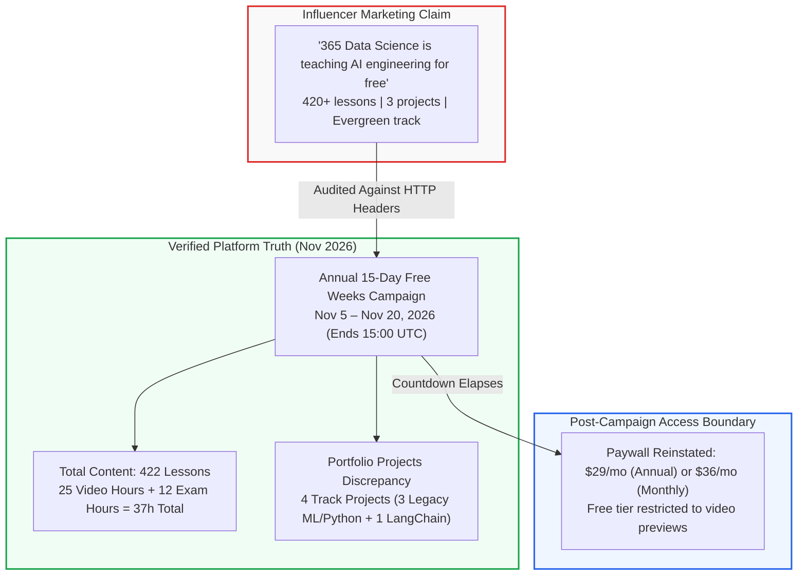
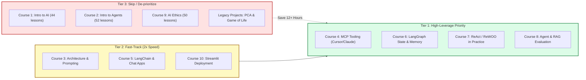

## Is 365 Data Science really teaching AI engineering for free?

In early November 2026, a widely shared LinkedIn post by creator Ved Prakash Meena made an eye-catching claim: [365 Data Science](https://365datascience.com/) is teaching AI engineering completely free of charge, packing 420+ lessons, 3 projects, and an end-to-end pathway from foundational basics to agentic AI. The post provided 11 shortened bitly links directing developers to 10 specific courses and a master career track.

<figure class="explanatory-image">
  
  <figcaption>AI-generated illustration by Codex / god-tibo-imagen (not source evidence)</figcaption>
</figure>

For software engineers, ML practitioners, and technical teams looking to upskill in agentic systems, Model Context Protocol (MCP), and LangGraph workflows, free access to structured courseware sounds like an unmissable opportunity. However, social media recommendations frequently blur the line between evergreen educational philanthropy and time-limited promotional marketing.

To establish the technical ground truth, I audited the primary web surfaces behind the viral post. I traced every HTTP 301 redirect across all 11 shortlinks, inspected landing page DOM structures, analyzed the active campaign countdown timer, verified catalog metadata, and examined the portfolio project repository. Throughout this article, **verified** denotes facts directly established from HTTP headers and platform records, **influencer-reported** denotes claims made solely in the viral social post, and **inferred** represents my own technical evaluation.

The short verdict: the lesson count claim holds up (422 actual lessons across 10 courses), but the access is strictly a **15-day promotional window ending on November 20, 2026**. Furthermore, the portfolio projects are largely classical Python exercises rather than agentic AI applications. Navigating this offering effectively requires aggressive triage.



---

## The promotional reality behind the 420-lesson viral claim

The primary claim in the viral post is that the platform is providing open, free access to its AI engineering curriculum. Following the 11 bitly links exposes the underlying mechanics immediately: every link redirects with HTTP 301 status to a URL stamped with explicit influencer marketing query parameters:

```text
utm_medium=paid&utm_source=influencer%20&utm_campaign=2026-ds-nov-free-weeks-ved-prakash-course-...
```

These parameters verify that the post is part of 365 Data Science's annual **November Free Weeks** promotion. Navigating to the registration portal at `https://365datascience.com/signup/` reveals an active countdown timer reading:

> **"AI & DATA Courses FREE for 15 days"**  
> `12 Days 02 Hours 41 Minutes Remaining` *(captured 2026-11-08)*  
> *No credit card required. Create your free account.*

The promotional window opened on **November 5, 2026**, and closes on **November 20, 2026, at 15:00 UTC**. During these 15 days, any user who registers with an email address or OAuth provider (Google, LinkedIn, or Facebook) receives unrestricted access to all 422 lessons, exercises, exams, and certificates across the 10 courses without entering payment information.

However, once the timer reaches zero on November 20, full access terminates. Under the platform's standard policy, accounts on the $0/month Free Plan are downgraded to "course previews" and limited exercises. Unlocking the courses thereafter requires enrolling in the Self-Study tier at **$29 per month billed annually ($348 upfront)** or **$36 per month billed monthly**. By omitting the November 20 deadline, the viral social post creates an inaccurate expectation of an evergreen free repository.

---

## What the 422 lessons across ten courses actually cover

The post lists 10 courses comprising the AI Agent Engineer career track. I verified the curriculum tree of each individual course against the published catalog. The courses contain exactly **422 lessons**, **193 interactive exercises**, and provide **39 Continuing Professional Education (CPE) credits**. Across the track, total content spans **37 curriculum hours**, consisting of approximately 25 hours of video instruction and 12 hours of practice exams.

The full breakdown of all 11 audited links is detailed below:

| # | Course Title | Instructor | Verified Lessons | Video / Total Duration | CPE | Level | Key Topics Covered |
|---|---|---|---|---|---|---|---|
| 1 | [Intro to AI](https://bit.ly/4AeQmyb) | Ned Krastev | 44 | 3h / 3h | 4 | Basic | AI history, symbolic vs connectionist AI, ML vs DL taxonomy, industry roles |
| 2 | [Intro to AI Agents and Agentic AI](https://bit.ly/4sCObBK) | Ned Krastev | 52 | 2h / 2h | 3 | Basic | Agent sensors, actuators, reflex vs goal-based agents, business applications |
| 3 | [AI Agent Architecture](https://bit.ly/4jX0NRY) | Ned Krastev | 55 | 2h / 2h | 4 | Interm. | Agentic workflows, prompt structuring, ReAct, Tree of Thought, multi-agent patterns |
| 4 | [MCPs for Everyone](https://bit.ly/3Wkgzg1) | Shoumik Goswami | 30 | 3h / 9h | 4 | Basic | Model Context Protocol basics, Claude Desktop configuration, Cursor tooling setup |
| 5 | [Build Chat Apps with OpenAI & LangChain](https://bit.ly/4zqGRvx) | Hristina Hristova | 51 | 4h / 7h | 8 | Advanced | LangChain chains, token economics, prompt templates, basic RAG vector stores |
| 6 | [Conversational AI Memory with LangGraph](https://bit.ly/4jXzLtH) | Hristina Hristova | 21 | 1h / 2h | 2 | Advanced | LangGraph StateGraph, conditional edges, SQLite checkpointers, memory persistence |
| 7 | [AI Agents in Practice](https://bit.ly/4jXzMxL) | Petar Petrov | 37 | 2h / 2h | 4 | Advanced | ReAct and ReWOO architectures, tool-calling pipelines, LangSmith tracing |
| 8 | [Evaluating AI Agents](https://bit.ly/3WndJa6) | Burcin Sarac | 36 | 2h / 2h | 2 | Interm. | RAG retrieval evaluation, answer relevance, latency, bias metrics, benchmark design |
| 9 | [AI Ethics](https://bit.ly/4AgnSnL) | Ned Krastev & Ivan Manov | 50 | 3h / 4h | 5 | Basic | Algorithmic fairness, privacy governance, transparency, EU AI Act compliance |
| 10 | [LLM Engineering with Streamlit](https://bit.ly/4z3OMhA) | Petar Petrov | 46 | 3h / 4h | 3 | Advanced | Streamlit UI integration, OpenAI chat completions, mock interview application |
| 11 | [AI Agent Engineer Track](https://bit.ly/4iwJeHv) | Platform Ensemble | 422 | 25h / 37h | 39 | Track | Integrated career pathway encompassing all 10 courses and capstone projects |

*Table notes: Link targets verify destination URLs. Video hours reflect recorded lectures; total duration includes estimated time for practice exams and coding exercises.*

Analyzing the curriculum reveals a clear divide in technical depth:

1. **Foundational Overviews (Courses 1, 2, and 9):** Comprise 146 lessons (over 34% of the track). These are high-level conceptual slide presentations on AI definitions and European AI regulations. For practicing software developers, they offer limited hands-on value.
2. **Intermediate Architecture (Courses 3, 4, and 8):** Cover essential concepts like prompt formatting, tool calling, and evaluation metrics. In particular, Course 4 by Shoumik Goswami addresses practical setup of the Model Context Protocol using Claude Desktop and Cursor. To understand how tool transport layers function under real production constraints, compare this with our technical analysis in [MCP security depends on transport construction](/posts/mcp-security-depends-on-transport-construction/).
3. **Advanced Implementation (Courses 5, 6, 7, and 10):** Contain the core coding content, focusing on LangChain, LangGraph, and Streamlit. Course 6 specifically covers state graphs and SQLite-backed persistence. Understanding how LangGraph manages checkpoints and state graphs is critical for production reliability, a concept explored in depth in [LangGraph history is not pending approval](/posts/langgraph-history-is-not-pending-approval/).

---

## The portfolio project disconnect: three classical exercises and one chatbot

The viral post claims that the track includes "3 projects". However, auditing the official career track portal at `https://365datascience.com/career-tracks/ai-agent-engineer/` reveals four linked portfolio projects:

1. **Machine Learning for User Classification Project** (10 hours estimated)
2. **Music Genre Classification Project with PCA and Logistic Regression** (3 hours estimated)
3. **Building Conway's Game of Life in Python Project** (15 hours estimated)
4. **Create a Q&A Chatbot with LangChain Project** (8 hours estimated)

Here lies the most glaring technical contradiction of the curriculum: **three out of the four portfolio projects have virtually nothing to do with agentic AI or LLM engineering**.

- Building Conway's Game of Life is a classic Python object-oriented programming and grid-simulation exercise. While instructive for fundamental programming logic, it teaches zero agent orchestration, zero tool calling, and zero model integration.
- Music Genre Classification with Principal Component Analysis (PCA) and Logistic Regression is a traditional tabular and audio signal feature-classification task originating from the mid-2010s machine learning canon.
- User Classification is a standard scikit-learn classification pipeline.

Only the fourth project—**Create a Q&A Chatbot with LangChain**—engages with modern generative AI by wiring vector embeddings, document chunking, and LLM prompt templates. The discrepancy between the social post's "3 projects" claim and the platform's actual portfolio suggests that the post author either counted in-course practical modules (such as Course 7's ReAct script or Course 10's Streamlit mock interview app) or failed to scrutinize the legacy nature of the portfolio projects attached to the career track.

---

## Prioritized 15-day triage and open-source alternatives

Attempting to complete 37 hours of video and exercises within the remaining 12 days requires approximately **2.5 to 3 hours of focused study every single day**. For working engineers, brute-forcing the entire 422-lesson playlist is inefficient. 

A high-leverage study strategy prioritizes the modules that are difficult to self-assemble while bypassing generic introductory lectures:



### 1. High-Leverage Priority (Complete Before November 20)
- **Course 4 (MCPs for Everyone):** Focus on configuring local MCP servers and connecting external tools to Claude Desktop and Cursor.
- **Course 6 (LangGraph Conversational Memory):** Focus on `StateGraph` compilation, message persistence, and SQLite checkpointing.
- **Course 7 (AI Agents in Practice):** Study the execution difference between ReAct (interleaved reasoning and action) and ReWOO (Reasoning Without Observation, separating planning from execution).
- **Course 8 (Evaluating AI Agents):** Study RAG retrieval metrics and automated evaluation patterns.

### 2. Low-Leverage Modules (Skip or Fast-Forward)
- **Courses 1, 2, and 9:** These slide-heavy overviews can be replaced by 30 minutes of reading official documentation or regulatory summaries.
- **Legacy Portfolio Projects:** Do not spend 15 hours coding Conway's Game of Life if your goal is mastering agentic engineering.

### 3. Open-Source Primary Alternatives
If you miss the November 20 cutoff or choose not to register an account, the entire agentic stack taught in this track is accessible via open-source documentation and free resources:

- **Model Context Protocol:** The official [Anthropic MCP Specification](https://modelcontextprotocol.io/) provides complete SDK quickstarts for TypeScript and Python.
- **LangGraph & State Graphs:** The official [LangGraph Documentation](https://langchain-ai.github.io/langgraph/) contains comprehensive tutorials on human-in-the-loop gates, checkpointers, and multi-agent supervisory patterns.
- **Agent Evaluation:** The open-source [Ragas Framework](https://docs.ragas.io/) and [TruLens Documentation](https://www.trulens.org/) provide code-first tutorials on faithfulness, answer relevance, and context recall benchmarks.

---

## Key Takeaways

| Investigation Dimension | Viral Influencer Claim | Verified Primary Truth | Engineering Takeaway |
|---|---|---|---|
| **Pricing & Access** | "Teaching AI engineering for free" | 15-day promotional window (Nov 5–20, 2026); reverts to $29/mo | Free access is time-limited; prioritize high-value modules immediately |
| **Registration Gates** | No qualification given | Free account required; no credit card required during window | Safe to test with disposable or OAuth logins without billing risk |
| **Curriculum Volume** | "420+ lessons" | Verified 422 lessons across 10 courses; 37 content hours | Substantial volume, but 34% consists of high-level introductory theory |
| **Portfolio Projects** | "3 projects" | 4 portfolio tracks listed; 3 are legacy classical ML/Python | Skip Game of Life and PCA; focus on LangChain/LangGraph applications |
| **Sponsorship Status** | Educational resource share | Paid influencer marketing (`utm_medium=paid&utm_source=influencer`) | Treat viral social curation as commercial campaign distribution |

---

## New Questions

1. As commercial learning platforms bundle Model Context Protocol (MCP) into entry-level curriculums, will introductory tool-calling tutorials prepare developers for the security implications of arbitrary tool execution in multi-tenant environments?
2. Why do structured career tracks continue to pair cutting-edge LLM agent coursework with decade-old classical machine learning projects, and how quickly will curricula adapt to demand for autonomous harness testing?
3. With developer education increasingly distributed through sponsored influencer campaigns, what automated verification methods can technical teams establish to separate genuine open-access materials from promotional trial funnels?

---

## References

**Primary Promotional Post & Shortlinks:**
- [Viral LinkedIn Post by Ved Prakash Meena](https://www.linkedin.com/posts/ved-prakash-meena_365-data-science-is-teaching-ai-engineering-activity-7524040457639641088-F6z3) (LinkedIn activity: 7524040457639641088-F6z3, accessed 2026-11-08)
- [LinkedIn Share Link](https://lnkd.in/p/g2XkJzyS)
- [Course 1 Shortlink: Intro to AI](https://bit.ly/4AeQmyb)
- [Course 2 Shortlink: Intro to AI Agents](https://bit.ly/4sCObBK)
- [Course 3 Shortlink: AI Agent Architecture](https://bit.ly/4jX0NRY)
- [Course 4 Shortlink: MCPs for Everyone](https://bit.ly/3Wkgzg1)
- [Course 5 Shortlink: Chat Apps & RAG](https://bit.ly/4zqGRvx)
- [Course 6 Shortlink: Conversational Memory](https://bit.ly/4jXzLtH)
- [Course 7 Shortlink: AI Agents in Practice](https://bit.ly/4jXzMxL)
- [Course 8 Shortlink: Evaluating AI Agents](https://bit.ly/3WndJa6)
- [Course 9 Shortlink: AI Ethics](https://bit.ly/4AgnSnL)
- [Course 10 Shortlink: LLM Engineering](https://bit.ly/4z3OMhA)
- [Track Shortlink: Full Career Track](https://bit.ly/4iwJeHv)

**365 Data Science Primary Documentation:**
- [365 Data Science AI Agent Engineer Career Track](https://365datascience.com/career-tracks/ai-agent-engineer/) (accessed 2026-11-08)
- [365 Data Science Pricing & Plans](https://365datascience.com/pricing/) (accessed 2026-11-08)
- [365 Data Science Campaign Signup Portal](https://365datascience.com/signup/) (accessed 2026-11-08)
- [Course 1: Intro to AI](https://365datascience.com/courses/intro-to-ai/)
- [Course 2: Intro to AI Agents and Agentic AI](https://365datascience.com/courses/intro-to-ai-agents-and-agentic-ai/)
- [Course 3: AI Agent Architecture](https://365datascience.com/courses/ai-agent-architecture/)
- [Course 4: MCPs for Everyone](https://365datascience.com/courses/mcps-for-everyone-supercharge-your-ai-tooling-skills/)
- [Course 5: Build Chat Applications with OpenAI and LangChain](https://365datascience.com/courses/build-chat-applications-with-openai-and-langchain/)
- [Course 6: Build Conversational AI Memory with LangGraph](https://365datascience.com/courses/build-conversational-ai-memory-with-langgraph/)
- [Course 7: AI Agents in Practice](https://365datascience.com/courses/ai-agents-in-practice/)
- [Course 8: Evaluating AI Agents: From Metrics to Real-World Impact](https://365datascience.com/courses/evaluating-ai-agents-from-metrics-to-real-world-impact/)
- [Course 9: AI Ethics](https://365datascience.com/courses/ai-ethics/)
- [Course 10: LLM Engineering in Practice with Streamlit and OpenAI](https://365datascience.com/courses/llm-engineering-in-practice-with-streamlit-and-openai/)

**Open-Source Standards & Specifications:**
- [Model Context Protocol Specification](https://modelcontextprotocol.io/) (Anthropic, open standard documentation)
- [LangGraph StateGraph & Persistence Documentation](https://langchain-ai.github.io/langgraph/) (LangChain AI documentation)
- [Ragas: Automated Evaluation for RAG Systems](https://docs.ragas.io/) (Exploding Gradients open-source framework)
