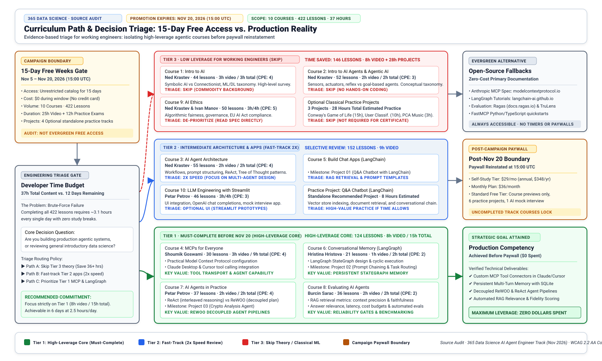
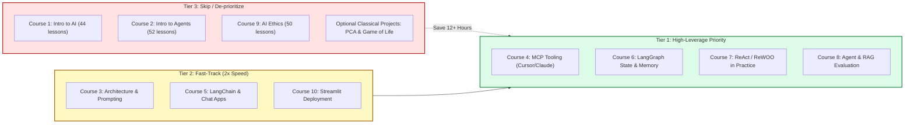

> **Correction (2026-11-08):** Following an evidence-based audit review:
> 1. **Project Requirements vs. Recommendations:** The 4 projects showcased on the career track landing page are recommended practice projects in a standalone carousel, not mandatory requirements to earn the accredited Career Track Certificate (which requires completing the 10 curriculum courses and passing the final exam). The viral post's claim of "3 projects" likely refers to in-course practical project applications.
> 2. **Marketing Taxonomy vs. Creator Compensation:** The URL parameter `utm_medium=paid&utm_source=influencer%20` reflects internal marketing campaign attribution tags assigned by the platform, but does not constitute proof of direct financial payment or monetary sponsorship to the creator. The earlier claim of "confirmed commercial sponsorship" has been corrected.
> 3. **Audit Access Scope & Retraction of Format Assertions:** The audit inspected public DOM elements, syllabus outlines, lesson titles, and pricing structures without streaming proprietary video lectures. Characterizations of video presentation styles (such as "slide presentations" or "slide-heavy overviews") were unverified assumptions and have been removed.
> 4. **Pricing & Google Authentication:** Standard Free Plan features (which include course previews, 6 projects, practice exams, and 1 AI mock interview at $0/month) have been clarified. "Google" on the signup interface refers strictly to third-party OAuth sign-in and does not indicate Google sponsorship or provision of the courseware.
> 5. **Viral Infographic & In-Course Milestone Projects:** Direct forensic inspection of the marketing graphic attached to the viral LinkedIn post confirms that the influencer's claim of '3 projects' originates from three in-course practical project milestones (Project 01: Q&A Chatbot with LangChain, Project 02: Prompt Chaining & Task Routing, and Project 03: Crypto Analysis Agent) embedded within Courses 5, 6, and 7, rather than the four standalone recommended practice projects showcased on the career track landing page carousel.

## Is 365 Data Science really teaching AI engineering for free?

In early November 2026, a widely shared LinkedIn post by creator Ved Prakash Meena made an eye-catching claim: [365 Data Science](https://365datascience.com/) is teaching AI engineering completely free of charge, packing 420+ lessons, 3 projects, and an end-to-end pathway from foundational basics to agentic AI. The post provided 11 shortened bitly links directing developers to 10 specific courses and a master career track.

<figure class="explanatory-image">
  
  <figcaption>AI-generated illustration by Codex / god-tibo-imagen (not source evidence)</figcaption>
</figure>

For software engineers, ML practitioners, and technical teams looking to upskill in agentic systems, Model Context Protocol (MCP), and LangGraph workflows, free access to structured courseware sounds like an unmissable opportunity. However, social media recommendations frequently blur the line between evergreen educational philanthropy and time-limited promotional marketing.

Forensic inspection of the viral LinkedIn post reveals an attached 1080×1351 promotional infographic titled *"365 DataScience AI Agent Engineer"*, summarizing the 10 courses, 3 milestone projects, and a conceptual Plan–Tool–Memory loop. We audited both this image and the platform's visual assets for potential reproduction. Under Section XII (Items 1, 2, 4, 13, 14, 15, 18, and 19) of the [365 Data Science Terms of Use](https://365datascience.com/terms-of-use/), all visual elements, course diagrams, brand marks, and layout graphics are proprietary intellectual property with all rights reserved; reproduction, public display, downloading, or commercial redistribution without prior written consent is strictly prohibited. Furthermore, Sections 3.1 and 8.2 of the [LinkedIn User Agreement](https://www.linkedin.com/legal/user-agreement) reserve content rights to creators and forbid third-party commercial redistribution or scraping. Neither 365 Data Science nor the post creator provides a Creative Commons, open-source, or public-domain redistribution license.

Under our publication's editorial policy and copyright standards, proprietary third-party commercial graphics without verified open licenses cannot be copied or rehosted on a monetized publication. To maintain strict copyright integrity while ensuring readers have full visual and technical clarity, we link directly to the [original LinkedIn promotional post](https://www.linkedin.com/posts/ved-prakash-meena_365-data-science-is-teaching-ai-engineering-activity-7524040457639641088-F6z3) and provide our own original, transparent vector (SVG) diagram below, illustrating the complete curriculum architecture, project milestones, and time-triage decision flow.

To establish the technical ground truth, I audited the primary web surfaces behind the viral post. I traced every HTTP 301 redirect across all 11 shortlinks, inspected landing page DOM structures, analyzed the active campaign countdown timer, verified catalog metadata, and examined the portfolio project repository. Throughout this article, **verified** denotes facts directly established from HTTP headers and platform records, **influencer-reported** denotes claims made solely in the viral social post, and **inferred** represents my own technical evaluation.

The short verdict: the lesson count claim holds up (422 actual lessons across 10 courses), but the access is strictly a **15-day promotional window ending on November 20, 2026**. Furthermore, the portfolio projects are largely classical Python exercises rather than agentic AI applications. Navigating this offering effectively requires aggressive triage.


---

## The promotional reality behind the 420-lesson viral claim

The primary claim in the viral post is that the platform is providing open, free access to its AI engineering curriculum. Following the 11 bitly links exposes the underlying mechanics immediately: every link redirects with HTTP 301 status to a URL stamped with explicit influencer marketing query parameters:

```text
utm_medium=paid&utm_source=influencer%20&utm_campaign=2026-ds-nov-free-weeks-ved-prakash-course-...
```

These query parameters reflect internal campaign attribution tags configured by 365 Data Science's marketing team for its annual **November Free Weeks** promotion. While the parameters categorize the inbound channel under a `paid/influencer` taxonomy, tracking tags alone do not verify direct monetary compensation, speaker fees, or a paid sponsorship contract with the creator, as platforms routinely assign standardized tracking tags to partner, affiliate, or community distribution links.

> **"AI & DATA Courses FREE for 15 days"**  
> `12 Days 02 Hours 41 Minutes Remaining` *(captured 2026-11-08)*  
> *No credit card required. Create your free account.*

The promotional window opened on **November 5, 2026**, and closes on **November 20, 2026, at 15:00 UTC**. During these 15 days, any user who registers with an email address or third-party OAuth identity provider (Google, LinkedIn, or Facebook) receives unrestricted access to all 422 lessons, exercises, exams, and certificates across the 10 courses without entering payment information. (Note that Google serves solely as an authentication identity provider here, not as a course provider or sponsor; the courses are produced and hosted by 365 Data Science).

However, once the timer reaches zero on November 20, full access terminates. Under the platform's standard policy outside promotional windows, accounts on the $0/month Free Plan receive access to all course previews, 6 projects, interactive exercises, practice exams, and 1 AI mock interview. Unlocking the full catalog of 136 courses, 51 projects, 12 career tracks, and accredited certificates thereafter requires enrolling in the Self-Study tier at **$29 per month billed annually ($348 upfront)** or **$36 per month billed monthly**. By omitting the November 20 deadline, the viral social post creates an inaccurate expectation of an evergreen free repository.

---

## What the 422 lessons across ten courses actually cover

The post lists 10 courses comprising the AI Agent Engineer career track. I verified the curriculum tree of each individual course against the published catalog. The courses contain exactly **422 lessons**, **193 interactive exercises**, and provide **39 Continuing Professional Education (CPE) credits**. Across the track, total content spans **37 curriculum hours**, consisting of approximately 25 hours of video instruction and 12 hours of practice exams.

The full breakdown of all 11 audited links is detailed below:

| # | Course Title | Instructor | Verified Lessons | Video / Total Duration | CPE | Level | Key Topics Covered |
|---|---|---|---|---|---|---|---|
| 1 | [Intro to AI](https://bit.ly/4AeQmyb) | Ned Krastev | 44 | 3h / 3h | 4 | Basic | AI history, symbolic vs connectionist AI, ML vs DL taxonomy, industry roles |
| 2 | [Intro to AI Agents and Agentic AI](https://bit.ly/4sCObBK) | Ned Krastev | 52 | 2h / 2h | 3 | Basic | Agent sensors, actuators, reflex vs goal-based agents, business applications |
| 3 | [AI Agent Architecture](https://bit.ly/4jX0NRY) | Ned Krastev | 55 | 2h / 2h | 4 | Interm. | Agentic workflows, prompt structuring, ReAct, Tree of Thought, multi-agent patterns |
| 4 | [MCPs for Everyone](https://bit.ly/3Wkgzg1) | Shoumik Goswami | 30 | 3h / 9h | 4 | Basic | Model Context Protocol basics, Claude Desktop configuration, Cursor tooling setup |
| 5 | [Build Chat Apps with OpenAI & LangChain](https://bit.ly/4zqGRvx) | Hristina Hristova | 51 | 4h / 7h | 8 | Advanced | LangChain chains, token economics, prompt templates, basic RAG vector stores |
| 6 | [Conversational AI Memory with LangGraph](https://bit.ly/4jXzLtH) | Hristina Hristova | 21 | 1h / 2h | 2 | Advanced | LangGraph StateGraph, conditional edges, SQLite checkpointers, memory persistence |
| 7 | [AI Agents in Practice](https://bit.ly/4jXzMxL) | Petar Petrov | 37 | 2h / 2h | 4 | Advanced | ReAct and ReWOO architectures, tool-calling pipelines, LangSmith tracing |
| 8 | [Evaluating AI Agents](https://bit.ly/3WndJa6) | Burcin Sarac | 36 | 2h / 2h | 2 | Interm. | RAG retrieval evaluation, answer relevance, latency, bias metrics, benchmark design |
| 9 | [AI Ethics](https://bit.ly/4AgnSnL) | Ned Krastev & Ivan Manov | 50 | 3h / 4h | 5 | Basic | Algorithmic fairness, privacy governance, transparency, EU AI Act compliance |
| 10 | [LLM Engineering with Streamlit](https://bit.ly/4z3OMhA) | Petar Petrov | 46 | 3h / 4h | 3 | Advanced | Streamlit UI integration, OpenAI chat completions, mock interview application |
| 11 | [AI Agent Engineer Track](https://bit.ly/4iwJeHv) | Platform Ensemble | 422 | 25h / 37h | 39 | Track | Integrated career pathway encompassing all 10 courses and capstone projects |

*Table notes: Link targets verify destination URLs. Video hours reflect recorded lectures; total duration includes estimated time for practice exams and coding exercises.*

*(Audit scope disclosure: This technical evaluation is grounded in public syllabus outlines, lesson titles, instructor credentials, and catalog metadata. Proprietary video streams were not viewed or streamed; accordingly, this analysis evaluates topic coverage and structural progression rather than video presentation formats or delivery styles.)*

Analyzing the curriculum reveals a clear divide in technical depth:

1. **Foundational Overviews (Courses 1, 2, and 9):** Comprise 146 lessons (over 34% of the track). Based on published syllabus outlines, these modules focus on introductory concepts, taxonomy (symbolic AI, machine learning vs. deep learning), agent definitions, and European AI governance. For experienced software developers already familiar with ML basics, these introductory overviews cover conceptual ground that may be secondary to hands-on implementation.
2. **Intermediate Architecture (Courses 3, 4, and 8):** Cover essential concepts like prompt formatting, tool calling, and evaluation metrics. In particular, Course 4 by Shoumik Goswami addresses practical setup of the Model Context Protocol using Claude Desktop and Cursor. To understand how tool transport layers function under real production constraints, compare this with our technical analysis in [MCP security depends on transport construction](/posts/mcp-security-depends-on-transport-construction/).
3. **Advanced Implementation (Courses 5, 6, 7, and 10):** Contain the core coding content, focusing on LangChain, LangGraph, and Streamlit. Course 6 specifically covers state graphs and SQLite-backed persistence. Understanding how LangGraph manages checkpoints and state graphs is critical for production reliability, a concept explored in depth in [LangGraph history is not pending approval](/posts/langgraph-history-is-not-pending-approval/).

### Concrete implementation scenarios: primary evidence vs. production realities

To bridge the gap between high-level syllabus outlines and hands-on software engineering, we examine three core architectural components taught in the track. For each scenario, we explicitly distinguish between **primary evidence** (topics and tools published in the official 365 Data Science syllabus) and **observation vs. assumption** (verified syllabus facts versus production engineering realities).

#### 1. Model Context Protocol (MCP) tool configuration (Course 4 context)

- **Primary Evidence (1차 근거):** Course 4 syllabus (*"MCPs for Everyone"*, 30 lessons by Shoumik Goswami) covers Model Context Protocol concepts, connecting external tools to Claude Desktop, and configuring Cursor tooling.
- **Observation vs. Assumption (관찰 vs. 가정):**
  - *Observed (Platform syllabus):* Course 4 introduces local MCP server registration using JSON configuration files in desktop hosts (e.g., `claude_desktop_config.json`), establishing tool discovery through `tools/list` and tool execution through `tools/call`.
  - *Assumption vs. Production Reality:* While introductory tutorials demonstrate wiring an SQLite query or script runner in a desktop client in minutes, deploying MCP in real-world multi-agent production requires solving transport-level process isolation, preventing API keys and environment variables in the parent process from leaking into tool child processes, managing process restarts in `stdio` when tools crash, and enforcing token budget boundaries against bloated tool schemas.

A standard desktop configuration wiring a local SQLite analytics server demonstrates the pattern:

```json
{
  "mcpServers": {
    "sqlite-analytics": {
      "command": "uvx",
      "args": ["mcp-server-sqlite", "--db-path", "./data/analytics.db", "--read-only"],
      "env": {
        "SQLITE_TIMEOUT": "5000"
      }
    }
  }
}
```

When an agent issues a tool call, the host translates LLM intent into a structured JSON-RPC request over standard I/O:

```json
{
  "jsonrpc": "2.0",
  "method": "tools/call",
  "params": {
    "name": "read_query",
    "arguments": {
      "query": "SELECT cohort_date, count(*) as active_learners FROM student_progress WHERE course_id = 4 GROUP BY cohort_date ORDER BY cohort_date DESC LIMIT 5;"
    }
  },
  "id": 1
}
```

*Engineering constraint:* In desktop environments, `stdio` servers inherit user privileges. In production agent harnesses, tool execution must be sandbox-isolated with explicit read-only constraints and query timeout guards to prevent runaway resource consumption.

#### 2. State persistence & SQLite checkpointing in LangGraph (Course 6 context)

- **Primary Evidence (1차 근거):** Course 6 syllabus (*"Conversational AI Memory with LangGraph"*, 21 lessons by Hristina Hristova) covers `StateGraph` compilation, message persistence, conditional routing edges, and SQLite checkpointers.
- **Observation vs. Assumption (관찰 vs. 가정):**
  - *Observed (Platform syllabus):* Course 6 demonstrates creating a cyclic graph with LangGraph's `StateGraph`, appending conversational history to `MessagesState`, and persisting thread state across user turns using an SQLite checkpointer (`SqliteSaver`).
  - *Assumption vs. Production Reality:* A local SQLite checkpointer is an effective educational baseline for state persistence, but production multi-turn systems must isolate thread-scoped working state (short-term dialogue) from durable semantic recall (vector/entity graphs), while guarding against concurrent write locks when agents spawn asynchronous sub-tasks.

The core stateful execution pattern in Python:

```python
from typing import Annotated
from typing_extensions import TypedDict
from langgraph.graph import StateGraph, START, END
from langgraph.graph.message import add_messages
from langgraph.checkpoint.sqlite import SqliteSaver

class AgentState(TypedDict):
    messages: Annotated[list, add_messages]
    triage_tier: str

def reasoning_node(state: AgentState) -> dict:
    # Deliberate on incoming query and assign routing label
    return {
        "triage_tier": "tier-1",
        "messages": [{"role": "assistant", "content": "Prioritizing MCP & LangGraph modules."}]
    }

# Construct state graph with transactional checkpointing
builder = StateGraph(AgentState)
builder.add_node("reasoning", reasoning_node)
builder.add_edge(START, "reasoning")
builder.add_edge("reasoning", END)

# Persist thread state across user turns
with SqliteSaver.from_conn_string("./data/agent_memory.db") as checkpointer:
    graph = builder.compile(checkpointer=checkpointer)
    config = {"configurable": {"thread_id": "session-student-20261108"}}
    result = graph.invoke(
        {"messages": [{"role": "user", "content": "How do I allocate my study hours?"}]},
        config
    )
```

*Engineering constraint:* Checkpointers save raw execution graph snapshots. If an agent fails mid-trajectory, the harness can replay from the last saved state without re-invoking expensive upstream LLM calls, though production workloads require vacuuming stale checkpoints to prevent database bloat.

#### 3. Automated agent & RAG evaluation metrics (Course 8 context)

- **Primary Evidence (1차 근거):** Course 8 syllabus (*"Evaluating AI Agents"*, 36 lessons by Burcin Sarac) covers RAG retrieval evaluation, answer relevance, latency, bias metrics, and benchmark construction.
- **Observation vs. Assumption (관찰 vs. 가정):**
  - *Observed (Platform syllabus):* Course 8 covers quantitative evaluation frameworks that move beyond subjective manual inspection of chat responses, introducing structured scoring rubrics.
  - *Assumption vs. Production Reality:* Automated agent evaluation cannot treat the agent as a black box that only emits a final string. A robust evaluation harness must independently measure retrieval precision (did the agent retrieve the exact context needed?), faithfulness (did the agent's response adhere strictly to the retrieved context without fabricating details?), and tool execution fidelity (did the agent invoke the correct tool with valid schema arguments?).

An automated evaluation contract using the open-source Ragas evaluation framework:

```python
from ragas.metrics import faithfulness, answer_relevancy, context_precision
from ragas import evaluate
from datasets import Dataset

# Ground-truth evaluation dataset for agent retrieval & response
eval_dataset = Dataset.from_dict({
    "question": [
        "What is the exact deadline for 365 Data Science Free Weeks 2026?"
    ],
    "contexts": [[
        "The promotional window opened on Nov 5, 2026 and closes on Nov 20, 2026 at 15:00 UTC."
    ]],
    "answer": [
        "Promotional access ends on November 20, 2026 at 15:00 UTC, after which accounts revert to Free Plan preview mode."
    ],
    "ground_truth": [
        "November 20, 2026 at 15:00 UTC."
    ]
})

# Execute multi-dimensional scoring rubric
score_results = evaluate(
    dataset=eval_dataset,
    metrics=[faithfulness, answer_relevancy, context_precision]
)
```

*Engineering constraint:* Automated evaluation pipelines compute deterministic scores between 0.0 and 1.0. CI/CD test gates can enforce failure thresholds (e.g., rejecting any prompt modification where `faithfulness < 0.90`), guarding against subtle regressions before deployment.

---

## The portfolio project scope: optional practice tracks and in-course applications

The viral post claims that the track includes "3 projects". Crucially, forensic examination of the promotional roadmap infographic attached to the viral LinkedIn post resolves the origin of this claim:

Along the visual curriculum path, the infographic explicitly embeds three milestone projects directly within the course progression:

1. **Project 01: Q&A Chatbot with LangChain** (embedded after Course 5: Build Chat Apps)
2. **Project 02: Prompt Chaining & Task Routing** (embedded after Course 6: Conversational Memory)
3. **Project 03: Crypto Analysis Agent** (embedded after Course 7: AI Agents in Practice)

This explains why the social post advertised "3 projects"—the author was reciting the three in-course practical milestones labeled on the marketing roadmap.

In contrast, auditing the public career track landing page at `https://365datascience.com/career-tracks/ai-agent-engineer/` displays four standalone practice projects in a separate carousel:

1. **Machine Learning for User Classification Project** (10 hours estimated)
2. **Music Genre Classification Project with PCA and Logistic Regression** (3 hours estimated)
3. **Building Conway's Game of Life in Python Project** (15 hours estimated)
4. **Create a Q&A Chatbot with LangChain Project** (8 hours estimated)

Importantly, these four carousel projects are **recommended standalone practice tracks**, each individually accessible in the free project catalog. They are **not mandatory prerequisites** to complete the AI Agent Engineer career track or earn the accredited Career Track Certificate (which requires completing the 10 curriculum courses and passing the final exam). Three of the four carousel projects (User Classification, PCA Music, and Conway's Game of Life) are classical Python and machine learning exercises that do not teach agentic architecture, tool calling, or LLM evaluation.

Regarding the attached promotional infographic and platform graphics: under Section XII of 365 Data Science's Terms of Use and Section 3.1 & 8.2 of the LinkedIn User Agreement, all visual marketing assets and course materials are proprietary with all rights reserved, prohibiting commercial reproduction or redistribution. Because neither 365 Data Science nor the post creator provides an open redistribution license, embedding the third-party raster graphic directly into this publication would violate copyright boundaries. To respect intellectual property while providing full visual and technical clarity, we link directly to the [original LinkedIn promotional post](https://www.linkedin.com/posts/ved-prakash-meena_365-data-science-is-teaching-ai-engineering-activity-7524040457639641088-F6z3) and provide our own original, transparent vector (SVG) diagram below, illustrating the complete curriculum architecture, project milestones, and time-triage decision flow.
---

## Prioritized 15-day triage and open-source alternatives

Attempting to complete 37 hours of video and exercises within the remaining 12 days requires approximately **2.5 to 3 hours of focused study every single day**. For working engineers, brute-forcing the entire 422-lesson playlist is inefficient. 

A high-leverage study strategy prioritizes the modules that are difficult to self-assemble while bypassing generic introductory lectures:

{: .w-100 .shadow .rounded-10 }
_Figure 1. Original vector schematic for this article. Depicting the 10-course progression, the three in-course practical project milestones revealed by the viral infographic, and the high-leverage 15-day triage decision path. Authored by akillness as an original SVG on transparency; not proprietary source material._

[Open the original SVG](/assets/img/posts/2026-11-08-365-data-science-ai-agent-curriculum-audit/curriculum-path-and-decision-flow.svg).



### 1. High-Leverage Priority (Complete Before November 20)
- **Course 4 (MCPs for Everyone):** Focus on configuring local MCP servers and connecting external tools to Claude Desktop and Cursor.
- **Course 6 (LangGraph Conversational Memory):** Focus on `StateGraph` compilation, message persistence, and SQLite checkpointing.
- **Course 7 (AI Agents in Practice):** Study the execution difference between ReAct (interleaved reasoning and action) and ReWOO (Reasoning Without Observation, separating planning from execution).
- **Course 8 (Evaluating AI Agents):** Study RAG retrieval metrics and automated evaluation patterns.

### 2. Low-Leverage Modules (Skip or Fast-Forward)
- **Courses 1, 2, and 9:** As introductory conceptual modules, their syllabus topics (history, high-level taxonomy, and regulatory overviews) can be reviewed quickly or bypassed if you already have practical software and ML experience.
- **Optional Classical Portfolio Projects:** Do not spend 15 hours coding Conway's Game of Life if your immediate goal is mastering agentic engineering before the Free Weeks window closes.

### 3. Open-Source Primary Alternatives
If you miss the November 20 cutoff or choose not to register an account, the entire agentic stack taught in this track is accessible via open-source documentation and free resources:

- **Model Context Protocol:** The official [Anthropic MCP Specification](https://modelcontextprotocol.io/) provides complete SDK quickstarts for TypeScript and Python.
- **LangGraph & State Graphs:** The official [LangGraph Documentation](https://langchain-ai.github.io/langgraph/) contains comprehensive tutorials on human-in-the-loop gates, checkpointers, and multi-agent supervisory patterns.
- **Agent Evaluation:** The open-source [Ragas Framework](https://docs.ragas.io/) and [TruLens Documentation](https://www.trulens.org/) provide code-first tutorials on faithfulness, answer relevance, and context recall benchmarks.

---

## Key Takeaways

| Investigation Dimension | Viral Influencer Claim | Verified Primary Truth | Engineering Takeaway |
|---|---|---|---|
| **Pricing & Access** | "Teaching AI engineering for free" | 15-day promotional window (Nov 5–20, 2026); standard Free Plan includes previews & 6 projects; full access reverts to $29/mo (annual) or $36/mo (monthly) | Free access is time-limited; prioritize high-value modules immediately |
| **Registration Gates** | No qualification given | Free account required; no credit card required during window | Safe to test with disposable or OAuth logins without billing risk |
| **Curriculum Volume** | "420+ lessons" | Verified 422 lessons across 10 courses; 37 content hours | Substantial volume, but 34% consists of high-level introductory theory |
| **Portfolio Projects** | "3 projects" | 4 recommended standalone practice projects (optional, not required for certificate); 3 practical coding projects embedded directly in courseware | Standalone projects are optional practice; prioritize in-course LangChain, LangGraph, and Streamlit agent builds |
| **Sponsorship Status** | Educational resource share | Tracking parameters reflect internal campaign taxonomy (`utm_medium=paid&utm_source=influencer`); does not establish direct creator remuneration | Verify promotional campaign boundaries and expiration dates independently of social curation |

---

## New Questions

1. As commercial learning platforms bundle Model Context Protocol (MCP) into entry-level curriculums, will introductory tool-calling tutorials prepare developers for the security implications of arbitrary tool execution in multi-tenant environments?
2. Why do structured career tracks continue to pair cutting-edge LLM agent coursework with decade-old classical machine learning projects, and how quickly will curricula adapt to demand for autonomous harness testing?
3. With developer education increasingly distributed through sponsored influencer campaigns, what automated verification methods can technical teams establish to separate genuine open-access materials from promotional trial funnels?

---

## References

**Primary Promotional Post & Shortlinks:**
- [Viral LinkedIn Post by Ved Prakash Meena](https://www.linkedin.com/posts/ved-prakash-meena_365-data-science-is-teaching-ai-engineering-activity-7524040457639641088-F6z3) (LinkedIn activity: 7524040457639641088-F6z3, accessed 2026-11-08)
- [LinkedIn Share Link](https://lnkd.in/p/g2XkJzyS)
- [Course 1 Shortlink: Intro to AI](https://bit.ly/4AeQmyb)
- [Course 2 Shortlink: Intro to AI Agents](https://bit.ly/4sCObBK)
- [Course 3 Shortlink: AI Agent Architecture](https://bit.ly/4jX0NRY)
- [Course 4 Shortlink: MCPs for Everyone](https://bit.ly/3Wkgzg1)
- [Course 5 Shortlink: Chat Apps & RAG](https://bit.ly/4zqGRvx)
- [Course 6 Shortlink: Conversational Memory](https://bit.ly/4jXzLtH)
- [Course 7 Shortlink: AI Agents in Practice](https://bit.ly/4jXzMxL)
- [Course 8 Shortlink: Evaluating AI Agents](https://bit.ly/3WndJa6)
- [Course 9 Shortlink: AI Ethics](https://bit.ly/4AgnSnL)
- [Course 10 Shortlink: LLM Engineering](https://bit.ly/4z3OMhA)
- [Track Shortlink: Full Career Track](https://bit.ly/4iwJeHv)

**365 Data Science Primary Documentation:**
- [365 Data Science AI Agent Engineer Career Track](https://365datascience.com/career-tracks/ai-agent-engineer/) (accessed 2026-11-08)
- [365 Data Science Pricing & Plans](https://365datascience.com/pricing/) (accessed 2026-11-08)
- [365 Data Science Campaign Signup Portal](https://365datascience.com/signup/) (accessed 2026-11-08)
- [Course 1: Intro to AI](https://365datascience.com/courses/intro-to-ai/)
- [Course 2: Intro to AI Agents and Agentic AI](https://365datascience.com/courses/intro-to-ai-agents-and-agentic-ai/)
- [Course 3: AI Agent Architecture](https://365datascience.com/courses/ai-agent-architecture/)
- [Course 4: MCPs for Everyone](https://365datascience.com/courses/mcps-for-everyone-supercharge-your-ai-tooling-skills/)
- [Course 5: Build Chat Applications with OpenAI and LangChain](https://365datascience.com/courses/build-chat-applications-with-openai-and-langchain/)
- [Course 6: Build Conversational AI Memory with LangGraph](https://365datascience.com/courses/build-conversational-ai-memory-with-langgraph/)
- [Course 7: AI Agents in Practice](https://365datascience.com/courses/ai-agents-in-practice/)
- [Course 8: Evaluating AI Agents: From Metrics to Real-World Impact](https://365datascience.com/courses/evaluating-ai-agents-from-metrics-to-real-world-impact/)
- [Course 9: AI Ethics](https://365datascience.com/courses/ai-ethics/)
- [Course 10: LLM Engineering in Practice with Streamlit and OpenAI](https://365datascience.com/courses/llm-engineering-in-practice-with-streamlit-and-openai/)

**Open-Source Standards & Specifications:**
- [Model Context Protocol Specification](https://modelcontextprotocol.io/) (Anthropic, open standard documentation)
- [LangGraph StateGraph & Persistence Documentation](https://langchain-ai.github.io/langgraph/) (LangChain AI documentation)
- [Ragas: Automated Evaluation for RAG Systems](https://docs.ragas.io/) (Exploding Gradients open-source framework)

**Legal & Terms Documentation:**
- [365 Data Science Terms of Use](https://365datascience.com/terms-of-use/) (Section XII: Copyrights and Other Rights of Intellectual Property, accessed 2026-11-08)
- [LinkedIn User Agreement](https://www.linkedin.com/legal/user-agreement) (Sections 3.1 & 8.2: Content Ownership, Permitted Display License, and Prohibition of Unauthorized Commercial Scraping/Redistribution, accessed 2026-11-08)
- [LinkedIn Promotional Infographic by Ved Prakash Meena](https://media.licdn.com/dms/image/v2/D5622AQGNTflF79yrLQ/feedshare-shrink_1280/B56aGrC7WEG0AI-/0/1793871034006?e=2147483647&v=beta&t=w_-bRp2eOBx7n94nhlvwECbdEoeKfxxQ1W7T0khKIl0) (Audited visual asset: 1080×1351 px JPEG, accessed 2026-11-08)
