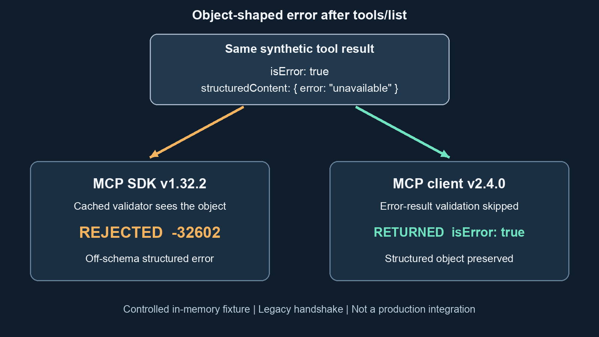

A tool can fail and still return structured data. Does `isError` change the schema contract, or just describe the outcome? This Source Audit compares the dated MCP requirement with pinned TypeScript source and a small, reproducible client experiment. The useful finding is a version-specific difference—not a security vulnerability or a claim about every MCP host.

Cover art: AI-generated with god-tibo-imagen; conceptual illustration, not protocol evidence.

## Does isError change the schema contract?

The MCP tools specification revision dated 2026-07-28 says that, when a tool defines an `outputSchema`, servers **MUST** provide structured results conforming to it and clients **SHOULD** validate them. Its structured-content section allows JSON values, not only objects. Separately, `isError: true` identifies a tool execution error, and clients **SHOULD** provide tool execution errors to language models. [C-SPEC-OUTPUT] [C-SPEC-ERROR]

Those are different statements: a server obligation, a client validation recommendation, and a model-facing error channel. The flag is not described as an alternate schema for `structuredContent`. An implementation can therefore exhibit a permissive client check without establishing that an off-schema server response conforms to the protocol.

This distinction is easy to miss when a handler returns a useful machine-readable failure object. The application may want the model to recover, but the declared output schema still determines the shape the server has promised to produce.

## What the TypeScript clients actually checked

In the pinned v1.32.2 client source, the missing-payload predicate is `!result.structuredContent && !result.isError`. The output-validator branch instead uses the JavaScript truthiness guard `if (result.structuredContent)`, without an `isError` exemption. It also requires an output validator for the discovered tool. This is a truthiness guard, not an unconditional presence test over every possible JSON value. The structured payloads in the fixture below are objects; other envelope shapes and custom result schemas are outside this comparison. [C-V1-CLIENT]

The client comparison below comes from the exact released packages exercised by the fixture, not from a server documentation sentence used as a proxy for client behavior. Documentation and runtime results remain separate evidence types. [C-REPRO]

The controlled tool declared an object output schema with one required numeric `value` property and `additionalProperties: false`. Each client first called `listTools`, so its metadata included that schema. Six result shapes were exercised for each version:

| Synthetic result | v1.32.2 after `listTools` | v2.4.0 after `listTools` |
|---|---|---|
| Conforming success, `{ value: 7 }` | Returned | Returned |
| Off-schema success, `{ error: "unavailable" }` | Rejected, `-32602` | Rejected, `-32602` |
| Success missing `structuredContent` | Rejected, `-32600` | Rejected, `-32600` |
| Error with text only | Returned with `isError: true` | Returned with `isError: true` |
| Error with off-schema structured data | Rejected, `-32602` | Returned with the off-schema object |
| Error with conforming structured data, `{ value: 0 }` | Returned with `isError: true` | Returned with `isError: true` |

The recorded run passed all twelve rows above and an additional cold-client control, with assertions on returned payloads and thrown error codes—not merely whether the process exited successfully. [C-REPRO]

<figure class="explanatory-image">
  
  <figcaption>Original illustration by jeo, based on the controlled object-shaped error fixture; explanatory, not source evidence.</figcaption>
</figure>

## Discovery changes the v1 control

A separate v1 client called the same tool without first discovering it. That call returned the off-schema structured error. In this controlled connection the client had no cached output validator for the tool. The result separates two conditions that would otherwise be conflated: the SDK version and whether the client knows the declared output schema. [C-COLD-CONTROL]

This is one cold-client observation, not a promise that every host starts without metadata or that all client configurations behave identically. It is a reason to record discovery state when reproducing an output-validation report. A table saying only “v1 rejects it” would leave out an observed condition that changes the answer.

## The high-level server path is separate

The pinned v1 high-level server helper also returns early from output validation when `result.isError` is true. That is a source-code finding, not a server result measured by this client fixture. [C-V1-SERVER]

The **v2 server error guide**, in its tool-handler examples, says the SDK skips `outputSchema` validation on `isError` results and advises putting recovery hints in text. That is server-side SDK documentation, not evidence of what a v2 client checks. The client behavior in the table comes separately from the released-package experiment. [C-V2-DOC] [C-REPRO]

The fixture deliberately uses the low-level `Server` so the same synthetic result shapes reach both clients. It does not exercise the high-level helper, a production handler or a modern transport. Conflating those paths would turn a bounded client comparison into an unsupported end-to-end integration claim.

**Interpretation:** a validation skip in an SDK does not amend the protocol's server requirement. **Recommendation:** keep structured failure details inside a declared, schema-conforming result variant, and put model-facing recovery guidance in text. That is application-design guidance drawn from the contract and observations, not an additional MCP rule.

For another boundary that depends on construction rather than a reassuring label, see [MCP security depends on transport construction](/posts/mcp-security-depends-on-transport-construction/). The separate approval-path question appears in [Cloudflare OS MCP approvals still wait](/posts/cloudflare-os-mcp-approvals-still-wait/).

## Reproduce the bounded experiment

Download the [probe script](/assets/img/posts/2026-11-11-mcp-iserror-output-schema-contract/reproduction/probe.mjs), [package manifest](/assets/img/posts/2026-11-11-mcp-iserror-output-schema-contract/reproduction/package.json), [full dependency lock](/assets/img/posts/2026-11-11-mcp-iserror-output-schema-contract/reproduction/package-lock.json) and [recorded result](/assets/img/posts/2026-11-11-mcp-iserror-output-schema-contract/reproduction/result.json) into one directory. Run `npm ci --ignore-scripts`, then `node probe.mjs`. The lock fixes the installed aliases to `@modelcontextprotocol/sdk@1.32.2` and `@modelcontextprotocol/client@2.4.0`; dependency installation may contact the npm registry, while the scenarios use no network.

The recorded environment was Node `v25.6.1`, macOS arm64. A fresh installation from the distributable manifest and portable lock also completed, and the resulting thirteen-row JSON matched the distributed record exactly. Both runs used linked in-memory transports and a v1 low-level server; the v2 client explicitly connected with `prior.kind: legacy`. [C-REPRO]

These observations do not test production services, modern transport negotiation, other operating systems or every release in either SDK family. They also do not establish what a particular host does after catching a rejected promise. The protocol text, pinned implementation, documentation and local experiment remain separate evidence types.

## Key Takeaways

- `isError` identifies a tool execution failure; it is not an alternate output schema.
- In the tested object-shaped error case, discovered v1.32.2 rejected off-schema structured data, while v2.4.0 returned it. The v1 source uses a truthiness guard, so do not generalize the table to all JSON shapes.
- Discovery state matters: the separate cold v1 control returned the same object without the cached validator.
- Preserve the declared schema contract and place recovery hints where the model can read them, rather than depending on one client's permissive branch.

## New Questions

- Should the protocol spell out the relationship between structured tool errors and client validation more explicitly?
- How should an application represent typed domain failures without confusing them with protocol errors or SDK validation failures?

## References

**Protocol**

- **C-SPEC-OUTPUT, C-SPEC-ERROR:** [MCP Tools specification, 2026-07-28](https://modelcontextprotocol.io/specification/2026-07-28/server/tools), especially Structured Content, Output Schema and Error Handling. Read 11 November 2026.

**Code and documentation**

- **C-V1-CLIENT:** [TypeScript v1 client source](https://github.com/modelcontextprotocol/typescript-sdk/blob/3b73021a0a2272c0c04c3917bcdb03398b3ec63f/src/client/index.ts), pinned at `3b73021a0a2272c0c04c3917bcdb03398b3ec63f`.
- **C-V1-SERVER:** [TypeScript v1 server helper](https://github.com/modelcontextprotocol/typescript-sdk/blob/3b73021a0a2272c0c04c3917bcdb03398b3ec63f/src/server/mcp.ts), same pinned commit.
- **C-V2-DOC:** [TypeScript SDK v2 server error guide](https://ts.sdk.modelcontextprotocol.io/v2/servers/errors). Read 11 November 2026. Server-handler guidance, not client-validation evidence.

**Recorded experiment**

- **C-REPRO, C-COLD-CONTROL:** [Complete result JSON](/assets/img/posts/2026-11-11-mcp-iserror-output-schema-contract/reproduction/result.json) and [asserting probe source](/assets/img/posts/2026-11-11-mcp-iserror-output-schema-contract/reproduction/probe.mjs). Synthetic in-memory fixture only; environment and scope are recorded with the result.
