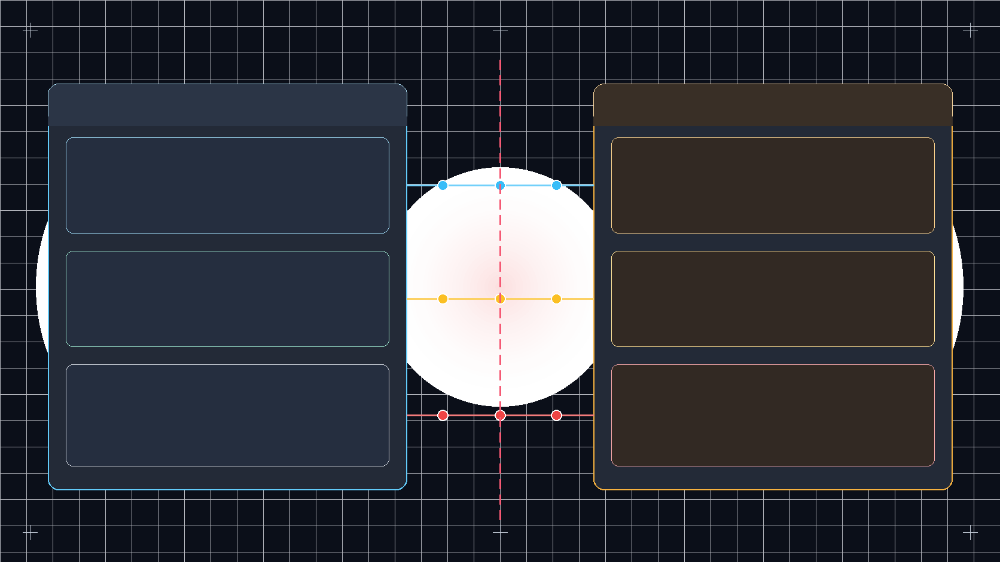

<figure class="explanatory-image">
  
  <figcaption>Original illustration by Fodev JEO: schematic diagram representing local daemon execution versus cloud gateway boundary; not source evidence.</figcaption>
</figure>

## Where Does Browser Use 1.0 Actually Execute Your Agent Tasks?

When developers upgrade an AI browser agent harness from version 0.x to 1.0, they frequently assume the underlying execution mechanics remain identical: an automated browser launched on `localhost`, controlled via Playwright or Chrome DevTools Protocol (CDP), and driven by an agentic decision loop. In Browser Use 1.0, however, that architectural default fundamentally changed.

The minimal `Agent(...).run_sync()` constructor in Browser Use 1.0 routes tasks through the Browser Use Cloud gateway by default, moving browser hosting and runner infrastructure outside the developer machine. Rather than initiating a local subprocess, the out-of-the-box Python snippet assumes the presence of a cloud API key and provisions compute in a managed environment.

Even when an engineer overrides this configuration, nuanced boundaries remain. Specifying `Browser('chromium')` provisions a local browser process on the host, but page screenshots and accessibility trees are still dispatched to external model provider APIs. Understanding where browser automation state lives—and where remote telemetry and network traffic flow—is essential for building reliable, secure agent infrastructure.

```mermaid
%%{init: {"flowchart": {"useMaxWidth": false}}}%%
flowchart LR
    subgraph Client ["Developer Host Environment"]
        AgentCode["Agent Script / CLI"]
        LocalBrowser["Local Chromium Daemon (default-chromium)"]
    end
    subgraph CloudBoundary ["External Boundaries"]
        CloudGateway["Browser Use Cloud Gateway"]
        LLMProvider["Model Provider API (OpenAI / Anthropic)"]
    end

    AgentCode -->|"Default run_sync()"| CloudGateway
    AgentCode -.->"Explicit Browser('chromium')"| LocalBrowser
    LocalBrowser -->|"DOM & Screenshots"| LLMProvider

    style Client fill:#f8fafc,stroke:#38bdf8,stroke-width:2px,color:#0f172a
    style CloudBoundary fill:#fffbeb,stroke:#f59e0b,stroke-width:2px,color:#0f172a
```

<svg viewBox="0 0 860 320" xmlns="http://www.w3.org/2000/svg" role="img" aria-label="Browser Use 1.0 architecture diagram showing local vs cloud execution boundaries" style="width:100%;max-width:860px;height:auto;display:block;margin:1.5rem auto;">
  <rect x="10" y="20" width="380" height="280" rx="12" fill="none" stroke="#38bdf8" stroke-width="2" stroke-dasharray="4 2"/>
  <text x="30" y="50" fill="#38bdf8" font-family="system-ui,-apple-system,sans-serif" font-size="14" font-weight="700">LOCAL HOST RUNTIME</text>
  <rect x="30" y="70" width="340" height="55" rx="8" fill="#1e293b" stroke="#38bdf8" stroke-width="1"/>
  <text x="45" y="98" fill="#f8fafc" font-family="system-ui,-apple-system,sans-serif" font-size="12" font-weight="600">CLI Stdio Transport (--cli-mcp)</text>
  <text x="45" y="114" fill="#94a3b8" font-family="system-ui,-apple-system,sans-serif" font-size="11">intercepts BrokenPipe via except* OSError</text>
  <rect x="30" y="140" width="340" height="55" rx="8" fill="#1e293b" stroke="#34d399" stroke-width="1"/>
  <text x="45" y="168" fill="#f8fafc" font-family="system-ui,-apple-system,sans-serif" font-size="12" font-weight="600">Background Daemon (default-chromium)</text>
  <text x="45" y="184" fill="#94a3b8" font-family="system-ui,-apple-system,sans-serif" font-size="11">isolated PID lifecycle; closed via --reload</text>
  <rect x="30" y="210" width="340" height="55" rx="8" fill="#1e293b" stroke="#94a3b8" stroke-width="1"/>
  <text x="45" y="238" fill="#f8fafc" font-family="system-ui,-apple-system,sans-serif" font-size="12" font-weight="600">CDP Endpoint (BU_CDP_URL)</text>
  <text x="45" y="254" fill="#94a3b8" font-family="system-ui,-apple-system,sans-serif" font-size="11">3s fail-fast refusal timeout</text>

  <rect x="470" y="20" width="380" height="280" rx="12" fill="none" stroke="#f59e0b" stroke-width="2"/>
  <text x="490" y="50" fill="#f59e0b" font-family="system-ui,-apple-system,sans-serif" font-size="14" font-weight="700">BROWSER USE CLOUD</text>
  <rect x="490" y="70" width="340" height="55" rx="8" fill="#1e293b" stroke="#f59e0b" stroke-width="1"/>
  <text x="505" y="98" fill="#f8fafc" font-family="system-ui,-apple-system,sans-serif" font-size="12" font-weight="600">Cloud Gateway (run_sync default)</text>
  <text x="505" y="114" fill="#94a3b8" font-family="system-ui,-apple-system,sans-serif" font-size="11">remote browser allocation via API key</text>
  <rect x="490" y="140" width="340" height="55" rx="8" fill="#1e293b" stroke="#fbbf24" stroke-width="1"/>
  <text x="505" y="168" fill="#f8fafc" font-family="system-ui,-apple-system,sans-serif" font-size="12" font-weight="600">Hosted bu-fast Reasoning Model</text>
  <text x="505" y="184" fill="#94a3b8" font-family="system-ui,-apple-system,sans-serif" font-size="11">automated plan and action generation</text>
  <rect x="490" y="210" width="340" height="55" rx="8" fill="#1e293b" stroke="#ef4444" stroke-width="1"/>
  <text x="505" y="238" fill="#f8fafc" font-family="system-ui,-apple-system,sans-serif" font-size="12" font-weight="600">Cancellation Budget Guard</text>
  <text x="505" y="254" fill="#94a3b8" font-family="system-ui,-apple-system,sans-serif" font-size="11">10s shared deadline caps billing retention</text>
</svg>

The release of Browser Use commit `dfb6a73d520809341c975c6a01c228327991e88b` (tagged for version 1.0.3) provides detailed telemetry-derived error data from real-world deployments. By analyzing the fixes merged in this update, systems engineers can trace how headless environments, Model Context Protocol (MCP) clients, and process teardowns behave under stress.

## The CLI MCP Pipeline and BrokenPipe Error Traps

Integrating browser automation into broader desktop agent frameworks often relies on standard input/output transport pipelines. Browser Use provides a dedicated `--cli-mcp` mode designed to expose browser control tools to MCP hosts and agent orchestrators. However, production telemetry revealed a common failure pattern: when an MCP host disconnected or closed its communication pipe immediately after issuing a termination command, the CLI process crashed with a non-zero exit code.

Specifically, across hundreds of logged devices, exiting processes raised unhandled `ExceptionGroup(BrokenPipeError)`. While the primary automation task had concluded successfully, the premature closure of standard output caused the process to register as an unhandled application error.

In `--cli-mcp` mode, early client pipe closure previously triggered an unhandled BrokenPipeError exception group on exit; 1.0.3 intercepts client-gone errors with `except* OSError` to guarantee a clean zero exit status. This pattern highlights a critical lesson for MCP server implementers: stdio communication must account for asymmetric client shutdown sequences without treating downstream pipe termination as an execution failure.

## Process Isolation: Background Daemons and Cross-Namespace DevTools Ports

Running browser agents in continuous integration pipelines, headless Linux servers, or embedded editor sandboxes introduces difficult browser lifecycle constraints. Previous iterations frequently failed when attempting to spawn visible browser windows in headless environments where no display server was present.

The CLI script mode now runs an isolated background daemon named `default-chromium` to ensure headless environments and script invocations consistently obtain a browser instance without colliding with interactive sessions. By decoupling the automation browser from the desktop user's daily browser sessions, the harness eliminates conflicts over user profiles, active cookies, and window focus. The daemon process persists across subsequent script calls to avoid cold-start launch penalties, but can be cleanly terminated by passing the `--reload` parameter.

Containerized development environments—such as Docker containers, devcontainers, or IDE workspaces like Cursor—introduce an additional layer of complexity: process namespace isolation. When Chrome runs in a separate PID namespace, standard port-discovery mechanisms often reject active debugging handles due to mismatched process IDs.

Browser Use 1.0.3 resolves `DevToolsActivePort` across separate process namespace boundaries when the active process shares the matching browser identifier, fixing attachment in containerized workflows. By validating the unique browser identifier rather than requiring identical host PID numbers, the framework allows sandboxed agent orchestrators to control containerized browser targets securely.

## Fail-Fast CDP Timeouts and Bounded Cancellation Budgets

Network timeouts and cancellation semantics are often overlooked until deployed systems encounter hung connections or mounting cloud infrastructure costs. In earlier releases, configuring an incorrect or unreachable remote CDP endpoint via `BU_CDP_URL` caused client processes to stall for up to 30 seconds before delivering a vague error message.

Refused connections to `BU_CDP_URL` now terminate after a 3-second timeout rather than blocking the caller in a 30-second hang. Failing fast when a debugging endpoint is unavailable prevents agent orchestrators from accumulating blocked workers in concurrency queues.

A far more significant financial risk involved task cancellation during cloud browser execution. When an operator or automated watchdog cancelled a running task via `task.cancel()` or keyboard interrupt, the shutdown routine initiated a synchronization pass to preserve downloaded files from the remote browser environment. Each file listing and copy operation could take up to 300 seconds, maintaining cloud session allocation and generating billable charges long after the task was ostensibly stopped.

Task cancellation bounds post-cancellation cloud download synchronization to a shared 10-second budget via `CANCEL_DOWNLOADS_TIMEOUT_S`, preventing cancelled runs from sustaining cloud billing for up to 300 seconds. If download copying cannot complete within that strict 10-second ceiling, the operation terminates cleanly. In persistent `keep_alive` configurations, incomplete transfers are deferred to the workspace of the subsequent run, balancing data recovery against runaway infrastructure expenses.

| Architectural Dimension | Version 0.x Behavior | Version 1.0.3 Behavior | Operational Impact |
|---|---|---|---|
| Default Execution Host | Local Playwright Chromium | Browser Use Cloud Gateway | Requires explicit `Browser()` config for local runs |
| MCP Pipe Teardown | `BrokenPipeError` crashes (exit 1) | Intercepted via `except* OSError` (exit 0) | Clean pipeline exits in host orchestrators |
| Daemon Lifecycle | Ephemeral per-invocation process | Persistent `default-chromium` daemon | Eliminates cold-start browser startup overhead |
| Cross-Namespace CDP | Rejected on PID mismatch | Validated by browser identifier match | Container and devcontainer compatibility |
| CDP Refusal Timeout | 30-second blocking wait | 3-second fail-fast termination | Rapid diagnostic feedback on connection failure |
| Cancel Teardown Budget | Up to 300 seconds per copy pass | 10-second `CANCEL_DOWNLOADS_TIMEOUT_S` cap | Prevents cloud billing leakage on abort |

## Pruning Legacy 0.x Metadata from Tool-Result Payloads

As agent frameworks evolve, legacy configuration parameters can subtly degrade language model decision performance. During the transition from Browser Use 0.x to 1.0, internal action structures retired several fine-grained control flags, including `include_in_memory` and `include_extracted_content_only_once`.

In early 1.0 builds, while the first deprecated field was filtered out, secondary legacy fields occasionally survived serialization and leaked directly into the tool-result JSON payloads returned to the LLM. This unintended leakage introduced noise into the model's context window, risking hallucinations or format confusion in structured outputs.

The updated `ActionResult` implementation strips legacy 0.x memory and extraction flags with explicit warnings, preventing deprecated internal fields from reaching model tool-result payloads. Keeping the schema boundary between harness execution metadata and model context clean is vital for maintaining deterministic agent behavior.

Systems engineers interested in how browser agent decision latency and decision-loop boundaries are benchmarked in production can review our earlier analysis of [Jev browser agent decision loops](/posts/jev-shrinks-browser-agent-decision-loop/). Furthermore, understanding how transport layers impact protocol boundaries is explored in our evaluation of [MCP security and transport construction](/posts/mcp-security-depends-on-transport-construction/).

## Key Takeaways

- **Default cloud boundaries**: The default `Agent(...).run_sync()` constructor delegates compute to Browser Use Cloud; running locally requires explicit `Browser('chromium')` instantiation.
- **Local browser vs. local inference**: A local Chromium process does not imply local data custody; DOM structures and screenshots are still transmitted to the configured LLM API.
- **Resilient stdio teardown**: Handling `BrokenPipeError` with `except* OSError` ensures that CLI MCP tools exit with status 0 when clients close communication pipes early.
- **Fail-fast operational contracts**: Reducing refused CDP timeouts to 3 seconds and capping cancellation download passes at 10 seconds prevents pipeline hangs and runaway cloud billing.
- **Clean context hygiene**: Sanitizing deprecated internal metadata from `ActionResult` payloads protects downstream language models from schema pollution.

## New Questions

- How should browser agent harnesses detect and prevent DOM-based prompt injection attacks before page context reaches the reasoning model?
- Under what conditions should multi-tenant container environments isolate CDP sockets with mutual TLS rather than relying solely on process namespace and filesystem permissions?
- Can client-side browser agents dynamically throttle visual screenshot capture frequency based on DOM mutation density to minimize LLM token overhead?

## References

- [Browser Use Upstream Commit `dfb6a73d`](https://github.com/browser-use/browser-use/commit/dfb6a73d520809341c975c6a01c228327991e88b)
- [Browser Use Official Documentation](https://docs.browser-use.com/)
- [Browser Use Upstream Repository README](https://github.com/browser-use/browser-use/blob/dfb6a73d520809341c975c6a01c228327991e88b/README.md)
