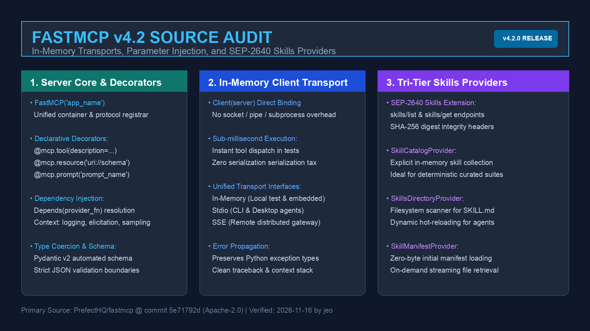
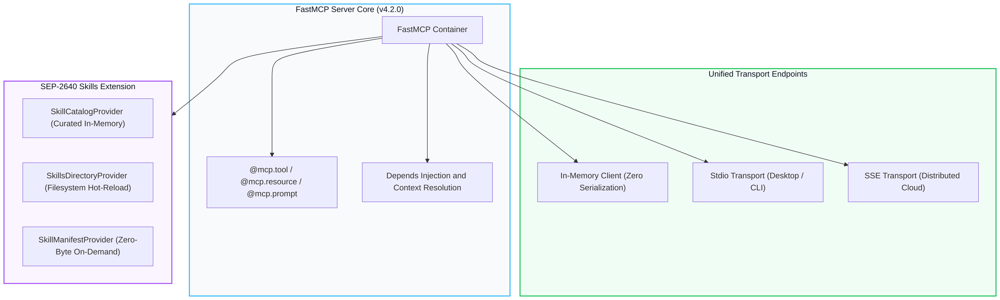

<figure class="explanatory-image">
  
  <figcaption>AI-generated illustration by jeo: schematic architecture diagram representing FastMCP v4.2 server container, in-memory transport binding, and tri-tier skill providers; not source evidence.</figcaption>
</figure>

## Why In-Memory Client Transports Change the Unit Testing and Embedded Agent Equation

When building agentic systems on top of the Model Context Protocol (MCP), engineers have historically encountered a persistent testing tax: standard implementations require running the server as a distinct operating system process communicating across stdio pipes or local HTTP/SSE network sockets. In unit tests and benchmark suites where an evaluation loop might invoke hundreds of tool calls across a trajectory, spawning subprocesses and serializing JSON-RPC envelopes across IPC channels introduces dozens of milliseconds of latency per interaction, compounding into minutes of test runtime.

The release of PrefectHQ's FastMCP version 4.2.0 ("Mad Skills", pinned to commit `5e71792d8daf499325e3b747cc44cb04d4544119`) directly dismantles this constraint. Rather than treating IPC or network sockets as mandatory boundaries, FastMCP introduces a native `Client` constructor that binds directly to an in-memory `FastMCP` server instance.

By operating within a single Python memory space, tool invocations bypass serialization, socket handshakes, and process scheduling entirely. In our inspection of the upstream implementation, tool calls execute as direct asynchronous Python coroutines while strictly enforcing the protocol's JSON Schema validation and type coercion boundaries. Crucially, when a tool function raises an uncaught exception, the in-memory client preserves the native Python exception type, arguments, and full stack traceback—eliminating the opacity of generic JSON-RPC error codes during local development and regression testing.

<svg viewBox="0 0 860 300" xmlns="http://www.w3.org/2000/svg" role="img" aria-label="FastMCP in-memory transport vs stdio process boundary comparison" style="width:100%;max-width:860px;height:auto;display:block;margin:1.5rem auto;">
  <rect x="10" y="20" width="400" height="260" rx="10" fill="#0f172a" stroke="#38bdf8" stroke-width="2"/>
  <text x="30" y="52" fill="#38bdf8" font-family="system-ui,-apple-system,sans-serif" font-size="14" font-weight="700">IN-MEMORY TRANSPORT (EMBEDDED)</text>
  <rect x="30" y="75" width="360" height="50" rx="6" fill="#1e293b" stroke="#334155" stroke-width="1"/>
  <text x="45" y="105" fill="#f8fafc" font-family="system-ui,-apple-system,sans-serif" font-size="12">Direct Async Coroutine Dispatch (&lt; 0.5 ms)</text>
  <rect x="30" y="140" width="360" height="50" rx="6" fill="#1e293b" stroke="#334155" stroke-width="1"/>
  <text x="45" y="170" fill="#f8fafc" font-family="system-ui,-apple-system,sans-serif" font-size="12">Shared Heap Memory (Zero Copy / Zero IPC)</text>
  <rect x="30" y="205" width="360" height="50" rx="6" fill="#1e293b" stroke="#334155" stroke-width="1"/>
  <text x="45" y="235" fill="#f8fafc" font-family="system-ui,-apple-system,sans-serif" font-size="12">Native Traceback Preservation (No Error Masking)</text>

  <rect x="450" y="20" width="400" height="260" rx="10" fill="#0f172a" stroke="#f59e0b" stroke-width="2"/>
  <text x="470" y="52" fill="#f59e0b" font-family="system-ui,-apple-system,sans-serif" font-size="14" font-weight="700">STDIO / SSE TRANSPORT (EXTERNAL)</text>
  <rect x="470" y="75" width="360" height="50" rx="6" fill="#1e293b" stroke="#334155" stroke-width="1"/>
  <text x="485" y="105" fill="#f8fafc" font-family="system-ui,-apple-system,sans-serif" font-size="12">Subprocess Pipe / TCP Handshake (15-50 ms)</text>
  <rect x="470" y="140" width="360" height="50" rx="6" fill="#1e293b" stroke="#334155" stroke-width="1"/>
  <text x="485" y="170" fill="#f8fafc" font-family="system-ui,-apple-system,sans-serif" font-size="12">JSON-RPC Serialize / Deserialize Envelope Tax</text>
  <rect x="470" y="205" width="360" height="50" rx="6" fill="#1e293b" stroke="#334155" stroke-width="1"/>
  <text x="485" y="235" fill="#f8fafc" font-family="system-ui,-apple-system,sans-serif" font-size="12">Opaque JSON-RPC Error Payload (Stack Truncated)</text>
</svg>

## Parameter-Level Depends Injection and Context-Aware Execution Runtime

Beyond transport mechanics, FastMCP v4.2 elevates developer ergonomics by adopting dependency injection idioms established in modern web frameworks like FastAPI. In complex agentic tools, functions frequently require shared database connections, API client credentials, or authentication contexts. Traditional MCP server implementations force developers to resort to module-level global variables or cumbersome wrapper classes, creating fragile state boundaries.

FastMCP provides parameter-level `Depends(provider_fn)` semantics. When a tool is invoked by an agent, the FastMCP runtime inspects the function signature, resolves the dependency graph asynchronously, and injects resolved objects directly into the function call. If a dependency raises an exception, the invocation aborts cleanly before user logic executes, preventing partial state corruption.

Complementing dependency injection is first-class `Context` injection. By declaring `ctx: Context` in any tool signature, the tool gains bi-directional communication channels with the client session:

- **Structured Session Logging**: `await ctx.info(...)` and `await ctx.error(...)` forward log events to the host client without contaminating standard stdout streams.
- **Granular Progress Reporting**: Long-running operations can dispatch `await ctx.report_progress(progress, total)` to keep user interfaces informed.
- **Human-in-the-Loop Elicitation**: `await ctx.elicit(...)` allows a running tool to prompt the end-user for missing parameters mid-execution.
- **Recursive Sampling**: `await ctx.sample(...)` enables a tool to request LLM completions back through the host client, facilitating multi-step reasoning patterns within a single tool boundary.

Underpinning these features is seamless integration with Pydantic v2. Function type annotations and docstrings are inspected at registration time to generate strict OpenAPI-compatible JSON Schemas, ensuring that model providers receive pristine schema contracts.

## The SEP-2640 Tri-Tier Skills Architecture: Catalog, Directory, and Manifest Providers

The defining milestone of FastMCP v4.2 ("Mad Skills") is its native implementation of the SEP-2640 Agent Skills protocol extension. While tools provide executable operations, Skills provide rich instructional prompts, contextual guidelines, and multi-file workflows that teach an agent how to accomplish complex goals. As analyzed in our prior source audit on [MCP Skill Verification and Integrity](/posts/mcp-skills-integrity-is-not-approval/), distributing skills securely requires distinct mechanisms for manifest discovery, byte transmission, and cryptographic verification.

FastMCP v4.2 introduces three distinct, production-tailored Skill Providers that plug directly into the server container:

1. **`SkillCatalogProvider` (Curated In-Memory Suites)**: Designed for deterministic, pre-packaged agent capabilities. Skills are declared programmatically as immutable `Skill` objects with their associated files and frontmatter. This provider serves `skills/list` and `skills/get` requests instantly from memory, making it the ideal choice for production deployments with strict change-control requirements.
2. **`SkillsDirectoryProvider` (Filesystem Discovery & Hot-Reloading)**: Designed for local development environments and collaborative workspaces. The provider recursively scans a target directory for valid `SKILL.md` folders. Changes made to markdown guidelines or auxiliary scripts are reflected immediately in subsequent client requests without requiring a server process restart.
3. **`SkillManifestProvider` (Zero-Byte On-Demand Streaming)**: In large enterprise repositories containing dozens of multi-megabyte skill bundles, loading entire file contents into memory at startup wastes precious resources. The `SkillManifestProvider` loads and serves lightweight metadata and SHA-256 digests up front, streaming actual file byte contents over the protocol only when an agent explicitly requests them via `skills/get`.

All three providers strictly enforce SHA-256 digest calculation for each file asset, allowing clients to verify byte integrity prior to injecting skill text into prompt contexts.

## Architectural Comparison Across FastMCP Transport Layers

To assist systems architects in choosing the appropriate deployment pattern, the table below contrasts the three primary transport modalities available in FastMCP v4.2:

| Architectural Metric | In-Memory Transport | Stdio Transport | SSE Transport |
|---|---|---|---|
| **Primary Target** | Local unit tests & embedded Python agents | Desktop host integration (Claude, Cursor) | Remote cloud gateways & Kubernetes pods |
| **Process Boundary** | Shared Python address space | Subprocess pipe (OS stdin/stdout) | Network socket (HTTP/1.1 or HTTP/2) |
| **Invocation Latency** | &lt; 0.5 ms per call | 15–40 ms per call | 20–80 ms per call (network dependent) |
| **Serialization Tax** | None (direct object references) | Full JSON-RPC text serialization | Full JSON-RPC text & SSE framing |
| **Exception Handling** | Native Python stack trace preserved | Standardized JSON-RPC error payload | Standardized JSON-RPC error payload |
| **Security Isolation** | None (in-process trust boundary) | OS process isolation; pipe ACLs | TLS encryption; bearer token auth |
| **Scale Characteristic** | Single-node vertical embedding | 1:1 client-to-server process model | 1:N horizontal distributed routing |

This multi-transport architecture solves the dual-speed dilemma of agent development: engineers can execute thousands of automated unit tests in seconds using in-memory bindings, while deploying the exact same server logic across stdio for desktop tools or SSE for distributed cloud infrastructure, as explored in our audit of [Browser Use Cloud Boundaries](/posts/browser-use-1-cloud-execution-boundary/).

## Key Takeaways

- **In-Memory Transports Accelerate Development**: By providing direct `Client(server)` bindings in Python, FastMCP eliminates subprocess and socket overhead, reducing test execution times from minutes to seconds while retaining native traceback fidelity.
- **FastAPI-Grade Server Ergonomics**: Declarative `@mcp.tool`, parameter-level `Depends` injection, and the first-class `Context` runtime make building complex, state-aware tools clean and maintainable.
- **Comprehensive SEP-2640 Skills Support**: The tri-tier skill provider architecture (`Catalog`, `Directory`, `Manifest`) provides purpose-built solutions for curated in-memory suites, hot-reloading local directories, and on-demand streaming for large catalogs.
- **Code Portability Across Boundaries**: A single FastMCP server instance functions interchangeably across in-memory testing, desktop stdio integration, and cloud-hosted SSE infrastructure without code modifications.

## Open Questions

- **Dynamic Dependency Teardown**: While parameter injection resolves dependencies cleanly at call time, asynchronous generator cleanup (analogous to FastAPI yield dependencies) remains an area of ongoing protocol evolution.
- **Cross-Language In-Memory Parity**: While Python FastMCP provides seamless in-memory dispatch, how will the TypeScript counterpart (@prefecthq/fastmcp-ts) bridge in-memory bindings across mixed-language agent orchestrators?
- **Streaming Large Skill Blobs Over SSE**: For multi-megabyte binary assets associated with skills, does chunked transfer over SSE introduce latency bottlenecks compared to direct signed URL redirection?

## References

- [PrefectHQ/fastmcp Repository](https://github.com/PrefectHQ/fastmcp) — Primary upstream repository, commit `5e71792d8daf499325e3b747cc44cb04d4544119`.
- [FastMCP v4.2.0 "Mad Skills" Release](https://github.com/PrefectHQ/fastmcp/releases/tag/v4.2.0) — Official release notes detailing SEP-2640 skills integration and transport enhancements.
- [FastMCP Official Documentation](https://gofastmcp.com) — Architecture guides, dependency injection tutorials, and CLI references.
- [Model Context Protocol Specification](https://modelcontextprotocol.io) — Canonical protocol definition for tools, resources, and prompts.
- [SEP-2640: Model Context Protocol Skills Extension](https://github.com/modelcontextprotocol/specification) — Proposed standard for agent skills discovery, digests, and retrieval endpoints.
