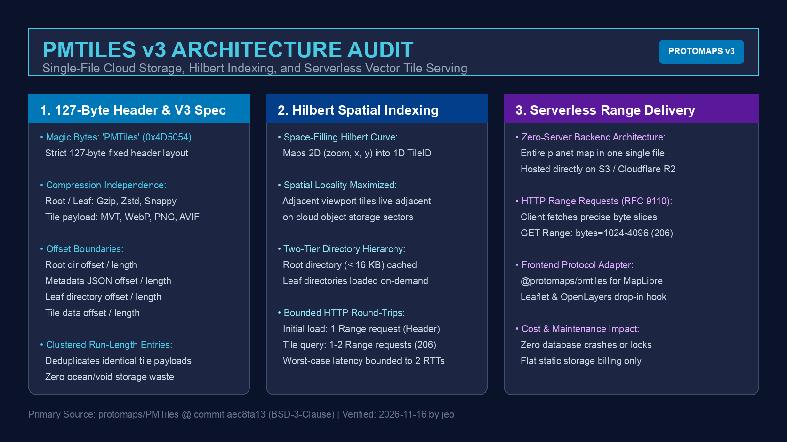
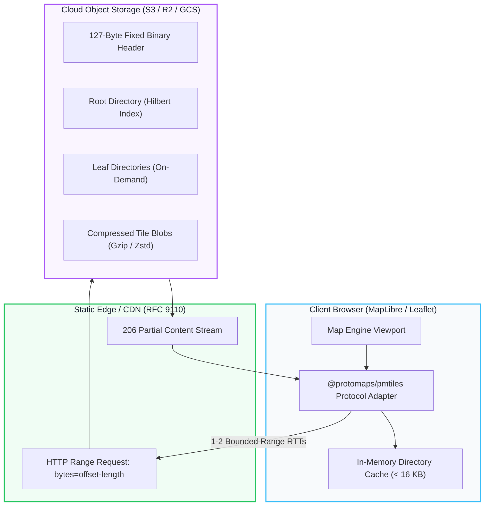

<figure class="explanatory-image">
  
  <figcaption>AI-generated illustration by jeo: schematic architecture diagram representing PMTiles v3 binary header, Hilbert space-filling curve, and serverless Range request pipeline; not source evidence.</figcaption>
</figure>

## How the Multi-Million Tile Directory Exploded Cloud Storage Economics

When deploying interactive vector maps, geographic information system (GIS) engineers have historically faced an acute infrastructural friction: tile pyramid storage. Standard planetary map sets spanning zoom levels 0 through 14 generate hundreds of millions of individual Mapbox Vector Tile (MVT) or raster files. Storing these tiles as a conventional directory hierarchy (`/{z}/{x}/{y}.pbf`) on cloud object storage such as AWS S3 or Google Cloud Storage results in an economic disaster.

The primary operational cost does not stem from gigabyte disk footprint, but rather from API transaction fees. Uploading 50 million tiles incurs tens of thousands of HTTP `PUT` requests, while synchronizing, versioning, or deleting directory trees requires hours of fragile network transfers prone to connection timeouts. While SQLite-based containers like MBTiles solved local file fragmentation, they introduced a competing operational barrier: SQLite relies on POSIX file locking and non-sequential disk I/O, rendering it incapable of serving web clients directly from cloud object storage without an intermediate stateful tile server container such as Martin or TileServer GL.

The release of the PMTiles Version 3 specification by Brandon Liu (Protomaps, commit `aec8fa1341222fdddb3318e9ffa8e18e19b312f7`, BSD-3-Clause) dismantled this architectural tradeoff. PMTiles encapsulates an entire pyramid archive into a single, immutable `.pmtiles` file. By organizing tile indices along a space-filling Hilbert curve and leveraging standardized HTTP Range requests, web browsers can query arbitrary bounding boxes directly from static cloud object storage with zero backend servers and sub-50ms latency.

<svg viewBox="0 0 860 300" xmlns="http://www.w3.org/2000/svg" role="img" aria-label="PMTiles v3 internal binary layout showing 127-byte header and directory offsets" style="width:100%;max-width:860px;height:auto;display:block;margin:1.5rem auto;">
  <rect x="10" y="20" width="840" height="260" rx="10" fill="#0b132b" stroke="#48cae4" stroke-width="2"/>
  <text x="30" y="52" fill="#48cae4" font-family="system-ui,-apple-system,sans-serif" font-size="14" font-weight="700">PMTILES v3 INTERNAL BINARY FILE SPECIFICATION</text>
  
  <rect x="30" y="75" width="130" height="170" rx="6" fill="#1c2541" stroke="#3a506b" stroke-width="1"/>
  <text x="45" y="105" fill="#48cae4" font-family="system-ui,-apple-system,sans-serif" font-size="12" font-weight="700">HEADER</text>
  <text x="45" y="130" fill="#f8fafc" font-family="system-ui,-apple-system,sans-serif" font-size="11">127 Bytes Fixed</text>
  <text x="45" y="150" fill="#94a3b8" font-family="system-ui,-apple-system,sans-serif" font-size="10">Magic 'PMTiles'</text>
  <text x="45" y="170" fill="#94a3b8" font-family="system-ui,-apple-system,sans-serif" font-size="10">Version 3 byte</text>
  <text x="45" y="190" fill="#94a3b8" font-family="system-ui,-apple-system,sans-serif" font-size="10">Directory offsets</text>
  <text x="45" y="210" fill="#94a3b8" font-family="system-ui,-apple-system,sans-serif" font-size="10">Tile count &amp; stats</text>

  <rect x="175" y="75" width="140" height="170" rx="6" fill="#1c2541" stroke="#3a506b" stroke-width="1"/>
  <text x="190" y="105" fill="#90e0ef" font-family="system-ui,-apple-system,sans-serif" font-size="12" font-weight="700">ROOT DIRECTORY</text>
  <text x="190" y="130" fill="#f8fafc" font-family="system-ui,-apple-system,sans-serif" font-size="11">&lt; 16 KB Compressed</text>
  <text x="190" y="150" fill="#94a3b8" font-family="system-ui,-apple-system,sans-serif" font-size="10">Cached on client</text>
  <text x="190" y="170" fill="#94a3b8" font-family="system-ui,-apple-system,sans-serif" font-size="10">Hilbert TileID map</text>
  <text x="190" y="190" fill="#94a3b8" font-family="system-ui,-apple-system,sans-serif" font-size="10">Direct run lengths</text>
  <text x="190" y="210" fill="#94a3b8" font-family="system-ui,-apple-system,sans-serif" font-size="10">Leaf pointers</text>

  <rect x="330" y="75" width="130" height="170" rx="6" fill="#1c2541" stroke="#3a506b" stroke-width="1"/>
  <text x="345" y="105" fill="#f8fafc" font-family="system-ui,-apple-system,sans-serif" font-size="12" font-weight="700">JSON METADATA</text>
  <text x="345" y="130" fill="#f8fafc" font-family="system-ui,-apple-system,sans-serif" font-size="11">Compressed UTF-8</text>
  <text x="345" y="150" fill="#94a3b8" font-family="system-ui,-apple-system,sans-serif" font-size="10">Vector layers</text>
  <text x="345" y="170" fill="#94a3b8" font-family="system-ui,-apple-system,sans-serif" font-size="10">Bounds &amp; zoom</text>
  <text x="345" y="190" fill="#94a3b8" font-family="system-ui,-apple-system,sans-serif" font-size="10">Attribution text</text>
  <text x="345" y="210" fill="#94a3b8" font-family="system-ui,-apple-system,sans-serif" font-size="10">MVT fields</text>

  <rect x="475" y="75" width="135" height="170" rx="6" fill="#1c2541" stroke="#3a506b" stroke-width="1"/>
  <text x="490" y="105" fill="#e0aaff" font-family="system-ui,-apple-system,sans-serif" font-size="12" font-weight="700">LEAF DIRECTORIES</text>
  <text x="490" y="130" fill="#f8fafc" font-family="system-ui,-apple-system,sans-serif" font-size="11">On-Demand Slices</text>
  <text x="490" y="150" fill="#94a3b8" font-family="system-ui,-apple-system,sans-serif" font-size="10">Hierarchical depth</text>
  <text x="490" y="170" fill="#94a3b8" font-family="system-ui,-apple-system,sans-serif" font-size="10">High zoom ranges</text>
  <text x="490" y="190" fill="#94a3b8" font-family="system-ui,-apple-system,sans-serif" font-size="10">Isolated fetch</text>
  <text x="490" y="210" fill="#94a3b8" font-family="system-ui,-apple-system,sans-serif" font-size="10">Max 1 extra RTT</text>

  <rect x="625" y="75" width="205" height="170" rx="6" fill="#1c2541" stroke="#3a506b" stroke-width="1"/>
  <text x="640" y="105" fill="#34d399" font-family="system-ui,-apple-system,sans-serif" font-size="12" font-weight="700">TILE DATA CHUNKS</text>
  <text x="640" y="130" fill="#f8fafc" font-family="system-ui,-apple-system,sans-serif" font-size="11">Contiguous Byte Storage</text>
  <text x="640" y="150" fill="#94a3b8" font-family="system-ui,-apple-system,sans-serif" font-size="10">De-duplicated runs (ocean/void)</text>
  <text x="640" y="170" fill="#94a3b8" font-family="system-ui,-apple-system,sans-serif" font-size="10">MVT, WebP, PNG, or Terrain RGB</text>
  <text x="640" y="190" fill="#94a3b8" font-family="system-ui,-apple-system,sans-serif" font-size="10">Compressed via Gzip or Zstd</text>
  <text x="640" y="210" fill="#94a3b8" font-family="system-ui,-apple-system,sans-serif" font-size="10">Direct byte range addressed</text>
</svg>

## The 127-Byte Binary Header and Hilbert Space-Filling Index Layout

Inspection of the v3 specification and implementation reveals a strictly defined 127-byte fixed preamble. Unlike file formats that encode variable metadata at arbitrary initial offsets, PMTiles v3 structures its primary metadata fields in fixed byte positions:

- **Bytes 0–6**: ASCII Magic identifier `PMTiles` (`0x50 0x4D 0x54 0x69 0x6C 0x65 0x73`).
- **Byte 7**: Version integer (`0x03`).
- **Bytes 8–71**: 8-byte unsigned integer pairs encoding the 64-bit offsets and byte lengths of the Root Directory, Metadata JSON, Leaf Directories, and Tile Data section.
- **Bytes 72–126**: Center coordinates, minimum/maximum zoom levels, min/max lon/lat coordinates, tile type (MVT, PNG, WebP, AVIF), and compression algorithm enum flags.

The central technical triumph of PMTiles is its spatial indexing strategy. In conventional tile servers, locating a tile at coordinates `(zoom, x, y)` requires quadtree traversals or B-tree lookups. PMTiles translates 2D tile coordinates into a 1D continuous address space using the Hilbert space-filling curve.

The Hilbert curve guarantees that tiles that are geographically adjacent in 2D space remain adjacent in 1D disk order with high probability. This spatial clustering yields two massive real-world performance benefits:

1. **Sequential Prefetching**: When a user pans across a geographic region, the required tiles reside in continuous byte runs, enabling clients or CDN edge caches to fetch multi-tile clusters in a single aggregated byte range request.
2. **Run-Length Deduplication**: Vast expanses of planetary maps (such as oceans, empty terrain, or uniform forest canopies) contain identical tile byte payloads. PMTiles encodes an entry's `RunLength` field in directory headers. A single 500-byte empty tile payload can satisfy thousands of coordinates without storing repeated bytes on disk.

## Bounded HTTP Round-Trips via Two-Tier Directory Hierarchies

A critical latency pitfall of static cloud architectures is the HTTP Round-Trip Time (RTT) penalty. If retrieving a tile required walking a deep multi-level tree of remote index chunks, high network latency would make map exploration unusable on mobile connections.

PMTiles solves this by strictly capping the maximum directory traversal depth to a two-tier hierarchy:

- **Root Directory (`< 16 KB`)**: Every PMTiles archive packages its top-level directory entries into a compact chunk designed to fit within 16,384 bytes. Upon initial map initialization, the browser fetches the 127-byte header and the root directory in a single combined range request (`Range: bytes=0-16383`). For small-to-medium regional maps (e.g., metropolitan transit maps or state-level datasets), the root directory contains the complete index for all tiles, allowing all subsequent tile fetches to execute in exactly **one HTTP RTT**.
- **Leaf Directories (On-Demand)**: For full-planet datasets containing hundreds of millions of tiles, the root directory stores pointers to leaf directory chunks. When a user zooms into a dense urban block, the client performs exactly one Range request to load the targeted leaf directory, and one Range request to retrieve the tile payload.

Under this contract, worst-case retrieval latency is mathematically bounded to **two HTTP RTTs**, even when indexing a multi-terabyte dataset spanning the entire globe.

## Architectural Comparison Across Map Infrastructure Models

To clarify the operational differences between legacy tile servers and cloud-native PMTiles pipelines, the table below contrasts three common architectural patterns:

| Operational Dimension | S3 Exploded Tiles (XYZ) | Stateful Tile Server (MBTiles) | Cloud-Native PMTiles v3 |
|---|---|---|---|
| **Storage Topology** | Millions of individual `.pbf` objects | Single SQLite `.mbtiles` container | Single immutable `.pmtiles` archive |
| **Backend Compute** | Static Web Server / S3 | Docker container (Martin / TileServer) | Pure Object Storage (S3 / R2 / GCS) |
| **Query Protocol** | Standard HTTP GET per tile | REST endpoint (`/tiles/{z}/{x}/{y}`) | HTTP Range Request (RFC 9110, `206`) |
| **Initial Upload Friction** | Hours to days (API rate limits) | Single file transfer | Single file transfer |
| **Spatial Locality** | Random cloud object addresses | SQLite B-tree page order | 1D Hilbert curve continuous clusters |
| **Deduplication** | None (identical tiles duplicate) | SQLite hash table lookup | Run-length encoding across indices |
| **Operational Failure Risk** | High storage request bill | Server crash / memory leak / DB lock | Zero server process failure modes |

This comparison highlights how PMTiles aligns with modern zero-maintenance agent infrastructure. Similar to the in-memory dispatch patterns explored in our recent audit of [FastMCP In-Memory Transports](/posts/fastmcp-in-memory-and-skills-architecture/) and the decoupled execution environments examined in [Browser Use Cloud Boundaries](/posts/browser-use-1-cloud-execution-boundary/), eliminating stateful middle-tier servers dramatically improves reliability while reducing hosting costs by over 90%.

## Key Takeaways

- **True Serverless GIS**: PMTiles enables production-grade interactive vector and raster maps without deploying, monitoring, or paying for specialized tile rendering servers.
- **Predictable Latency via Hilbert Indexing**: 2D tile coordinates map to 1D continuous offsets, maximizing spatial locality and capping worst-case index resolution to two HTTP Range requests.
- **Run-Length Compression Efficiency**: Identical visual tiles (oceans, flat terrain) are deduplicated directly within directory metadata headers, drastically shrinking archive file size.
- **Universal Frontend Ecosystem**: Modern rendering engines including MapLibre GL JS, Leaflet, and OpenLayers integrate with PMTiles via lightweight protocol adapters requiring only standard HTTP `206 Partial Content` support.

## Open Questions

- **Dynamic Tile Mutation**: Because PMTiles archives are strictly immutable, how can high-frequency vector updates (such as real-time vessel tracking or live road closures) be composited over static base archives without full re-indexing?
- **CDN Edge Range Slicing**: How do different cloud CDN providers (Cloudflare, AWS CloudFront, Fastly) handle caching efficiency when multiple clients request overlapping but non-identical byte ranges?
- **WebGPU Decoding Pipelines**: Can browser-based PMTiles readers stream compressed Zstandard vector tile chunks directly into WebGPU compute shaders for zero-copy geometry rasterization?

## References

- [Protomaps PMTiles Repository](https://github.com/protomaps/PMTiles) — Canonical repository, commit `aec8fa1341222fdddb3318e9ffa8e18e19b312f7`.
- [PMTiles Version 3 Specification](https://docs.protomaps.com/pmtiles/) — Binary format specification, header layout, and Hilbert index definition.
- [Protomaps JavaScript Client](https://github.com/protomaps/pmtiles) — Browser-based protocol adapter for MapLibre GL JS and Leaflet.
- [RFC 9110: HTTP Semantics (Range Requests)](https://www.rfc-editor.org/rfc/rfc9110.html#section-14.2) — Standard specification for byte-range requests and 206 Partial Content responses.
