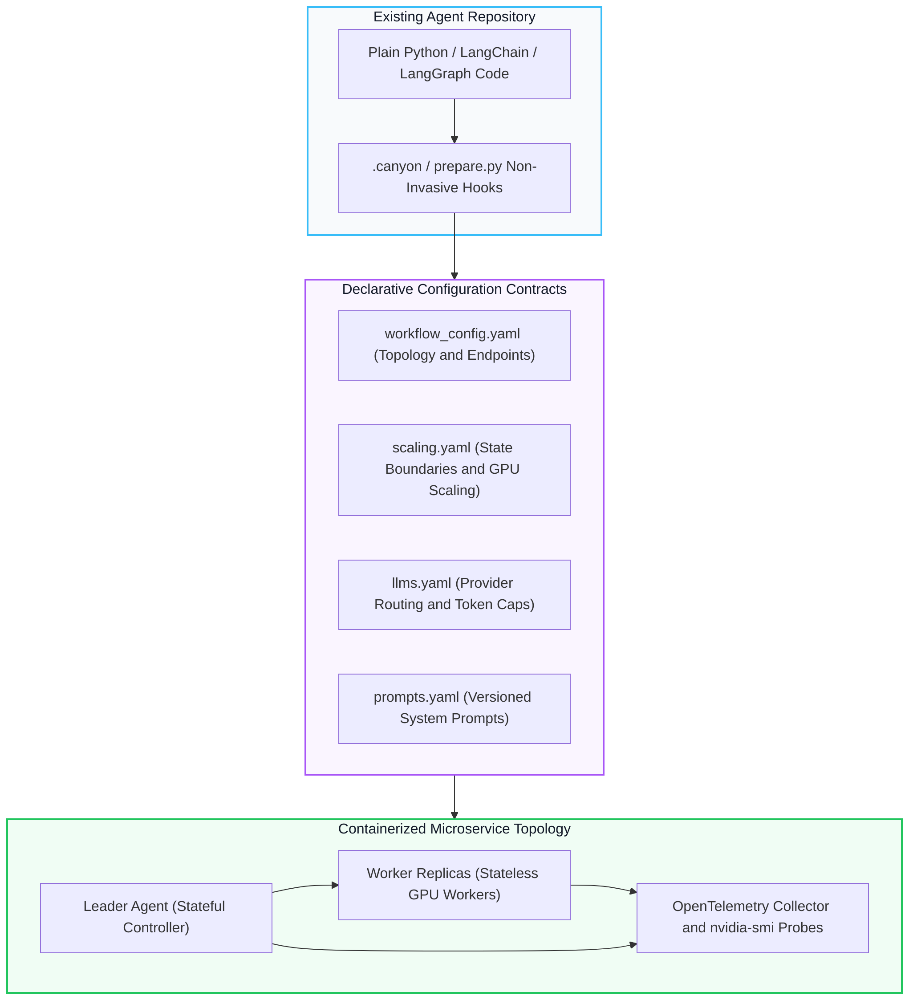

<figure class="explanatory-image">
  
  <figcaption>AI-generated illustration by Gemini: schematic visual representing cloud-native GPU clusters and multi-agent topology in CanyonOS; not source evidence.</figcaption>
</figure>

## The Production Gap Between Python Agent Scripts and Distributed Topologies

When software engineers transition multi-agent prototypes—built using standard Python, LangChain, or LangGraph—into production cloud environments, they encounter severe infrastructure friction. A multi-agent system running smoothly inside a single development process requires substantial refactoring to operate reliably across distributed servers. Each agent persona requires an isolated container image, explicit state boundaries, secure inter-service network routing, hardware GPU acceleration, and strict budgetary controls over language model token consumption.

Traditionally, addressing these requirements forces engineering teams to write hundreds of lines of boilerplate code: inheriting from proprietary cloud SDK base classes, littering application logic with vendor decorators, and hand-crafting complex Dockerfiles and Kubernetes manifests. This tight coupling between domain reasoning and infrastructure mechanics creates severe technical debt and vendor lock-in.

The release of **CanyonOS v0.2.2** by the CanyonCodeCoreAI team (pinned to commit `49e9bd042735aa88e694c9e1fc5069223ba19820`, Apache-2.0) dismantles this operational boundary. CanyonOS functions as a cloud-native agent operating system that converts existing Python agent code into scalable, containerized microservice topologies without requiring developers to alter a single line of application source code.



<svg viewBox="0 0 860 300" xmlns="http://www.w3.org/2000/svg" role="img" aria-label="CanyonOS control plane contracts and container deployment architecture" style="width:100%;max-width:860px;height:auto;display:block;margin:1.5rem auto;">
  <rect x="10" y="20" width="840" height="260" rx="10" fill="#080c14" stroke="#a855f7" stroke-width="2"/>
  <text x="30" y="52" fill="#a855f7" font-family="system-ui,-apple-system,sans-serif" font-size="14" font-weight="700">CANYONOS: FOUR DECLARATIVE CONTROL PLANE CONTRACTS</text>

  <rect x="30" y="75" width="190" height="170" rx="6" fill="#111827" stroke="#374151" stroke-width="1"/>
  <text x="45" y="105" fill="#38bdf8" font-family="system-ui,-apple-system,sans-serif" font-size="12" font-weight="700">WORKFLOW CONFIG</text>
  <text x="45" y="130" fill="#f8fafc" font-family="system-ui,-apple-system,sans-serif" font-size="11">workflow_config.yaml</text>
  <text x="45" y="152" fill="#94a3b8" font-family="system-ui,-apple-system,sans-serif" font-size="10">Primary serving endpoint</text>
  <text x="45" y="172" fill="#94a3b8" font-family="system-ui,-apple-system,sans-serif" font-size="10">Agent adapter mapping</text>
  <text x="45" y="192" fill="#94a3b8" font-family="system-ui,-apple-system,sans-serif" font-size="10">Callable functions whitelist</text>
  <text x="45" y="212" fill="#cbd5e1" font-family="system-ui,-apple-system,sans-serif" font-size="10">Enforces least privilege</text>

  <rect x="235" y="75" width="190" height="170" rx="6" fill="#111827" stroke="#374151" stroke-width="1"/>
  <text x="250" y="105" fill="#a855f7" font-family="system-ui,-apple-system,sans-serif" font-size="12" font-weight="700">SCALING CONFIG</text>
  <text x="250" y="130" fill="#f8fafc" font-family="system-ui,-apple-system,sans-serif" font-size="11">scaling.yaml</text>
  <text x="250" y="152" fill="#94a3b8" font-family="system-ui,-apple-system,sans-serif" font-size="10">Stateful vs Stateless mode</text>
  <text x="250" y="172" fill="#94a3b8" font-family="system-ui,-apple-system,sans-serif" font-size="10">Min / Max replica bounds</text>
  <text x="250" y="192" fill="#94a3b8" font-family="system-ui,-apple-system,sans-serif" font-size="10">NVIDIA GPU pass-through</text>
  <text x="250" y="212" fill="#cbd5e1" font-family="system-ui,-apple-system,sans-serif" font-size="10">Automated queue scaling</text>

  <rect x="440" y="75" width="190" height="170" rx="6" fill="#111827" stroke="#374151" stroke-width="1"/>
  <text x="455" y="105" fill="#f59e0b" font-family="system-ui,-apple-system,sans-serif" font-size="12" font-weight="700">LLM BUDGET CAP</text>
  <text x="455" y="130" fill="#f8fafc" font-family="system-ui,-apple-system,sans-serif" font-size="11">llms.yaml</text>
  <text x="455" y="152" fill="#94a3b8" font-family="system-ui,-apple-system,sans-serif" font-size="10">Model gateway provider</text>
  <text x="455" y="172" fill="#94a3b8" font-family="system-ui,-apple-system,sans-serif" font-size="10">Daily / Monthly token caps</text>
  <text x="455" y="192" fill="#94a3b8" font-family="system-ui,-apple-system,sans-serif" font-size="10">Fallback provider routing</text>
  <text x="455" y="212" fill="#cbd5e1" font-family="system-ui,-apple-system,sans-serif" font-size="10">Hard loop break protection</text>

  <rect x="645" y="75" width="185" height="170" rx="6" fill="#111827" stroke="#374151" stroke-width="1"/>
  <text x="660" y="105" fill="#10b981" font-family="system-ui,-apple-system,sans-serif" font-size="12" font-weight="700">VERSIONED PROMPTS</text>
  <text x="660" y="130" fill="#f8fafc" font-family="system-ui,-apple-system,sans-serif" font-size="11">prompts.yaml</text>
  <text x="660" y="152" fill="#94a3b8" font-family="system-ui,-apple-system,sans-serif" font-size="10">System prompt extraction</text>
  <text x="660" y="172" fill="#94a3b8" font-family="system-ui,-apple-system,sans-serif" font-size="10">Zero-rebuild hot patching</text>
  <text x="660" y="192" fill="#94a3b8" font-family="system-ui,-apple-system,sans-serif" font-size="10">A/B prompt variant testing</text>
  <text x="660" y="212" fill="#cbd5e1" font-family="system-ui,-apple-system,sans-serif" font-size="10">Deterministic rollback</text>
</svg>

## Non-Invasive Packaging via prepare.py and .canyon Metadata

The primary technical contribution of CanyonOS is its non-invasive packaging engine. When an engineer runs `canyonos new-app` on an existing codebase, CanyonOS does not modify source files. Instead, it inspects the Abstract Syntax Tree (AST) of the repository to discover agent classes, invocation signatures, and external imports.

The inspection engine emits a `.canyon/` metadata directory containing generated service wrappers:

1. **`prepare.py` Static Extraction**: Parses Python type hints and docstrings to expose OpenAPI-compliant JSON Schemas for each agent method, analogous to the automatic schema generation audited in [FastMCP In-Memory Transports](/posts/fastmcp-in-memory-and-skills-architecture/).
2. **Container Isolation Wrappers**: Generates dedicated entrypoint wrappers that bind HTTP and gRPC network listeners to agent methods without polluting the original class definition.
3. **Health Probe Injection**: Emits lightweight liveness and readiness endpoints (`/healthz`, `/ready`) that monitor memory consumption, event loop lag, and GPU availability.

Because the underlying repository remains vanilla Python, developers continue using standard local debugging tools, unit testing harnesses, and CI pipelines without running heavy virtualization locally.

## Declarative Control Planes: The Four Core YAML Contracts

CanyonOS decouples operational governance from agent logic using four declarative contracts:

### 1. Topology & Endpoints (`workflow_config.yaml`)

Defines the inter-agent communication graph. It specifies the primary external ingress `endpoint` and enumerates the exact `functions` each agent is permitted to call. By enforcing network segmentation at the adapter layer, a compromised researcher agent cannot invoke privileged deployment or financial tools.

### 2. State & GPU Scaling (`scaling.yaml`)

Specifies whether agent instances maintain durable state across calls or operate as disposable stateless workers. For computationally intensive workloads (such as running local vLLM or Ollama inference instances), `scaling.yaml` configures hardware acceleration:

```yaml
replicas:
  min: 1
  max: 8
  target_queue_latency_ms: 250
hardware:
  gpu:
    enabled: true
    count: 1
    device_flags: "--gpus all"
state:
  type: stateless
```

Under load spikes, CanyonOS spawns container replicas dynamically, attaching NVIDIA GPU devices via container runtime hooks while draining idle replicas when queues clear.

### 3. Model Gateways & Hard Cost Caps (`llms.yaml`)

One of the greatest operational risks in autonomous multi-agent deployments is runaway execution loops: two agents entering an infinite conversational recursion, accumulating thousands of dollars in cloud API bills overnight.

CanyonOS enforces hardware-level circuit breakers through `llms.yaml`:

```yaml
providers:
  primary: openai/gpt-4o
  fallback: anthropic/claude-3-5-sonnet
budget:
  max_daily_usd: 50.00
  max_tokens_per_minute: 100000
circuit_breaker:
  on_budget_exceeded: terminate_and_alert
```

When an agent trajectory exceeds configured spending limits, the CanyonOS proxy intercepts outgoing HTTP requests, aborts the task, and emits an alert—preventing runaway financial liabilities, similar to the cancel timeout budgets examined in our audit of [Browser Use Cloud Boundaries](/posts/browser-use-1-cloud-execution-boundary/).

### 4. Versioned Prompt Decoupling (`prompts.yaml`)

Hardcoding system prompts inside Python strings forces a full container build and rollout whenever instructions are updated. CanyonOS extracts prompts into a versioned registry. Operators can modify system instructions, test prompt variants, and deploy changes instantaneously across running replicas without restarting container processes.

## Distributed Observability: OpenTelemetry Tracing and GPU Probes

In distributed multi-agent systems, diagnosing latency spikes or execution failures across dozens of asynchronous microservices is notoriously difficult. CanyonOS integrates OpenTelemetry (OTel) instrumentation into its container wrappers by default:

- **W3C Trace Context Propagation**: Every agent call injects `traceparent` headers, linking parent prompts, child tool calls, and background sub-tasks into a unified distributed trace.
- **Hardware Telemetry Integration**: Background daemon probes query `nvidia-smi` to log VRAM allocation, GPU core utilization, and temperature directly alongside application trace spans.
- **Unified Health Verification**: Operators run `canyonos doctor` to diagnose network routing, DNS resolution, and GPU driver compatibility across all cluster nodes in a single command.

## Architectural Comparison: Containerized Agent Frameworks

| Architectural Metric | Manual Docker / K8s Deployment | Decorator-Heavy Frameworks | CanyonOS (v0.2.2) |
|---|---|---|---|
| **Code Modification** | Manual Dockerfile & YAML authoring | Mandatory proprietary decorators | Zero code changes (AST extraction) |
| **Agent Packaging** | Monolithic container image | Shared runtime process | Individual microservice replicas |
| **Configuration Model** | Scattered Helm / K8s manifests | Code-embedded configurations | 4 declarative YAML control planes |
| **GPU Auto-Scaling** | Complex K8s Device Plugin setup | Manual cloud host provisioning | Declarative `scaling.yaml` (`--gpus all`) |
| **Budget Circuit Breakers** | None (manual cloud billing alerts) | Application-level middleware | Proxy-enforced hard budget caps |
| **Telemetry Built-in** | Manual OTel exporter setup | Proprietary SaaS dashboard lock-in | Native OpenTelemetry + `nvidia-smi` |

## Key Takeaways

- **Zero-Code Containerization**: CanyonOS transforms existing Python agent repositories into containerized microservice topologies using static AST analysis and `.canyon` wrappers without touching source code.
- **Declarative Operational Governance**: Four declarative YAML contracts (`workflow_config`, `scaling`, `llms`, `prompts`) cleanly isolate network security, GPU scaling, cost caps, and prompt management from domain logic.
- **Hard Cost Protection**: Infrastructure-level token budgeting circuit breakers prevent runaway recursive loops from generating unexpected cloud billing spikes.
- **Turnkey Production Observability**: Automated W3C trace propagation and live GPU metric harvesting provide immediate diagnostic visibility into multi-agent latency bottlenecks, complementing runtime verification tools like [TruLens Evaluation Pipelines](/posts/trulens-rag-triad-evaluation/).

## Open Questions

- **Cross-Host GPU Memory Migration**: When stateful agents require migration across physical GPU nodes during node maintenance, how can VRAM context caches be transferred without cold-start model reloading?
- **gRPC vs WebSockets for Interservice Traffic**: While HTTP/gRPC handles request-response agent calls cleanly, how will high-frequency streaming interactions (such as live audio or video token streaming) scale across container boundaries?
- **Serverless Scale-to-Zero Latency**: For agents that run intermittently, can cold-start initialization latency (container pull, GPU driver attachment) be brought under 500 milliseconds on cloud Kubernetes clusters?

## References

- [CanyonCodeCoreAI CanyonOS Repository](https://github.com/CanyonCodeCoreAI/canyonos) — Canonical upstream repository, commit `49e9bd042735aa88e694c9e1fc5069223ba19820`.
- [CanyonOS Architecture and Deployment Specification](https://github.com/CanyonCodeCoreAI/canyonos/blob/main/README.md) — Multi-agent container scaling operator guides.
- [OpenTelemetry Python Instrumentation](https://opentelemetry.io/docs/languages/python/) — Distributed tracing standards and W3C trace context propagation.
- [NVIDIA Container Toolkit Reference](https://docs.nvidia.com/datacenter/cloud-native/container-toolkit/latest/index.html) — GPU pass-through configuration and container runtime interfaces.
