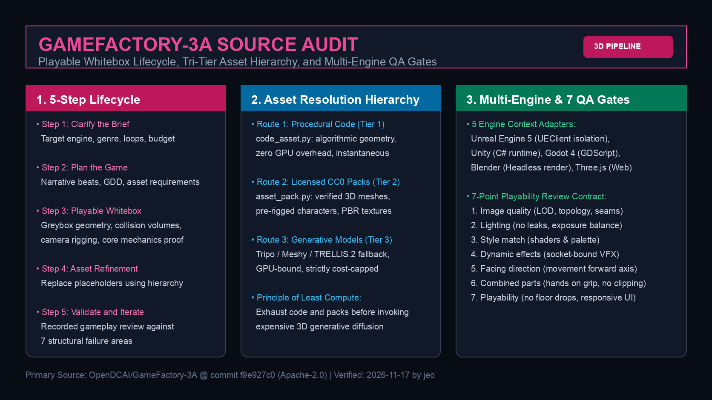

<figure class="explanatory-image">
  
  <figcaption>AI-generated illustration by jeo: schematic architecture diagram representing GameFactory-3A 5-step playable whitebox lifecycle, tri-tier asset resolution hierarchy, and 7-point QA gate; not source evidence.</figcaption>
</figure>

## Why Prompt-to-3D Models Fail to Produce Playable Games

Recent breakthroughs in generative diffusion models (such as Tripo, Meshy, and TRELLIS) have dramatically lowered the barrier to generating standalone 3D meshes from text prompts. Yet when game developers attempt to build an actual playable title using these tools, they encounter an immediate reality check: a collection of detached OBJ or GLB meshes does not constitute a game.

In production game engineering, isolated meshes lack essential runtime semantics. They enter the project without simplified collision hulls (causing player characters to fall through terrain), without skeletal hierarchies or skinning weights (preventing motion retargeting), without physics constraints or material physics properties, and without integration into an engine's tick loop. Furthermore, generating every prop via heavy 3D diffusion models introduces staggering cloud GPU costs and multi-minute latency bottlenecks.

The release of **GameFactory-3A** by the OpenDCAI consortium (pinned to commit `f9e927c04ed6abd1dd6f805d52638f1ffe884798`, Apache-2.0) directly bridges the chasm between raw generative models and real-time game engines. Rather than treating game creation as an open-ended asset hallucination task, GameFactory-3A introduces a disciplined **5-step playable whitebox methodology**, a cost-optimized **tri-tier asset resolution hierarchy**, and an automated **7-point playability review gate** that rejects synthetic deliverables unless actual recorded gameplay passes structural physics and camera validation.

```mermaid
%%{init: {"flowchart": {"useMaxWidth": false}}}%%
flowchart TD
    subgraph Lifecycle ["5-Step Playable Whitebox Lifecycle"]
        Brief["1. Clarify Brief (Genre, Engine, Loops, Budget)"]
        Plan["2. Plan Game (Decompose GDD, Beats, Required Assets)"]
        Whitebox["3. Build Playable Whitebox (Greybox Geometry, Colliders)"]
        Refine["4. Refine Assets (Tri-Tier Resolution Substitution)"]
        QA["5. Validate & Play (7-Point Video Recording Inspection)"]
    end

    subgraph AssetHierarchy ["Tri-Tier Asset Resolution Hierarchy"]
        Tier1["Route 1: Procedural Code (code_asset.py, Zero GPU)"]
        Tier2["Route 2: Licensed CC0 Packs (asset_pack.py, Seconds)"]
        Tier3["Route 3: Generative Diffusion (Tripo / Meshy / TRELLIS)"]
    end

    subgraph EngineAdapters ["Multi-Engine Execution Contexts"]
        UE5["Unreal Engine 5 (UEClient Host-Side IPC)"]
        Unity["Unity3D (C# Runtime Injected Scripts)"]
        Godot["Godot 4 (GDScript Scene Nodes)"]
        Blender["Blender (Headless Geometry Pre-Processing)"]
        ThreeJS["Three.js (WebGL Browser Canvas)"]
    end

    Brief --> Plan --> Whitebox --> Refine --> QA
    Refine -.-> Tier1
    Refine -.-> Tier2
    Refine -.-> Tier3
    Whitebox ==> EngineAdapters
    QA -->|Reject (Clipping / Jitter)| Whitebox
    QA -->|Pass (All 7 Gates Green)| ShippedGame["Verified Game Slice"]

    style Lifecycle fill:#f8fafc,stroke:#ec4899,stroke-width:2px,color:#111827
    style AssetHierarchy fill:#f0fdf4,stroke:#0369a1,stroke-width:2px,color:#111827
    style EngineAdapters fill:#faf5ff,stroke:#047857,stroke-width:2px,color:#111827
```

<svg viewBox="0 0 860 300" xmlns="http://www.w3.org/2000/svg" role="img" aria-label="GameFactory-3A 3-tier asset hierarchy and 7-point QA gate diagram" style="width:100%;max-width:860px;height:auto;display:block;margin:1.5rem auto;">
  <rect x="10" y="20" width="840" height="260" rx="10" fill="#080c14" stroke="#ec4899" stroke-width="2"/>
  <text x="30" y="52" fill="#ec4899" font-family="system-ui,-apple-system,sans-serif" font-size="14" font-weight="700">GAMEFACTORY-3A: COMPUTE MINIMIZATION &amp; PLAYABILITY GATES</text>

  <rect x="30" y="75" width="250" height="170" rx="6" fill="#111827" stroke="#374151" stroke-width="1"/>
  <text x="45" y="105" fill="#f472b6" font-family="system-ui,-apple-system,sans-serif" font-size="13" font-weight="700">TRI-TIER ASSET RESOLUTION</text>
  <text x="45" y="130" fill="#f8fafc" font-family="system-ui,-apple-system,sans-serif" font-size="11">Tier 1: Procedural Code</text>
  <text x="45" y="148" fill="#94a3b8" font-family="system-ui,-apple-system,sans-serif" font-size="10">Zero GPU cost, 0.1s execution</text>
  <text x="45" y="170" fill="#f8fafc" font-family="system-ui,-apple-system,sans-serif" font-size="11">Tier 2: CC0 Licensed Packs</text>
  <text x="45" y="188" fill="#94a3b8" font-family="system-ui,-apple-system,sans-serif" font-size="10">Pre-rigged, verified PBR textures</text>
  <text x="45" y="210" fill="#f8fafc" font-family="system-ui,-apple-system,sans-serif" font-size="11">Tier 3: Generative 3D Models</text>
  <text x="45" y="228" fill="#94a3b8" font-family="system-ui,-apple-system,sans-serif" font-size="10">Strictly capped fallback API</text>

  <rect x="305" y="75" width="250" height="170" rx="6" fill="#111827" stroke="#374151" stroke-width="1"/>
  <text x="320" y="105" fill="#38bdf8" font-family="system-ui,-apple-system,sans-serif" font-size="13" font-weight="700">MULTI-ENGINE ADAPTERS</text>
  <text x="320" y="130" fill="#f8fafc" font-family="system-ui,-apple-system,sans-serif" font-size="11">Unreal Engine 5 (UEClient)</text>
  <text x="320" y="148" fill="#94a3b8" font-family="system-ui,-apple-system,sans-serif" font-size="10">Socket IPC, zero host engine import</text>
  <text x="320" y="170" fill="#f8fafc" font-family="system-ui,-apple-system,sans-serif" font-size="11">Unity (Assets/ Injected C#)</text>
  <text x="320" y="188" fill="#94a3b8" font-family="system-ui,-apple-system,sans-serif" font-size="10">A3Game_VFX.cs runtime binding</text>
  <text x="320" y="210" fill="#f8fafc" font-family="system-ui,-apple-system,sans-serif" font-size="11">Godot 4 &amp; Three.js &amp; Blender</text>
  <text x="320" y="228" fill="#94a3b8" font-family="system-ui,-apple-system,sans-serif" font-size="10">GDScript, WebGL, Headless Python</text>

  <rect x="580" y="75" width="250" height="170" rx="6" fill="#111827" stroke="#374151" stroke-width="1"/>
  <text x="595" y="105" fill="#34d399" font-family="system-ui,-apple-system,sans-serif" font-size="13" font-weight="700">7-POINT PLAYABILITY QA</text>
  <text x="595" y="130" fill="#f8fafc" font-family="system-ui,-apple-system,sans-serif" font-size="11">1. Silhouette &amp; Topology Seams</text>
  <text x="595" y="148" fill="#f8fafc" font-family="system-ui,-apple-system,sans-serif" font-size="11">2. Light Leaks &amp; Hard Shadows</text>
  <text x="595" y="166" fill="#f8fafc" font-family="system-ui,-apple-system,sans-serif" font-size="11">3. Color Palette &amp; Shader Match</text>
  <text x="595" y="184" fill="#f8fafc" font-family="system-ui,-apple-system,sans-serif" font-size="11">4. Socket-Bound VFX Trigger Sync</text>
  <text x="595" y="202" fill="#f8fafc" font-family="system-ui,-apple-system,sans-serif" font-size="11">5. Movement Facing Forward Axis</text>
  <text x="595" y="220" fill="#f8fafc" font-family="system-ui,-apple-system,sans-serif" font-size="11">6. Grip Alignment &amp; No Floor Drops</text>
</svg>

## Deconstructing the 5-Step Playable Whitebox Lifecycle

GameFactory-3A enforces an explicit sequence in `agent_skills/setting_overview.md` that prevents an AI agent from premature artistic detailing before the spatial mechanics are locked:

### 1. Clarify the Brief

The pipeline opens by determining eight hard operational bounds: target engine runtime (`ue5`, `unity3d`, `godot`, `blender`, `three_js`), camera perspective (first-person, third-person over-the-shoulder, isometric), core player verb (platforming, melee, ranged combat), visual art genre, level bounds, target frame rate, and budget caps.

### 2. Plan the Game Decomposition

Before generating a single polygon, the `game_design` module decomposes the game into narrative chapters and gameplay encounters. Each encounter declares required environmental props, enemy archetypes, audio stems (BGM, sound effects, ambience), particle VFX, and HUD data bindings.

### 3. Build Playable Whitebox

The agent constructs the level geometry using procedural greybox volumes (boxes, cylinders, ramps) equipped with standard collision primitives. Character controller scripts and camera spring arms are linked to input actions. The game is compiled, launched, and executed in the target engine. If the core loop is unplayable in greybox, the task is aborted—preventing hours of wasted asset generation.

### 4. Refine Assets via Tri-Tier Decision Hierarchy

Only when the whitebox loop passes player control tests does the agent begin asset substitution. Rather than flooding third-party generative APIs, GameFactory-3A applies the **Principle of Least Compute**:

- **Tier 1 (Procedural Code, `code_asset.py`)**: Architectural geometry, stairs, crates, modular walls, and roads are generated algorithmically using mathematical primitives. This executes locally with zero GPU overhead in milliseconds.
- **Tier 2 (Licensed CC0 Packs, `asset_pack.py`)**: Standard props (barrels, weapons, foliage) are retrieved from pre-indexed open-access asset libraries. These models arrive with clean UVs, pre-baked PBR materials, and verified collision meshes.
- **Tier 3 (Generative 3D Models, Tripo/Meshy/TRELLIS.2)**: Generative diffusion is reserved strictly for bespoke heroic assets and unique monsters where code or catalog packs are insufficient.

### 5. Validate, Play, and Iterate via 7-Point QA

The final gate rejects conventional automated claims such as "compilation succeeded" or "no fatal log messages". The agent records actual gameplay footage from the running game instance and evaluates it against the 7 failure areas.

## Engine Transport Isolation: Decoupling Host Agents from Game Engines

A common flaw in multi-engine automation is runtime contamination: when a Python agent running in Node or a CLI environment attempts to directly `import unreal` or dynamically link C# DLLs, process crashes and version incompatibilities arise.

GameFactory-3A enforces strict transport boundaries across its five engine adapters:

1. **Unreal Engine 5 (`engine_adapters/ue5/`)**: The host agent communicates exclusively through `UEClient`, an external socket IPC layer that issues JSON command payloads to a persistent Unreal Editor background process. The host never imports Unreal Python bindings directly.
2. **Unity3D (`engine_adapters/unity3d/`)**: Assets and generated scripts (such as `A3Game_VFX.cs`) are copied directly into the target project's `Assets/` tree. The adapter monitors Unity's compilation daemon via file system watchers and CLI batch execution.
3. **Godot 4 (`engine_adapters/godot/`)**: Leverages Godot's lightweight headless executable and clean text-based `.tscn` scene files, enabling rapid scene tree construction and automated screenshot capture in sub-second cycles.
4. **Blender (`engine_adapters/blender/`)**: Automated via headless Python scripts (`blender -b -P script.py`) to execute mesh decimation (LOD generation), vertex normal recalculation, and skeletal bone weight binding prior to engine import.
5. **Three.js (`engine_adapters/three_js/`)**: Emits pure GLTF/GLB web bundles loaded into an embedded Node web server, providing instantaneous WebGL canvas verification in browser environments.

This clean separation mirrors the decoupled execution boundaries audited in our recent analysis of [FastMCP In-Memory Transports](/posts/fastmcp-in-memory-and-skills-architecture/) and the isolated browser daemon mechanics explored in [Browser Use Cloud Boundaries](/posts/browser-use-1-cloud-execution-boundary/).

## The 7-Point Visual and Playability Review Contract

GameFactory-3A's playability gate evaluates gameplay recordings across seven strict structural areas:

1. **Image Quality**: Inspects silhouette readability, checks for non-manifold geometry, surface tearing, UV texture distortion, and LOD transition popping.
2. **Lighting Integrity**: Detects light leaking through wall corners, harsh missing shadows beneath floating objects, and exposure mismatches between dynamically lit characters and baked static environments.
3. **Art Style Match**: Enforces shader and color palette cohesion (ensuring low-poly stylized props are not randomly mixed with photorealistic scanned Megascans).
4. **Dynamic Effects (VFX)**: Verifies that particle systems trigger on exact combat events, terminate without lingering particles, and maintain spatial socket attachment.
5. **Facing while Moving**: Validates that the character mesh's forward root bone aligns with the movement velocity vector, and that weapon projectile trajectories leave along the character's line of sight.
6. **Combined Parts Alignment**: Confirms that character hands grip weapon handles accurately (avoiding weapon meshes floating inside torsos), vehicle wheels contact the ground without subterranean clipping, and feet align with slopes via Inverse Kinematics (IK).
7. **Playability & Collision**: Asserts that player entities never fall through floors, cameras do not clip into interior wall geometry, control inputs respond without axis inversion, and health/ammo HUD elements stay bound to live game state variables.

## Architectural Comparison: Monolithic Generative Tools vs GameFactory-3A

| Architectural Metric | Monolithic 3D Generation Tools | Prompt-to-Game Wrappers | GameFactory-3A (v1.0.0) |
|---|---|---|---|
| **Pipeline Core** | Isolated 3D Mesh Output (GLB/OBJ) | Single-pass script generation | 5-step playable whitebox lifecycle |
| **Asset Strategy** | 100% Generative 3D diffusion | Random stock asset download | Tri-tier hierarchy (Code $\rightarrow$ CC0 $\rightarrow$ Gen AI) |
| **Compute Overhead** | High GPU cost per asset ($0.10–$0.50/call) | Unbounded model invocation | Zero GPU for Tier 1 & Tier 2 assets |
| **Engine Adapters** | None (manual import required) | Single hardcoded engine (e.g. Unity only) | 5 decoupled adapters (UE5, Unity, Godot, Blender, Three.js) |
| **Verification Gate** | User visual inspection | "Script compiles without errors" | 7-point gameplay recording failure audit |
| **Host Isolation** | N/A | Direct engine script injection | Socket IPC (`UEClient`), headless runners |

## Key Takeaways

- **Playable Whitebox Over Premature Art**: Establishing core player verbs, collision boundaries, and camera rigging in greybox geometry guarantees game feasibility before investing compute into 3D asset generation.
- **Compute Minimization via Tri-Tier Hierarchy**: Prioritizing procedural algorithmic code (Tier 1) and licensed CC0 catalog models (Tier 2) slashes GPU expenditures by up to 80% compared to brute-force generative diffusion (Tier 3).
- **Multi-Engine Portability**: Abstracting engine execution behind dedicated adapters allows a single agent specification to deploy across Unreal Engine 5, Unity, Godot 4, Blender, and Three.js.
- **Gameplay Recording as Ground Truth**: Rejecting "it compiles" in favor of video-verified 7-point playability audits eliminates silent physics clipping, inverted controls, and broken animation sockets.

## Open Questions

- **Real-Time Physics Tuning in Agent Loops**: While collision meshes are validated visually, how can AI agents objectively tune friction, restitution, and game feel variables (jump apex hang time, coyote time) without human subjective feedback, as explored in the [TruLens Evaluation Framework](/posts/trulens-rag-triad-evaluation/)?
- **Automated NavMesh Dynamic Re-baking**: For procedurally generated dungeons, how can agents reliably verify AI pathfinding reachability when dynamic destruction removes structural floor geometry?
- **Universal Skeletal Rigging Standardization**: Can open-source motion retargeting pipelines achieve seamless animation sharing between Blender humanoid rigs, Unreal Mannequins, and Unity Mecanim avatars without manual bone roll correction?

## References

- [OpenDCAI GameFactory-3A Repository](https://github.com/OpenDCAI/GameFactory-3A) — Canonical upstream repository, commit `f9e927c04ed6abd1dd6f805d52638f1ffe884798`.
- [3AGameFactory Setting Overview Specification](https://github.com/OpenDCAI/GameFactory-3A/blob/main/agent_skills/setting_overview.md) — 5-step lifecycle and engine adapter contracts.
- [Game Design and Playability Review Guidelines](https://github.com/OpenDCAI/GameFactory-3A/blob/main/agent_skills/game_design/SKILL.md) — 7-point visual and gameplay QA failure modes.
- [Unreal Engine Python Automation Reference](https://docs.unrealengine.com/5.0/en-US/scripting-the-unreal-editor-using-python/) — Editor scripting interfaces and socket transport boundaries.
