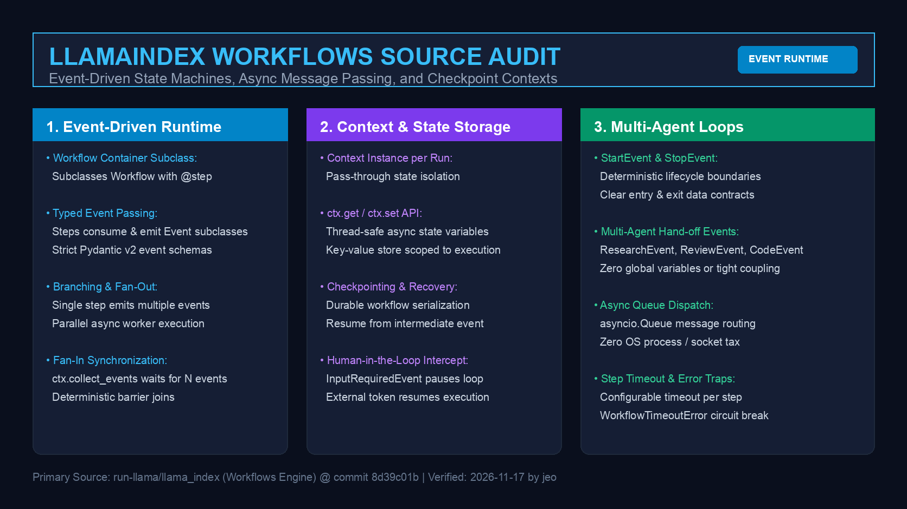
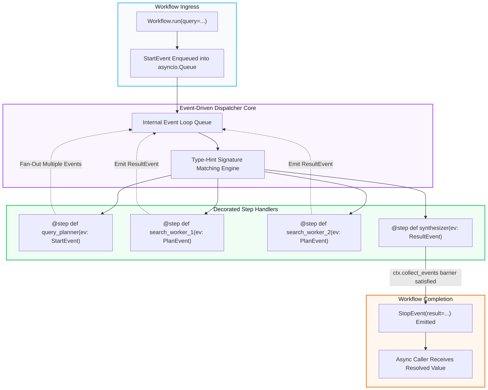

<figure class="explanatory-image">
  
  <figcaption>AI-generated illustration by jeo: schematic architecture diagram representing LlamaIndex Workflows event-driven runtime, fan-out and fan-in barriers, and context checkpointing; not source evidence.</figcaption>
</figure>

## The Architectural Limits of Static Graph Abstractions in Agentic Systems

In the evolution of multi-agent software engineering, developers have predominantly relied on graph-based abstractions: Directed Acyclic Graphs (DAGs) and explicit StateGraphs. In these paradigms, an application is modeled as a collection of fixed nodes connected by predetermined edges. While suitable for linear data pipelines and rigid state transitions, graph abstractions strain under the dynamic realities of production autonomous agents.

Real-world agent interactions rarely follow static topological paths. A research coordinator agent may inspect an ambiguous user query and dynamically fan out three parallel search tasks across heterogeneous APIs. Asynchronously, those three tasks complete at unpredictable intervals and must be gathered through a deterministic synchronization barrier before a summarizer agent can execute. If an unexpected error or missing parameter occurs, the pipeline must dynamically route into an interrogation sub-loop without rewiring the global graph structure.

The release of the **Workflows runtime** within the LlamaIndex framework (pinned to commit `8d39c01b1a457ee8c1b923984faefea6db467888`, MIT/Apache-2.0) resolves this tension by abandoning static graph topology in favor of a pure **event-driven asynchronous state machine**.



<svg viewBox="0 0 860 300" xmlns="http://www.w3.org/2000/svg" role="img" aria-label="LlamaIndex Workflows event passing and barrier synchronization diagram" style="width:100%;max-width:860px;height:auto;display:block;margin:1.5rem auto;">
  <rect x="10" y="20" width="840" height="260" rx="10" fill="#0a0f1d" stroke="#38bdf8" stroke-width="2"/>
  <text x="30" y="52" fill="#38bdf8" font-family="system-ui,-apple-system,sans-serif" font-size="14" font-weight="700">LLAMAINDEX WORKFLOWS: EVENT-DRIVEN STATE MACHINE ARCHITECTURE</text>

  <rect x="30" y="75" width="250" height="170" rx="6" fill="#151e34" stroke="#1e293b" stroke-width="1"/>
  <text x="45" y="105" fill="#38bdf8" font-family="system-ui,-apple-system,sans-serif" font-size="13" font-weight="700">1. EVENT PASSING</text>
  <text x="45" y="130" fill="#f8fafc" font-family="system-ui,-apple-system,sans-serif" font-size="11">StartEvent to StopEvent</text>
  <text x="45" y="152" fill="#94a3b8" font-family="system-ui,-apple-system,sans-serif" font-size="10">Decoupled Pydantic v2 schemas</text>
  <text x="45" y="172" fill="#94a3b8" font-family="system-ui,-apple-system,sans-serif" font-size="10">Type-inferred queue dispatch</text>
  <text x="45" y="192" fill="#94a3b8" font-family="system-ui,-apple-system,sans-serif" font-size="10">Zero explicit edge configuration</text>
  <text x="45" y="212" fill="#cbd5e1" font-family="system-ui,-apple-system,sans-serif" font-size="10">Sub-millisecond in-process routing</text>

  <rect x="305" y="75" width="250" height="170" rx="6" fill="#151e34" stroke="#1e293b" stroke-width="1"/>
  <text x="320" y="105" fill="#c084fc" font-family="system-ui,-apple-system,sans-serif" font-size="13" font-weight="700">2. FAN-IN BARRIERS</text>
  <text x="320" y="130" fill="#f8fafc" font-family="system-ui,-apple-system,sans-serif" font-size="11">ctx.collect_events Barrier</text>
  <text x="320" y="152" fill="#94a3b8" font-family="system-ui,-apple-system,sans-serif" font-size="10">Buffers parallel emitted events</text>
  <text x="320" y="172" fill="#94a3b8" font-family="system-ui,-apple-system,sans-serif" font-size="10">Waits for N matching events</text>
  <text x="320" y="192" fill="#94a3b8" font-family="system-ui,-apple-system,sans-serif" font-size="10">Eliminates async race conditions</text>
  <text x="320" y="212" fill="#cbd5e1" font-family="system-ui,-apple-system,sans-serif" font-size="10">Deterministic state aggregation</text>

  <rect x="580" y="75" width="250" height="170" rx="6" fill="#151e34" stroke="#1e293b" stroke-width="1"/>
  <text x="595" y="105" fill="#34d399" font-family="system-ui,-apple-system,sans-serif" font-size="13" font-weight="700">3. CHECKPOINT CONTEXT</text>
  <text x="595" y="130" fill="#f8fafc" font-family="system-ui,-apple-system,sans-serif" font-size="11">Durable State &amp; Pauses</text>
  <text x="595" y="152" fill="#94a3b8" font-family="system-ui,-apple-system,sans-serif" font-size="10">ctx.get and ctx.set thread isolation</text>
  <text x="595" y="172" fill="#94a3b8" font-family="system-ui,-apple-system,sans-serif" font-size="10">InputRequiredEvent human pause</text>
  <text x="595" y="192" fill="#94a3b8" font-family="system-ui,-apple-system,sans-serif" font-size="10">Event stream disk persistence</text>
  <text x="595" y="212" fill="#cbd5e1" font-family="system-ui,-apple-system,sans-serif" font-size="10">Fault-tolerant crash recovery</text>
</svg>

## Deconstructing the Event-Driven Runtime Mechanics

In LlamaIndex Workflows, an agentic application subclasses the base `Workflow` container. Steps are declared using the `@step` decorator. Instead of specifying which step precedes or follows another, steps declare the input `Event` types they consume and return the `Event` instances they produce.

### 1. Type-Inferred Dispatch

The internal dispatch engine is backed by Python's native `asyncio.Queue`. When a workflow begins via `await workflow.run(query="...")`, the runtime constructs a `StartEvent` and enqueues it.

The dispatcher inspects registered `@step` methods at module load time. When an event arrives on the queue, the dispatcher matches the event's Python class against the type annotations of all registered steps. Any step matching the incoming event signature is dispatched as an asynchronous coroutine task.

This decouples steps completely: a planning step does not know whether one, five, or zero workers will consume its output event. New capabilities are plugged in simply by adding a step that subscribes to an existing event type.

### 2. Deterministic Fan-In with `ctx.collect_events`

In distributed agent topologies, coordinating parallel asynchronous sub-tasks is a notorious source of race conditions and memory leaks. Workflows solves this through its native `ctx.collect_events` synchronization barrier:

```python
from llama_index.core.workflow import Workflow, Event, StartEvent, StopEvent, step, Context

class ResearchResultEvent(Event):
    source: str
    content: str

class ResearchWorkflow(Workflow):
    @step
    async def gather_data(self, ctx: Context, ev: ResearchResultEvent) -> StopEvent | None:
        # Wait until 3 parallel research events have been delivered
        events = ctx.collect_events(ev, [ResearchResultEvent] * 3)
        if events is None:
            return None  # Barrier not yet satisfied; yield execution
        
        # All 3 events collected deterministically
        aggregated = "\n".join([e.content for e in events])
        return StopEvent(result=aggregated)
```

The `Context` object maintains an in-memory event buffer scoped to the active execution run. Until the exact required quantity of events has accumulated, `ctx.collect_events` returns `None`, quietly yielding execution. Only when the final event arrives does the method return the complete list, triggering downstream synthesis in a single atomic invocation.

## Context Checkpointing, State Scoping, and Human-in-the-Loop

A major pitfall of agent orchestration frameworks is state leakage: when multiple concurrent user sessions share agent memory, mutable variables contaminate concurrent requests.

Workflows enforces strict scoping boundaries through its execution-bound `Context`:

- **Execution-Scoped Key-Value Store**: Calling `await ctx.set("user_id", "123")` and `await ctx.get("user_id")` provides thread-safe state access guaranteed to remain isolated to the specific workflow execution.
- **Durable Checkpointing**: Because all state transitions are mediated by discrete, serializable `Event` objects, the runtime can write the event log to disk or PostgreSQL. If a container dies mid-execution, the workflow reconstructs its state by replaying previous events up to the failure point.
- **Human-in-the-Loop Pausing**: By emitting an `InputRequiredEvent`, the workflow enters a suspended state, serializing its context and freeing execution threads. When an operator submits the required approval token via `HumanResponseEvent`, the workflow resumes seamlessly without holding live socket connections open.

This clean separation of state and execution mirrors the non-invasive container isolation we audited in [CanyonOS Multi-Agent Scaling](/posts/canyonos-multi-agent-orchestration-and-gpu-scaling/) and the robust process boundaries explored in [Browser Use Cloud Boundaries](/posts/browser-use-1-cloud-execution-boundary/).

## Architectural Comparison Across Multi-Agent Orchestrators

| Architectural Metric | LangGraph (StateGraph) | CrewAI | LlamaIndex Workflows |
|---|---|---|---|
| **Control Abstraction** | Explicit state transition graph | Role-based sequential crew | Event-driven async state machine |
| **Node Binding** | Nodes connected by explicit edges | Sequential / hierarchical manager | Type-hinted event queue matching |
| **Fan-In Coordination** | Conditional edge routing | Manager agent polling | Built-in `ctx.collect_events` barrier |
| **State Paradigm** | Centralized state dictionary reducer | Shared task context memory | Scoped `Context` store + event replay |
| **Runtime Overhead** | Graph compilation overhead | High prompt token overhead | Sub-millisecond `asyncio` coroutine dispatch |
| **Extensibility** | Requires updating graph topology | Fixed agent role structure | Add `@step` subscribing to any `Event` |

## Key Takeaways

- **Event-Driven Over Graph Topology**: Modeling agent workflows as asynchronous event queues eliminates fragile node-and-edge wiring while providing natural support for non-linear, dynamic multi-agent loops.
- **Deterministic Synchronization**: The `ctx.collect_events` barrier solves parallel fan-out and fan-in data joins without custom locks, semaphores, or race conditions.
- **Isolated Context State**: Scoping state to an explicit `Context` instance prevents memory leaks across concurrent requests while enabling durable disk checkpointing and fault-tolerant crash recovery.
- **Native Human-in-the-Loop**: Suspending workflows via `InputRequiredEvent` allows long-running governance and human approval loops without keeping expensive server threads active.

## Open Questions

- **Distributed Event Queue Backends**: While in-process `asyncio.Queue` delivers sub-millisecond dispatch on a single node, how will Workflows scale across distributed Kubernetes worker pods using Redis or Kafka event brokers without increasing serialization latency, as explored in [FastMCP In-Memory Transports](/posts/fastmcp-in-memory-and-skills-architecture/)?
- **Event Schema Evolution**: In production pipelines with long-running checkpoints, how can teams handle backward-incompatible migrations to Pydantic event schemas without invalidating persisted in-flight workflows?
- **Automated Deadlock Detection**: If an upstream step fails to emit the expected number of events required by `ctx.collect_events`, what automated timeout policies should garbage-collect the stalled barrier?

## References

- [LlamaIndex Core Workflows Repository](https://github.com/run-llama/llama_index) — Canonical upstream repository, commit `8d39c01b1a457ee8c1b923984faefea6db467888`.
- [LlamaIndex Workflows Documentation](https://docs.llamaindex.ai/en/stable/module_guides/workflow/) — Official guides covering Workflow, Context, Event subclasses, and human-in-the-loop patterns.
- [Python Asynchronous I/O Documentation](https://docs.python.org/3/library/asyncio.html) — Reference for coroutine scheduling and event loop primitives.
