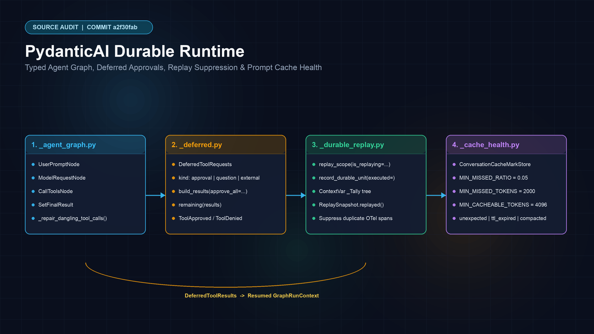
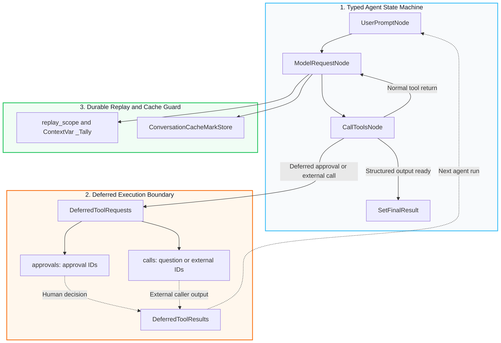

<figure class="explanatory-image">
  
  <figcaption>Original illustration by jeo (Pillow programmatic schematic) illustrating PydanticAI's graph nodes, deferred tool approval boundaries, replay telemetry scopes, and cache-collapse monitoring; not source evidence.</figcaption>
</figure>

## Why Do Durable Agent Loops Double-Count Telemetry and Lose Track of Pending Approvals?

Most Python agent SDKs treat a run as a single in-memory `while` loop: call a model, execute tools, append messages, and return text. That model breaks down the moment an agent runs inside a durable workflow engine (such as Temporal or DBOS), pauses for human approval mid-turn, or sustains long multi-turn conversations against provider prompt caches.

When a durable engine resumes a crashed or suspended workflow, it replays the agent run from the beginning while returning stored results for completed units. Without explicit replay accounting, OpenTelemetry instrumentation re-emits spans and double-bills token and cost metrics for work that never re-executed. Meanwhile, pausing for human approval leaves dangling tool calls in message history unless the framework separates pending external requests from resolved tool results, and silent edits to early messages invalidate provider prompt caches without alerting operators.

Inspecting `pydantic/pydantic-ai` at pinned commit `a2f30fab734755e41c9f6b72e09f7d93340e6c6b` reveals four concrete internal subsystems that address these failure modes directly: `_agent_graph.py`, `_deferred.py`, `_durable_replay.py`, and `_cache_health.py`.



<svg viewBox="0 0 860 280" xmlns="http://www.w3.org/2000/svg" role="img" aria-label="PydanticAI internal contract layers across graph state, deferred tools, replay tallying, and cache health" style="width:100%;max-width:860px;height:auto;display:block;margin:1.5rem auto;">
  <rect x="12" y="16" width="836" height="248" rx="10" fill="none" stroke="#38bdf8" stroke-width="2"/>
  <text x="32" y="46" fill="#0284c7" font-family="system-ui,-apple-system,sans-serif" font-size="14" font-weight="700">PYDANTIC-AI INTERNAL SUBSYSTEM BOUNDARIES (COMMIT a2f30fab)</text>

  <rect x="32" y="68" width="188" height="174" rx="6" fill="none" stroke="#38bdf8" stroke-width="1.5"/>
  <text x="44" y="94" fill="#0284c7" font-family="system-ui,-apple-system,sans-serif" font-size="12" font-weight="700">_agent_graph.py</text>
  <text x="44" y="118" fill="currentColor" font-family="system-ui,-apple-system,sans-serif" font-size="10.5">GraphAgentState</text>
  <text x="44" y="138" fill="currentColor" font-family="system-ui,-apple-system,sans-serif" font-size="10.5">UserPromptNode</text>
  <text x="44" y="158" fill="currentColor" font-family="system-ui,-apple-system,sans-serif" font-size="10.5">ModelRequestNode</text>
  <text x="44" y="178" fill="currentColor" font-family="system-ui,-apple-system,sans-serif" font-size="10.5">CallToolsNode</text>
  <text x="44" y="198" fill="currentColor" font-family="system-ui,-apple-system,sans-serif" font-size="10.5">_repair_dangling_tool_calls</text>
  <text x="44" y="220" fill="#64748b" font-family="system-ui,-apple-system,sans-serif" font-size="9.5">pydantic_graph BaseNode</text>

  <rect x="234" y="68" width="194" height="174" rx="6" fill="none" stroke="#f59e0b" stroke-width="1.5"/>
  <text x="246" y="94" fill="#d97706" font-family="system-ui,-apple-system,sans-serif" font-size="12" font-weight="700">_deferred.py</text>
  <text x="246" y="118" fill="currentColor" font-family="system-ui,-apple-system,sans-serif" font-size="10.5">DeferredToolRequests</text>
  <text x="246" y="138" fill="currentColor" font-family="system-ui,-apple-system,sans-serif" font-size="10.5">approval | question | external</text>
  <text x="246" y="158" fill="currentColor" font-family="system-ui,-apple-system,sans-serif" font-size="10.5">build_results(approve_all=...)</text>
  <text x="246" y="178" fill="currentColor" font-family="system-ui,-apple-system,sans-serif" font-size="10.5">remaining(results)</text>
  <text x="246" y="198" fill="currentColor" font-family="system-ui,-apple-system,sans-serif" font-size="10.5">filter_deferred_results()</text>
  <text x="246" y="220" fill="#64748b" font-family="system-ui,-apple-system,sans-serif" font-size="9.5">Explicit HITL boundary</text>

  <rect x="442" y="68" width="192" height="174" rx="6" fill="none" stroke="#10b981" stroke-width="1.5"/>
  <text x="454" y="94" fill="#059669" font-family="system-ui,-apple-system,sans-serif" font-size="12" font-weight="700">_durable_replay.py</text>
  <text x="454" y="118" fill="currentColor" font-family="system-ui,-apple-system,sans-serif" font-size="10.5">replay_scope()</text>
  <text x="454" y="138" fill="currentColor" font-family="system-ui,-apple-system,sans-serif" font-size="10.5">record_durable_unit()</text>
  <text x="454" y="158" fill="currentColor" font-family="system-ui,-apple-system,sans-serif" font-size="10.5">ContextVar _Tally tree</text>
  <text x="454" y="178" fill="currentColor" font-family="system-ui,-apple-system,sans-serif" font-size="10.5">ReplaySnapshot.replayed()</text>
  <text x="454" y="198" fill="currentColor" font-family="system-ui,-apple-system,sans-serif" font-size="10.5">Omit span.end() on replay</text>
  <text x="454" y="220" fill="#64748b" font-family="system-ui,-apple-system,sans-serif" font-size="9.5">Zero duplicate OTel billing</text>

  <rect x="648" y="68" width="180" height="174" rx="6" fill="none" stroke="#8b5cf6" stroke-width="1.5"/>
  <text x="660" y="94" fill="#7c3aed" font-family="system-ui,-apple-system,sans-serif" font-size="12" font-weight="700">_cache_health.py</text>
  <text x="660" y="118" fill="currentColor" font-family="system-ui,-apple-system,sans-serif" font-size="10.5">ConversationCacheMarkStore</text>
  <text x="660" y="138" fill="currentColor" font-family="system-ui,-apple-system,sans-serif" font-size="10.5">MIN_MISSED_RATIO: 0.05</text>
  <text x="660" y="158" fill="currentColor" font-family="system-ui,-apple-system,sans-serif" font-size="10.5">MIN_MISSED_TOKENS: 2000</text>
  <text x="660" y="178" fill="currentColor" font-family="system-ui,-apple-system,sans-serif" font-size="10.5">MIN_CACHEABLE: 4096</text>
  <text x="660" y="198" fill="currentColor" font-family="system-ui,-apple-system,sans-serif" font-size="10.5">CollapseReason taxonomy</text>
  <text x="660" y="220" fill="#64748b" font-family="system-ui,-apple-system,sans-serif" font-size="9.5">Cross-run LRU tracking</text>
</svg>

## Modeling Agent Turns as Explicit `pydantic_graph` Nodes

In `pydantic_ai_slim/pydantic_ai/_agent_graph.py`, the agent execution loop is built on top of `pydantic_graph` (`BaseNode`, `End`, `Graph`, `GraphBuilder`, `GraphRunContext`). Rather than hiding turn transitions inside recursive callbacks, the runtime decomposes execution into explicit `AgentNode` subclasses carrying `GraphAgentState` and `GraphAgentDeps`:

- **`UserPromptNode`**: Anchors initial user input, repairs or prepares history (`_clean_message_history`, `_repair_dangling_tool_calls`, `_merge_consecutive_messages`), and resolves deferred tool inputs from a prior pause.
- **`ModelRequestNode`**: Applies request deadlines (`start_request_deadline`, `enforce_request_deadline`), handles continuation segments (`_ContinuationStreamedResponse`, `MAX_GENERATION_CONTINUATIONS`), and manages fallback model attempts (`AttemptLog`, `carried_attempts`).
- **`CallToolsNode`**: Separates normal local tool execution (`process_tool_calls`) from tools that raise approval or external-execution boundaries.
- **`SetFinalResult`**: Finalizes validated output once structured or plain output criteria pass.

This explicit node decomposition makes step-by-step iteration (`agent.iter(...)`) and persistence across process boundaries straightforward, because every boundary between a model request and a tool invocation is a typed state transition. In that respect, it shares the strict phase separation we saw in [LlamaIndex Workflows State Machines](/posts/llamaindex-workflows-event-driven-state-machines/), while keeping state transitions strongly typed with Pydantic models rather than loosely subscribed event queues.

## Separating Approvals, Questions, and External Calls in `_deferred.py`

A common mistake in human-in-the-loop agent harnesses is treating every paused tool call as a generic "approval" prompt. In `pydantic_ai_slim/pydantic_ai/_deferred.py`, PydanticAI narrows and structures this boundary with `DeferredToolKind = Literal['approval', 'question', 'external']` and `DeferredToolRequests`.

1. **Three Distinct Pause Semantics**: `requests.approvals` holds calls waiting on `ToolApproved(override_args=...)` or `ToolDenied(message=...)`. `requests.calls` holds both `'external'` calls (whose execution happens outside the agent runtime) and `'question'` calls (created via `CallDeferred(kind='question')`, such as `AskUser`), distinguished by an internal `_kinds` mapping serialized only when questions exist.
2. **Fail-Closed ID Matching**: `DeferredToolRequests.build_results(...)` validates that every key in `approvals` exists in `self.approvals` and every key in `calls` exists in `self.calls`, raising a `UserError` or `ValueError` on mismatched IDs instead of silently dropping responses.
3. **Partial Resolution Tracking**: Calling `requests.remaining(results)` filters resolved IDs via `filter_deferred_results(requests, results)` and returns either a smaller `DeferredToolRequests` object with remaining metadata and `_kinds`, or `None` once every pending call and approval is settled.
4. **Caller-Owned Authorization**: Notably, `DeferredToolResults.answered_by` records who answered each tool call (`tool_call_id` to user, bot, or policy name), and the source docstring explicitly warns that PydanticAI does not verify `answered_by` itself—hosts must authorize respondents before populating it.

Separating unresolved requests from the message history ensures that developers do not confuse historical checkpoints with active pending approvals, avoiding the checkpoint-inspection pitfalls analyzed in [LangGraph History Is Not Pending Approval](/posts/langgraph-history-is-not-pending-approval/) and aligning with host-boundary controls examined in [MCP Skills Integrity Is Not Approval](/posts/mcp-skills-integrity-is-not-approval/).

## Suppressing Duplicate Telemetry During Durable Replay (`_durable_replay.py`)

Durable execution engines such as Temporal replay deterministic workflow code from the beginning after a pause or worker restart. If an agent's OpenTelemetry instrumentation runs normally during replay, every already-completed model call and tool invocation emits a duplicate span and double-counts token usage.

`pydantic_ai_slim/pydantic_ai/_durable_replay.py` solves this cleanly using `contextvars.ContextVar` without coupling core instrumentation to a specific workflow vendor:

```python
from pydantic_ai._durable_replay import record_durable_unit, replay_scope, start_as_current_span

with replay_scope():
    with start_as_current_span(tracer, "agent_turn") as span:
        # Engine returns cached result instead of executing body
        record_durable_unit(executed=False)
```

- **Scoped `ContextVar` Isolation**: `replay_scope(is_replaying=...)` sets `_scope` and a root `_Tally(parent=None)` in `ContextVar`s so concurrent async tasks inside the same process do not contaminate each other's counts.
- **Hierarchical Credit Propagation**: When `start_as_current_span` opens a span, it creates a child `_Tally(parent=parent)` and captures a `ReplaySnapshot` (`_executed`, `_replayed`). Whenever a durable unit completes, `record_durable_unit(executed=...)` walks up the `tally.parent` chain, incrementing `executed` or `replayed` on every enclosing span.
- **Selective Span Suppression**: In the `finally` block of `start_as_current_span`, `state.replayed()` returns `True` if `is_replaying()` is true, or if zero units executed (`self._tally.executed == self._executed`) while at least one unit replayed (`self._tally.replayed > self._replayed`). When `state.replayed()` is `True`, `span.end()` is never called—so the OpenTelemetry SDK never exports the duplicate span—and `parent.credit(executed=True)` is skipped.

This design handles mixed runs naturally: if a workflow replays three earlier steps and then executes one new step inside the same parent turn span, `executed > 0`, so the parent span closes and exports normally while purely replayed child spans vanish.

## Detecting Silent Prompt-Cache Collapse Across Runs (`_cache_health.py`)

Long-running agents depend heavily on provider prompt caching to control latency and cost. Yet a single subtle mutation—re-ordering system instructions, editing an early message, or letting a run sit idle past a provider's retention TTL—can cause a cache miss on thousands of prefix tokens while the model call still returns HTTP 200.

`pydantic_ai_slim/pydantic_ai/_cache_health.py` introduces a shared diagnostic layer consumed by both OpenTelemetry instrumentation and Python warnings (`WarnOnCacheBusts`):

| Threshold / Type | Value in Source | Engineering Purpose |
|---|---|---|
| `MIN_CACHEABLE_TOKENS` | `4096` | Prevents false alarms below largest model minimum cacheable prefix (4,096 tokens) |
| `MIN_MISSED_RATIO` | `0.05` | Triggers collapse check only when shortfall exceeds 5% of established cached prefix |
| `MIN_MISSED_TOKENS` | `2000` | Filters out small provider rounding variations below 2,000 missed tokens |
| `CacheKey` | `(provider_name, provider_url, model_name)` | Scopes retention clock and established prefix per provider cache endpoint |
| `CollapseReason` | `'unexpected' \| 'ttl_expired' \| 'compacted' \| 'unknown' \| 'unreported'` | Distinguishes real prefix drift (`'unexpected'`) from normal TTL expiry or `CompactionPart` |

Because `ConversationCacheMarkStore` keys `CacheMarks` by `RunContext.conversation_id` and keeps an LRU-bounded `OrderedDict` across runs, the first request of a resumed conversation is checked against the prefix established by the *previous* run. By comparing elapsed time against `_expected_cache_retention` and tracking `CompactionPart` digests (`compactions` count and `latest_compaction` hash), the store avoids raising false alerts when a drop is simply caused by intentional history compaction or TTL expiration.

## Key Takeaways

- **Explicit Graph Nodes Simplify Persistence**: Decomposing the turn loop into `UserPromptNode`, `ModelRequestNode`, `CallToolsNode`, and `SetFinalResult` gives durable runners clean serialization boundaries and history-repair hooks.
- **Typed Deferral Prevents Ambiguous HITL State**: `DeferredToolRequests` separates `'approval'`, `'question'`, and `'external'` pauses by ID and enforces strict matching in `build_results` and `remaining`.
- **Parent-Chained `ContextVar` Tallies Eliminate Replay Double-Counting**: `_durable_replay.py` suppresses OTel span export whenever all durable units inside a span were replayed, without leaking state across concurrent async tasks.
- **Cross-Run Cache Health Separates Drift from Expiry**: `ConversationCacheMarkStore` flags unexpected prefix invalidations (>5% and >=2,000 tokens lost) across conversation continuations while filtering out expected TTL expirations and compactions.

## Open Questions

- **Authorization Coupling on `answered_by`**: Because PydanticAI intentionally leaves authorization checks on `DeferredToolResults.answered_by` to the host application, how should multi-tenant hosts enforce cryptographic or session-bound signer verification before calling `build_results`?
- **Distributed Cache-Mark Sharing**: `ConversationCacheMarkStore` operates as an in-process LRU `OrderedDict`; in horizontally scaled worker pools where consecutive turns of one `conversation_id` hit different pods, will teams need an external store adapter to preserve `'unexpected'` vs `'ttl_expired'` attribution across workers?
- **Custom Span Processors vs Un-ended Spans**: Leaving replayed OpenTelemetry spans un-ended prevents export in standard SDKs, yet long-lived processes using custom `on_start` span processors should verify those processors do not retain un-ended span references in memory.

## References

- [PydanticAI Repository](https://github.com/pydantic/pydantic-ai) — Canonical upstream repository, pinned commit `a2f30fab734755e41c9f6b72e09f7d93340e6c6b`.
- [`pydantic_ai/_agent_graph.py`](https://github.com/pydantic/pydantic-ai/blob/a2f30fab734755e41c9f6b72e09f7d93340e6c6b/pydantic_ai_slim/pydantic_ai/_agent_graph.py) — `GraphAgentState`, `UserPromptNode`, `ModelRequestNode`, `CallToolsNode`, and history repair helpers.
- [`pydantic_ai/_deferred.py`](https://github.com/pydantic/pydantic-ai/blob/a2f30fab734755e41c9f6b72e09f7d93340e6c6b/pydantic_ai_slim/pydantic_ai/_deferred.py) — `DeferredToolRequests`, `DeferredToolResults`, `DeferredToolKind`, and `filter_deferred_results`.
- [`pydantic_ai/_durable_replay.py`](https://github.com/pydantic/pydantic-ai/blob/a2f30fab734755e41c9f6b72e09f7d93340e6c6b/pydantic_ai_slim/pydantic_ai/_durable_replay.py) — `replay_scope`, `record_durable_unit`, `ReplaySnapshot`, and `start_as_current_span`.
- [`pydantic_ai/_cache_health.py`](https://github.com/pydantic/pydantic-ai/blob/a2f30fab734755e41c9f6b72e09f7d93340e6c6b/pydantic_ai_slim/pydantic_ai/_cache_health.py) — `ConversationCacheMarkStore`, `CollapseReason`, and prompt-cache collapse thresholds.
