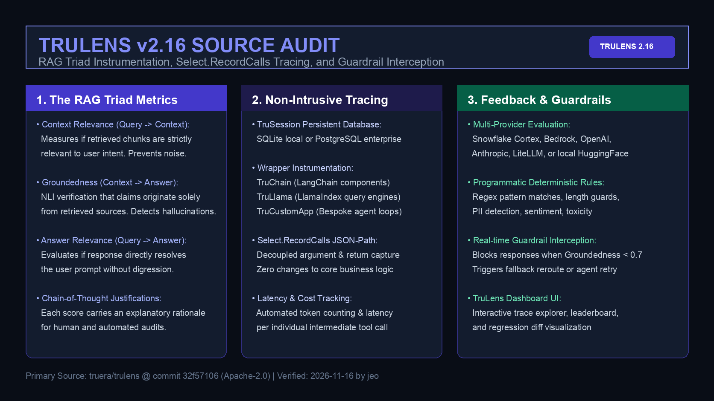
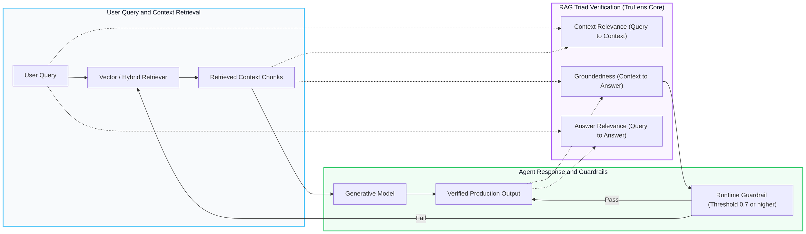

<figure class="explanatory-image">
  
  <figcaption>AI-generated illustration by jeo: schematic architecture diagram representing TruLens v2.16 RAG Triad evaluation metrics, Select.RecordCalls tracing, and guardrail interception; not source evidence.</figcaption>
</figure>

## Why Gut-Feeling LLM Evals Fail in Enterprise Agent Deployments

When engineering retrieval-augmented generation (RAG) pipelines and multi-step agent harnesses, developers frequently fall into a predictable testing trap: running a dozen prompt variations in a development notebook, skimming the text outputs, and concluding that the application is ready for production. In deployment, however, user queries rapidly diverge from the engineer's test set. When an agent hallucinates numbers, cites non-existent policy guidelines, or silently ignores retrieved facts, traditional monitoring tools (such as HTTP latency counters or error code loggers) show green dashboards while user trust quietly erodes.

The core challenge is that language model generation is inherently open-ended. Traditional NLP metrics such as BLEU or ROUGE require an exact reference answer (Ground Truth), which does not exist in conversational or open-domain workflows. Furthermore, monolithic end-to-end evaluations fail to pinpoint where a pipeline broke down: did the vector retriever fail to surface relevant documents, or did the generator hallucinate despite receiving accurate context?

The release of TruLens version 2.16.0 by Truera (pinned to commit `32f57106c7f897a05806107737c413e65665fe46`, Apache-2.0) addresses this measurement void. Rather than treating evaluation as an opaque post-hoc benchmark, TruLens decomposes the application pipeline into decoupled, verifiable relationships known as the **RAG Triad**. By combining programmatic Natural Language Inference (NLI) scoring, non-intrusive runtime instrumentation via `Select.RecordCalls`, and real-time execution guardrails, TruLens converts qualitative LLM interactions into mathematically observable telemetry.



<svg viewBox="0 0 860 300" xmlns="http://www.w3.org/2000/svg" role="img" aria-label="TruLens RAG Triad evaluation relationships and data flow diagram" style="width:100%;max-width:860px;height:auto;display:block;margin:1.5rem auto;">
  <rect x="10" y="20" width="840" height="260" rx="10" fill="#090d16" stroke="#818cf8" stroke-width="2"/>
  <text x="30" y="52" fill="#818cf8" font-family="system-ui,-apple-system,sans-serif" font-size="14" font-weight="700">THE RAG TRIAD: THREE DECOUPLED EVALUATION AXES</text>

  <rect x="30" y="75" width="250" height="170" rx="6" fill="#131c2e" stroke="#312e81" stroke-width="1"/>
  <text x="45" y="105" fill="#a5b4fc" font-family="system-ui,-apple-system,sans-serif" font-size="13" font-weight="700">1. CONTEXT RELEVANCE</text>
  <text x="45" y="130" fill="#f8fafc" font-family="system-ui,-apple-system,sans-serif" font-size="11">Axis: Query -> Context</text>
  <text x="45" y="155" fill="#94a3b8" font-family="system-ui,-apple-system,sans-serif" font-size="10">Filters uninformative noise chunks</text>
  <text x="45" y="175" fill="#94a3b8" font-family="system-ui,-apple-system,sans-serif" font-size="10">Prevents attention budget dilution</text>
  <text x="45" y="195" fill="#94a3b8" font-family="system-ui,-apple-system,sans-serif" font-size="10">Quantifies retriever recall precision</text>
  <text x="45" y="215" fill="#cbd5e1" font-family="system-ui,-apple-system,sans-serif" font-size="10">Formula: P(Chunk Relevant | Query)</text>

  <rect x="305" y="75" width="250" height="170" rx="6" fill="#131c2e" stroke="#312e81" stroke-width="1"/>
  <text x="320" y="105" fill="#c7d2fe" font-family="system-ui,-apple-system,sans-serif" font-size="13" font-weight="700">2. GROUNDEDNESS</text>
  <text x="320" y="130" fill="#f8fafc" font-family="system-ui,-apple-system,sans-serif" font-size="11">Axis: Context -> Answer</text>
  <text x="320" y="155" fill="#94a3b8" font-family="system-ui,-apple-system,sans-serif" font-size="10">NLI sentence-by-sentence parsing</text>
  <text x="320" y="175" fill="#94a3b8" font-family="system-ui,-apple-system,sans-serif" font-size="10">Detects fabricated statistics/claims</text>
  <text x="320" y="195" fill="#94a3b8" font-family="system-ui,-apple-system,sans-serif" font-size="10">Independent of user prompt intent</text>
  <text x="320" y="215" fill="#cbd5e1" font-family="system-ui,-apple-system,sans-serif" font-size="10">Formula: Supported Claims / Total</text>

  <rect x="580" y="75" width="250" height="170" rx="6" fill="#131c2e" stroke="#312e81" stroke-width="1"/>
  <text x="595" y="105" fill="#6ee7b7" font-family="system-ui,-apple-system,sans-serif" font-size="13" font-weight="700">3. ANSWER RELEVANCE</text>
  <text x="595" y="130" fill="#f8fafc" font-family="system-ui,-apple-system,sans-serif" font-size="11">Axis: Query -> Answer</text>
  <text x="595" y="155" fill="#94a3b8" font-family="system-ui,-apple-system,sans-serif" font-size="10">Detects conversational digression</text>
  <text x="595" y="175" fill="#94a3b8" font-family="system-ui,-apple-system,sans-serif" font-size="10">Catches unhelpful polite evasion</text>
  <text x="595" y="195" fill="#94a3b8" font-family="system-ui,-apple-system,sans-serif" font-size="10">Validates direct prompt resolution</text>
  <text x="595" y="215" fill="#cbd5e1" font-family="system-ui,-apple-system,sans-serif" font-size="10">Formula: Semantic Entailment to Prompt</text>
</svg>

## Deconstructing the Mathematical Mechanics of the RAG Triad

The power of the RAG Triad lies in its ability to isolate the specific failure domain of an agent workflow. In traditional QA benchmarks, a bad response could be caused by poor retrieval, inaccurate synthesis, or prompt drift. TruLens models these as three independent geometric projections:

### 1. Context Relevance ($Query \rightarrow Context$)

Context relevance measures whether the retrieved text chunks are pertinent to the user query. In our source audit of `trulens.feedback.v2.feedback_functions`, the evaluator splits retrieved chunks into individual sentences and computes semantic alignment with the user query:

$$\text{Context Relevance} = \frac{\sum_{s \in \text{Context}} \mathbf{1}(\text{Relevant}(s, \text{Query}))}{|\text{Context}|}$$

If an agent queries an internal knowledge base for "Kubernetes ingress timeouts" and the retriever surfaces five general networking documents alongside one relevant timeout snippet, the Context Relevance score drops to 0.2. This immediately flags that the vector embedding index or chunking strategy needs fine-tuning, before blaming the language model.

### 2. Groundedness ($Context \rightarrow Answer$)

Groundedness serves as the primary defense against hallucination. It audits whether every factual assertion made in the final answer is directly substantiated by the retrieved context. TruLens implements an NLI claim decomposition pipeline:

1. **Assertion Extraction**: The generated response is parsed into atomic claims (e.g., "The timeout default is 30 seconds", "Option X was deprecated in version 1.4").
2. **Entailment Scoring**: For each claim $c_i$, the evaluation provider determines whether the retrieved context $K$ strictly entails $c_i$:

$$\text{Groundedness} = \frac{1}{N} \sum_{i=1}^{N} \text{Entailment}(c_i \mid K)$$

Crucially, Groundedness operates completely independently of the original prompt. Even if the answer is completely off-topic, if everything stated is true according to the context, Groundedness remains high while Answer Relevance fails.

### 3. Answer Relevance ($Query \rightarrow Answer$)

Answer relevance evaluates whether the response directly addresses what the user requested. If a user asks "What is the command to restart the daemon?" and the agent responds with a grounded history of Unix daemon design without providing the command, Groundedness will be 1.0, but Answer Relevance will plummet to near zero.

By cross-referencing these three independent signals, engineers achieve granular diagnostic clarity:

- **Low Context Relevance + Low Groundedness**: Retrieval failure cascaded into hallucinated response.
- **High Context Relevance + Low Groundedness**: Generation failure; the model ignored the provided facts and fabricated speculative details.
- **High Context Relevance + High Groundedness + Low Answer Relevance**: Alignment failure; the model accurately quoted the text but failed to synthesize an answer to the user's question.

## Non-Intrusive Trace Instrumentation via Select.RecordCalls

A major friction point in adopting LLM observability libraries is code invasiveness: frameworks frequently require wrapping every function in proprietary classes or instrumenting code with verbose callbacks. TruLens bypasses this via `Select.RecordCalls`, an abstract syntax tree (AST) JSON-Path selector mechanism that intercepts method calls without altering domain logic.

Consider an agent pipeline with separate `retrieve()` and `generate()` steps:

```python
from trulens.core import TruSession, Feedback, Select
from trulens.apps.custom import TruCustomApp
from trulens.providers.openai import OpenAI as OpenAIProvider

session = TruSession()
provider = OpenAIProvider()

# Declare evaluation feedback functions using JSON-Path selectors
f_groundedness = (
    Feedback(provider.groundedness_measure_with_cot_reasons, name="Groundedness")
    .on(Select.RecordCalls.retrieve.rets)     # Context input from retrieve() return
    .on(Select.RecordCalls.generate.rets)     # Answer input from generate() return
)

f_answer_relevance = (
    Feedback(provider.relevance_with_cot_reasons, name="Answer Relevance")
    .on(Select.RecordCalls.generate.args.query) # Original user prompt
    .on(Select.RecordCalls.generate.rets)       # Final agent output
)

# Instrument custom agent without rewriting application classes
tru_agent = TruCustomApp(
    my_agent_instance,
    app_name="ProductionResearchAgent",
    app_version="v2.1",
    feedbacks=[f_groundedness, f_answer_relevance]
)

# Execution runs normally while TruLens records full telemetry in background
response, record = tru_agent.with_record(my_agent_instance.run, user_query)
```

The `with_record` context manager intercepts intermediate method calls, extracts inputs and outputs according to the `Select.RecordCalls` path, computes evaluation metrics asynchronously, and logs full trace metadata (latency, token count, cost, feedback scores) into SQLite or PostgreSQL. Similar to the decoupled in-memory architectures explored in our audit of [FastMCP In-Memory Transports](/posts/fastmcp-in-memory-and-skills-architecture/), this separation of evaluation logic from execution logic guarantees that benchmarking never degrades production execution stability.

## Real-Time Guardrail Interception and Execution Gating

Monitoring evaluation scores in post-hoc dashboards provides essential regression tracking, but production reliability demands proactive failure prevention. TruLens bridges observation and execution through runtime **Guardrails**.

When a feedback function is attached as a guardrail, the evaluation score is computed inline prior to returning the result to the caller. If a critical metric (such as Groundedness) drops below a defined quality threshold, the execution contract triggers an interception event:

```python
from trulens.core.guardrails.base import block_on_failure

# Intercept and block execution if groundedness falls below 0.75
@block_on_failure(feedback=f_groundedness, threshold=0.75)
def verified_generate(query: str, context: list[str]) -> str:
    return model.complete(query=query, context=context)
```

In automated agent systems, guardrails enable resilient self-healing patterns:
1. **Dynamic Query Expansion**: If Context Relevance scores low, the agent halts generation, invokes a query rewrite tool, and attempts retrieval against an alternative index.
2. **Deterministic Fallback Dispatch**: If Groundedness fails twice consecutively, the system returns a safe, pre-scripted fallback message ("I cannot locate verified documentation to support an answer to this query") rather than emitting plausible hallucinations.
3. **Automated Escalation**: Flawed trajectories are tagged and routed directly to a human verification queue for domain-expert review.

This runtime interception philosophy mirrors the fail-fast process boundaries we examined in our analysis of [Browser Use Cloud Boundaries](/posts/browser-use-1-cloud-execution-boundary/), where unbounded or drifting agent operations are terminated before incurring financial or operational damage.

## Architectural Comparison Across LLM Evaluation Frameworks

To assist infrastructure teams in selecting the right observability framework, the table below compares TruLens v2.16 with alternative open-source evaluation tools:

| Evaluation Dimension | TruLens v2.16 | Ragas (v0.2) | DeepEval (v1.4) |
|---|---|---|---|
| **Primary Architecture** | RAG Triad + Non-intrusive `RecordCalls` tracing | Dataset-centric metric batch calculation | Pytest-integrated CI/CD assertion framework |
| **Real-Time Guardrails** | Built-in inline execution blocking & rerouting | None (post-hoc batch evaluation only) | Test-time assertion thresholds |
| **Tracing Model** | Full AST method-level capture (`TruChain`/`TruLlama`) | Explicit callback integration (`Tracer`) | Custom test wrapper decorators |
| **Storage Persistence** | Native SQLite local / PostgreSQL enterprise | External pandas DataFrame / disk export | Local JSON / DeepEval Cloud dashboard |
| **Agent Support** | First-class multi-step `TruCustomApp` loop tracking | Primary focus on single-turn RAG retrieval | Multi-turn agent conversational metrics |
| **Evaluation Backends** | Multi-provider (Bedrock, Cortex, OpenAI, HuggingFace) | LangChain chat model wrapper bindings | LiteLLM wrapper abstraction |

## Key Takeaways

- **The RAG Triad Decouples Quality Diagnosis**: Evaluating Context Relevance, Groundedness, and Answer Relevance independently eliminates guesswork, allowing engineers to isolate retriever failures from generative hallucinations.
- **Non-Intrusive Instrumentation via Select.RecordCalls**: Decoupled JSON-Path selectors capture arguments and returns across arbitrary agent functions without modifying domain code or incurring invasive SDK lock-in.
- **Guardrails Transform Evals into Active Defenses**: Real-time evaluation thresholds enable agents to intercept ungrounded hallucinations mid-flight, triggering automated query rewrites or safe fallback dispatches.
- **Enterprise-Ready Trace Persistence**: Native support for SQLite during local development and PostgreSQL in production ensures that evaluation metrics, token expenditures, and latency profiles persist in durable storage.

## Open Questions

- **Evaluation Latency in Critical Paths**: While async evaluation scales well for background logging, inline guardrails require model-graded NLI calls that add 200–500ms of latency. How can small, specialized SLMs (e.g., 1B–3B parameter NLI models) be optimized for sub-50ms local guardrail inference?
- **Multi-Modal Groundedness Verification**: As agents incorporate vision capabilities (such as the browser viewports audited in [Browser Use 1.0](/posts/browser-use-1-cloud-execution-boundary/)), how will the RAG Triad extend NLI groundedness to verify visual assertions against raw screenshot pixels?
- **Dynamic Context Window Dilution**: When agents maintain long conversational memories across multiple sessions, how should Context Relevance penalize ancient conversational context versus immediate retrieval chunks?

## References

- [TruLens Upstream Repository](https://github.com/truera/trulens) — Canonical repository, commit `32f57106c7f897a05806107737c413e65665fe46`.
- [TruLens Documentation & Architecture Guides](https://www.trulens.org/) — Official guides covering TruSession, feedback providers, and RAG Triad instrumentation.
- [The RAG Triad Whitepaper](https://www.trulens.org/trulens_eval/core_concepts_rag_triad/) — Conceptual foundation and mathematical definitions of Context Relevance, Groundedness, and Answer Relevance.
- [Model Context Protocol Specification](https://modelcontextprotocol.io) — Context protocol references for agent tool execution boundaries.
