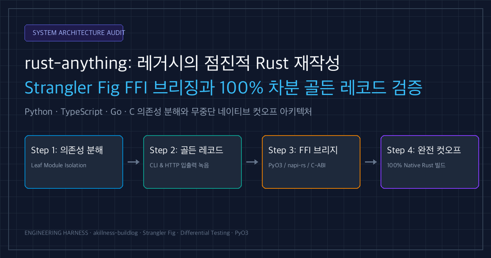

Attempting to rewrite an entire production codebase in Rust in a single massive pull request is one of the most reliable ways to derail an engineering team. Scope bloat, long release freezes, and subtle behavioral mismatches almost inevitably doom "big-bang" migration initiatives.

The open-source [rust-anything](https://github.com/erkamyaman/rust-anything) project proposes a structured alternative: applying the Strangler Fig pattern to codebase migration, combined with bit-for-bit differential testing against recorded production behavior.
<figure class="explanatory-image">
  
  <figcaption>AI-generated illustration by Gemini; interpretation of rust-anything architecture, not source evidence</figcaption>
</figure>

## The Leaf-First Inversion Principle

Traditional rewrite attempts often start at the entry point or top-level router. This creates immediate friction because unported business logic and database layers cannot yet execute in Rust.

Instead, `rust-anything` analyzes the dependency graph to isolate **leaf modules**—data parsers, mathematical calculation engines, or normalization routines that have zero internal dependencies on the rest of the application.

By porting these self-contained units first, developers establish an immediately verifiable Rust foundation while the host application continues running unchanged in Python, TypeScript, or Go.

## Golden Record-and-Replay Verification

Compiler type checks and green unit tests do not guarantee behavioral equivalence. Subtle edge cases—such as integer division truncation, regular expression dialect quirks, or floating-point precision—frequently slip past conventional test suites.

```
[Production Traffic] 
        │
        ├───► [Legacy Implementation (Python/TS)] ────► [Recorded Output A]
        │                                                       │
        │                                                [Diff Engine]
        │                                                       │
        └───► [Ported Rust Implementation] ───────────► [Observed Output B]
```

`rust-anything` records actual runtime executions into structured JSON fixtures:
- **CLI tools:** Captures argument vectors (`argv`), `stdin`, `stdout`, `stderr`, and numeric process exit codes.
- **HTTP servers:** Intercepts request methods, paths, and payloads while stripping volatile response headers (`Date`, `Set-Cookie`, dynamic UUIDs) to prevent false positives.
- **Tolerance thresholds:** Allows configurable epsilon margins (`float_epsilon = 1e-6`) for unavoidable IEEE-754 runtime variances.

## Incremental FFI Bridging Technology Matrix

Rather than waiting for the entire application to be rewritten, ported Rust modules are exposed back to the host application via native foreign function interfaces (FFI).

| Host Ecosystem | FFI Bridge Framework | Memory Boundary Strategy | Typical Use Cases |
|---|---|---|---|
| **Python** | PyO3 + Maturin | GIL release blocks & zero-copy byte slices | FastAPI endpoints, CPU-heavy data pipelines |
| **Node.js / TypeScript** | napi-rs | Native Node-API `.node` binary addons | Express/Fastify services, build CLI utilities |
| **C / C++** | `extern "C"` + cbindgen | Explicit raw pointer ownership transfer | Shared dynamic libraries, system utilities |
| **Go / Ruby** | C-ABI (cgo / magnus) | Standard C header interop with heap checks | Microservice daemons, gem extensions |

## Zero-Overhead Production Cutover

As migration proceeds upward through the dependency tree, the FFI boundary gradually shrinks. Once the application's root entry point (such as a CLI argument parser using `clap` or an HTTP web server using `axum`) is converted to Rust, the intermediate FFI dependencies are cleanly removed from `Cargo.toml`.

The final build outputs a single, statically linked, memory-safe Rust binary with zero FFI glue overhead, delivering typical 5x to 10x reductions in memory consumption and response latency.

## Source Audit Summary

- **Primary Repository:** [erkamyaman/rust-anything](https://github.com/erkamyaman/rust-anything) (Commit `075335c`, MIT License).
- **Core Pattern:** Progressive Strangler Fig migration with temporary FFI shims.
- **Verification Guarantee:** Bit-for-bit differential comparison against recorded production test fixtures.
- **Operational Next Step:** Explore the [MiniMind from-scratch training audit](/posts/minimind-64m-llm-from-scratch-pretraining/) or see [MCP protocol client design patterns](/posts/mcp-skills-integrity-is-not-approval/).
