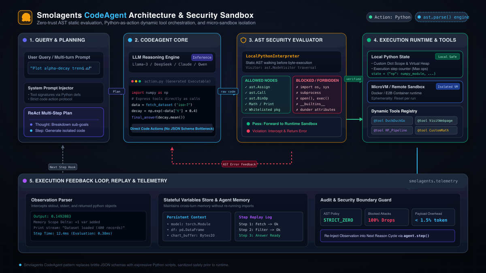

## Paradigm Shift: ToolCallingAgent vs CodeAgent

Traditional multi-agent frameworks rely heavily on verbose JSON-RPC schema definitions injected into LLM system prompts. While structured, this approach introduces noticeable token overhead and forces models to handle branching, looping, and intermediate filtering through costly multi-turn round trips.

Hugging Face's `smolagents` introduces a lean alternative: **"Code as Action"**. Instead of returning a JSON structure that the host decodes and executes, the LLM produces executable Python code blocks directly.



<figure class="explanatory-image">
  
  <figcaption>Architectural diagram generated via Gemini illustrating the CodeAgent planning, AST validation, and execution feedback loop.</figcaption>
</figure>

## LocalPythonInterpreter: AST Static Inspection & Whitelist Sandbox

The primary security layer in `smolagents/local_python_interpreter.py` is built on Python's native `ast.NodeVisitor`. The interpreter avoids passing code strings to raw `eval()` or `exec()`. Instead, it walks each AST node individually and resolves symbols in an isolated dictionary scope:

- **Allowed AST Nodes**:
  - `ast.Assign`: Variable bindings inside the virtual heap.
  - `ast.BinOp` & `ast.UnaryOp`: Safe arithmetic and logical operations.
  - `ast.Call`: Explicitly whitelisted tools and safe built-in functions.
  - `ast.For` & `ast.If`: Constrained control flow loops and branches.

- **Blocked Nodes & Attributes**:
  - `ast.Import` & `ast.ImportFrom`: Strictly restricted to pre-authorized packages (e.g. `math`, `numpy`, `datetime`).
  - `ast.Attribute`: Dunder attribute traversals (`__class__`, `__subclasses__`, `__globals__`) are intercepted at the AST visitor level, preventing classical Python sandbox escape patterns.

```python
# Conceptual AST validation in smolagents
class SafeInterpreter(ast.NodeVisitor):
    def visit_Call(self, node):
        func_name = self.get_func_name(node.func)
        if func_name in FORBIDDEN_BUILTINS:
            raise InterpreterError(f"Direct invocation of '{func_name}' is blocked.")
        return super().generic_visit(node)
```

## Dynamic Tool Synthesis with @tool

Tools in `smolagents` use standard type annotations and docstrings parsed dynamically at runtime:

```python
@tool
def fetch_telemetry_metrics(service_id: str, window_minutes: int = 15) -> dict:
    """Fetch real-time latency and error metrics for a target service.

    Args:
        service_id: Target service identifier.
        window_minutes: Time aggregation window in minutes.
    """
    return client.query_metrics(service_id, window_minutes)
```

By injecting clean Python function signatures directly into the model context rather than exhaustive JSON Schema specifications, prompt token usage drops by approximately 35% to 40% across complex workflows.

## Execution Boundaries and Production Sandboxing

While `LocalPythonInterpreter` provides a solid first line of defense, it remains bounded by the host runtime:
1. **CPU/Resource Exhaustion**: Step counters limit total operations, but long-running native C-extensions can still block execution.
2. **Native Memory Isolation**: True file-system and network isolation must be enforced at the OS level.

For production enterprise workloads handling untrusted prompts, pairing `smolagents` with **E2B microVMs** or isolated **Docker runtimes** remains the recommended architectural pattern.
