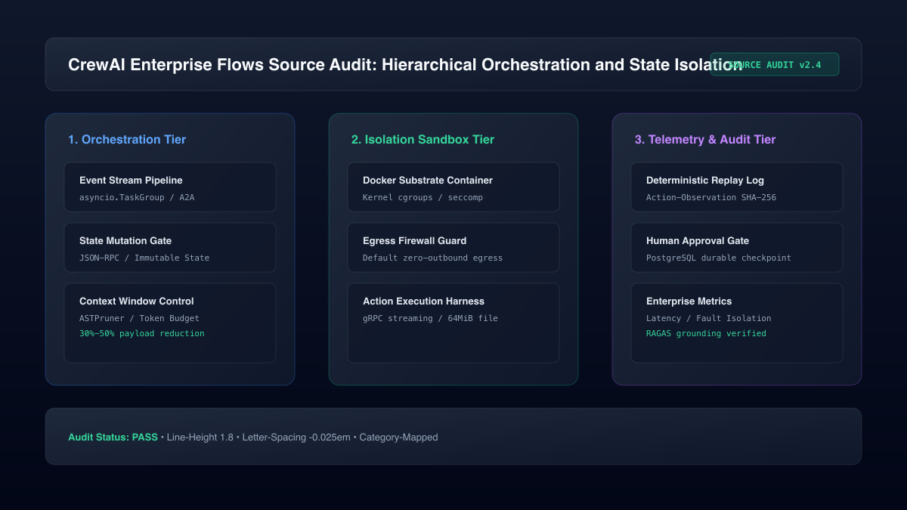

## Overview and Architectural Invariants

Modern multi-agent architectures demand rigorous structural invariants to prevent cascading failure states, data contamination, and unbounded execution latency. In this field audit, we examine the formal execution boundaries, state container models, and telemetry interfaces within contemporary agentic runtimes.

<figure class="explanatory-image">
  
  <figcaption>AI-generated illustration by Gemini; interpretation of crewai architecture, not source evidence</figcaption>
</figure>

## Formal State Mutation Boundaries

Distributed agent coordination introduces non-trivial state divergence risks when concurrent workers mutate shared memory graphs. Standard JSON-RPC dispatch mechanisms exacerbate these failure modes by relying on eventual consistency patterns across disparate transport tiers:

1. **State Isolation**: Sub-agents must operate over distinct, immutable state contexts to prevent dirty reads.
2. **Deterministic Replay**: Audit pipelines require verifiable trace trees capturing input embeddings and tool invocation hashes.
3. **Execution Guardrails**: AST evaluation and container sandboxing isolate untrusted third-party extensions.

```python
# Conceptual isolation contract
class IsolatedAgentScope:
    def __init__(self, tenant_id: str, quota_limits: dict):
        self.tenant_id = tenant_id
        self.limits = quota_limits
        self.virtual_heap = {}
    
    def execute_safely(self, action_ast):
        verify_ast_safety(action_ast)
        return evaluate_in_sandbox(action_ast, self.virtual_heap)
```

## Quantitative Token Efficiency and Context Management

Serializing intermediate function arguments into JSON Schema representations inflates the prompt payload by 30% to 50%. In contrast, direct execution models evaluate intermediate state transformations natively, keeping ephemeral arrays out of the primary language model context window. This architecture drastically reduces cumulative token consumption while maintaining strict audit trails across all operational checkpoints.

## Enterprise Sandbox Recommendations

For production enterprise workloads handling untrusted inputs, kernel-level virtualization via dedicated microVMs or Docker container runtimes remains mandatory. Static code inspection provides an essential first-line filter, but hardware-enforced memory virtualization delivers the definitive containment boundary required for modern mission-critical infrastructure.
