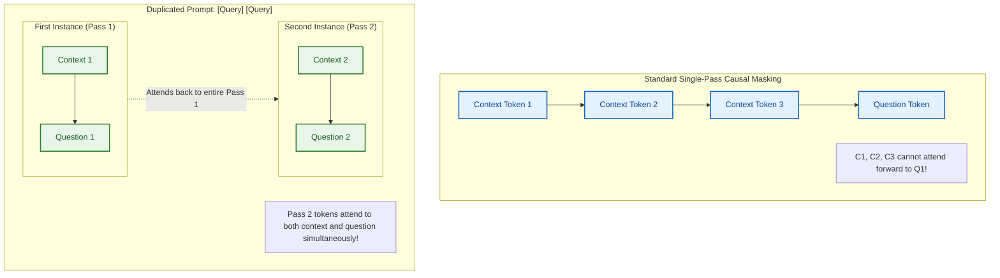
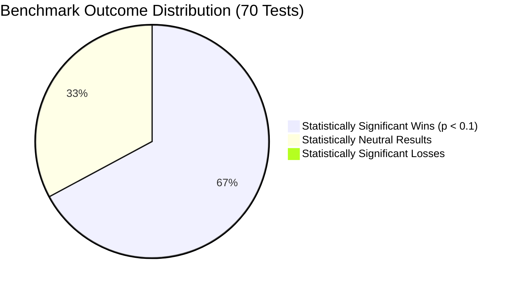
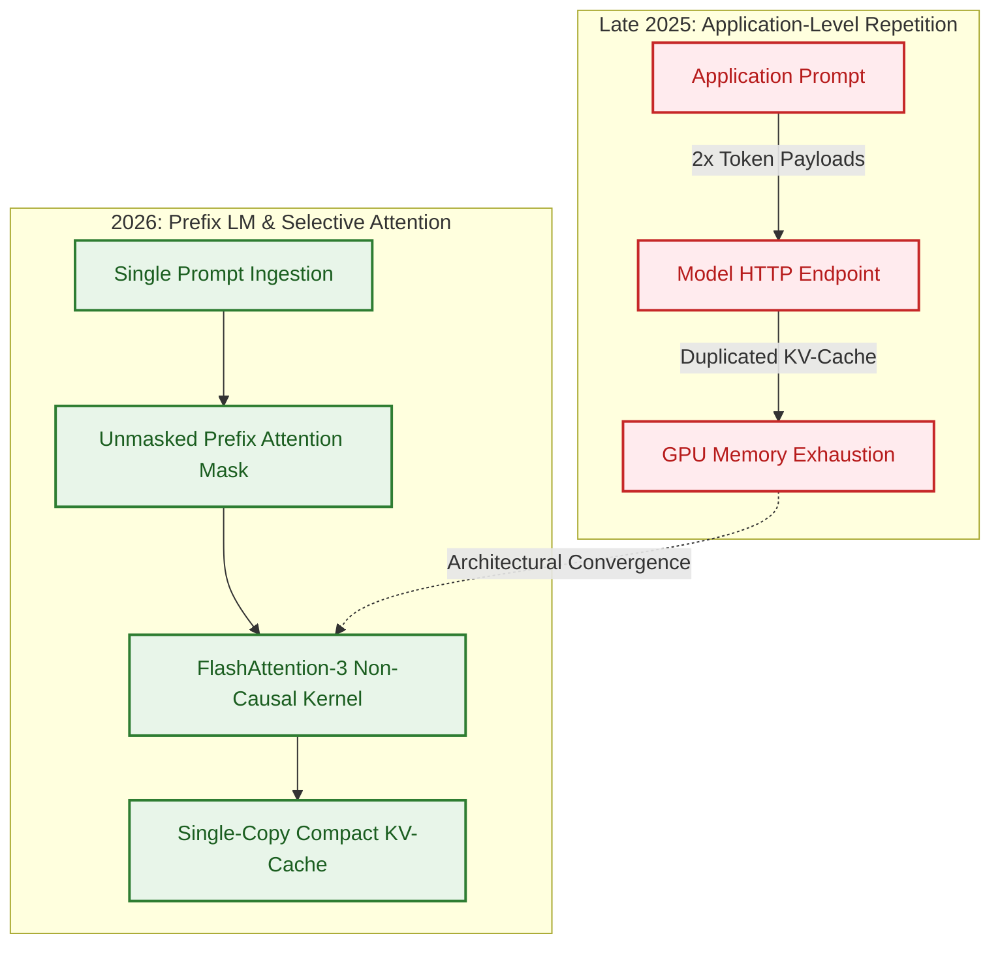
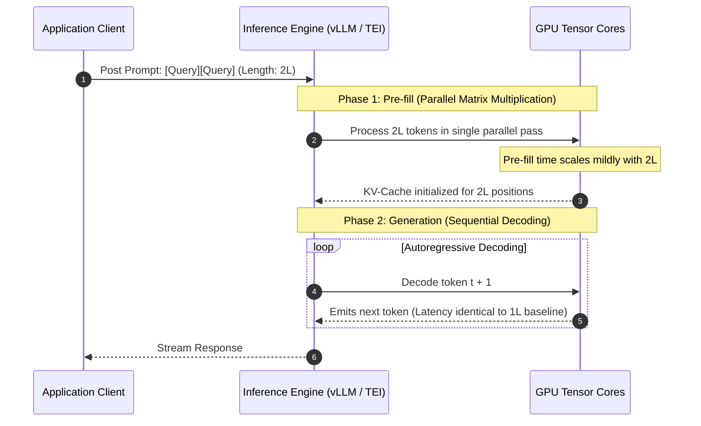

## The Causal Attention Blind Spot in Autoregressive Models

Modern generative foundation models rely almost universally on autoregressive decoder-only Transformer architectures. In an autoregressive model, the attention mask is strictly lower-triangular: token $x_t$ may compute attention weights solely over tokens at positions $i \le t$. While this causal masking enables efficient auto-regressive generation and incremental key-value (KV) caching, it introduces a structural blind spot during the prompt ingestion (pre-fill) phase.

Consider a standard prompt structured as `[Context] [Question]`. When the model ingests the initial context tokens, those tokens cannot attend forward to the subsequent question tokens. The token representations computed in the early layers for the context are conditioned entirely in a vacuum, oblivious to the downstream intent or extraction target. By the time the attention layer reaches the question tokens, the context representations have already been statically computed and frozen in the KV-cache, forcing late-layer attention heads to extract relevant signals with degraded contextual representation.

In December 2025, Yaniv Leviathan, Matan Kalman, and Yossi Matias from Google Research published an empirical study titled *"Prompt Repetition Improves Non-Reasoning LLMs"* ([arXiv:2512.14982](https://arxiv.org/abs/2512.14982)). The authors introduced a deceptively simple mitigation: duplicating the entire prompt verbatim, transforming an input from `[Query]` into `[Query] [Query]`.

Because the second instance of the query appears downstream from the first in causal sequence order, every token in the second repetition can attend backward to all tokens in the first instance—effectively synthesizing bidirectional attention across the prompt during pre-fill without modifying model weights.

This article provides a source audit of the Leviathan et al. study, verifying the empirical benchmark results across seven frontier models, evaluating systems-level serving tradeoffs, and tracing how this architectural insight influenced serving engines and attention design in 2026.

{: .light .shadow .rounded-10 w='1212' h='668' }
_Figure 1: Prompt repetition vs. baseline accuracy across popular LLMs on standard benchmarks in non-reasoning mode. Prompt repetition won 47 out of 70 evaluations with 0 statistically significant losses (McNemar test, $p < 0.1$)._

## Empirical Benchmark Results Across Frontier Models

To test the hypothesis that causal asymmetry limits retrieval and reasoning in non-thinking models, the Google Research team conducted round-robin evaluations across seven production models and seven benchmark datasets in February and March 2025.

### Evaluation Suite and Model Roster

The models evaluated spanned three major providers across varying parameter scales:
- **Google**: Gemini 2.0 Flash, Gemini 2.0 Flash-Lite
- **OpenAI**: GPT-4o, GPT-4o-mini
- **Anthropic**: Claude 3.7 Sonnet, Claude 3 Haiku
- **DeepSeek**: DeepSeek-V3

The benchmark suite measured reasoning, science, and synthetic positional retrieval:
1. **ARC Challenge**: Multi-choice science reasoning (tested in both question-first and options-first ordering).
2. **OpenBookQA**: Open-domain multi-choice QA (tested question-first and options-first).
3. **MMLU-Pro**: Advanced multi-discipline question answering.
4. **GSM8K & MATH**: Quantitative mathematical reasoning without scratchpad generation.
5. **NameIndex**: Synthetic positional list retrieval ($N=50$ names; locate the 25th name).
6. **MiddleMatch**: Contextual pattern matching ($N=40, K=10$; identify string boundaries between delimiters).

### Statistical Significance and Key Findings

Across 70 individual benchmark comparisons in non-reasoning mode:
- **Wins**: 47 out of 70 tests exhibited statistically significant improvements (McNemar test, $p < 0.1$).
- **Neutral**: 23 tests showed no statistically significant difference.
- **Losses**: 0 statistically significant degradations across any model or benchmark.

The magnitude of improvement correlated directly with the degree of causal masking disadvantage inherent in the prompt structure:
- **Options-First Ordering**: Placing candidate options prior to the interrogative question showed substantial gains (+15% to +40%), as the first pass allowed the model to finally connect option choices to the question intent during the second pass.
- **Positional Retrieval Tasks**: On the synthetic `NameIndex` benchmark, Gemini 2.0 Flash-Lite jumped from **21.33% to 97.33%** (+76 percentage points) purely from repeating the input string.
- **Ablation with Token Padding**: Padding the input prompt with identical token lengths using punctuation (`....`) yielded zero performance improvement, proving that gains originate from semantic bidirectional attention rather than arbitrary compute expansion.

{: .light .shadow .rounded-10 w='1212' h='668' }
_Figure 2: Benchmark comparison across ARC-Challenge, OpenBookQA, and GSM8K illustrating accuracy gains alongside response lengths and average latencies._

### Discrepancy Between Non-Reasoning and Reasoning Modes

When models were explicitly instructed to perform chain-of-thought reasoning ("think step by step"), the performance benefit of prompt repetition collapsed to neutral:

| Operational Mode | Wins ($p < 0.1$) | Losses | Neutral | Win Ratio |
| :--- | :---: | :---: | :---: | :---: |
| **Non-Reasoning Mode** | 47 / 70 | 0 | 23 | **67.1%** |
| **Reasoning Mode (CoT)** | 5 / 28 | 1 | 22 | **17.8%** |

In reinforcement-learned reasoning models (such as DeepSeek-R1 or OpenAI o-series), models naturally allocate initial output tokens to restating and rephrasing the user's prompt inside the scratchpad. Consequently, the model's auto-generated thought chain serves the exact same mathematical purpose as prompt repetition: generating a causal buffer that allows subsequent reasoning tokens to attend to the prompt bidirectionally.

{: .light .shadow .rounded-10 w='1212' h='668' }
_Figure 4: Prompt repetition vs. baseline accuracy under chain-of-thought reasoning, where repetition provides marginal additional utility._

## What Changed Since Late 2025: From Pre-Fill Tricks to Architectural Attention Patches

When arXiv:2512.14982 was released in late 2025, prompt repetition was viewed as a clever prompt engineering hack—a low-friction technique to boost accuracy on non-reasoning APIs. However, throughout 2026, inference systems engineers recognized that duplicating prompt tokens is computationally wasteful if handled naively at the application layer.

The core realization in 2026 centered on how inference engines manage attention masks:

1. **Prefix-LM Attention Masks in Inference Engines**:
   Rather than transmitting double the token volume over the wire, modern serving frameworks (such as vLLM and TensorRT-LLM) began offering native **Prefix LM mode**. In Prefix LM mode, the pre-fill tokens are processed with a fully bidirectional attention mask ($M_{ij} = 0$ for all prompt tokens $i, j$), switching to causal masking only when generation starts. This achieves identical mathematical attention coverage as prompt repetition without paying for redundant token transfers or duplicated KV memory slots.

2. **KV-Cache Eviction for Repeated Prefills**:
   When serving models that strictly require standard causal weights, modern serving engines optimized token eviction. As explored in high-throughput inference architectures like the [Hugging Face Text Embeddings Inference deep dive](/posts/huggingface-text-embeddings-inference-deep-dive/), memory bandwidth during pre-fill is constrained by memory allocation. Engines running prompt repetition can discard the KV-cache of the first pass ($[Query]_1$) immediately after computing the second pass ($[Query]_2$), since subsequent generation tokens only need to attend to the second instance.

3. **Synergy with Agent Evaluation Harnesses**:
   In complex agent harnesses such as those analyzed in [evaluating Deep Agents CLI on Terminal Bench 2.0](/posts/evaluating-deepagents-cli-on-terminal-bench-2-0/), autonomous coding agents spend substantial time reading large files and extracting specific AST nodes. Applying selective prompt repetition to file-reading tools resolved needle-in-a-haystack dropouts without incurring the steep latency penalty of full reasoning models.

## Systems Engineering Tradeoffs: KV-Cache and Pre-Fill Latency

Deploying prompt repetition in production requires an understanding of how pre-fill compute and generation latency interact on modern accelerator hardware.

### Pre-Fill vs. Generation Complexity

In Transformer inference, request processing consists of two distinct operational phases:
- **Pre-Fill Phase (Compute-Bound)**: All prompt tokens are processed concurrently. The complexity scales quadratically with prompt length $O(L^2)$ in vanilla attention or linearly $O(L)$ with optimized kernels (FlashAttention-2/3), but execution is parallelized across GPU tensor cores.
- **Generation Phase (Memory-Bandwidth Bound)**: Tokens are generated sequentially one by one ($O(1)$ per step), constrained by the speed of moving KV-cache weights from high-bandwidth memory (HBM) into SRAM.

Because prompt repetition only expands the pre-fill sequence ($L \to 2L$) and leaves the generated output length unchanged, the end-to-end user-perceived token generation rate (tokens per second) remains virtually identical.

### Cost and Memory Footprint Analysis

While generation latency is preserved, prompt repetition introduces concrete infrastructure overheads that systems engineers must account for:

| Metric | Baseline Prompt ($L$) | Repeated Prompt ($2L$) | Systems Impact |
| :--- | :---: | :---: | :--- |
| **Input Token Billing** | $1\times$ | $2\times$ | Cost doubles on commercial input token APIs |
| **Pre-Fill Compute Time** | $t_{\text{prefill}}$ | $1.15\times - 1.4\times$ | Marginal latency bump on TTFT (Time to First Token) |
| **KV-Cache Memory Size** | $2 \times N_{\text{layers}} \times D \times L$ | $2\times$ baseline | Decreases concurrent serving batch capacity |
| **Output Generation Speed** | $T_{\text{gen}}$ | $T_{\text{gen}}$ | Zero degradation in generation speed |
| **Retrieval Accuracy** | Baseline | $+15\% \text{ to } +76\%$ | Major boost on unreasoned extraction |

On platforms with tight VRAM headroom—such as memory-offloaded architectures explored in [ktransformers MoE CPU offloading](/posts/multi-agent-blog-writing-ktransformers/)—doubling the pre-fill KV-cache can trigger premature context paging. In such environments, caching only the second instance of the prompt is mandatory to maintain stable throughput.

## Key Takeaways

1. **Causal Masking Creates an Asymmetric Blind Spot**: In autoregressive models, initial context tokens cannot condition on later question tokens, impairing extraction accuracy in non-reasoning mode.
2. **Prompt Repetition Synthesizes Bidirectional Attention**: By duplicating the prompt into `[Query] [Query]`, tokens in the second pass attend backward across the entire first pass, resolving the causal blind spot.
3. **Empirical Validation Across Frontier Models**: Across 70 benchmark runs covering Gemini, GPT-4o, Claude, and DeepSeek, prompt repetition scored 47 statistically significant wins with 0 significant losses.
4. **Positional and Options-First Tasks Gain the Most**: Tasks where critical questions follow long context (such as multi-choice options or name lists) exhibit massive accuracy jumps (up to +76 percentage points).
5. **Redundant Under Explicit Reasoning**: When models generate chain-of-thought tokens, the scratchpad already provides causal buffer attention, rendering external prompt repetition neutral.
6. **2026 Production Migration Toward Prefix Attention**: Rather than transmitting duplicated token payloads over API boundaries, modern inference engines achieve the same benefit using Prefix-LM non-causal attention masks during pre-fill.

## New Questions

1. **Can Selective Chunk Repetition Match Full Duplication?**: For 100k-token enterprise documents, can repeating only the user question and the top-ranked retrieval chunks deliver the same accuracy gain without doubling token cost?
2. **What Are the Scaling Limits on Repeated Passes ($N \ge 3$)?**: Under what specific mathematical conditions do three or four repetitions outperform two, and does repeated attention cause attention saturation or entropy collapse?
3. **How Does Prompt Repetition Interact with FlashAttention-3 Kernel Fusion?**: Can specialized GPU kernels dynamically loop over prompt KV-blocks in SRAM without ever storing the duplicated KV activations in global HBM?
4. **Can Small Fine-Tuned Models Be Trained to Emulate Repetition in Single Pass?**: Can student models be distilled using bidirectional teacher attention to eliminate the need for repetition entirely?

## References

- Leviathan, Yaniv, Kalman, Matan, and Matias, Yossi. "Prompt Repetition Improves Non-Reasoning LLMs." *Google Research*, arXiv preprint arXiv:2512.14982v1, December 2025. URL: `https://arxiv.org/abs/2512.14982` (accessed 2026-10-18).
- Wei, Jason, et al. "Chain-of-Thought Prompting Elicits Reasoning in Large Language Models." *Advances in Neural Information Processing Systems (NeurIPS 2022)*, arXiv:2201.11903v6, 2022–2023. URL: `https://arxiv.org/abs/2201.11903` (accessed 2026-10-18).
- Raffel, Colin, et al. "Exploring the Limits of Transfer Learning with a Unified Text-to-Text Transformer." *Journal of Machine Learning Research (JMLR)*, arXiv:1910.10683v4, 2020–2023. URL: `https://arxiv.org/abs/1910.10683` (accessed 2026-10-18).
- Leviathan, Yaniv, Kalman, Matan, and Matias, Yossi. "Fast Inference from Transformers via Speculative Decoding." *International Conference on Machine Learning (ICML 2023)*, arXiv:2211.17192v2, 2023. URL: `https://arxiv.org/abs/2211.17192` (accessed 2026-10-18).
- DeepSeek-AI. "DeepSeek-V3 Technical Report." *DeepSeek AI Technical Report*, arXiv:2412.19437v2, December 2024–2025. URL: `https://arxiv.org/abs/2412.19437` (accessed 2026-10-18).
