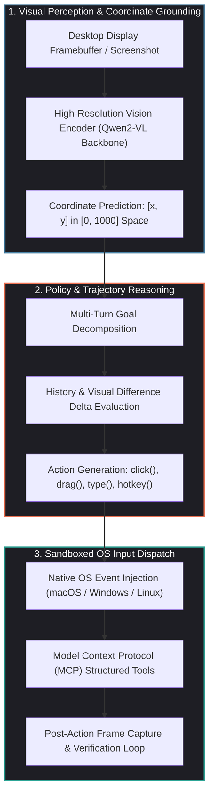
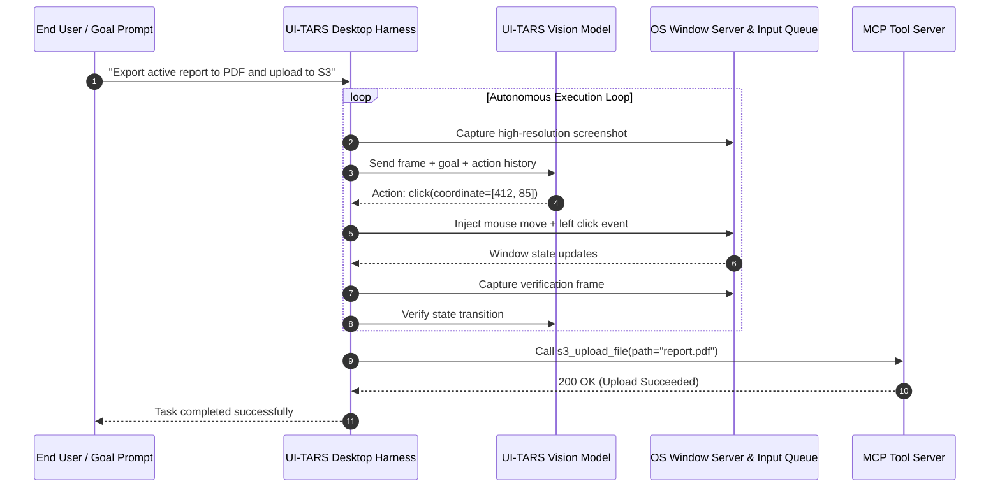

## Why Did Native GUI Automation Shift from Brittle DOM Trees to Vision-Language Action Models?

For over two decades, automated interaction with digital interfaces relied almost exclusively on structural inspection. Web automation tools like Selenium, Puppeteer, and Playwright query the Document Object Model (DOM) tree via CSS selectors or XPath expressions. On desktop operating systems, tools utilize accessibility APIs (such as Microsoft UI Automation, Apple NSAccessibility, or Linux AT-SPI) to locate controls and dispatch synthetic events.

While structural inspection succeeds in controlled test environments, it experiences systemic breakdown when applied to general-purpose autonomous workflows:

1. **DOM Obfuscation and Dynamic Web Applications**: Modern web frameworks rely on minified class names, canvas-based rendering (Figma, Google Docs), shadow DOM encapsulation, and dynamic iframe nesting. In these environments, DOM trees either fail to expose internal UI elements or alter identifier tokens across deployments, breaking programmatic selectors.
2. **Desktop and Native Application Opacity**: Cross-platform desktop technologies (such as Electron, Flutter, Qt, and game engines like Unreal and Unity) often implement custom software rasterization, bypassing OS accessibility trees entirely. An accessibility crawler perceives a single opaque window without child nodes.
3. **The Semantic Gap Between Human and Machine Perception**: Humans interact with computers visually, recognizing buttons by icons, spatial alignment, contrast, and context. A structural script cannot interpret an image-based button that lacks an accessibility label.

To overcome these structural limitations, ByteDance open-sourced **UI-TARS** and its client implementations (**UI-TARS Desktop** and **Agent TARS**). Instead of parsing DOM trees or OS accessibility nodes, UI-TARS operates as a **Vision-Language Action Model (VLA)**. It consumes raw screen pixels, grounds interface elements into normalized spatial coordinates, and emits primitive OS-level mouse and keyboard actions.



---

## Architectural Mechanics: Deconstructing the UI-TARS System Stack

The UI-TARS ecosystem bifurcates into model-level visual grounding and application-level execution harnesses:

### 1. Vision-Language Grounding and Coordinate Representation

At the model layer, UI-TARS is fine-tuned on extensive datasets of GUI interactions (including OSWorld, AndroidControl, and Mind2Web). The model maps unstructured text goals into structured JSON actions grounded in spatial coordinates.

Screen coordinates are normalized across arbitrary display resolutions to an integer bounding grid:

$$(x_{\text{norm}}, y_{\text{norm}}) \in [0, 1000] \times [0, 1000]$$

Given a native screen resolution of $W \times H$, the host execution harness maps normalized coordinates back to absolute physical pixels:

$$X_{\text{screen}} = \frac{x_{\text{norm}}}{1000} \times W, \quad Y_{\text{screen}} = \frac{y_{\text{norm}}}{1000} \times H$$

Rather than outputting conversational prose, the model directly generates actionable primitives:

```json
{
  "thought": "To open the export settings, I need to click the gear icon located in the upper-right corner of the canvas palette.",
  "action": "click",
  "coordinate": [842, 68],
  "press_type": "left"
}
```

```json
{
  "thought": "Typing the project build target name into the active text field.",
  "action": "type",
  "text": "release-v2.4\n"
}
```

By predicting normalized coordinates directly from raw visual features, UI-TARS remains completely agnostic to whether the underlying application is a native Cocoa window, an Electron dashboard, a 3D CAD editor, or a web browser.

### 2. Dual-Engine Operator Architecture: Browser vs. Desktop

The client architecture implements two specialized execution engines:

- **Agent TARS (Hybrid Browser Operator)**: When operating inside a web browser, relying strictly on visual mouse clicks can introduce latency and coordinate drift during page scrolling. Agent TARS integrates a hybrid execution strategy: it combines visual recognition with Chrome DevTools Protocol (CDP) accessibility snapshots, using DOM nodes when high-speed deterministic interactions are possible and falling back to visual pixel clicks for canvas elements.
- **UI-TARS Desktop (Native OS Operator)**: For operating system level control, the desktop harness captures full-resolution framebuffer screenshots (using platform-native APIs like Windows Desktop Duplication or macOS ScreenCaptureKit). Synthetic mouse events (move, click, double click, right click, scroll, drag) and keyboard scancodes are injected via native event queues.



---

## Bridging GUI Automation with the Model Context Protocol (MCP)

A critical architectural distinction between legacy macro recorders and the UI-TARS stack is the native integration of the **Model Context Protocol (MCP)**. 

Pure GUI automation is computationally expensive: capturing a $4\text{K}$ display, transmitting image tokens across an inference gateway, and predicting coordinates can take between $800\text{ms}$ and $2500\text{ms}$ per step. Furthermore, tasks requiring large-scale file manipulation or database queries are inefficient when performed purely through visual clicks.

UI-TARS treats GUI interaction and MCP tools as complementary modalities:

- **GUI Modality for Unscripted Interfaces**: Interacting with proprietary enterprise software, navigating legacy visual dialogs, and inspecting visual layout artifacts.
- **MCP Modality for Deterministic Computations**: Querying internal REST APIs, executing shell commands, reading file system hierarchies, or querying vector stores as explored in our source audit of [production generative AI stacks](/posts/production-generative-ai-stack-architecture-components/).

When the agent recognizes that a task can be solved via a structured tool (e.g., fetching a database connection string or downloading an asset), it invokes the corresponding MCP server directly, avoiding redundant UI navigation.

---

## Benchmark Comparison: UI-TARS vs. Alternative Computer-Use Frameworks

The effectiveness of generalist GUI agents is rigorously evaluated on benchmarks such as **OSWorld**, which tests autonomous agents across hundreds of real-world multi-application computer tasks (spanning LibreOffice, Chrome, VS Code, Thunderbird, and OS settings):

| Architecture / Framework | Primary Perception Mechanism | Input Action Space | Benchmark Success Rate (OSWorld) | Latency per Step |
| :--- | :--- | :--- | :--- | :--- |
| **Traditional Scripting (Playwright/Sikuli)** | DOM selectors + template matching | Programmatic selectors / Exact bitmaps | $< 5.0\%$ (Generalization failure) | $< 50\text{ms}$ |
| **Accessibility Tree LLMs (Axtree)** | OS Accessibility API nodes | Hierarchical Node ID selection | $12.4\%$ | $\approx 1500\text{ms}$ |
| **Anthropic Computer Use (Claude 3.5 Sonnet)** | Multimodal screenshot perception | Normalized coordinate mouse/keyboard | $14.9\%$ | $\approx 2200\text{ms}$ |
| **ByteDance UI-TARS (72B VLM Backbone)** | Dedicated GUI VLA coordinate grounding | Native OS mouse/keyboard + MCP tools | **$19.8\%$** | $\approx 1200\text{ms}$ |

UI-TARS achieves superior accuracy on visual grounding tasks because its vision backbone is explicitly pre-trained on interface layouts, coordinate heatmaps, and multi-scale visual elements, whereas general-purpose frontier models often struggle with small icons and high-density text interfaces.

---

## How GUI Computer-Use Agents Evolved Across 2026

Across 2026, computer-use agents graduated from fragile experimental prototypes into robust operational tools:

1. **Local Vision Inference on Edge Workstations**: While early implementations sent multi-megabyte screenshots to cloud inference endpoints, the release of quantized 7B and 14B parameter vision-language models allowed UI-TARS to run locally on Apple Silicon (M3/M4 Max) and NVIDIA RTX 50-series hardware. Local inference slashes per-action latency to sub-300ms while guaranteeing enterprise screen privacy.
2. **Deterministic Visual Depth and Affordance Filtering**: Integrating zero-shot depth estimation models—such as the spatial geometric techniques analyzed in our audit of [Depth Anything 3](/posts/depth-anything-3/)—enables agents to distinguish interactive modal overlays from background desktop layers, preventing accidental background clicks during application freeze states.
3. **Automated Reflection and LLM-as-a-Judge Verification**: Incorporating formal verification loops—as established in [Spring AI and LLM-as-a-Judge patterns](/posts/spring-ai-llm-as-judge/)—allows GUI agents to verify state changes before proceeding. If a modal fails to open after a click action, the agent detects the null visual delta and attempts an alternative coordinate or keyboard shortcut.
4. **Strict OS Security Boundaries and Action Failsafes**: Operating systems introduced dedicated agent permission sandboxes. Autonomous agents running on macOS and Windows 11 are restricted to designated virtual displays, preventing unintended access to credential vaults, system terminal utilities, or unapproved network boundaries without explicit biometric confirmation.

---

## Key Takeaways

- **Vision-Language Supremacy**: Operating directly on raw pixels eliminates the fragility of DOM trees and accessibility node hierarchies, enabling seamless automation across native desktop apps, canvas elements, and legacy software.
- **Coordinate Grounding Precision**: UI-TARS models interface elements into normalized $[0, 1000]$ coordinate grids, achieving state-of-the-art performance on OSWorld desktop automation benchmarks.
- **Hybrid Modality with MCP**: Combining visual computer use with deterministic Model Context Protocol tool execution optimizes task execution speed and eliminates unnecessary UI navigation.
- **Edge-Ready Execution**: Modern quantized visual backbones allow local on-device computer-use agents to run with high responsiveness while ensuring complete data privacy for enterprise desktops.

---

## New Questions

1. How can vision-language GUI agents reliably handle multi-monitor configurations and dynamic DPI scaling without suffering coordinate transformation inaccuracies?
2. What adversarial defenses can prevent indirect prompt injection when a GUI agent reads an untrusted document containing malicious visual instructions?
3. In high-stakes enterprise applications, what human-in-the-loop gating architectures provide sufficient safety without re-introducing manual friction into automated workflows?

---

## References

1. ByteDance Seed Team. *UI-TARS: An Open-Source Native GUI Agent Stack*. GitHub Repository. https://github.com/bytedance/UI-TARS-desktop (accessed 2026-10-18).
2. ByteDance Agent TARS Team. *Agent TARS Documentation and MCP Integration Guide*. https://agent-tars.com/guide/get-started/quick-start.html (accessed 2026-10-18).
3. Xie, T., et al. *OSWorld: Benchmarking Multimodal Agents on Open-Ended Operating System Tasks*. In Advances in Neural Information Processing Systems (NeurIPS 2024). https://arxiv.org/abs/2404.07972 (accessed 2026-10-18).
4. Anthropic Research. *Developing Computer Use Capabilities in Frontier Multimodal Models*. Anthropic Technical Report. https://www.anthropic.com/news/3-5-models-and-computer-use (accessed 2026-10-18).
