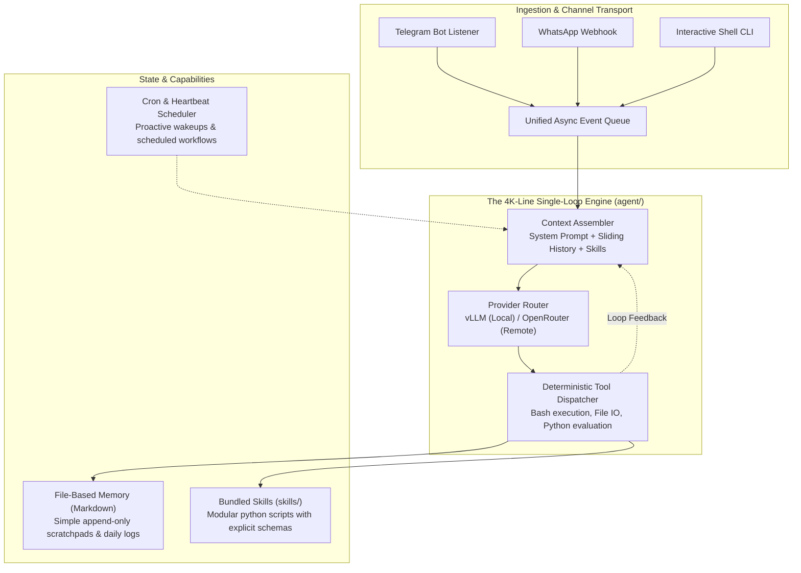

<div style="display:flex; gap:12px; flex-wrap:wrap;">
  <div style="flex:1; min-width:280px;">
    
  </div>
  <div style="flex:1; min-width:280px;">
    
  </div>
</div>

## Does Building a Capable Autonomous Agent Truly Require 400,000 Lines of Code?

In late 2023 and 2024, the enterprise agent ecosystem experienced massive framework inflation. Frameworks such as LangChain, AutoGen, and CrewAI expanded into towering multi-repository monoliths spanning hundreds of thousands of lines of code. Developers attempting to build custom assistants encountered layers of nested class hierarchies, opaque callback hooks, heavy dependency graphs, and brittle stateful graph abstractions. When an agent failed, tracing the root cause through twenty abstraction layers was often more time-consuming than building the agent from scratch.

In response to this architectural bloat, researchers at HKUDS (University of Hong Kong Data Intelligence Lab) introduced **nanobot**—an ultra-lightweight, Clawdbot-inspired personal agent runtime that implements end-to-end autonomous capabilities in approximately **4,000 lines of transparent Python code**.

This architectural audit investigates how nanobot strips out framework overhead while retaining core agentic primitives: single-loop execution, file-based memory, decoupled messaging channels, and local-first inference serving.



---

## 1. Deconstructing the 4,000-Line Codebase

The defining triumph of nanobot is that its entire architecture can be completely read, understood, and audited in a single weekend. The project achieves a 99% codebase reduction compared to enterprise frameworks by rejecting premature abstractions and adhering to standard library primitives.

The directory layout is strictly modular and flat:
- `agent/`: Houses the foundational ReAct loop, context window assembly, tool execution, and prompt templates.
- `skills/`: Contains self-contained capability plugins (web search, weather lookup, document summarization).
- `channels/`: Adapters connecting the core loop to external messaging protocols (Telegram, WhatsApp).
- `cron/` and `heartbeat/`: Lightweight background threads providing proactive agent wakeups and periodic task execution.
- `providers/`: Decoupled API connectors supporting local inference (vLLM, Ollama) and commercial endpoints (OpenRouter, Anthropic, OpenAI).

```
nanobot/
├── agent/
│   ├── loop.py          # Core ReAct loop (~250 lines)
│   ├── context.py       # Token-budgeted context formatting
│   ├── memory.py        # Flat-file markdown persistence
│   └── tools.py         # Subprocess execution & tool parsing
├── channels/            # Telegram, WhatsApp, CLI listeners
├── cron/                # Scheduled background heartbeat
├── providers/           # vLLM, OpenRouter, OpenAI wrappers
└── skills/              # Domain-specific skill scripts
```

---

## 2. The Single-Loop ReAct Engine

Enterprise frameworks frequently introduce complex state graph libraries with dozens of node types, conditional edges, and async channel routers. In practice, however, an autonomous agent fundamentally operates on an iterative state-transition loop:

$$\text{State}_{t+1} = \text{Execute}(\text{LLM}(\text{Prompt} \cup \text{History}_t \cup \text{Tools}))$$

Nanobot implements this loop in fewer than 250 lines of clean Python. At each iteration:
1. **Context Assembly**: The system prompt, recent conversational history, available skill schemas, and current scratchpad notes are formatted into a single message payload.
2. **Inference Dispatch**: The prompt is submitted to the configured provider (e.g., a local vLLM instance).
3. **Tool Execution**: The model's response is inspected for tool call syntax. If a tool call is detected, the command is executed synchronously via a sandboxed subprocess or Python function.
4. **Observation Feedback**: The stdout or return value is appended directly to the conversation history as an observation, and the loop repeats until the model emits a final user-facing response.

By avoiding multi-level call stacks, stack traces point directly to the line of code that triggered an exception, eliminating framework-induced debugging ambiguity, as examined in our architectural review of [modern software layers](/posts/modern-software-architecture/).

---

## 3. Flat-File Memory vs. Heavy Vector Databases

A common source of latency and maintenance complexity in modern agents is the default inclusion of distributed vector databases (Chroma, Pinecone, Milvus) for basic conversational memory.

Nanobot demonstrates that for personal assistants and single-user workflows, **flat-file markdown memory** is not only sufficient—it is superior:
- **Append-Only Daily Notes**: Conversations and key user preferences are written to plain markdown files organized by date (`memory/YYYY-MM-DD.md`).
- **Human-Auditable State**: Developers can inspect, edit, or purge agent memories using standard text editors without running complex database migrations or querying embedding endpoints.
- **Context Injection via BM25 / Grep**: Rather than computing dense vector embeddings for every conversational turn, relevant memories are retrieved via simple lexical keyword matching or sliding window inclusion, completely eliminating embedding API costs and startup latency.

---

## 4. Local-First Engineering and Game-Dev Pipelines

For developers working in resource-constrained environments—such as game development studios, embedded robotics, or secure enterprise enclaves—nanobot's minimalism delivers three decisive advantages:

### 1. Zero-Cost Parallel Assistant Pods
Because nanobot has a memory footprint under 50 MB, engineers can spin up dozens of isolated agent instances simultaneously on a single workstation. One instance triages build server logs, another audits procedural generation assets, and a third runs regression tests in the background.

### 2. Air-Gapped Data Privacy via vLLM
By decoupling the provider interface, nanobot seamlessly points to local vLLM or Ollama instances running on local workstation GPUs (e.g., RTX 4090 or Apple Silicon). Proprietary source code, game design documents, and confidential level telemetry never leave the local network.

### 3. Rapid Prototyping Velocity
In game production, game designers and gameplay engineers need to customize agent behaviors rapidly. Modifying an agent's memory policy or tool execution logic in nanobot requires editing a single file, avoiding the framework lock-in that hampers larger platforms, a principle aligned with our blueprint for [building minimal AI assistants](/posts/build-your-own-ai-assistant-minimal-openclaw/).

---

## Comparative Matrix: Monolithic vs. Minimalist Agent Runtimes

| Feature Dimension | HKUDS Nanobot | OpenClaw Minimal | AutoGen (Microsoft) | CrewAI | LangGraph |
| :--- | :--- | :--- | :--- | :--- | :--- |
| **Codebase Size** | **~4,000 lines** | ~6,500 lines | > 150,000 lines | > 85,000 lines | > 120,000 lines |
| **Dependencies** | Minimal (Requests, PyYAML) | Minimal | Heavy (PyGraphviz, etc.) | Heavy (LangChain stack) | Heavy (LangChain core) |
| **Startup Latency** | **< 150 ms** | < 250 ms | 2.5 s – 5.0 s | 3.0 s – 6.0 s | 2.0 s – 4.5 s |
| **RAM Footprint** | **~45 MB** | ~65 MB | ~450 MB | ~520 MB | ~380 MB |
| **Comprehension Time** | **1–2 days** | 2–3 days | Weeks | Weeks | Weeks |
| **Local LLM Support** | Native (vLLM / Ollama) | Native | Adapter required | Adapter required | Adapter required |

The comparison demonstrates that for personal automation and specialized workflows, architectural minimalism achieves equivalent functional capability at a fraction of the computational and cognitive overhead, matching the developer tooling evolution analyzed in our [AI developer productivity audit](/posts/21-top-ai-tools/).

---

## How Minimalist Agent Frameworks Evolved Across 2026

Entering 2026, the minimalist agent movement expanded into standard production infrastructure:

1. **Single-Binary Standalone Agents**: Next-generation ultralight agents are increasingly compiled into standalone Go, Rust, or PyInstaller binaries. These single-file agents run as sidecar containers inside Kubernetes pods, executing automated health checks and log triage without external Python environment dependencies.
2. **Standardized Model Context Protocol (MCP) Adoption**: By replacing bespoke proprietary skill definitions with the open MCP standard, minimalist agents gain access to thousands of community tools without bloating their core codebase.
3. **Micro-Agent Swarms**: Instead of relying on monolithic multi-agent orchestrators with central coordinators, systems deploy decoupled micro-agents that communicate over lightweight Redis message buses or Unix domain sockets.

---

## Key Takeaways

- **Minimalism Accelerates Iteration**: A 4,000-line codebase allows engineers to inspect, modify, and debug the entire agent loop without fighting framework abstractions.
- **File-Based Memory Is Undervalued**: Plain markdown files provide an auditable, zero-cost, and robust memory layer for single-user and local-first workflows.
- **Local vLLM Integration Secures IP**: Decoupling the model provider enables completely offline, private execution for sensitive proprietary projects.

---

## New Questions

- At what point does task complexity demand hierarchical multi-agent coordination rather than a collection of independent minimalist single-loop agents?
- How can minimalist agent runtimes maintain cross-session memory coherence when operating across multiple disconnected messaging channels (e.g., Telegram and CLI)?

---

## References

- HKUDS. (2024). *Nanobot: An Ultra-Lightweight Personal Agent Framework*. GitHub Repository. [https://github.com/HKUDS/nanobot](https://github.com/HKUDS/nanobot) (accessed 2026-10-18).
- Yao, S., Zhao, J., Yu, D., Du, N., Shafran, I., Narasimhan, K., & Cao, Y. (2023). *ReAct: Synergizing Reasoning and Acting in Language Models*. International Conference on Learning Representations (ICLR 2023). [https://arxiv.org/abs/2210.03629](https://arxiv.org/abs/2210.03629) (accessed 2026-10-18).
- Kwon, W., Li, Z., Zhuang, S., Sheng, Y., Zheng, L., Yu, C. H., ... & Stoica, I. (2023). *Efficient Memory Management for Large Language Model Serving with PagedAttention*. Proceedings of the 29th ACM Symposium on Operating Systems Principles (SOSP 2023). [https://doi.org/10.1145/3600006.3613165](https://doi.org/10.1145/3600006.3613165) (accessed 2026-10-18).
- Wang, X., Chen, Y., Yuan, L., Zhang, Y., Li, M., Ji, H., & Yao, H. (2024). *Executable Code Actions Elicit Better LLM Agents*. International Conference on Machine Learning (ICML 2024). [https://arxiv.org/abs/2402.01030](https://arxiv.org/abs/2402.01030) (accessed 2026-10-18).
- DigitalBourgeois. (2024). *Nanobot Deep-Dive: Architecture and Workflow Analysis of Ultra-Lightweight Agents*. Tistory Tech Analysis. [https://digitalbourgeois.tistory.com/m/2701](https://digitalbourgeois.tistory.com/m/2701) (accessed 2026-10-18).
