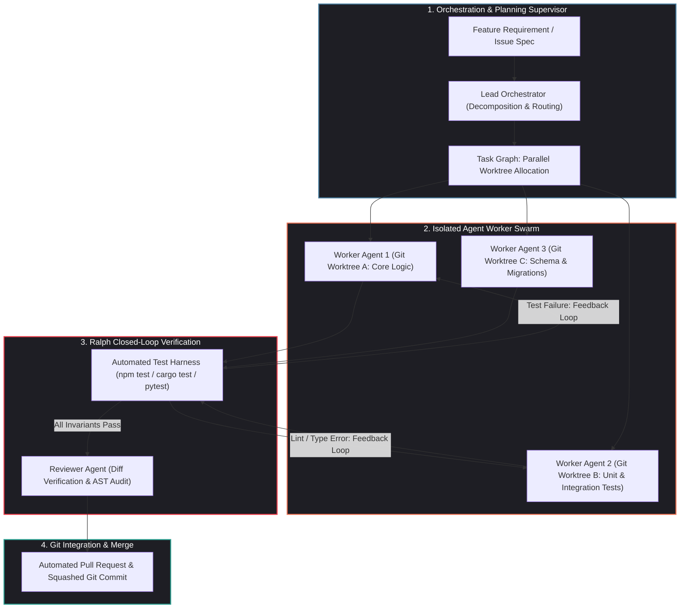
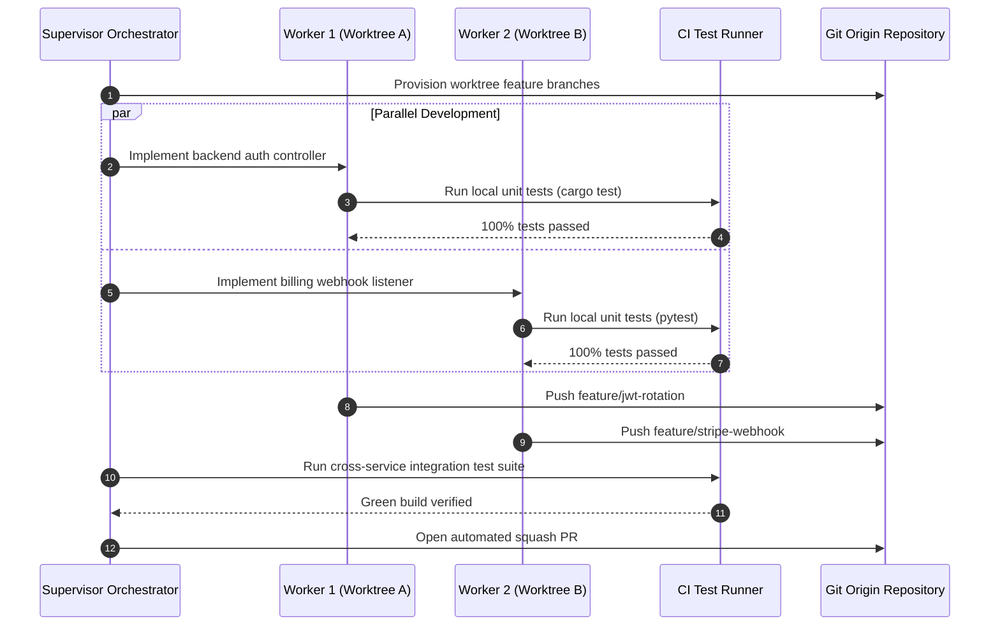

## Why Did Autonomous AI Coding Evolve from Chat Assistants to Multi-Agent Engineering Teams?

For several years, AI-assisted software development was defined by the conversational pair-programming paradigm: an engineer highlighted code in an IDE, opened a chat sidebar, and prompted a foundation model for refactoring suggestions or inline completions. While this interactive model accelerated boilerplate authoring, it hit an impenetrable ceiling when confronted with real-world software engineering complexities:

1. **Context Window Saturation and Blindness**: Large codebases cannot be injected into a single prompt without degrading reasoning quality, inflating inference costs, and losing track of peripheral architectural dependencies.
2. **Open-Loop Hallucination and Syntax Errors**: Conversational LLMs output text without validating that imports resolve, types check, or unit test suites pass. The burden of running build compilers, inspecting stack traces, and fixing subtle logic regressions fell entirely on the human developer.
3. **Monolithic Task Overload**: Asking a single agent instance to simultaneously explore an unfamiliar codebase, plan a migration, write tests, refactor core business logic, and update documentation invariably results in shallow, unverified code changes.

By 2026, the software engineering industry underwent a decisive architectural shift: **Harness Engineering**. Rather than treating language models as monolithic code generators, modern developer tools structure autonomous systems as coordinated **multi-agent teams** operating within closed verification loops, equipped with isolated execution sandboxes, modular domain skills, and persistent git-native memory trails.



---

## The Four Core Architectural Pillars of 2026 AI Coding

Modern agentic engineering systems (including Claude Code, GitHub Copilot Workspace, OpenCode, and enterprise harness frameworks) rely on four foundational design patterns:

### 1. The Ralph Wiggum Pattern: Closed-Loop Autonomous Execution

The defining characteristic of production agent loops is autonomous self-correction, colloquially formalized by Geoffrey Huntley as the **Ralph Wiggum Pattern**. 

Instead of generating code in a single open-loop forward pass, an agent is bound to a strict, iterative control loop:

$$\text{Loop State}_{t+1} = f(\text{Codebase State}_t, \text{Compiler/Test Diagnostic}_t)$$

The harness provides the agent with execution tools (`bash`, `read_file`, `replace_file_content`) and enforces an automated invariant:

1. The agent inspects code and emits an incremental diff.
2. The harness automatically runs test and lint commands (`cargo test`, `npm run typecheck`).
3. If errors occur, the compiler output is piped directly back into the agent's context window as high-priority feedback.
4. The cycle repeats until all acceptance tests pass without human intervention, bounded by maximum loop and token circuit breakers.

By transforming software creation into a goal-directed search problem bounded by compiler diagnostics, agents autonomously resolve missing imports, type mismatches, and edge-case test failures.

### 2. Modular Skill Registries: Context-Efficient Specialization

Injecting complete documentation, API schemas, and tool specifications into an agent's system prompt consumes thousands of tokens per turn, starving the context window of essential codebase information.

2026 systems adopt the open **Agent Skills specification** (`SKILL.md` standard). Skills operate as modular packages composed of:

- **Metadata Front Matter**: Name, description, triggering conditions, and tool requirements.
- **Progressive Disclosure**: Agents inspect lightweight skill manifests to decide which capabilities are relevant to a task. Only when a skill is activated are its detailed instructions, scripts, and schemas loaded into context.
- **Executable Binaries and Scripts**: Skills include deterministic command-line utilities that execute multi-step routines outside LLM inference, reducing token consumption by over 90%.

As shown in our analysis of [native GUI agent stacks](/posts/ui-tars-desktop/), integrating standard protocols like the Model Context Protocol (MCP) and skill registries allows agents to seamlessly switch between file-system refactoring, database migrations, and UI regression testing.

### 3. Parallel Git Worktree Swarms

When multiple agents collaborate on a single repository, concurrent file edits inevitably cause race conditions and corrupted states. 2026 orchestration engines resolve this through **Git Worktree Isolation**:

```bash
# Supervisor provisions isolated worktree workspaces per agent
git worktree add ../agent-lane-auth-service feature/jwt-rotation
git worktree add ../agent-lane-billing feature/stripe-webhook-idempotency
```

Each subagent operates within its own physical filesystem directory and Git branch. A central supervisor coordinates the dependency graph:

- The **Architect Agent** specifies contracts and writes mock test suites in the primary branch.
- The **Implementation Agents** check out individual worktrees, write code in parallel, and run local test suites in isolation.
- The **Merge and Reviewer Agent** runs integration tests across merged branches, resolving semantic conflicts before opening a consolidated Pull Request.



### 4. Durable Reasoning Trails and Memory Architecture

Single-session agents suffer from amnesia; once a terminal session closes or context compacts, the rationale behind subtle architectural decisions is lost.

Inspired by Steve Yegge's **Beads** architecture and persistent memory graphs, 2026 harnesses record durable reasoning trails alongside code:

- **Git-Native Traceability**: Decisions, benchmark proofs, and trade-off rationales are checked into the repository as structured Markdown artifacts or append-only JSONL ledgers.
- **Graph-Refined Knowledge**: As explored in our source audit of [combining Rust and Python for high-performance AI systems](/posts/combining-rust-and-python-for-high-performance-ai-systems/), knowledge pipelines ingest agent outputs into persistent semantic graphs (such as Graphify vaults), enabling future agent instances to query historical context via vector and graph search before beginning modifications.

---

## Benchmark Progression: The Leap in Software Engineering Autonomy

The evolution of agentic coding is measured against **SWE-bench Verified**, a gold-standard benchmark requiring agents to resolve genuine GitHub issues from prominent open-source Python repositories (evaluating multi-file comprehension, test generation, and bug fixing):

| Era / Benchmark Year | Dominant Paradigm | SWE-bench Verified Resolution Rate | Primary Limiting Factor |
| :--- | :--- | :--- | :--- |
| **Early 2024** | Zero-shot prompting (GPT-4) | $1.96\%$ | Context window overflow; lack of execution feedback |
| **Late 2024** | Basic tool use & ReAct loops | $13.5\% - 22.0\%$ | Infinite loops; inability to backtrack from broken edits |
| **2025** | Advanced single-agent harnesses (SWE-agent, Aider) | $38.0\% - 49.0\%$ | Complex multi-file refactoring; context drift |
| **2026** | **Multi-Agent Teams + Ralph Closed Loops (Claude 3.7+ Swarms)** | **$68.5\% - 74.2\%$** | Unstructured human specifications; ambiguous product intent |

The near-quadrupling of resolution rates across two years did not result from model parameter scaling alone; it was primarily unlocked by **harness engineering**—giving agents deterministic tools, automated test compilers, and strict verification gates.

---

## How Multi-Agent Coding Frameworks Evolved Across 2026

The enterprise software development lifecycle underwent profound transformations across 2026:

1. **Spec-First Engineering**: Rather than having human developers write code, senior engineers operate as systems architects who write rigorous specifications, acceptance criteria, and edge-case matrices. Multi-agent teams ingest these specs and handle implementation, verification, and documentation.
2. **Deterministic Code Refactoring via Semantic Search**: Agents utilize indexed AST tools (such as tree-sitter and Semble) to discover symbols and call graphs with token-compact output, completely avoiding brute-force grepping across massive codebases.
3. **Compound AI Infrastructure Integration**: Agent teams integrate directly with enterprise cloud infrastructure, as analyzed in our review of [production generative AI stack architectures](/posts/production-generative-ai-stack-architecture-components/). When an agent builds a microservice, it provisions staging database instances, configures OpenTelemetry tracing spans, and verifies end-to-end telemetry autonomously.
4. **Autonomous Security Auditing and Red-Teaming**: Specialized security subagents continuously audit pull requests against OWASP Top 10 vulnerabilities, memory leaks, and secret exposure before any automated commit merges into protected production branches.

---

## Key Takeaways

- **Harness Over Monolith**: Model capability alone is insufficient for production software engineering; robust execution harnesses with compiler feedback loops and isolated sandboxes are essential.
- **Ralph Verification Loop**: Closed-loop execution—where code changes are iteratively tested and corrected against automated test runners—is the foundation of autonomous code generation.
- **Git Worktree Parallelism**: Dividing complex tasks across isolated Git worktrees enables multi-agent swarms to work concurrently without merge conflicts or state corruption.
- **Progressive Skill Disclosure**: Modular `SKILL.md` registries allow agents to access deep domain capabilities without polluting context windows with static documentation.

---

## New Questions

1. When multi-agent swarms generate thousands of lines of verified code in minutes, how will human engineering teams effectively audit systemic architectural debt and design coherence?
2. What distributed consensus protocols are required when multiple autonomous agents must resolve cross-repository API contract changes synchronously?
3. How will software engineering compensation and career ladders adapt as the primary developer skill shifts from manual syntax authoring to specification design and agent harness evaluation?

---

## References

1. Osmani, A. *AI Coding in 2026: The Shift to Agent Teams and Closed-Loop Systems*. Addy Osmani Engineering Insights. https://addyosmani.com/blog/ (accessed 2026-10-18).
2. Huntley, G. *The Ralph Wiggum Pattern: Autonomous Agent Loops and Error Convergence*. https://ghuntley.com/ralph/ (accessed 2026-10-18).
3. Jimenez, C. E., et al. *SWE-bench: Can Language Models Resolve Real-World GitHub Issues?* In The Twelfth International Conference on Learning Representations (ICLR 2024). https://arxiv.org/abs/2310.06770 (accessed 2026-10-18).
4. Agent Skills Working Group. *The Agent Skills Specification: Modular Instructions for AI Agents*. https://agentskills.io/home (accessed 2026-10-18).
