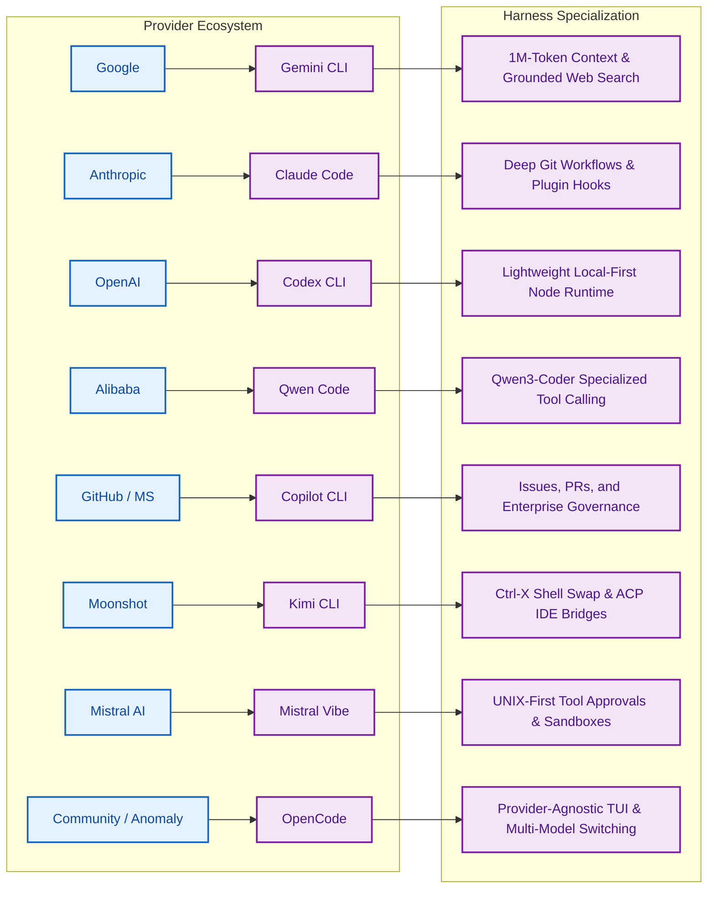
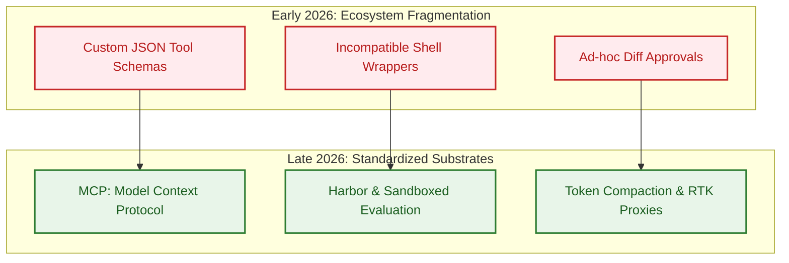

## The Substrate Advantage: Why the Terminal Beats the IDE Extension

During the initial commercial wave of AI coding assistants between 2022 and 2024, software tooling vendors focused almost exclusively on graphical integrated development environment (IDE) extensions. Graphical autocomplete overlays and sidebar chat panels were hailed as the primary interface for developer productivity. Yet, as models advanced from reactive line-by-line tab completion to autonomous, multi-turn software engineering agents capable of resolving complex bug reports and refactoring legacy packages, the IDE sidebar revealed profound architectural limitations.

In an IDE sidebar, the model is trapped inside a GUI sandboxed plugin process. It lacks direct access to the operating system's process table, cannot easily manage long-running local background daemons, struggles with multi-file Git rebase conflicts, and incurs massive context-window bloat serializing language server protocol (LSP) payloads over JSON-RPC.

Conversely, the command-line interface (CLI) is the native habitat of professional software engineering. In the terminal, files, compilers, linters, Git trees, remote SSH sessions, container engines, and continuous integration runners are unified through POSIX primitives, stdin/stdout streams, and deterministic exit codes.

```mermaid
flowchart TD
    subgraph IDE ["IDE Extension Limitations"]
        GUI[Graphical IDE Extension] --> SandboxedPlugin[Restricted Plugin Process]
        SandboxedPlugin --> JSONRPC[Heavy JSON-RPC / LSP Serialization]
        JSONRPC --> FragileState[Fragile GUI State & High Context Bloat]
    end

    subgraph CLI ["CLI Terminal Harness Advantages"]
        Terminal[Terminal Native Harness] --> Shell[Direct POSIX Shell & Process Control]
        Shell --> Tools[Git, Make, Pytest, Linters, Ripgrep]
        Tools --> ExitCodes[Deterministic Exit Codes & Structured Diffs]
        ExitCodes --> Feedback[Instant Execution Feedback Loop]
    end

    classDef ide fill:#ffebee,stroke:#c62828,stroke-width:2px,color:#b71c1c;
    classDef cli fill:#e8f5e9,stroke:#2e7d32,stroke-width:2px,color:#1b5e20;
    class GUI,SandboxedPlugin,JSONRPC,FragileState ide;
    class Terminal,Shell,Tools,ExitCodes,Feedback cli;
```

This source audit examines the rapid emergence of terminal-native coding harnesses. We compare eight leading CLI agent architectures released between late 2025 and 2026—Gemini CLI, OpenCode, Claude Code, Codex CLI, Qwen Code, Copilot CLI, Kimi CLI, and Mistral Vibe—and evaluate why the terminal provides a measurably superior substrate for autonomous agentic verification.

{: .light .w-100 .shadow .rounded-10 w='760' h='435' }

## Comparative Architecture of Eight Frontier Terminal Harnesses

The transition toward terminal-native harnesses produced diverse architectural philosophies across major AI research labs and open-source communities. Below is an architectural breakdown of eight prominent implementations.

### 1. Gemini CLI (Google)
- **Runtime & Distribution**: Open-source Node/TypeScript implementation (`google-gemini/gemini-cli`) installable via `npx`, `npm`, or Homebrew.
- **Context & Model Layer**: Powered by Gemini 3 Flash and Pro models, leveraging native 1M+ token context windows to ingest entire multi-repo codebases without intermediate chunking.
- **Tooling Interface**: Incorporates Google Search grounding, POSIX shell command execution, file system operations, and native Model Context Protocol (MCP) server integration. Generous developer tiers (up to 1,000 requests/day) lower testing friction.

### 2. OpenCode (Anomaly)
- **Runtime & Distribution**: A provider-agnostic, open-source terminal user interface (TUI) client built by terminal-first developers (`anomalyco/opencode`).
- **Architectural Philosophy**: Implements a client/server decoupling where the TUI interface can run on a thin local laptop while the execution agent runs on a remote cloud GPU workstation.
- **Model Agnosticism**: Supports dynamic runtime switching between OpenAI, Anthropic, Bedrock, and local Ollama or vLLM backends, avoiding provider vendor lock-in.

### 3. Claude Code (Anthropic)
- **Runtime & Distribution**: Terminal-native agent (`anthropics/claude-code`) optimized specifically for Claude 3.5 and 3.7 Sonnet.
- **Workflow Integration**: Deep integration with Git command structures, automated commit generation, and GitHub issue mentions. It features an interactive diff review mechanism where users approve, modify, or reject proposed code mutations before they are applied to disk.

{: .light .w-100 .shadow .rounded-10 w='760' h='435' }

### 4. Codex CLI (OpenAI)
- **Runtime & Distribution**: Lightweight, local-first CLI harness distributed as pre-compiled native binaries and npm packages (`openai/codex`).
- **Access Model**: Integrates directly with ChatGPT Plus/Team credentials via OAuth, removing the requirement to configure raw API tokens for corporate developers while offering programmatic API key fallback.

### 5. Qwen Code (Alibaba Cloud)
- **Runtime & Distribution**: Open-source terminal agent (`QwenLM/qwen-code`) optimized for the open-weights Qwen3-Coder series.
- **Enterprise Features**: Provides headless automation modes, TypeScript SDK bindings, and an OAuth-backed free tier (2,000 requests/day). It excels in environments requiring self-hosted model deployments to comply with data sovereignty regulations.

{: .light .w-100 .shadow .rounded-10 w='760' h='435' }

### 6. Copilot CLI (Microsoft / GitHub)
- **Runtime & Distribution**: Enterprise-governed terminal assistant tightly wired into GitHub's ecosystem (`github/copilot-cli`).
- **Ecosystem Integration**: Reads and manipulates GitHub Issues, pull request threads, and CI workflow runs directly from the terminal prompt, wrapping mutations in corporate compliance policies.

### 7. Kimi CLI (Moonshot AI)
- **Runtime & Distribution**: Terminal assistant with dual-mode shell integration (`MoonshotAI/kimi-cli`).
- **Interactive Innovation**: Introduces an inline `Ctrl-X` shortcut that allows developers to seamlessly toggle between normal interactive zsh/bash shell usage and agentic command synthesis, bridging the gap between manual terminal commands and agent actions.

### 8. Mistral Vibe (Mistral AI)
- **Runtime & Distribution**: Minimalist, UNIX-first CLI coding assistant (`mistralai/mistral-vibe`).
- **Philosophy**: Emphasizes minimal token footprints, fast local initialization, explicit human-in-the-loop tool approval gates, and sandboxed subagent task spawning.

## What Changed Since Early 2026: The Consolidation of Terminal Standards

When CLI coding agents first proliferated in early 2026, the ecosystem suffered from fragmentation. Each lab implemented proprietary JSON schemas for tool definitions, bespoke configuration dotfiles, and incompatible diff representation protocols.

Between mid-2025 and late 2026, the industry consolidated around three foundational architectural standards:

1. **Ubiquitous MCP (Model Context Protocol) Adoption**:
   Rather than hardcoding bespoke API clients for Jira, GitHub, PostgreSQL, and AWS inside each CLI binary, almost every major CLI harness adopted the open Model Context Protocol. By running local MCP servers over stdio, a single tool integration (such as database query execution) functions identically across Claude Code, Gemini CLI, and OpenCode.

2. **Automated Headless Benchmarking via Harbor**:
   In early 2026, evaluating whether a CLI update improved or degraded code generation required tedious manual testing. As detailed in our analysis of [evaluating Deep Agents CLI on Terminal Bench 2.0](/posts/evaluating-deepagents-cli-on-terminal-bench-2-0/), the community standardized on containerized evaluation harnesses like Harbor. CLI agents now run in headless batch modes inside Docker or Daytona sandboxes against 89+ real-world terminal tasks, producing reproducible accuracy scores.

3. **Token Compaction and Pre-Fill Efficiency**:
   Long terminal sessions generate massive amounts of compiler logs, package installation dumps, and stack traces. Modern CLI harnesses in late 2026 integrated streaming token filters and proxy layers (such as RTK and adaptive output summarizers) to prune repetitive terminal output before it consumes LLM context windows, mirroring the performance optimizations explored in [Deconstructing 17 Agentic Architectures](/posts/all-agentic-architectures-comprehensive-guide/).

4. **Multi-Agent Coordination vs. Single-Agent Verification**:
   Early experimentation with multi-agent swarms in the terminal gave way to bounded, single-agent verification. As demonstrated in [multi-agent productivity gains](/posts/multi-agent-productivity-gains/), having a single CLI agent execute commands and verify results against real compiler linters yields substantially higher task completion rates than multi-agent role-playing swarms.

## Systems Discipline: Sandboxing, Diff Approvals, and Headless Execution

Deploying terminal coding agents in production enterprise environments requires balancing developer autonomy against system safety. Because the agent possesses shell execution privileges, an unconstrained prompt injection or faulty model hallucination can execute destructive commands (`rm -rf`, force-pushing master, or leaking environment credentials).

### Architectural Safety Matrix

| Evaluation Dimension | Minimalist Approach (Mistral Vibe, Codex) | Enterprise Governed (Copilot CLI, Claude Code) | Extensible / Open (OpenCode, Gemini CLI) |
| :--- | :--- | :--- | :--- |
| **Tool Execution Gate** | Explicit per-command prompt approval | Policy-driven whitelisting & Git diffs | Configurable MCP permission matrices |
| **Sandbox Isolation** | Host process execution by default | Local containerized subprocesses | Pluggable Docker / remote daemon backends |
| **Context Overhead** | Low (streamlined single-task) | Medium (tracks full Git and PR trees) | High (supports 1M+ token global search) |
| **Automation Capability** | Interactive terminal only | Headless CI/CD GitHub Action integration | REST / RPC headless daemon mode |

### Safe Production Configuration

When deploying a CLI agent harness across an engineering team, adhere to three core operational rules:

1. **Enforce Read-Only Defaults on Filesystem Traversal**: Tools for file reading (`cat`, `ripgrep`, `ls`) should execute with zero friction, while file modifications (`sed`, `edit`, `git commit`) must produce unified visual diffs requiring explicit user confirmation.
2. **Isolate Network Access in Ephemeral Sandboxes**: When executing automated regression suites or third-party code installations (`npm install`, `pip install`), route CLI execution into containerized sandboxes to prevent credential exfiltration.
3. **Bind Verification to Project Linters**: The CLI harness must automatically append `git diff` and project-specific lint/test commands (`npm test`, `cargo check`) upon task completion, forcing the agent to verify its own solution before yielding control.

## Key Takeaways

1. **The Terminal Is the Optimal Substrate**: Direct access to POSIX shell primitives, Git version control, and deterministic compiler exit codes makes the CLI far superior to IDE sidebars for autonomous agentic workflows.
2. **Context Window vs. Tooling Diversity**: Different harnesses optimize for distinct strengths: Gemini CLI excels in massive multi-repo context ingestion (1M+ tokens), while Claude Code and OpenCode prioritize Git workflow integration and model agnosticism.
3. **MCP Has Become the Lingua Franca**: The adoption of the Model Context Protocol across virtually all major CLI harnesses eliminates tool duplication, allowing unified stdio integrations across disparate model backends.
4. **Harness Engineering Outweighs Raw Model Swapping**: Empirical performance gains stem from robust diff approvals, token compaction filters, and automated sandbox verification rather than swapping LLM weights alone.
5. **Human-in-the-Loop Diff Review Is Mandatory**: Autonomous file mutation must remain gated behind explicit, syntax-highlighted visual diff approvals to prevent catastrophic environment corruption.

## New Questions

1. **Will Terminal Agents Completely Replace Traditional Shells?**: Will natural language prompt interfaces absorb standard Unix shells like Zsh and Bash, or will they remain companion subprocesses toggled via hotkeys?
2. **How Can Terminal Agents Safely Handle Multi-Host Orchestration?**: What abstractions are required for a local CLI agent to securely orchestrate tasks across distributed Kubernetes clusters and remote SSH nodes simultaneously?
3. **What Are the Latency Tradeoffs of Local vs. Remote CLI Daemons?**: Does decoupling the terminal UI from a cloud-hosted execution daemon introduce network latency that degrades developer flow state?
4. **Can Autonomous Terminal Agents Self-Repair Tooling Failures?**: Can CLI harnesses automatically detect missing system dependencies (e.g., missing shared C libraries) and construct isolated build environments without human intervention?

## References

- Google Gemini Team. "Gemini CLI: Open-Source AI Agent for the Terminal." `google-gemini/gemini-cli`, release v0.5.x, 2025–2026. URL: `https://github.com/google-gemini/gemini-cli` (accessed 2026-10-18).
- Anthropic. "Claude Code: Agentic Coding in the Terminal." `anthropics/claude-code`, official documentation and release notes, 2025–2026. URL: `https://github.com/anthropics/claude-code` (accessed 2026-10-18).
- Anomaly Software. "OpenCode: The Open Source, Provider-Agnostic Terminal Agent." `anomalyco/opencode`, repository tag v0.9.x, 2025–2026. URL: `https://github.com/anomalyco/opencode` (accessed 2026-10-18).
- Qwen Team. "Qwen Code: Terminal Agent for Qwen Coder Series." `QwenLM/qwen-code`, release v0.3.x, Alibaba Cloud, 2025–2026. URL: `https://github.com/QwenLM/qwen-code` (accessed 2026-10-18).
- Model Context Protocol Working Group. "Model Context Protocol Specification." Anthropic PBC and Open Source Contributors, specification version 2025-11-25, 2025–2026. URL: `https://modelcontextprotocol.io/` (accessed 2026-10-18).
