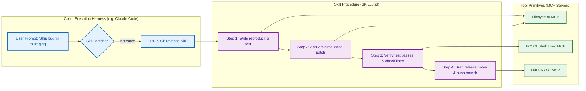
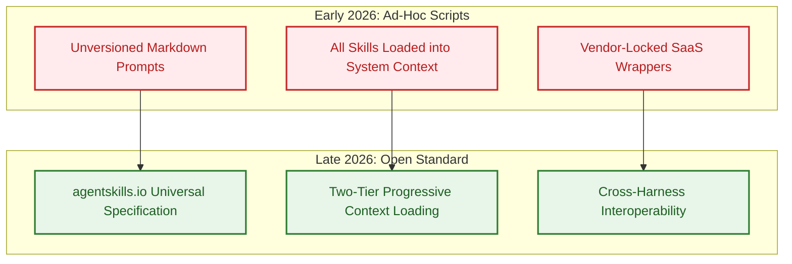

## Why Skills Are the Scalable Execution Primitive for AI Agents

In early enterprise deployments of generative AI, software organizations attempted to expand model capabilities by stuffing massive system prompts with hundreds of lines of procedural instructions. These monolithic prompt designs quickly reached an architectural breaking point: instructions for database querying, Git branching, security auditing, and document formatting competed for the model's finite attention span, leading to prompt dilution, instruction non-compliance, and severe context degradation.

When tool calling was introduced via function schemas and Model Context Protocol (MCP) servers, a complementary failure mode emerged. While MCP successfully standardized *how* an agent communicates with external APIs over JSON-RPC, it did not specify *when* or *why* an agent should perform a multi-step sequence of operations. Providing an agent with fifty raw API tools without operational domain knowledge routinely resulted in erratic execution trajectories and incomplete task states.

In February 2026, integration platform provider Composio released [`ComposioHQ/awesome-claude-skills`](https://github.com/ComposioHQ/awesome-claude-skills), a curated catalog aggregating production-tested workflows for Anthropic's Claude ecosystem (spanning Claude.ai, Claude Code, and the Claude API). Rather than treating agent capabilities as monolithic prompts or isolated tool schemas, the repository formalized the concept of **Skills** as modular, decoupled workflow units.


This article provides a source audit of the `awesome-claude-skills` catalog. We analyze the architectural contract separating skills from tools, examine how Composio bridges external SaaS applications, trace the transition toward standardized agent skills across modern CLI harnesses, and outline production design patterns for enterprise development teams.

## Architectural Anatomy: How Claude Skills Bridge MCP and Execution

A common point of confusion among systems engineers is the division of responsibility between a tool server (such as an MCP provider) and an agent skill. 

- **Tools (The Muscle)**: A tool provides an execution capability. An MCP server exposes schemas like `read_file`, `git_checkout`, `query_postgres`, or `send_slack_message`. It enforces security parameters, network connections, and data serialization, but maintains zero procedural awareness.
- **Skills (The Brain & Procedure)**: A skill is an executable operational manual. Formatted as a structured `SKILL.md` document, it specifies precondition requirements, task decomposition strategies, edge-case mitigation, expected output schemas, and self-verification checks.



### The Composio Catalog Structure

The `awesome-claude-skills` catalog categorizes over 100 enterprise skills across nine operational domains:
1. **Development & Code Engineering**: TDD test loops, changelog generators, worktree isolators, and Playwright browser validation.
2. **Data & Analytics**: Read-only PostgreSQL query analyzers, root-cause tracers, and CSV summarizers.
3. **Document & Media Processing**: Automated PDF, XLSX, and DOCX generators with strict schema conformance.
4. **DevOps & Cloud Systems**: AWS cost auditing, CDK deployment harnesses, and container hygiene.
5. **Security & Forensics**: Threat-hunting pipelines and log audit analyzers.
6. **Collaboration & Product Management**: Meeting insights summarizers, Jira/GitHub bi-directional sync, and release note drafting.

In Composio's architecture, skills interface with external services through the `connect-apps` bridge, which handles authentication lifecycles (OAuth refresh tokens, API key vaults) for over 500 SaaS endpoints. When an agent invokes a skill requiring Slack, GitHub, or Jira access, the underlying runtime routes execution through authenticated gateway endpoints without exposing sensitive developer credentials directly to the model's scratchpad context.

## What Changed Since Early 2026: The Rise of the AgentSkills Standard

When the `awesome-claude-skills` catalog launched in February 2026, skills were distributed largely as ad-hoc prompt snippets or vendor-locked Composio plugins. Developers frequently copied raw markdown blocks directly into their `.claude/` or `.cursorrules` folders.

Between early 2026 and late 2026, the ecosystem underwent rapid standardization across three core vectors:



### 1. The Universal `agentskills.io` Specification
The industry consolidated around the open `Agent Skills` specification (`agentskills.io`). Every compliant skill is packaged inside a dedicated folder containing a canonical `SKILL.md` manifest with strict YAML front matter:

```yaml
---
name: release-notes-generator
description: Generates user-facing release notes by inspecting Git commit histories against ticket trackers. Use when the user requests a changelog, tag notes, or release summary.
tools:
  - git-cli
  - github-issues
---
```

This standardized format ensures that a skill written for Claude Code functions seamlessly across other terminal harnesses, including Gemini CLI, OpenCode, and Codex CLI, as discussed in [Why the Terminal Is the Superior Harness for Coding Agents](/posts/cli-harness-coding-agents/).

### 2. Progressive Two-Tier Context Loading
In early implementations, loading dozens of skills simultaneously blew through model context limits and degraded reasoning. Late 2026 harnesses solved this through progressive disclosure:
- **Tier 1 (Discovery Index)**: Only the skill name and one-sentence trigger description are indexed into the agent's baseline system prompt (consuming fewer than 20 tokens per skill).
- **Tier 2 (On-Demand Activation)**: Only when the model determines that a user's task matches a skill's activation trigger is the full `SKILL.md` instruction body read into context. Once the task is resolved, the temporary instruction context is purged.

This dynamic activation mirrors the deterministic state transitions analyzed in [Deconstructing 17 Agentic Architectures](/posts/all-agentic-architectures-comprehensive-guide/), preventing context contamination across multi-turn interactions.

### 3. Automated Skill Validation and Quality Gates
Manual inspection of skill instructions gave way to automated linting tools (`skill-standardization`). Continuous integration pipelines now validate that:
- Trigger descriptions contain explicit routing keywords without overlapping ambiguities.
- Mandatory reference scripts and schema templates reside in predictable subdirectories (`scripts/`, `references/`).
- The skill specifies deterministic verification criteria rather than open-ended conversational prompts.

## Enterprise Production Patterns: Role Stacks and Boundary Enforcement

Deploying skills across cross-functional engineering teams requires moving beyond individual developer hacks. Leading software organizations organize skills into curated **Role Stacks** paired with strict execution boundaries.

### Curated Role Stacks

| Organizational Role | Core Skill Portfolio | Measurable Engineering Outcome |
| :--- | :--- | :--- |
| **Software Engineer** | `test-driven-development`, `git-worktree-isolation`, `playwright-ui-test` | Bounded defect leakage; automated pre-commit regression checks |
| **Site Reliability Engineer** | `root-cause-tracing`, `postgres-explain-audit`, `cloud-cost-hygiene` | Accelerated MTTR during incidents; prevention of non-indexed queries |
| **Product Manager** | `changelog-generator`, `meeting-action-synthesizer`, `jira-spec-validator` | Elimination of stale sprint documentation and manual ticket updates |

### Boundary Enforcement and Safety Gates

Because skills orchestrate tools with real-world side effects, production harnesses must implement strict policy boundaries:

1. **Read/Write Execution Separation**:
   Skills that analyze state (`postgres-query-analyzer`, `log-tracer`) should be bound strictly to read-only tool replicas or database follower nodes. Skills that modify state (`git-push`, `aws-deploy`) must require explicit interactive user diff approvals before dispatching commands.
2. **Deterministic Verification Assertions**:
   A well-designed skill never concludes by simply claiming a task is complete. It must mandate an automated assertion step. For example, a code refactoring skill must explicitly execute `npm test` or `cargo check` and inspect the exit code before reporting success, mirroring the sandboxed evaluation rigor demonstrated in [evaluating Deep Agents CLI on Terminal Bench 2.0](/posts/evaluating-deepagents-cli-on-terminal-bench-2-0/).

## Key Takeaways

1. **Skills Are Procedural Operational Manuals**: While tools provide raw API execution capabilities, skills supply the domain knowledge, sequencing logic, and self-verification rules required to accomplish complex workflows reliably.
2. **The Catalog Formalized Workflow Categorization**: Composio's `awesome-claude-skills` provided the open-source community with over 100 production-ready workflow templates across development, data analysis, and devops.
3. **Progressive Two-Tier Loading Solved Context Bloat**: Modern harnesses inject only lightweight skill descriptions into the baseline prompt, loading full procedural manuals into active context solely upon task activation.
4. **Standardization Around `agentskills.io`**: The industry transitioned away from vendor-specific prompt scripts toward universal, cross-harness `SKILL.md` packages compatible with Claude Code, Gemini CLI, and OpenCode.
5. **Mandatory Self-Verification Steps**: Enterprise-grade skills enforce deterministic verification (linters, test suites, schema validation) before signaling task completion, eliminating false-positive completions.

## New Questions

1. **Can Agents Synthesize and Self-Improve Their Own Skills?**: Can an autonomous harness observe recurring human developer corrections during interactive terminal sessions and automatically compile new, reusable `SKILL.md` packages?
2. **How Should Skill Conflicts Be Resolved Under High Concurrency?**: When two active skills propose contradictory execution steps for a shared Git repository, what arbitration protocols ensure transactional consistency?
3. **What Are the Security Vectors of Third-Party Skill Registries?**: How can enterprises prevent prompt-injection vulnerabilities or malicious shell commands concealed within community-contributed skill repositories?
4. **Will Skill Standards Converge with Foundation Model Post-Training?**: Will future frontier models internalize standardized skill schemas directly into model weights, reducing the necessity of runtime markdown prompt injections?

## References

- ComposioHQ. "Awesome Claude Skills: Curated Directory of Skills for Claude." `ComposioHQ/awesome-claude-skills`, release commit `main` branch, 2025–2026. URL: `https://github.com/ComposioHQ/awesome-claude-skills` (accessed 2026-10-18).
- Anthropic. "Extending Claude Code with Custom Skills and Workflows." *Anthropic Documentation*, 2025–2026. URL: `https://docs.anthropic.com/en/docs/claude-code/skills` (accessed 2026-10-18).
- Agent Skills Working Group. "The Agent Skills Specification (agentskills.io)." Open Specification Standard, v1.0.0, 2025–2026. URL: `https://agentskills.io/` (accessed 2026-10-18).
- Model Context Protocol Working Group. "Model Context Protocol Specification." Anthropic PBC and Open Source Contributors, 2025–2026. URL: `https://modelcontextprotocol.io/` (accessed 2026-10-18).
- Composio Platform Inc. "Composio Integration Gateway Architecture." *Composio Technical Documentation*, 2025–2026. URL: `https://platform.composio.dev/` (accessed 2026-10-18).
