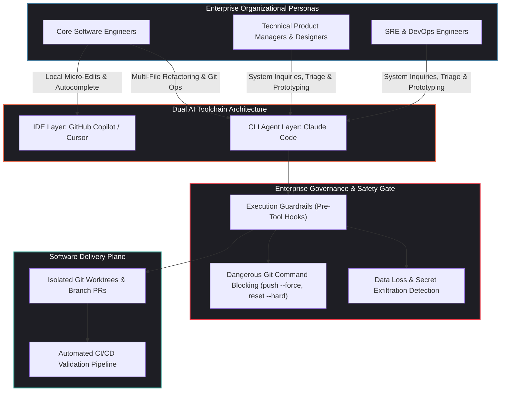
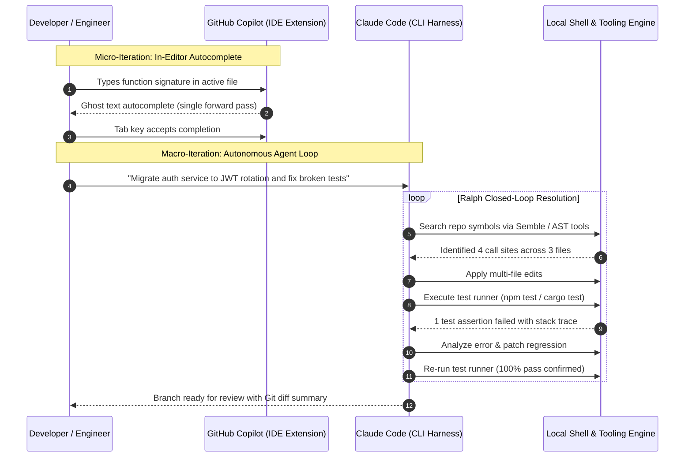

## Why Are Enterprise Engineering Organizations Adopting Terminal Agents Alongside IDE Autocomplete?

The rapid mainstreaming of AI coding assistants began inside integrated development environments (IDEs). Extensions like GitHub Copilot and Cursor embedded inline next-token suggestions directly into editor buffers, accelerating repetitive syntax generation and function authoring. However, as enterprise software organizations scaled their AI initiatives, a clear structural boundary emerged: inline autocomplete tools assist with **local line-level drafting**, but they lack the autonomous agency, architectural context, and shell execution capabilities required to execute end-to-end engineering tasks.

When Anthropic released **Claude Code**—an agentic command-line interface (CLI) tool capable of searching repositories, editing multi-file dependency graphs, running build scripts, and managing Git histories—major technology enterprises (including Microsoft, despite its multi-billion-dollar partnership with OpenAI) initiated broad internal pilots. Engineers and non-technical staff alike were encouraged to benchmark Claude Code directly against existing IDE extensions.

This dual-adoption trend signals a fundamental shift in software engineering infrastructure:

1. **Terminal-Native Execution Over Editor Sandboxes**: Real-world software engineering happens in the shell—running migrations, executing test suites, grepping build logs, profiling memory allocations, and managing Git worktrees. A CLI agent operating natively inside the terminal can inspect compiler output, detect broken tests, and execute self-correcting loops without requiring human intervention.
2. **De-coupling Architecture from Single-Vendor Monoliths**: Enterprise IT organizations refuse to accept single-model lock-in. Running heterogeneous toolchains—pairing OpenAI models in GitHub Copilot with Anthropic models in Claude Code—mitigates vendor risk and matches specific model strengths to specific engineering roles.
3. **The Expansion of the Developer Persona**: By providing an intuitive, natural language CLI that translates high-level operational intent into deterministic shell commands, technical product managers, designers, and site reliability engineers can inspect services, generate bug reproduction scripts, and submit targeted pull requests without mastering complex local IDE configurations.



---

## Architectural Comparison: In-Editor Autocomplete vs. CLI Agentic Harnesses

To evaluate why enterprises run dual toolchains rather than standardizing on a single interface, we must examine the architectural divergence between inline editor models and terminal agent loops.



| Operational Dimension | In-Editor Autocomplete (GitHub Copilot) | Terminal Agent Harness (Claude Code) |
| :--- | :--- | :--- |
| **Execution Surface** | Editor buffer (VS Code, JetBrains, Visual Studio) | Native OS terminal (zsh, bash, tmux) |
| **Primary Interaction Unit** | Cursor position, active document context | Entire repository filesystem, Git graph, shell tools |
| **Feedback Loop Mechanism** | Passive (waits for human typing triggers) | Active (closed-loop execution until tests pass) |
| **Tool Execution Authority** | Read-only editor workspace inspection | Direct command execution (`bash`, `git`, package managers) |
| **Context Window Scope** | Truncated local buffer slices + recent tabs | Dynamically indexed symbol trees and progressive skill loading |
| **Primary Engineering Value** | Lowers keystroke latency for routine syntax | Automates complex multi-file refactors and investigation |

As highlighted in our architectural survey of [AI coding in 2026 and multi-agent teams](/posts/ai-coding-topics-2026/), the combination of inline micro-assistance and terminal macro-autonomy provides a comprehensive productivity multiplier that neither paradigm can achieve in isolation.

---

## Enterprise Governance, Guardrails, and Security Boundaries

Granting an autonomous language model direct execution authority over the terminal introduces severe security and operational risks:

1. **Destructive Git Operations**: An agent attempting to resolve merge conflicts might execute `git reset --hard` or `git push --force`, destroying uncommitted local work or overwriting remote branches.
2. **Credential and Secret Exfiltration**: If an agent reads an untrusted external issue or web page that contains prompt injection payloads, it could be coerced into outputting `.env` secrets or SSH keys to an external server.
3. **Runaway Compute and Financial Burn**: Unchecked autonomous loops can generate thousands of API calls, consuming enterprise rate limits and inflating token expenditures.

To mitigate these risks, production deployments wrap CLI agents in layered governance harnesses:

### 1. Pre-Tool Execution Hooks and Command Blocking

Modern CLI agents support event-driven hook architectures (such as Claude Code's PreToolUse and PostToolUse lifecycle hooks). Security teams enforce deterministic shell policies:

```json
{
  "blocked_commands": [
    "^git push.*--force",
    "^git reset --hard",
    "^git clean -fd",
    "^rm -rf /",
    "^curl.*\\|.*sh"
  ],
  "require_confirmation": [
    "^git commit",
    "^git push",
    "^npm publish",
    "^docker rm"
  ]
}
```

Whenever an agent attempts to emit a destructive command, the local hook interceptor aborts execution before the shell receives the command string, prompting the developer for explicit cryptographic or interactive confirmation.

### 2. Isolated Workspace Sandboxing

Rather than executing directly against the developer's primary working tree, enterprise harnesses provision temporary Git worktree directories or sandboxed container environments. If an agent's experimental refactor fails, the worktree is cleanly destroyed without leaving orphan artifacts or corrupting developer state.

---

## Cross-Disciplinary Enablement: Expanding Technical Agency Beyond Engineers

One of the most consequential findings from enterprise pilots is that **non-developers derive the highest proportional leverage** from terminal agents.

In traditional game development and enterprise product organizations:

- **Game Designers and Level Scripters**: Historically relied on dedicated gameplay engineers to expose configuration sliders or balance enemy stats in engine source code. With Claude Code, designers inspect Python balance scripts and JSON level definitions directly, adjust values, and run validation linters autonomously.
- **Product Managers**: Rather than filing tickets requesting log exports or database metrics, PMs run terminal agents configured with read-only SQL skills to query staging environments and summarize retention funnels.
- **Customer Support and QA Teams**: As explored in our analysis of [UI-TARS native GUI agent stacks](/posts/ui-tars-desktop/), QA teams utilize agentic harnesses to reproduce complex user-reported bugs, generating end-to-end regression scripts that engineers can immediately review and merge.

---

## How Enterprise Agent Toolchains Evolved Across 2026

Enterprise adoption of agentic tooling accelerated across 2026, transitioning from individual developer experimentation into centralized corporate infrastructure:

1. **OpenTelemetry-Based Telemetry and Usage Auditing**: Platforms like Zeude and Langfuse introduced enterprise observability for CLI agents. Management teams track token burn, tool-call error rates, and SWE-bench style task completion metrics across thousands of internal developer workstations, as detailed in our guide to [production generative AI stacks](/posts/production-generative-ai-stack-architecture-components/).
2. **Centralized Skill Synchronization**: Rather than having engineers write custom shell aliases, organizations maintain version-controlled enterprise skill registries. A security engineer updates a vulnerability scanner skill, and every Claude Code instance across the organization receives the updated definition instantly.
3. **Automated Architectural Linters and AST Analysis**: CLI agents incorporate indexed AST parsers that enforce architectural invariants (e.g., verifying that a new controller implements mandatory OpenTelemetry spans and adheres to domain boundaries) before code ever enters a pull request.
4. **Agent-to-Agent Peer Review**: Development workflows incorporate automated review swarms. When an engineer's Claude Code instance submits a PR, a designated internal Reviewer Agent checks the diff against internal security policies, leaving line-level feedback within seconds.

---

## Key Takeaways

- **Complementary Dual Toolchains**: Enterprise engineering teams do not replace IDE autocomplete with CLI agents; they deploy both. In-editor extensions handle micro-keystroke authoring, while terminal agents orchestrate multi-file refactoring, test resolution, and Git operations.
- **Terminal as the Natural Agent Interface**: Operating directly within the shell provides agents with access to real compilers, linters, and runtime diagnostics, enabling true closed-loop error correction.
- **Mandatory Governance and Guardrails**: Granting terminal execution authority demands pre-tool hooks that block destructive Git operations, prevent secret exfiltration, and sandbox file modifications.
- **Democratization of Engineering Workflows**: High-level natural language CLI agents empower non-technical and semi-technical roles (designers, PMs, QA) to inspect systems and build prototypes without complex development environments.

---

## New Questions

1. How will enterprise IT departments handle compliance and audit trails when thousands of local CLI agents generate and execute ephemeral shell commands daily?
2. As agentic code authoring velocity outpaces human review capacity, what new automated verification architectures will prevent technical debt from accumulating in core monorepos?
3. Will future IDEs absorb the terminal agent entirely, or will the lightweight, scriptable command-line interface remain the preferred substrate for autonomous engineering swarms?

---

## References

1. Warren, T. *Inside Microsoft's AI Coding Shakeup: Testing Claude Code Against GitHub Copilot*. The Verge. https://www.theverge.com/news/614660/microsoft-claude-code-ai-coding-github-copilot (accessed 2026-10-18).
2. Anthropic Research. *Claude Code: An Agentic Command Line Tool for Engineering Teams*. Anthropic Product Documentation. https://docs.anthropic.com/en/docs/agents-and-tools/claude-code (accessed 2026-10-18).
3. GitHub Core Engineering. *GitHub Copilot Workspace: Evolving Developer Workflows from Autocomplete to Agent Tasks*. GitHub Technology Blog. https://github.blog/news-insights/product-news/github-copilot-workspace/ (accessed 2026-10-18).
4. Dohmke, T. *The Future of Software Development: AI Pair Programmers, Agent Harnesses, and Human Creativity*. ACM Queue. https://queue.acm.org/ (accessed 2026-10-18).
