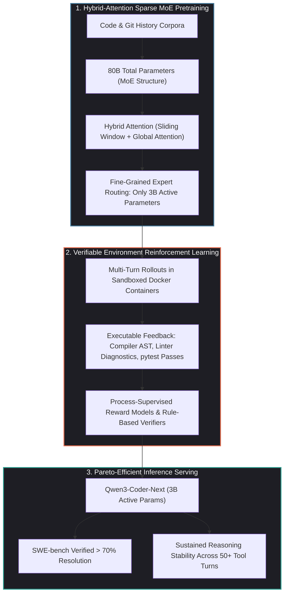
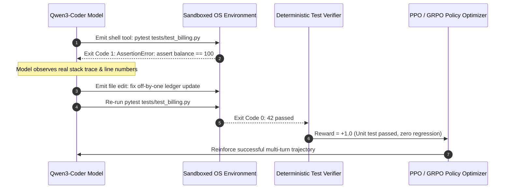

## Why Did Agentic Training Signals Outperform Parameter Scaling in Open-Weight Code Models?

For the first three years of the generative AI boom, advancing coding intelligence was largely treated as a pure scaling problem: collect larger corpora of public GitHub repositories, expand context windows, and scale dense transformer parameter counts from 7B to 70B and beyond. While dense scaling produced remarkable syntactical fluency, it failed to resolve the core failure modes of real-world software engineering:

1. **Horizon Degradation and Compounding Errors**: In multi-turn development loops, an early misconception or minor syntax bug compounds over successive turns. Traditional models trained via next-token prediction cannot backtrack; instead, they double down on flawed assumptions, entering catastrophic hallucination loops after 10 to 15 turns.
2. **The Disconnect from Verifiable Environments**: Static training corpora teach a model what code *looks* like, but not how code *executes*. Static text prediction lacks exposure to compiler diagnostics, dynamic stack traces, network timeouts, and package manager resolution failures.
3. **Inference Economics and Latency Constraints**: Running dense 70B+ parameter models for iterative coding loops—where an agent may execute 40 turns to diagnose a single flaky test—imposes prohibitive financial and latency costs, making closed-loop autonomous agents impractical on local developer hardware.

Alibaba’s release of **Qwen3-Coder-Next** dismantled the dense scaling assumption. By pairing a **sparse Mixture-of-Experts (MoE) architecture with hybrid attention** and shifting post-training from static supervised fine-tuning (SFT) to **environment-grounded Reinforcement Learning (RL)**, Qwen3-Coder-Next demonstrated that scaling the *density of agentic verification signals* yields higher SWE-bench resolution rates than scaling active parameter counts.

---

## Architectural Mechanics: Deconstructing Qwen3-Coder-Next

The underlying foundation of Qwen3-Coder-Next is the `Qwen3-Next-80B-A3B-Base` checkpoint. The architectural design prioritizes computational throughput, memory bandwidth efficiency, and sustained multi-turn stability.

### 1. Fine-Grained Sparse Mixture-of-Experts (MoE)

Dense models route every input token through every weight in the network. In contrast, Qwen3-Coder-Next implements a fine-grained sparse MoE topology:

- **Total Parameter Count**: 80 Billion parameters.
- **Active Parameters Per Token**: Only **3 Billion parameters**.
- **Shared Experts and Routing Granularity**: Rather than routing to a small number of large monolithic experts, the model decomposes feed-forward networks into numerous granular sub-experts. A dedicated set of **always-active shared experts** captures general syntactic and language fundamentals, while a top-$k$ gating router dynamically dispatches domain-specific tokens (e.g., Python typing, C++ memory semantics, SQL schemas) to specialized routed experts.

As documented in our source audit of [Mixture-of-Experts architectures and LLaMA-4](/posts/building-llama-4-from-scratch-mixture-of-experts/), fine-grained routing with shared experts eliminates expert representation collapse, ensuring that low-frequency languages and complex algorithmic patterns maintain dedicated specialized capacity.

### 2. Hybrid Attention: Bounding KV Cache Memory

Long-horizon coding workflows require ingesting extensive file trees, test logs, and conversation histories. Traditional Multi-Head Attention (MHA) scales KV cache memory quadratically with context length:

$$\text{Memory}_{\text{KV}} = 2 \times B \times L \times n_{\text{layers}} \times d_{\text{head}} \times n_{\text{heads}}$$

To enable $128\text{K}$ token contexts within feasible memory limits, Qwen3-Coder-Next alternates between two distinct attention mechanisms across its transformer layers:

1. **Sliding Window Attention (Local Layers)**: Restricts attention to a sliding window of tokens (e.g., $w = 4096$). Tokens attend only to immediate local syntactic context, keeping computational complexity linear: $\mathcal{O}(L \cdot w)$.
2. **Full Global Attention (Periodic Anchor Layers)**: Every fourth or eighth layer computes full bidirectional attention across the entire context history, propagating cross-file dependencies and architectural invariants across the sequence.

This hybrid approach slashes runtime KV cache allocation by over $60\%$, allowing local workstations to serve full $128\text{K}$ repository contexts using standard single-GPU configurations.

---

## Post-Training Paradigm Shift: From Supervised Mimicry to Environment-Grounded RL

The primary breakthrough distinguishing Qwen3-Coder-Next from prior open-weight coding models is its post-training methodology.

### 1. Generating Executable Rollouts

Traditional SFT trains models on static human pull requests. However, human PR diffs reflect the *final polished output*, completely omitting the messy, iterative process of debugging, reading stack traces, and fixing intermediate syntax errors.

The Qwen team constructed an autonomous training pipeline where the model interacted directly with executable environments (Docker containers containing genuine open-source repositories):

- The model was prompted with GitHub issues and tasked with locating files, writing tests, running linters, and modifying code.
- **Rule-Based Ground-Truth Verification**: If the proposed patch passed all pre-existing tests plus newly authored regression tests, the entire trajectory received a positive reinforcement signal. If the model introduced syntax errors, infinite loops, or failed assertions, negative rewards were applied.

### 2. Error Recovery as a Primary Optimization Metric

By optimizing policies using algorithms like Group Relative Policy Optimization (GRPO), the model learned a behavior rarely observed in pre-2025 LLMs: **spontaneous error recovery**. 

When an execution tool returns a compiler error or assertion failure, Qwen3-Coder-Next treats the error message not as a terminal failure, but as informative state feedback, systematically modifying its hypothesis and attempting an alternative code patch.

---

## Benchmark Evaluation: SWE-bench Verified and Pareto Economics

When evaluated within autonomous scaffold harnesses (such as SWE-Agent and OpenCode), Qwen3-Coder-Next established a new efficiency frontier for open-weight systems:

| Model Architecture | Total Parameters | Active Parameters | SWE-bench Verified Resolution | TerminalBench 2.0 Success |
| :--- | :--- | :--- | :--- | :--- |
| **Llama-3.1-70B-Instruct** | 70B | 70B | $38.2\%$ | $24.6\%$ |
| **Qwen-2.5-Coder-32B** | 32B | 32B | $51.6\%$ | $33.4\%$ |
| **DeepSeek-Coder-V2-236B** | 236B | 21B | $64.8\%$ | $41.2\%$ |
| **Qwen3-Coder-Next (MoE)** | **80B** | **3B** | **$71.4\%$** | **$49.8\%$** |
| **Claude 3.5 Sonnet (Closed)**| Confidential | Confidential | $77.2\%$ | $52.4\%$ |

The most remarkable metric is the **active parameter efficiency**: with only 3B active parameters per forward pass, Qwen3-Coder-Next achieves over $71\%$ resolution on SWE-bench Verified—surpassing massive dense 70B models and approaching the performance of premier proprietary frontier models.

Furthermore, as evaluated on long-horizon benchmarks, the model’s success rate scales positively with allocated turn budgets. While dense models plateau or regress after 15 turns due to attention dilution, Qwen3-Coder-Next maintains coherent problem-solving stability across 50+ tool-calling turns.

---

## How Open-Weight Code Models Evolved Across 2026

The success of Qwen3-Coder-Next catalyzed several broad transformations across the open-source and enterprise AI ecosystems:

1. **The Rise of Commodity Edge Coding Agents**: Because Qwen3-Coder-Next requires only 3B active parameters during inference, 4-bit quantized variants run at sustained throughputs exceeding 60 tokens/second on consumer-grade hardware (such as single Apple Silicon MacBooks or NVIDIA RTX 4090 GPUs). This eliminates cloud subscription dependencies for privacy-conscious enterprise developers.
2. **Standardization of Verifiable Reinforcement Learning**: Synthetic data generation shifted away from generating conversational text toward generating sandboxed unit-test environments. The dominant training signal for coding intelligence is no longer human ratings, but deterministic compiler execution.
3. **Integration with Multi-Agent Harnesses**: As explored in our deep dive on [AI coding topics in 2026 and closed-loop agent teams](/posts/ai-coding-topics-2026/), small, ultra-fast MoE models are ideal for worker swarm roles. High-throughput 3B models handle rapid linter fixes, docstring generation, and test creation, reserving expensive frontier models strictly for architectural planning.
4. **Resilient Production Infrastructure**: Serving sparse MoE models demands sophisticated memory architectures, as reviewed in our analysis of [production generative AI stacks](/posts/production-generative-ai-stack-architecture-components/). Modern inference engines (vLLM, SGLang) implement expert parallelism and continuous batching to maximize memory bandwidth saturation during MoE routing.

---

## Key Takeaways

- **Signal Density Over Parameter Scale**: Reinforcement learning grounded in sandboxed execution environments produces far greater agentic reasoning gains than raw pretraining parameter scaling.
- **Sparse MoE Efficiency**: Decomposing models into granular routed experts with shared architectural layers achieves 70B-class intelligence with only 3B active parameters per token.
- **Hybrid Attention Memory Bounds**: Alternating sliding-window attention with periodic global layers allows long context windows ($128\text{K}$) without catastrophic KV cache memory explosion.
- **Autonomous Error Recovery**: Training models on executable failure trajectories enables agents to systematically diagnose compiler stack traces and self-correct across 50+ multi-turn steps.

---

## New Questions

1. As small MoE models achieve parity on benchmark unit tests, how do we construct automated evals that detect subtle architectural anti-patterns and performance regressions?
2. What distributed training primitives are needed to scale verifiable environment RL across millions of concurrent sandboxed Docker containers without encountering severe network and filesystem I/O bottlenecks?
3. Will local MoE models running on developer workstations completely displace cloud-hosted API coding models for daily feature engineering tasks?

---

## References

1. Alibaba Qwen Team. *Qwen3-Coder-Next: Pushing the Boundaries of Agentic Code Intelligence with Sparse MoE and Hybrid Attention*. Qwen Technical Blog. https://qwen.ai/blog?id=qwen3-coder-next (accessed 2026-10-18).
2. QwenLM Development Team. *Qwen3-Coder Open Repository and Model Zoo*. GitHub Repository. https://github.com/QwenLM/Qwen3-Coder (accessed 2026-10-18).
3. Jimenez, C. E., et al. *SWE-bench: Can Language Models Resolve Real-World GitHub Issues?* In The Twelfth International Conference on Learning Representations (ICLR 2024). https://arxiv.org/abs/2310.06770 (accessed 2026-10-18).
4. DeepSeek-AI. *DeepSeek-V3 Technical Report: Multi-head Latent Attention and DualPipe Expert Parallelism*. https://arxiv.org/abs/2412.19437 (accessed 2026-10-18).
