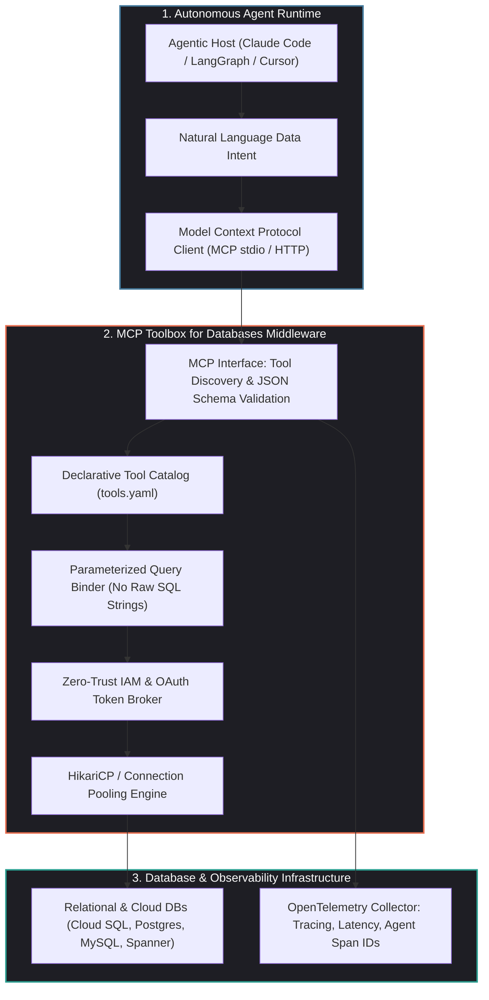
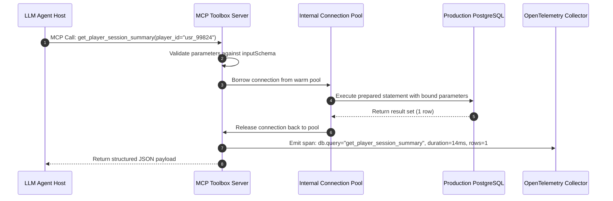

## Why Did Unfettered Agentic SQL Demand a Dedicated Database Tooling Middleware?

When language models demonstrated the ability to translate natural language inquiries into executable SQL, enterprise teams rushed to connect LLMs directly to operational relational databases. The naive approach appeared straightforward: dump table schemas into an agent's system prompt, expose a generic `execute_sql(query: string)` tool, and let the model execute queries directly against Postgres or MySQL databases.

In production environments, this unmediated direct-execution pattern proved disastrous:

1. **SQL Injection via Adversarial Prompt Injection**: If an agent reads untrusted user input (such as support ticket transcripts or forum comments) and constructs raw SQL strings, malicious actors can manipulate the prompt to append `DROP TABLE`, exfiltrate password hashes, or modify sensitive billing records.
2. **Connection Starvation and Thread Exhaustion**: High-throughput multi-agent swarms frequently spin up ephemeral worker threads. If dozens of concurrent agent sessions each open direct TCP connections without centralized pooling, database connection limits are rapidly saturated, bringing operational services offline.
3. **Cartesian Joins and Compute Exhaustion**: Models frequently hallucinate schema joins on unindexed foreign keys or emit unbounded `SELECT *` statements across tables containing tens of millions of rows, triggering severe CPU and I/O bottlenecks.
4. **Complete Absence of Telemetry and Audit Trails**: Traditional database audit logs record queries coming from a single shared service account. They provide zero visibility into which upstream prompt, user persona, or agent trajectory caused a catastrophic table scan.

To solve this systemic vulnerability, Google open-sourced **MCP Toolbox for Databases**. Operating as an enterprise-grade middleware server implementing the **Model Context Protocol (MCP)**, Toolbox centralizes connection management, IAM authentication, parameterized query validation, and OpenTelemetry instrumentation into a single control plane.



---

## Architectural Mechanics: Deconstructing the Toolbox Control Plane

MCP Toolbox for Databases shifts the interaction paradigm: instead of granting an agent arbitrary SQL execution permissions, it exposes **declarative, parameterized database tools** defined in structured YAML manifests.

### 1. Declarative Parameterized Toolsets

Database engineers author tool configurations that enforce strict parameter binding, preventing SQL injection by design:

```yaml
# tools.yaml - Declarative Database Tool Definition
toolsets:
  player_analytics:
    description: "Read-only analytics tools for investigating player retention and churn"
    database: "postgres_primary"
    tools:
      - name: "get_player_session_summary"
        description: "Retrieve aggregated gameplay session metrics for a specific player ID"
        statement: |
          SELECT 
            player_id, 
            COUNT(session_id) AS total_sessions, 
            AVG(duration_seconds) AS avg_duration,
            MAX(created_at) AS last_active_timestamp
          FROM player_sessions
          WHERE player_id = :player_id AND created_at >= NOW() - INTERVAL '30 days'
          GROUP BY player_id;
        parameters:
          - name: "player_id"
            type: "string"
            description: "The unique UUID identifier of the player"
            required: true
```

When an agent interacts with MCP Toolbox, it does not invent SQL syntax; it perceives a typed tool schema via MCP:

```json
{
  "name": "get_player_session_summary",
  "description": "Retrieve aggregated gameplay session metrics for a specific player ID",
  "inputSchema": {
    "type": "object",
    "properties": {
      "player_id": { "type": "string" }
    },
    "required": ["player_id"]
  }
}
```

The model emits `{ "player_id": "usr_99824" }`. The Toolbox middleware binds this parameter into a pre-compiled prepared statement, completely neutralizing prompt injection risks.

### 2. High-Performance Connection Pooling and Multiplexing

Rather than allowing autonomous agent loops to establish ephemeral, unmanaged TCP sockets, Toolbox maintains robust connection pools (utilizing Go `database/sql` pools or Java HikariCP engines). 

Dozens of concurrent agent reasoning threads are multiplexed across a bounded pool of long-lived database connections, enforcing strict query timeout budgets (e.g., terminating any query exceeding $2000\text{ms}$) to preserve database health.



### 3. Integrated Enterprise Identity and Zero-Trust IAM

For enterprise deployments on Google Cloud or AWS, hardcoding database credentials in agent environment files violates security compliance. 

Toolbox natively integrates with identity-aware proxies and IAM token brokers:

- **Cloud SQL Auth Proxy Integration**: Automatically generates ephemeral mTLS certificates for database connections.
- **Role-Based Row-Level Security (RLS)**: Enforces database-level access policies based on the authenticated agent's OAuth identity token, ensuring that an agent representing a regional support tier cannot query global financial tables.

---

## Observability and Telemetry: Tracing Agentic Data Operations

In our comprehensive survey of [production generative AI stack architectures](/posts/production-generative-ai-stack-architecture-components/), we emphasized that semantic tracing is mandatory for mission-critical deployments.

MCP Toolbox for Databases includes first-class **OpenTelemetry (OTel)** instrumentation out of the box. Every tool call emits trace spans adhering to semantic conventions:

- `gen_ai.agent.id`: Unique identifier of the calling agent session.
- `db.system`: Underlying database engine (`postgresql`, `mysql`, `cloudsql`).
- `db.operation`: Tool name and logical query type.
- `db.response.returned_rows`: Number of rows returned to the model context.
- `db.duration_ms`: Execution time inside the database engine.

If an agent initiates a hallucinated or inefficient query pattern (e.g., repeatedly querying session tables in an infinite loop), SRE teams receive automated alerts from their OTel backend (Datadog, Prometheus, or Google Cloud Trace) before database resource exhaustion impacts live customer traffic.

---

## Architectural Comparison: Direct SQL vs. ORM Wrappers vs. MCP Toolbox

Engineering teams evaluating database access mechanisms for autonomous agents encounter three distinct architectures:

| Architectural Dimension | Direct SQL Tool (`psql` CLI) | LangChain SQLDatabaseToolkit | Google MCP Toolbox for Databases |
| :--- | :--- | :--- | :--- |
| **Execution Safety** | Low (Vulnerable to injection & destructive DDL) | Medium (Read-only flags; vulnerable to Cartesian joins) | **High (Parameterized prepared statements only)** |
| **Connection Pooling** | None (Creates unmanaged process connections) | Client-side SQLAlchemy pool | **Centralized server-side connection multiplexing** |
| **Protocol Compatibility**| Shell CLI only | Python / LangChain ecosystem | **Standard MCP (compatible with Claude, Cursor, Go, etc.)** |
| **Authentication Model** | Static environment passwords | Static connection URIs | **Enterprise IAM, OAuth2, and ephemeral mTLS** |
| **Observability** | OS process accounting | Basic callback handlers | **Native OpenTelemetry spans across all queries** |
| **Schema Grounding** | Dumps raw DDL into prompt | Introspects tables per turn | **Declarative, high-signal JSON tool schemas** |

As demonstrated in our analysis of [SQLite-Graph and Cypher query compilation](/posts/sqlite-graph-cypher-query-support-analysis/), modern data systems increasingly enforce structured intermediate representations to prevent unstructured agent queries from corrupting relational and graph storage.

---

## How Database Agent Tooling Evolved Across 2026

The interaction layer between autonomous agents and enterprise data systems underwent significant maturation across 2026:

1. **Pre-Execution Cost and Cartesian Join Estimation**: Modern database toolboxes integrate query explain-plan analyzers. Before executing a query, Toolbox inspects PostgreSQL's `EXPLAIN (FORMAT JSON)` output. If the estimated cost exceeds a predefined limit or involves an unindexed full table scan on more than $100\text{K}$ rows, the query is rejected with explicit structural feedback.
2. **Hybrid Relational-Vector Unification**: In line with developments in [vector database selection for LLM applications](/posts/choice-vector-database-for-llm/), MCP Toolbox incorporates `pgvector` operators natively, allowing agents to perform semantic similarity searches and relational filtering within a single unified toolset.
3. **Decoupled Streamable HTTP Transports**: While initial MCP servers relied on local `stdio` pipes, enterprise deployments adopted Streamable HTTP transports. A single centralized Toolbox cluster running in a private Kubernetes VPC serves hundreds of distributed agent workstations securely over TLS.
4. **Adaptive Schema Caching**: Rather than repeatedly introspecting database catalogs on every turn, Toolbox maintains an in-memory cache of column descriptions and foreign-key topologies, updating only when database migration webhooks notify the control plane.

---

## Key Takeaways

- **Centralized Control Plane**: Exposing raw SQL execution directly to agents is an anti-pattern; database access must be mediated through an intelligent control plane that handles security, connection pooling, and observability.
- **Parameterized Tools Over Raw Strings**: Defining declarative YAML toolsets binds parameters to prepared statements, completely eliminating SQL injection and Cartesian join risks.
- **Enterprise Multiplexing**: Built-in connection pooling prevents multi-agent swarms from overwhelming database connection limits.
- **Auditability via OpenTelemetry**: Out-of-the-box OTel spans connect low-level database query execution directly to upstream agent reasoning traces, providing total operational visibility.

---

## New Questions

1. How can declarative toolsets support ad-hoc exploratory data analysis (EDA) without completely reverting to dangerous raw SQL execution?
2. What cryptographic delegation protocols will allow agents to inherit fine-grained user permissions when querying multi-tenant enterprise data warehouses?
3. How will database engines evolve their internal query optimizers when a significant fraction of incoming query traffic is synthesized by autonomous language models?

---

## References

1. Google Cloud Open Source. *MCP Toolbox for Databases: Enterprise Database Integration for AI Agents*. GitHub Repository. https://github.com/googleapis/genai-toolbox (accessed 2026-10-18).
2. Anthropic Research. *The Model Context Protocol: An Open Standard for Connecting AI Systems to Data Sources*. Anthropic Engineering Blog. https://www.anthropic.com/news/model-context-protocol (accessed 2026-10-18).
3. OpenTelemetry Database Semantic Conventions Working Group. *Database Client Calls Spans Specification*. OpenTelemetry Documentation. https://opentelemetry.io/docs/specs/semconv/database/ (accessed 2026-10-18).
4. PostgreSQL Global Development Group. *PostgreSQL Documentation: Prepared Statements and Connection Architecture*. https://www.postgresql.org/docs/current/sql-prepare.html (accessed 2026-10-18).
