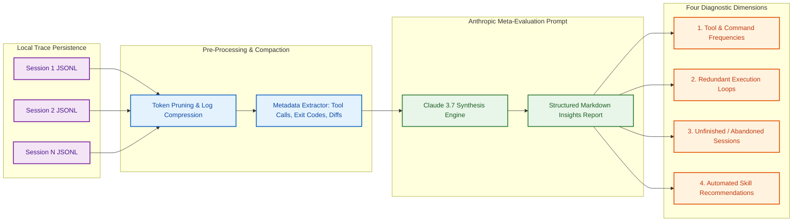
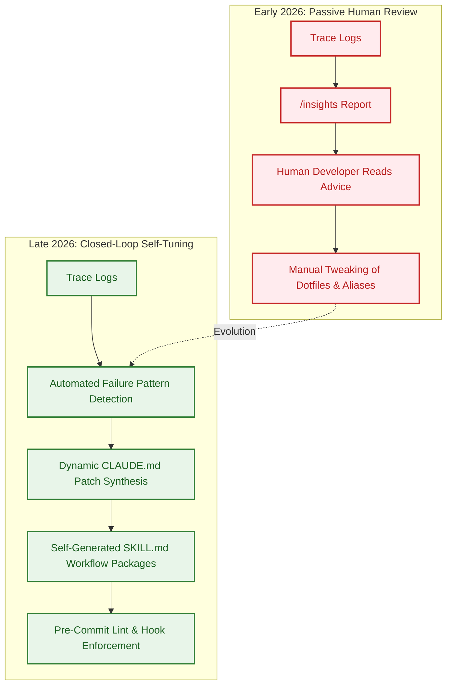
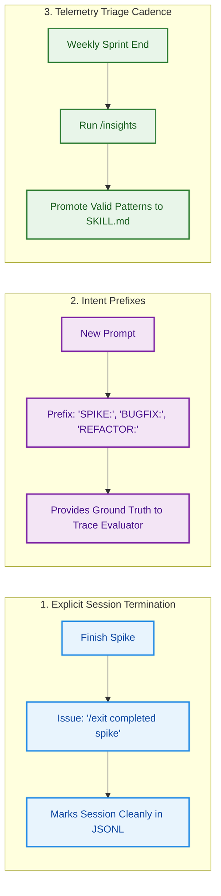

## The Inversion of Developer Telemetry: From Tool Metrics to Workflow Critique

For decades, software development telemetry operated in a strictly unidirectional paradigm: developers monitored their tools. Application performance monitoring (APM) agents, build profilers, continuous integration dashboards, and linter reports existed to measure compile latencies, memory allocations, test pass rates, and crash diagnostics. The human engineer was the sole consumer of this telemetry, using numerical metrics to optimize code and runtime performance.

In early 2026, the introduction of terminal-native coding agents inverted this dynamic. With the release of Anthropic's Claude Code command `/insights`, the developer tool began analyzing and evaluating the developer. Instead of merely recording raw command counts or token expenditures, the `/insights` engine ingests multi-session terminal transcripts, identifies behavioral bottlenecks, critiques engineering habits, and recommends organizational interventions.

This capability represents a fundamental transition in agent harness engineering. However, it also exposes a profound systems challenge: the **telemetry versus intent gap**. A command-line harness can observe shell commands, file edits, and tool invocations, but it cannot directly observe developer cognition, discarded experimental spikes, or out-of-band architectural discussions.

```mermaid
flowchart TD
    subgraph TraditionalAPM ["Traditional Telemetry (1990-2024)"]
        Dev1[Human Engineer] --> Code1[Source Code]
        Code1 --> Tool1[Compiler / APM / Linter]
        Tool1 --> Metric1[Numerical Dashboard: Latency, Errors, Memory]
        Metric1 --> Dev1
    end

    subgraph AgenticInsights ["Agentic Workflow Critique (2026)"]
        Dev2[Human Engineer] <--> Agent[Claude Code Terminal Harness]
        Agent --> Traces[Local Session JSONL Traces & Tool Invocations]
        Traces --> SynthesisEngine["/insights LLM Evaluation Engine"]
        SynthesisEngine --> Critique[Behavioral Critique & Habit Nudges]
        Critique --> SelfTuning[Automated Skill & Rule Generation]
        SelfTuning --> Agent
    end

    classDef trad fill:#e8f4fd,stroke:#1e88e5,stroke-width:2px,color:#0d47a1;
    classDef agentic fill:#e8f5e9,stroke:#2e7d32,stroke-width:2px,color:#1b5e20;
    class Dev1,Code1,Tool1,Metric1 trad;
    class Dev2,Agent,Traces,SynthesisEngine,Critique,SelfTuning agentic;
```

This source audit examines the technical architecture of Claude Code's `/insights` system. We inspect how local transcripts are processed, analyze the structural causes of telemetry misinterpretation, trace the 2026 shift toward automated harness self-tuning, and outline practical operational protocols for development teams.

## Technical Architecture: How Claude Code Synthesizes Session History

Claude Code persists session interactions as structured local logs (typically stored under `~/.claude/` or repository-scoped `.claude/history/` directories). When a user executes the `/insights` command, the CLI triggers an offline meta-evaluation pipeline that aggregates and summarizes these traces.

### The Four Diagnostic Dimensions

The `/insights` report categorizes developer-agent interactions into four primary operational dimensions:

1. **Tool and Command Distributions**:
   Measures the ratio of read operations (`grep`, `view`, `ls`) versus mutation operations (`edit`, `write`, `git commit`). A high read-to-write ratio often indicates that the agent is struggling to locate project architecture conventions, signaling that the repository lacks a clear entrypoint manifest like `CLAUDE.md`.

2. **Repetitive Retry Cascades**:
   Identifies instances where a developer or agent executes the same tool repeatedly with slight prompt variations (e.g., repeatedly editing a file to pass a stubborn unit test). The system flags these loops as candidate targets for automated test-driven harnesses.

3. **Session Dropout and Abandonment Tracking**:
   Surfaces sessions that terminate without a Git commit, pull request creation, or explicit conclusion. In the `/insights` narrative, these are flagged as potential friction points where the developer lost confidence in the agent's trajectory or abandoned a failing attempt.

4. **Procedural Skill and Hook Recommendations**:
   Rather than merely complaining about inefficiencies, `/insights` suggests modular interventions: creating custom slash commands, installing relevant Model Context Protocol (MCP) servers, or codifying recurring multi-step workflows into dedicated `SKILL.md` packages, as explored in [Awesome Claude Skills: Standardizing Agentic Workflow Primitives](/posts/awesome-claude-skills/).

## What Changed Since Early 2026: From Passive Coaching to Automated Self-Tuning

In early 2026, `/insights` functioned primarily as an introspective, human-readable coaching document. A developer ran `/insights` once every few weeks, read the natural-language suggestions, and manually made adjustments to their prompt style or shell alias configurations.

Between mid-2026 and late 2026, the agentic tooling ecosystem shifted from **passive human coaching** to **active closed-loop self-tuning**:

1. **Automated `CLAUDE.md` Rule Synthesis**:
   Instead of requiring developers to manually edit project rules, modern harness utilities parse recurring failure patterns from telemetry and propose concrete pull requests to the repository's `CLAUDE.md`. If `/insights` identifies that the agent repeatedly edits TypeScript files without compiling them via `tsc --noEmit`, the harness automatically injects a mandatory verification rule into project configuration.

2. **Self-Generated `SKILL.md` Packages**:
   When telemetry reveals that a developer repeatedly executes a three-step terminal sequence (e.g., pulling a Docker image, running database migrations, and checking container health), the harness prompts: *"You have performed this sequence 8 times this week. Would you like me to compile this into an executable skill?"* This transforms ephemeral developer behavior into version-controlled organizational assets.

3. **Standardized Telemetry Benchmarks**:
   Telemetry analysis was integrated into continuous evaluation pipelines like Harbor and Terminal Bench 2.0 (analyzed in [evaluating Deep Agents CLI on Terminal Bench 2.0](/posts/evaluating-deepagents-cli-on-terminal-bench-2-0/)). In these environments, trace logs are continuously graded to determine whether a newly deployed harness configuration reduces token overhead and eliminates redundant tool calling.

4. **Integration with Terminal-Native Standards**:
   As terminal-native coding harnesses consolidated across vendors (detailed in [Why the Terminal Is the Superior Harness for Coding Agents](/posts/cli-harness-coding-agents/)), telemetry schemas converged toward standard OpenTelemetry formats, allowing engineering leaders to aggregate anonymized agent efficiency data across entire distributed teams.

## Navigating the Telemetry vs. Intent Gap in Production Engineering

While automated insights provide powerful optimizations, treating `/insights` reports as unimpeachable truth introduces severe cognitive and operational pitfalls. 

### The Three Telemetry Illusions

1. **The "Abandoned Task" Fallacy**:
   A session that concludes without a Git commit is classified by telemetry as an "abandoned failure." In reality, experienced developers frequently launch short-lived agent sessions as disposable architectural spikes—checking how an API looks, verifying a syntax possibility, or confirming dependency constraints—with zero intention of committing code. Penalizing or flagging exploratory spikes as inefficiency discourages healthy prototyping.

2. **The "Tool Expert" Misclassification**:
   If an engineer runs 50 headless Playwright browser tests to diagnose a flaky login race condition, telemetry algorithms may classify the user as a "Browser Automation Specialist." This behavioral label conflates transient debugging activity with core job intent, skewing subsequent agent recommendations toward browser tools when the developer's primary objective was backend auth optimization.

3. **Emotional Resistance to Evaluative Tone**:
   When developer tooling shifts from neutral execution status (`Process exited with code 1`) to qualitative judgment (*"You tend to start tasks without closing them"* or *"Your prompting style is fragmented"*), engineers experience performance evaluation fatigue. Automated feedback must remain framed around systems optimization rather than personal productivity appraisals.

### Operational Protocols for Clean Telemetry

To ensure `/insights` reflects reality and produces actionable tooling improvements, engineering teams should establish three lightweight habits:

1. **Tag Prompts with Intent Prefixes**:
   Prefix exploratory sessions with explicit tags (`SPIKE:`, `EXPLORE:`, `BENCH:`). This provides metadata that prevents offline LLM evaluators from misclassifying throwaway spikes as abandoned production tasks.
2. **Explicitly Terminate Completed Workflows**:
   Before closing a terminal tab or terminating a process, supply an explicit completion signal (such as `task complete` or `/exit`), enabling the session aggregator to calculate accurate completion rates.
3. **Weekly Telemetry-to-Rules Triage**:
   During weekly team retrospectives, inspect aggregate `/insights` recommendations. If multiple developers encounter the same retry loop, promote the suggested mitigation directly into the repository's root `CLAUDE.md` or a shared team skill.

## Key Takeaways

1. **The Inversion of Developer Telemetry**: Claude Code's `/insights` marks a paradigm shift where AI developer tools transition from passive metric displays to qualitative evaluators of developer workflow efficiency.
2. **Four Diagnostic Focal Points**: The system analyzes tool distribution ratios, repetitive retry cascades, session drop-offs, and automated skill/MCP recommendations.
3. **The Telemetry vs. Intent Gap Is Real**: Telemetry captures mechanical actions (commands, edits, exits) but remains blind to developer intent, easily misclassifying intentional throwaway spikes as abandoned failures.
4. **Transition from Coaching to Self-Tuning**: In 2026, insights evolved from subjective human advice into automated, closed-loop generators of `CLAUDE.md` rules and version-controlled `SKILL.md` workflow packages.
5. **Operational Discipline Yields Clean Insights**: Utilizing intent prefixes (`SPIKE:`, `REFACTOR:`) and explicit completion tags eliminates false-positive friction reports and sharpens team-wide harness engineering.

## New Questions

1. **Can Multi-Agent Telemetry Detect Inter-Agent Communication Waste?**: How can `/insights` architectures be extended to quantify token redundancy and circular blame loops in multi-agent subagent swarms?
2. **Will Telemetry Feedback Loops Overfit Developer Behavior?**: Does continuously nudging developers toward the tool's preferred interaction patterns suppress creative, unconventional engineering breakthroughs?
3. **How Can Privacy Be Preserved in Enterprise Telemetry Aggregation?**: What cryptographic or differential-privacy techniques ensure team-wide `/insights` rollups do not expose sensitive developer credentials or proprietary algorithms?
4. **Can Real-Time Insights Intervene Before a Loop Degrades?**: Rather than generating offline post-mortem reports, can a lightweight watcher model detect recursive error loops in real time and dynamically inject guidance?

## References

- Anthropic. "Claude Code Documentation: Telemetry, History, and Workflow Commands." *Anthropic Documentation*, 2025–2026. URL: `https://docs.anthropic.com/en/docs/claude-code/overview` (accessed 2026-10-18).
- Anthropic. "Evaluating Coding Agents and Session Tracing in the Terminal." *Anthropic Engineering Publications*, 2025–2026. URL: `https://www.anthropic.com/research` (accessed 2026-10-18).
- Model Context Protocol Working Group. "Model Context Protocol Specification." Anthropic PBC and Open Source Contributors, 2025–2026. URL: `https://modelcontextprotocol.io/` (accessed 2026-10-18).
- OpenTelemetry Project. "OpenTelemetry Semantic Conventions for Generative AI Operations." *Cloud Native Computing Foundation (CNCF)*, release v1.28.0, 2025–2026. URL: `https://opentelemetry.io/docs/specs/semconv/gen-ai/` (accessed 2026-10-18).
