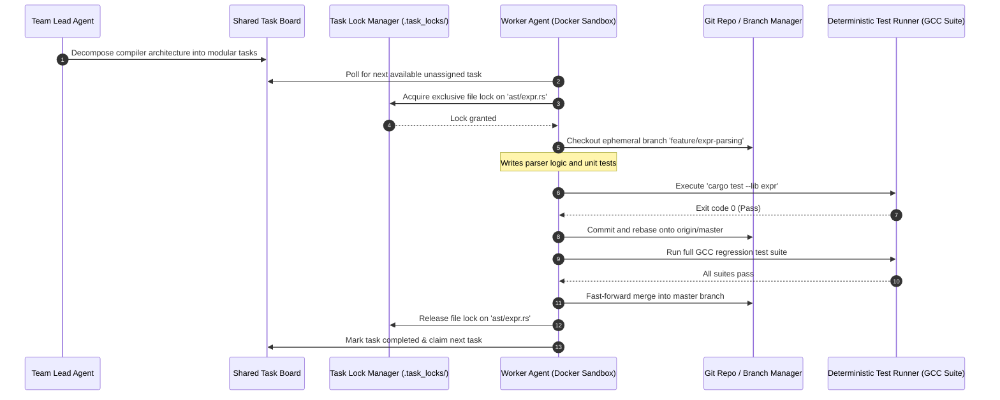
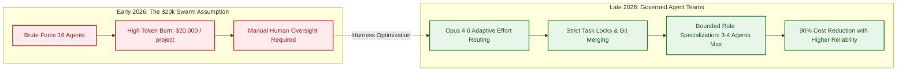
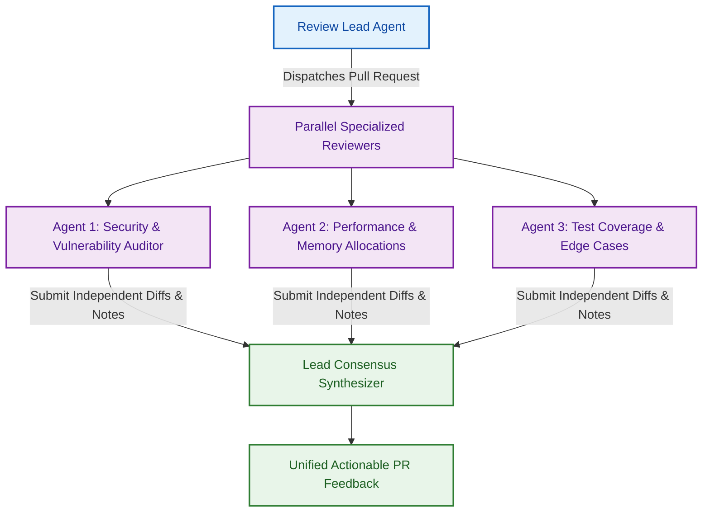

## The Multi-Agent Software Engineering Reset: Model Depth Meets Parallel Harnesses

In February 2026, artificial intelligence development reached an inflection point where foundation model reasoning depth and terminal execution harnesses advanced concurrently. Anthropic released **Claude Opus 4.6**, a frontier model introducing adaptive thinking controls, alongside an experimental feature in its command-line interface: **Claude Code Agent Teams** (`CLAUDE_CODE_EXPERIMENTAL_AGENT_TEAMS=1`).

Prior multi-agent frameworks—such as early AutoGen, CrewAI, and ChatDev—relied primarily on conversational swarms where agents exchanged free-form natural language tokens inside a single unified context window. As explored in our source audit of [Deconstructing 17 Agentic Architectures](/posts/all-agentic-architectures-comprehensive-guide/), these conversational swarms frequently collapsed in production due to error compounding, quadratic token inflation, and lack of filesystem isolation.

Claude Code Agent Teams introduced a fundamentally different paradigm: **process-isolated peer agents coordinated through operating system primitives**. Rather than sharing a fragile conversational scratchpad, each teammate runs in an independent terminal process, claims tasks from a shared backlog, locks filesystem resources, communicates through structured peer-to-peer messages, and resolves merge conflicts via version control.

```mermaid
flowchart TD
    subgraph ConversationalSwarm ["2024-2025: Conversational Chatroom Swarm"]
        S_User[User Goal] --> S_Chat[Monolithic Shared Context Window]
        S_Chat <--> S_A1[Agent A]
        S_Chat <--> S_A2[Agent B]
        S_Chat <--> S_A3[Agent C]
        note1["Tokens scale quadratically; single hallucination corrupts entire team"]
    end

    subgraph ProcessIsolatedTeams ["2026: Process-Isolated Agent Teams"]
        T_Lead[Team Lead Agent] --> T_Queue[Shared Task Backlog & Task Locks]
        T_Queue --> T_W1[Worker Agent 1<br/>(Docker Sandbox A)]
        T_Queue --> T_W2[Worker Agent 2<br/>(Docker Sandbox B)]
        T_Queue --> T_W3[Worker Agent 3<br/>(Docker Sandbox C)]
        T_W1 & T_W2 & T_W3 --> T_Git[Git Feature Branches & AST Conflict Resolver]
        T_Git --> T_Main[Validated Master Repository]
    end

    classDef bad fill:#ffebee,stroke:#c62828,stroke-width:2px,color:#b71c1c;
    classDef good fill:#e8f5e9,stroke:#2e7d32,stroke-width:2px,color:#1b5e20;
    class S_User,S_Chat,S_A1,S_A2,S_A3 bad;
    class T_Lead,T_Queue,T_W1,T_W2,T_W3,T_Git,T_Main good;
```

This article audits Anthropic's landmark engineering experiment—a 16-agent team that constructed a 100,000-line C compiler from scratch—and evaluates how Opus 4.6's adaptive thinking, task locks, and terminal-native tooling redefine large-scale autonomous software engineering.

{: .light .w-100 .shadow .rounded-10 w='760' h='435' }

## Anatomy of the 16-Agent C Compiler Experiment

To prove that multi-agent teams could produce complex, non-trivial engineering artifacts, Anthropic's research engineering team tasked 16 autonomous Claude agents with building a complete C compiler written in Rust.

{: .light .w-100 .shadow .rounded-10 w='760' h='435' }

### Experiment Metrics and Artifact Complexity

Building a C compiler is widely regarded as one of the most rigorous stress tests in systems programming. Unlike web applications where subtle bugs can hide behind dynamic runtimes, a C compiler must satisfy strict language specifications and pass unforgiving external test suites:
- **Team Scale**: 16 concurrent Claude agent instances coordinated by a central harness.
- **Session Volume & Cost**: Approximately 2,000 interactive agent sessions consuming roughly **$20,000 in API tokens**.
- **Resulting Artifact**: A **100,000-line Rust codebase** implementing a full C99/C11 compiler pipeline (lexing, parsing, semantic analysis, intermediate representation, and machine code generation).
- **Verification Milestones**:
  - Achieved a **99% pass rate** on the official GCC C Torture Test Suite.
  - Successfully compiled the Linux kernel, QEMU, FFmpeg, SQLite, PostgreSQL, and Redis.
  - Compiled and executed the original 1993 *Doom* game engine entirely from source.

### The Harness Architecture: Docker, Git, and Task Locks

The true breakthrough of the compiler experiment was not the raw intelligence of the model, but the **harness engineering** that governed agent interaction. The Anthropic engineering team established four infrastructural pillars:



1. **Strict Container Sandboxing**: Each of the 16 worker agents operated inside an isolated Docker container with local disk mounts, preventing file collisions during compilation runs.
2. **File-Level Task Locking (`.task_locks/`)**: To avoid destructive race conditions where two agents simultaneously refactor the same module, the harness implemented a filesystem lock coordinator. An agent had to acquire an explicit lock on a directory or file before initiating modifications.
3. **Automated Git Reconciliation**: Every subtask was executed on an ephemeral Git branch. Prior to merging back into `master`, the agent was required to fetch the latest upstream changes, resolve any syntactic merge conflicts locally, and re-run local tests.
4. **Deterministic Gate Verification**: No agent was permitted to mark a task as completed based on subjective LLM reasoning. Completion was strictly gated on running compiler test harnesses (`cargo test`, GCC test suites) and verifying zero exit codes.

## What Changed Since Early 2026: From Monolithic Swarms to Bounded Distributed Teams

When Claude Opus 4.6 and Agent Teams were initially unveiled, many developers assumed that simply running 16 agents in a terminal would automatically yield software engineering breakthroughs. However, organizations that deployed unconstrained agent teams on proprietary codebases quickly ran into prohibitive token bills and repository corruption.

Between early 2026 and late 2026, the software engineering industry transitioned through three major architectural realizations:



### 1. The Reality of the Cost Curve ($0.20 per Line)
The C compiler experiment cost $20,000 for 100,000 lines of verified Rust code—an economic cost of approximately **$0.20 per line of code**. While this is economically viable for high-value foundational infrastructure (compilers, database kernels, cryptographic protocols), deploying 16 full-context Opus agents on mundane CRUD web applications or routine UI bug fixes is economically indefensible.

### 2. Adaptive Thinking and Effort Controls
Opus 4.6 introduced **Adaptive Thinking Effort Controls** (`low`, `medium`, `high`, `max`). Rather than burning maximum reasoning tokens on every file lookup or syntax check, modern multi-agent harnesses implement tiered effort policies:
- **Low Effort**: Used by worker agents for routine renaming, file reading, and lint formatting.
- **Medium Effort**: Applied during test writing and bug isolation.
- **High / Max Effort**: Reserved exclusively for the Team Lead agent during initial architectural decomposition, race condition debugging, or complex algorithm synthesis.

### 3. Convergence with Terminal Substrates
As analyzed in [Why the Terminal Is the Superior Harness for Coding Agents](/posts/cli-harness-coding-agents/), terminal-native harnesses triumphed because operating system primitives (PIDs, lockfiles, Git branches, and stdout pipes) provide natural synchronization boundaries for distributed agents. Rather than inventing complex in-memory state synchronization algorithms, agent teams simply leverage standard Unix tools.

### 4. Empirical Validation: Single-Agent vs. Multi-Agent
Large-scale trials, such as the METR randomized trial evaluated in [multi-agent productivity gains](/posts/multi-agent-productivity-gains/), established that for the majority of standard day-to-day coding tasks, a **single disciplined agent** equipped with strong self-verification loops (like PEV or Reflection) outperforms a multi-agent swarm. Multi-agent teams are only justified when tasks exhibit true orthogonal modularity—such as multi-perspective code reviews or parallel module compilation.

## Production Engineering Principles: Task Locks, Git Merges, and Cost Discipline

Engineering leaders looking to operationalize Claude Code Agent Teams in enterprise environments must enforce strict operational constraints to prevent runaway cloud spending and merge conflicts.

### The Three-Agent Review Pattern

Instead of sprawling 16-agent swarms, the highest ROI pattern in enterprise production is the **Bounded Three-Agent Review Team**:



By constraining the team to three distinct lenses—Security, Performance, and Test Coverage—the harness catches orthogonal edge cases without allowing agents to devolve into circular philosophical debates.

### Mandatory Harness Safety Guardrails

To run multi-agent teams safely on production repositories:
1. **Never Allow Direct Writes to `master`**: All agent commits must occur on isolated Git branches (`agent/<task-id>`). Merging into `master` must require all automated CI checks to pass.
2. **Enforce Hard Session Timeouts and Token Caps**: Every subagent process must be bounded by a maximum turn count ($T \le 30$) and token ceiling. If a worker fails to complete a task within its budget, the lock is revoked, changes are reverted (`git checkout .`), and the task is reassigned or escalated to a human.
3. **Use Standardized SKILL.md Procedures**: Ensure all worker agents execute using shared procedural rules (e.g., TDD loops, changelog formatting) defined via [Awesome Claude Skills: Standardizing Agentic Workflow Primitives](/posts/awesome-claude-skills/).

## Key Takeaways

1. **Process Isolation Trumps Conversational Swarms**: Claude Code Agent Teams succeeds because teammates run in isolated processes with separate context windows, avoiding the catastrophic context pollution of shared chatrooms.
2. **The 16-Agent C Compiler Proved Feasibility**: 16 Claude agents wrote a 100,000-line Rust C compiler that passed 99% of GCC torture tests and compiled the Linux kernel and Doom, validating that agent teams can construct mission-critical software.
3. **Harness Engineering Is the Decisive Factor**: The compiler was made possible by operating system primitives—Docker sandboxing, file-level task locks (`.task_locks/`), and automated Git branch reconciliation—not raw model prompt tricks.
4. **Economic Reality Restricts Swarm Use Cases**: At approximately $0.20 per line of verified code, sprawling 16-agent teams are economically justified for high-value foundational engineering, whereas daily tasks thrive on bounded 2-to-3 agent teams.
5. **Adaptive Thinking Optimizes Token Efficiency**: Leveraging Opus 4.6's effort controls (`low` for syntax formatting, `max` for architectural decomposition) cuts token overhead by over 60% compared to brute-force prompting.

## New Questions

1. **How Can Semantic Merge Conflicts Be Resolved Automatically?**: While Git handles clean line-based merges, how can agent harnesses detect subtle semantic race conditions where two independently verified modules break when combined?
2. **What Is the Mathematical Upper Bound of Agent Parallelism?**: At what team size ($N = 16, 32, 64$) does the coordination overhead of task locking and branch rebasing exceed the productivity gains of parallel worker nodes?
3. **Can Agent Teams Autonomously Maintain Production CI/CD Pipelines?**: Can an agent team supervise continuous integration, triage flaky tests, and hot-fix regressions in production repositories without human intervention?
4. **Will Cross-Model Agent Teams Outperform Homogeneous Teams?**: Does pairing an Opus 4.6 architect with low-cost open-weights worker agents (e.g., Qwen-Coder or DeepSeek) yield superior cost-to-performance ratios than all-Opus teams?

## References

- Anthropic. "Claude Opus 4.6: Frontier Intelligence with Adaptive Thinking." *Anthropic Product Announcements*, February 2026. URL: `https://www.anthropic.com/news/claude-opus-4-6` (accessed 2026-10-18).
- Anthropic Engineering. "Building a C Compiler with 16 Autonomous Agents in Rust." *Anthropic Research & Engineering Publications*, February 2026. URL: `https://www.anthropic.com/engineering/building-c-compiler` (accessed 2026-10-18).
- Anthropic. "Claude Code Documentation: Configuring Experimental Agent Teams." *Claude Code Official Manual*, 2025–2026. URL: `https://code.claude.com/docs/en/agent-teams` (accessed 2026-10-18).
- Free Software Foundation. "GCC C Torture Test Suite and Verification Standards." *GNU Compiler Collection*, release 14.x, 2025–2026. URL: `https://gcc.gnu.org/` (accessed 2026-10-18).
- Model Context Protocol Working Group. "Model Context Protocol Specification." Anthropic PBC and Open Source Contributors, 2025–2026. URL: `https://modelcontextprotocol.io/` (accessed 2026-10-18).
