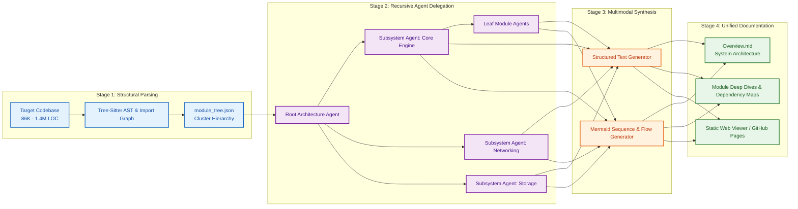

## The Repository-Scale Comprehension Gap in Automated Documentation

For decades, automated software documentation tools followed a strictly reductionist paradigm. Tools like Doxygen, Javadoc, Sphinx, and TypeDoc inspect isolated abstract syntax tree (AST) nodes to extract function signatures, type annotations, and docstring comments. While useful as low-level API dictionaries, these tools fail completely at developer onboarding. When a software engineer joins a project with hundreds of thousands of lines of code, their primary questions are architectural: *How do distributed microservices communicate? Where are the database transaction boundaries? What is the execution lifecycle of a client request?*

With the rise of large language models, teams attempted to generate holistic documentation by dumping entire repositories into frontier context windows. However, naive whole-repo prompting collapses under massive enterprise codebases. Industrial repositories routinely exceed 100,000 to over 1,000,000 lines of code (LOC)—well beyond the effective retrieval limits of even 1M-token context windows. Ingesting unpartitioned code dumps causes severe "lost-in-the-middle" attention degradation, hallucinated call graphs, and prohibitive token costs.

In late 2025, researchers from the FPT Software AI Center and the University of Melbourne published a landmark framework titled *"CodeWiki: Evaluating AI's Ability to Generate Holistic Documentation for Large-Scale Codebases"* ([arXiv:2510.24428](https://arxiv.org/abs/2510.24428)). CodeWiki replaces flat context dumping with an architecture-aware, recursive multi-agent decomposition pipeline tested across seven programming languages on codebases ranging from 86,000 to 1.4 million LOC.

```mermaid
flowchart TD
    subgraph TraditionalDocs ["Traditional Tools (Doxygen, Sphinx)"]
        A1[Repository Codebase] --> A2[File-by-File AST Extraction]
        A2 --> A3[Isolated API Reference Signatures]
        note1["Zero architectural context; blind to cross-module dataflow"]
    end

    subgraph NaiveLLM ["Naive Whole-Repo LLM Prompts"]
        B1[1M LOC Codebase] --> B2[Monolithic Prompt Injection]
        B2 --> B3[Context Degradation & Hallucinated Architectures]
        note2["Prohibitive token costs; loses structural hierarchy"]
    end

    subgraph CodeWikiPipeline ["CodeWiki Architecture (arXiv:2510.24428)"]
        C1[Multi-Language Codebase] --> C2[Hierarchical AST Module Decomposition]
        C2 --> C3[Recursive Multi-Agent Worker Pool]
        C3 --> C4[Multimodal Synthesis: Markdown & Mermaid Diagrams]
        C5[CodeWikiBench Rubrics] -.->|Automated Evaluation| C4
    end

    classDef trad fill:#ffebee,stroke:#c62828,stroke-width:2px,color:#b71c1c;
    classDef naive fill:#fff3e0,stroke:#e65100,stroke-width:2px,color:#bf360c;
    classDef codewiki fill:#e8f5e9,stroke:#2e7d32,stroke-width:2px,color:#1b5e20;
    class A1,A2,A3 trad;
    class B1,B2,B3 naive;
    class C1,C2,C3,C4,C5 codewiki;
```



This source audit examines CodeWiki's recursive multi-agent mechanics, details the CodeWikiBench evaluation methodology, analyzes the 2026 industry transition toward living documentation anchors, and outlines practical deployment tradeoffs for enterprise engineering teams.

## Technical Architecture: Hierarchical Decomposition and Recursive Multi-Agent Synthesis

CodeWiki operates across seven major programming languages: Python, Java, JavaScript, TypeScript, C, C++, and C#. Rather than processing a codebase linearly, CodeWiki executes a four-stage pipeline:



### 1. Hierarchical Module Clustering (`module_tree.json`)
The pipeline begins by constructing a dependency graph using Tree-sitter parsers to analyze cross-file imports, class inheritance trees, and foreign symbol calls. It clusters related files into cohesive subsystems, producing an explicit structural manifest (`module_tree.json`). This ensures that the agent understands functional boundaries before generating a single line of text.

### 2. Recursive Multi-Agent Execution Pool
CodeWiki divides labor hierarchically:
- **Leaf Agents**: Process individual source files and leaf packages, extracting operational responsibilities, exposed interfaces, and inbound/outbound dependencies.
- **Subsystem Agents**: Ingest the synthesized summaries of their child leaf agents, abstracting internal implementation details into high-level subsystem responsibilities.
- **Root Architecture Agent**: Operates strictly on the subsystem abstracts, formulating the global system topology, cross-cutting concerns (e.g., authentication, caching, logging), and end-to-end data pipelines.

By passing synthesized summaries upward rather than raw source code, CodeWiki guarantees that no single agent exceeds its optimal context window, enabling the framework to scale seamlessly to million-line codebases without context degradation.

### 3. Multimodal Artifact Generation
CodeWiki recognizes that human software engineers rely heavily on visual mental models. The framework generates:
- **System Topologies**: High-level component diagrams illustrating module boundaries.
- **Data Flow Graphs**: Flowcharts mapping state transitions through processing pipelines.
- **Sequence Diagrams**: Visualizing multi-module call sequences during critical operations (e.g., user registration, transaction commit).

### 4. Empirical Evaluation on CodeWikiBench
To measure documentation quality rigorously, the authors created **CodeWikiBench**, an evaluation suite comprising multi-dimensional rubrics:
- **Completeness**: Coverage of public interfaces, internal subsystems, and edge-case exceptions.
- **Structural Correctness**: Adherence to actual dependency hierarchies without phantom links.
- **Architectural Fidelity**: Verifying that high-level dataflow diagrams accurately represent runtime call sequences.

Evaluated against prior baseline tools like DeepWiki, CodeWiki achieved a composite score of **68.79%** with frontier proprietary models, demonstrating particular strength on modular languages with clear package structures.

## What Changed Since Early 2026: From Static Wikis to Living Project Anchors

When CodeWiki was introduced in late 2025 and early 2026, the primary output was conceived as a static documentation portal—a set of markdown files rendered via GitHub Pages for human onboarding. 

However, during 2026, the proliferation of terminal coding agents transformed the role of repository documentation:

```mermaid
flowchart TD
    subgraph Early2026 ["Early 2026: Human-Facing Static Wikis"]
        E1[CodeWiki Run] --> E2[GitHub Pages Static Site]
        E2 --> E3[Read Once by Human Engineers]
        E3 --> E4[Code Evolves; Docs Become Stale After 2 Sprints]
    end

    subgraph Late2026 ["Late 2026: Machine-Readable Project Anchors"]
        L1[CodeWiki AST Hierarchy] --> L2[Incremental Drift Detection via Git Diff]
        L2 --> L3[Living Agent Anchors: CLAUDE.md & AGENTS.md]
        L3 --> L4[Local Code Graph Indexes (mex / llm-wiki)]
        L4 --> L5[Autonomous Terminal Agents Ingest Verified Context]
    end

    E4 -.->|Ecosystem Evolution| L1

    classDef old fill:#ffebee,stroke:#c62828,stroke-width:2px,color:#b71c1c;
    classDef new fill:#e8f5e9,stroke:#2e7d32,stroke-width:2px,color:#1b5e20;
    class E1,E2,E3,E4 old;
    class L1,L2,L3,L4,L5 new;
```

1. **AI Agents as the Primary Consumers of Documentation**:
   In modern software engineering, coding agents (such as Claude Code, Gemini CLI, and OpenCode, evaluated in [Why the Terminal Is the Superior Harness for Coding Agents](/posts/cli-harness-coding-agents/)) require architectural context just as much as human developers. Rather than outputting verbose prose for humans, CodeWiki architectures evolved to generate **compact project anchors** (`CLAUDE.md`, root `AGENTS.md`, and structured knowledge graphs). These machine-readable anchors allow coding agents to navigate unfamiliar repositories without burning thousands of exploratory tokens.

2. **Incremental Drift Detection via Git Diffs**:
   Running a full CodeWiki pass on a 1.4-million-line repository consumes substantial compute ($20 to $50 per full generation). In late 2026, production implementations integrated Git diff watchers. Instead of regenerating the entire documentation tree, the harness identifies mutated files, invalidates only the affected leaf and subsystem agents, and re-synthesizes the parent architecture docs incrementally.

3. **Coordination with Distributed Agent Teams**:
   In complex multi-agent engineering workflows—such as Anthropic's 16-agent C compiler experiment analyzed in [Claude Opus 4.6 and Agent Teams: Lessons from the 16-Agent Compiler Harness](/posts/claude-opus-46-agent-teams/)—maintaining a shared, up-to-date architectural map is essential to prevent parallel agents from duplicating work or breaking interface contracts.

## Operational Economics and Implementation Tradeoffs

Deploying CodeWiki across enterprise codebases requires balancing documentation fidelity against API costs and operational complexity.

### Multi-Tier Model Routing

Running a frontier model (such as Claude Opus 4.6 or GPT-4o) across every leaf node of a 1.4M LOC codebase is cost-prohibitive. Production deployments implement multi-tier model routing:

```bash
# Configuration: Tiered model routing for cost efficiency
codewiki config set \
  --api-key $MODEL_API_KEY \
  --base-url $API_BASE_URL \
  --main-model claude-3-7-sonnet \       # High-level architecture & sequence diagrams
  --cluster-model deepseek-v3 \          # Leaf module AST parsing and summarization
  --fallback-model glm-4p5               # Cheap fallback for simple utility packages
```

| Pipeline Layer | Recommended Model Class | Context Demand | Operational Focus |
| :--- | :--- | :---: | :--- |
| **Leaf Module Parsing** | Cost-effective 70B+ (DeepSeek-V3, Flash) | Low-Medium | Accurate function extraction & import tracking |
| **Subsystem Aggregation** | Frontier Sonnet / GPT-4o class | Medium-High | Cross-file dataflow & interface reconciliation |
| **Root System Overview** | Frontier Reasoning (Opus 4.6 / o3-mini) | High | Abstract architectural framing & Mermaid topologies |

### Critical Failure Modes and Mitigations

1. **Phantom Dependency Edges in Diagrams**:
   LLMs occasionally hallucinate dependencies between modules that share similar nomenclature (e.g., connecting `UserAuthService` directly to `AnalyticsPipeline` when they only interact via message queues). Mitigate this by enforcing deterministic AST static analysis: diagrams should only render edges validated by static call graph tools.
2. **Context Fragmentation in Deeply Nested Monorepos**:
   Monorepos containing 50+ packages can produce module trees with excessive nesting depth. Cap the recursion depth (`--max-depth 3`) to prevent over-fragmentation and ensure that documentation remains focused on major architectural boundaries.

## Key Takeaways

1. **Architectural Context Over Function Signatures**: Traditional doc generators extract API signatures but fail at system understanding; CodeWiki solves this by structuring documentation around architectural subsystems and dataflow.
2. **Hierarchical Decomposition Solves the LOC Ceiling**: Tested on codebases up to 1.4M LOC, CodeWiki delegates analysis recursively across leaf, subsystem, and root agents, preventing context-window degradation.
3. **Multimodal Synthesis Accelerates Onboarding**: Generating visual Mermaid sequence and flow diagrams alongside structured text provides human and AI developers with instant mental models.
4. **CodeWikiBench Established Empirical Standards**: The benchmark formalizes multi-dimensional rubrics (completeness, structural correctness, architectural fidelity) for repository-scale documentation.
5. **From Static Portals to Machine-Readable Anchors**: Modern production workflows convert CodeWiki outputs into living project anchors (`CLAUDE.md`, `AGENTS.md`) and incremental drift-detection pipelines to guide autonomous coding agents.

## New Questions

1. **Can CodeWiki Ingest Runtime Traces Alongside Static Code?**: How can dynamic OpenTelemetry distributed traces and eBPF network maps be fused with static AST trees to generate runtime-accurate architecture docs?
2. **How Can Living Documentation Detect Architectural Rot Automatically?**: Can a continuous CodeWiki agent flag pull requests that violate documented architectural boundaries (e.g., unauthorized cross-module imports) before code is merged?
3. **What Are the Scaling Limits for Multi-Language Monorepos?**: How effectively does hierarchical decomposition perform when a single repository mixes C++, Rust, Python, and TypeScript across shared memory or RPC boundaries?
4. **Can Autonomous Coding Agents Edit Documentation Incrementally Without Full Re-Runs?**: Can an agent that modifies a single interface autonomously update its corresponding Mermaid sequence diagram with guaranteed correctness?

## References

- Truong, Nghi, et al. "CodeWiki: Evaluating AI's Ability to Generate Holistic Documentation for Large-Scale Codebases." *FPT Software AI Center & University of Melbourne*, arXiv preprint arXiv:2510.24428v1, 2025–2026. URL: `https://arxiv.org/abs/2510.24428` (accessed 2026-10-18).
- FSoft-AI4Code Team. "CodeWiki: Open-Source Holistic Documentation Framework." `FSoft-AI4Code/CodeWiki`, commit `main` branch, 2025–2026. URL: `https://github.com/FSoft-AI4Code/CodeWiki` (accessed 2026-10-18).
- FSoft-AI4Code Team. "CodeWiki Interactive Demonstration and Benchmark Visualizer." GitHub Pages, 2025–2026. URL: `https://fsoft-ai4code.github.io/codewiki-demo/` (accessed 2026-10-18).
- Tree-sitter Authors. "Tree-sitter: An Incremental Parsing System for Programming Tools." Version 0.22.x, 2025–2026. URL: `https://tree-sitter.github.io/tree-sitter/` (accessed 2026-10-18).
- Anthropic. "Claude Code: Project Documentation Conventions (CLAUDE.md)." *Anthropic Documentation*, 2025–2026. URL: `https://docs.anthropic.com/en/docs/claude-code/overview` (accessed 2026-10-18).
