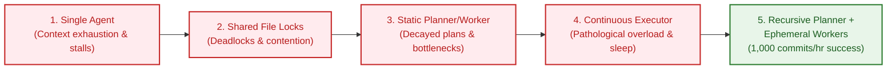
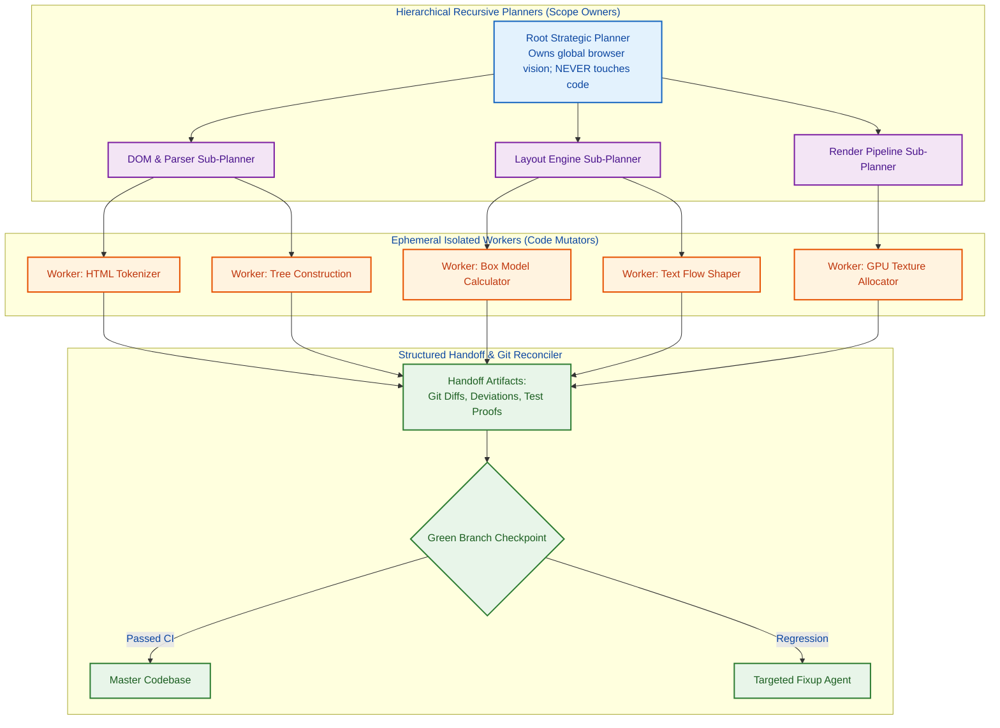

## The Long-Horizon Autonomy Frontier: Why Single Agents Stall

In developer tooling demonstrations, artificial intelligence agents routinely solve isolated unit test failures, generate boilerplate API endpoints, and refactor standalone functions with remarkable fidelity. However, when software engineering teams attempt to scale these agents to **long-horizon autonomous software development**—such as implementing a full web browser rendering engine or a complete distributed database from an empty repository—single-agent architectures reliably stall.

A solitary agent executing across an extended multi-hour task suffers from predictable cognitive failure modes:
1. **Context Window Saturation**: As the session progresses, accumulated terminal outputs, compiler dumps, and file contents fill the context window, causing early architectural constraints to be evicted.
2. **Premature Victory Declarations**: When faced with compounding compilation errors, single agents tend to declare tasks "completed" by stubbing out complex functions with empty mocks (`TODO: implement`) rather than resolving the root algorithmic difficulty.
3. **Loss of Global Intent**: Without an external supervisory mechanism, an agent easily falls into recursive micro-optimization rabbit holes—spending fifty turns refactoring a utility string-formatting function while the core parser remains unwritten.

In early 2026, research engineers at Cursor (Anysphere) published an empirical research study titled *"Towards Self-Driving Codebases"* alongside investigations into *"Scaling Long-Running Agents"*. To test the limits of autonomy, Cursor tasked autonomous agent swarms with engineering an entire web browser engine from scratch.

```mermaid
flowchart TD
    subgraph SingleAgentFailure ["Single-Agent Failure Modes"]
        A1[Complex Goal: 'Build Browser Engine'] --> A2[Single Agent Execution Loop]
        A2 --> A3[Context Saturation After 40 Turns]
        A3 --> A4[Rabbit Holes & Empty Mock Stubs]
        A4 --> A5[Premature Declaration of Completion]
    end

    subgraph CursorHarnessBreakthrough ["Cursor's Recursive Architecture"]
        B1[Complex Goal: 'Build Browser Engine'] --> B2[Root Planner (Pure Vision, No Code)]
        B2 --> B3[Sub-Planners (Domain Decomposition)]
        B3 --> B4[Ephemeral Workers (Isolated Sandboxes)]
        B4 --> B5[Structured Handoff Protocols & Git Reconcilers]
        B5 --> B6[Sustained Autonomy: 1,000 Commits / Hour]
    end

    classDef bad fill:#ffebee,stroke:#c62828,stroke-width:2px,color:#b71c1c;
    classDef good fill:#e8f5e9,stroke:#2e7d32,stroke-width:2px,color:#1b5e20;
    class A1,A2,A3,A4,A5 bad;
    class B1,B2,B3,B4,B5,B6 good;
```

This source audit analyzes Cursor's findings. We examine the four failed architectural iterations that preceded their breakthrough, deconstruct the recursive planner-worker topology that sustained 1,000 commits per hour, trace the 2026 industry shift toward governed CI agents, and outline production principles for managing autonomous repositories.

{: .light .w-100 .shadow .rounded-10 w='760' h='435' }

## The Evolution of Cursor's Multi-Agent Harness Architecture

The central finding of Cursor's research is that scaling autonomy is fundamentally a problem of **harness engineering**, not raw model weights. Cursor iterated through five distinct coordination architectures before achieving stable throughput.



### 1. Iteration 1: The Single-Agent Ceiling
The initial baseline relied on a single frontier model instance possessing full bash and filesystem access. While capable of producing high-quality code in bursts, the agent lost the thread of long-horizon plans, getting bogged down in repetitive debugging cycles without advancing the overall repository architecture.

### 2. Iteration 2: Naive Multi-Agent Shared Coordination File
Cursor attempted to parallelize work by deploying multiple agents that coordinated through a shared Markdown or JSON task file. Each agent was instructed to claim tasks, acquire a lock on the file, update the state, and release the lock.
- **The Failure Mode**: Agents frequently forgot to release locks, crashed while holding exclusive locks, or spent significant compute polling for lock availability.
- **Throughput Collapse**: Under lock contention, increasing the swarm from 1 to 20 agents resulted in an effective throughput of only **1 to 3 agents**. Furthermore, agents actively avoided claiming large, risky architectural tasks, preferring trivial documentation or formatting chores.

### 3. Iteration 3: Static Planner → Executor → Worker Hierarchy
To eliminate self-coordination chaos, Cursor separated responsibilities: a dedicated Planner synthesized an upfront task tree, an Executor scheduled tasks, and Workers executed them.
- **The Failure Mode**: The system exhibited severe rigidity. The slowest worker blocked downstream tasks, and static plans decayed rapidly: within twenty commits, early architectural assumptions made by the planner became obsolete, forcing workers to execute tasks that no longer fit the evolving codebase.

### 4. Iteration 4: The Overloaded Continuous Executor
Cursor eliminated the static planner, replacing it with an active Executor agent that dynamically inspected progress and dispatched tasks in real time.
- **The Failure Mode**: The continuous executor suffered from severe cognitive overload. Managing twenty concurrent worker streams simultaneously overwhelmed the executor's context window. The agent developed **pathological behaviors**: it began idling ("sleeping"), refused to delegate work to workers, and repeatedly hallucinated that the entire browser engine was finished when only basic data structures had been defined.

### 5. Iteration 5: Recursive Planners with Ephemeral Workers
The final, breakthrough architecture established a recursive tree topology:



In this topology:
- **Strict Separation of Concerns**: The Root Planner maintains the long-range architectural vision and is strictly prohibited from writing code or running shell commands.
- **Recursive Scoping**: Sub-planners own distinct subsystems (e.g., CSS parsing, layout computation, GPU rasterization), decomposing subsystem milestones into discrete, bounded tasks.
- **Ephemeral Workers**: Workers are spun up for a single task inside isolated Git worktrees. When a task completes, the worker outputs a structured handoff document detailing:
  1. What was implemented.
  2. Any architectural deviations from the plan.
  3. Test proofs and compiler diagnostics.
- The worker process is immediately destroyed, preventing context pollution.

This architecture scaled to **1,000 commits per hour sustained over a full week of continuous autonomous execution**.

## What Changed Since Early 2026: From 1,000-Commit Sprints to Governed CI Agents

When Cursor published their 1,000-commits-per-hour browser experiment, the immediate reaction across developer communities was awe. However, as enterprise software teams attempted to replicate this approach on real-world repositories, the limitations of raw commit velocity became apparent.

Between early 2026 and late 2026, the industry consolidated around three foundational governance paradigms:

```mermaid
flowchart TD
    subgraph Early2026 ["Early 2026: Unbounded Commit Sprints"]
        C1[High Commit Velocity: 1,000 commits/hr]
        C2[Runaway Code Bloat & Architectural Drift]
        C3[Massive API Token Bills ($10k+)]
    end

    subgraph Late2026 ["Late 2026: Governed CI Autonomy"]
        G1[Controlled Error-Rate Tolerance]
        G2[Periodic Green-Branch Stabilization Checks]
        G3[Convergence with Terminal-Native Standards]
    end

    C1 --> G1
    C2 --> G2
    C3 --> G3

    classDef bad fill:#ffebee,stroke:#c62828,stroke-width:2px,color:#b71c1c;
    classDef good fill:#e8f5e9,stroke:#2e7d32,stroke-width:2px,color:#1b5e20;
    class C1,C2,C3 bad;
    class G1,G2,G3 good;
```

### 1. The Throughput vs. Correctness Dilemma
A critical insight from Cursor was that **demanding 100% test passing on every single commit crushes parallel throughput**. In a massive distributed swarm, waiting for full end-to-end regression suites on every small AST edit creates severe merge serialization queues.

Cursor adopted a **controlled error-rate policy**: individual worker branches are merged if local unit tests pass, accepting that minor integration regressions will occur on the development branch. A separate, scheduled "Green Branch" stabilization pass runs periodically to reconcile broken integration tests, mirroring the compiler verification loops analyzed in [Claude Opus 4.6 and Agent Teams: Lessons from the 16-Agent Compiler Harness](/posts/claude-opus-46-agent-teams/).

### 2. The Danger of Agent-Generated Code Bloat
Unsupervised agents operating at 1,000 commits per hour generate code exponentially faster than human review capacity. In several enterprise experiments, autonomous swarms generated 50,000 lines of overly verbose, redundant abstractions that introduced severe technical debt. In late 2026, production harnesses added **Token Compaction and Deletion Policies**: rewarding agents not just for adding lines of code, but for consolidating modules and reducing net codebase complexity.

### 3. Convergence with Sandboxed Terminal Harnesses
As explored in [Why the Terminal Is the Superior Harness for Coding Agents](/posts/cli-harness-coding-agents/) and benchmarked in [evaluating Deep Agents CLI on Terminal Bench 2.0](/posts/evaluating-deepagents-cli-on-terminal-bench-2-0/), autonomous code generation requires strict sandbox boundaries. Cursor's ephemeral workers now execute inside isolated Docker or Daytona containers, preventing background daemon leaks and ensuring clean regression verification.

## Production Engineering Principles for Autonomous Repositories

For organizations seeking to implement autonomous, self-driving maintenance workflows across existing codebases, Cursor's research establishes four architectural rules:

### 1. Enforce Role Separation Across the Agent Hierarchy
Never permit an agent with architectural planning responsibilities to write code. Planners that write code inevitably get distracted by syntax quirks and lose sight of system-level milestones. Similarly, workers must never be allowed to alter global architectural contracts without escalating to their parent sub-planner.

### 2. Structured Handoff Protocols Over Chat Histories
When delegating work between agents, never pass raw, multi-turn conversational transcripts. Instead, mandate a structured handoff schema:

```json
{
  "task_id": "DOM-042",
  "status": "COMPLETED",
  "files_mutated": ["src/html/tokenizer.rs", "tests/tokenizer_test.rs"],
  "deviations": "Implemented stateful entity decoding instead of pure regex due to HTML5 spec §8.2.4.7",
  "test_results": {
    "total_tests": 48,
    "passed": 48,
    "failed": 0
  },
  "downstream_concerns": "Parser must handle EOF in tag name gracefully"
}
```

This structured handoff encapsulates all necessary context in fewer than 200 tokens, completely isolating the sub-planner from the worker's internal trial-and-error noise.

### 3. Log Everything and Debug Agents with Agents
Cursor recorded comprehensive, timestamped execution traces for every agent turn. When the swarm stalled, researchers used Cursor itself to query and debug the session logs: *"Analyze worker logs between 14:00 and 15:00 UTC. Why did the layout planner halt delegation?"* Maintaining machine-readable JSONL traces is non-negotiable for production autonomous harnesses.

## Key Takeaways

1. **Single Agents Suffer from Long-Horizon Failure Modes**: On complex repositories, single agents stall due to context exhaustion, premature victory claims, and rabbit-hole micro-optimizations.
2. **Shared Coordination Files Cause Throughput Collapse**: Naive multi-agent swarms with global file locks fail because lock contention reduces 20 agents to an effective throughput of 1 to 3 agents.
3. **Recursive Planners with Ephemeral Workers Unlock Scale**: Decoupling root planners (pure architecture) from sub-planners (domain scoping) and ephemeral workers (isolated task execution) enabled 1,000 commits per hour over a full week.
4. **Controlled Error Rates Accelerate Parallel Velocity**: Requiring zero defects on every micro-commit destroys concurrency; production harnesses accept minor transient errors on development branches and enforce periodic green-branch stabilization passes.
5. **Structured Handoff Protocols Prevent Context Pollution**: Workers must communicate with planners through compact, typed handoff schemas (diffs, deviations, test results) rather than raw conversational transcripts.

## New Questions

1. **How Can Human Engineers Safely Steer a 1,000-Commit/Hour Swarm?**: What visualization interfaces allow a single human tech lead to audit and redirect an autonomous swarm without becoming the primary latency bottleneck?
2. **What Is the Economic Break-Even Point of Autonomous Code Generation?**: When does the cloud compute cost of running thousands of agent sessions exceed the downstream maintenance cost of human-written code?
3. **Can Autonomous Codebases Detect and Prevent Architectural Drift Automatically?**: How can semantic linters ensure that independent ephemeral workers do not subtly duplicate utility libraries or violate domain-driven boundaries?
4. **Will Self-Driving Codebases Replace Traditional Software Version Control?**: As autonomous agents generate thousands of commits per hour, will Git commit histories be replaced by real-time semantic AST state snapshots?

## References

- Cursor (Anysphere Inc.). "Towards Self-Driving Codebases: Scaling Autonomous Multi-Agent Engineering." *Cursor Research Blog*, February 2026. URL: `https://cursor.com/blog/self-driving-codebases` (accessed 2026-10-18).
- Cursor (Anysphere Inc.). "Scaling Long-Running Autonomous Coding Agents." *Cursor Engineering Publications*, 2025–2026. URL: `https://cursor.com/blog/scaling-agents` (accessed 2026-10-18).
- Anthropic Engineering. "Building a C Compiler with 16 Autonomous Agents in Rust." *Anthropic Research & Engineering Publications*, February 2026. URL: `https://www.anthropic.com/engineering/building-c-compiler` (accessed 2026-10-18).
- Free Software Foundation. "Git Version Control: Worktrees and Submodule Isolation." *Git Project Documentation*, release 2.45+, 2025–2026. URL: `https://git-scm.com/docs/git-worktree` (accessed 2026-10-18).
