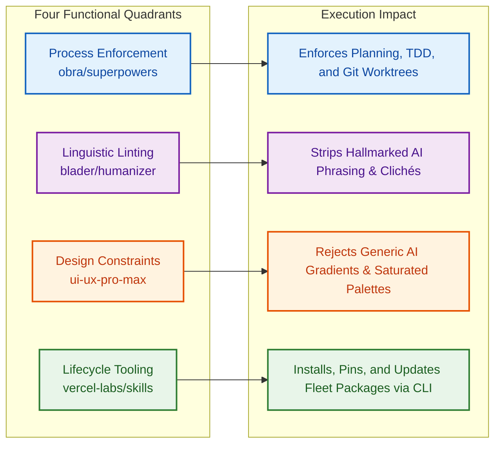
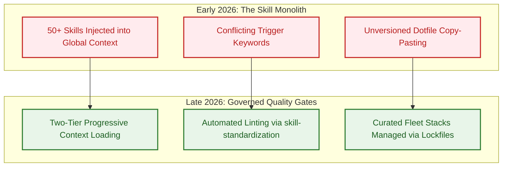

## The Proliferation and Attrition of Open-Source Agent Skills

Following the widespread adoption of terminal-native coding harnesses and the open `Agent Skills` specification in early 2026, the developer ecosystem experienced an explosion of community-contributed skills. Public registries such as `skills.sh` and GitHub repositories swelled to over 100,000 published packages. Developers rushed to install dozens of specialized skills promising automated SEO auditing, database scaffolding, Kubernetes manifest generation, and social media drafting.

Yet, within weeks of this proliferation, engineering teams encountered an overwhelming attrition curve: **over 90% of installed skills were abandoned within forty-eight hours of installation**.

The root cause of this attrition is structural. Most open-source skills were authored as shallow prompt wrappers—static text snippets instructing the model to "write in a friendly tone" or "format output as JSON." In production environments, these shallow wrappers provide negligible leverage: they fail to alter the underlying execution loop, introduce ambiguity into the agent's intent classification layer, and consume precious context tokens during every turn.

```mermaid
flowchart TD
    subgraph AttritionLoop ["The 90% Skill Attrition Loop"]
        A1[Developer Installs 50+ Niche Skills] --> A2[Context Window Bloat & Trigger Ambiguity]
        A2 --> A3[Agent Slowdown & Prompt Dilution]
        A3 --> A4[Developer Purges Catalog; Returns to Raw CLI]
    end

    subgraph SurvivalCriteria ["The Four Structural Survival Archetypes"]
        B1[1. Process Enforcement<br/>(Forces TDD & Planning)]
        B2[2. Anti-Pattern Linting<br/>(Eliminates Statistical Tells)]
        B3[3. Domain Constraint Rules<br/>(Enforces Strict Design Bounds)]
        B4[4. Lifecycle Management<br/>(Package Discovery & Upkeep)]
    end

    A4 -.->|Curated Evolution| SurvivalCriteria

    classDef bad fill:#ffebee,stroke:#c62828,stroke-width:2px,color:#b71c1c;
    classDef good fill:#e8f5e9,stroke:#2e7d32,stroke-width:2px,color:#1b5e20;
    class A1,A2,A3,A4 bad;
    class B1,B2,B3,B4 good;
```

A skill survives in continuous daily use if and only if it **alters the systemic process of the agent**, enforces rigid negative constraints, or manages the skill lifecycle itself. This source audit deconstructs four enduring skill primitives that survived this attrition curve—`obra/superpowers`, `blader/humanizer`, `nextlevelbuilder/ui-ux-pro-max-skill`, and `vercel-labs/skills`—and examines the architectural rules governing production skill portfolios.

## Deconstructing the Four Enduring Skill Primitives

Rather than providing superficial prompt text, each surviving skill represents a distinct foundational archetype in agentic workflow design:



### 1. Process Enforcement: `obra/superpowers`
Authored by veteran software engineer Jesse Vincent, `superpowers` addresses the primary pathology of autonomous coding agents: premature, unconstrained code mutation.
- **The Core Discipline**: It explicitly bars the agent from writing implementation code until a strict seven-phase workflow is satisfied:
  1. Brainstorming and problem boundary definition.
  2. Architecture planning and interface specification.
  3. Test-driven development (TDD): writing reproducing test cases before implementation.
  4. Worktree isolation: branching work into ephemeral Git worktrees.
  5. Granular execution: restricting task chunks to 2-to-5 minute increments.
  6. Double-review: requiring independent verification before merging.
- **Production Value**: By forcing procedural discipline into the prompt harness, `superpowers` prevents the erratic drift commonly observed during long-horizon tasks, complementing the multi-agent task locking examined in [Claude Opus 4.6 and Agent Teams: Lessons from the 16-Agent Compiler Harness](/posts/claude-opus-46-agent-teams/).

### 2. Linguistic Anti-Pattern Linting: `blader/humanizer`
While standard LLMs generate grammatically correct prose, their outputs suffer from recognizable statistical artifacts. The `humanizer` skill codifies editorial guidelines derived from Wikipedia's *Signs of AI Writing* and professional editorial manuals.
- **Targeted Linguistic Tells**:
  - **Overused AI Vocabulary**: Systematic eradication of buzzwords like "testament," "landscape," "showcasing," "delve," "pivotal," and "tapestry."
  - **Rhythmic Clichés**: Stripping excessive em-dash clauses, emoji bullet decorations, and predictable "rule-of-three" parallelisms.
  - **Inflated Conclusions**: Replacing generic summary platitudes (*"As AI continues to evolve..."*) with concrete, actionable engineering questions.
- **Production Value**: It functions as an automated editorial linter, transforming generic synthetic drafts into technical prose that respects human reader attention.

### 3. Domain Constraint Rules: `nextlevelbuilder/ui-ux-pro-max-skill`
When asked to build user interfaces, unconstrained agents consistently default to generic "AI aesthetics": saturated purple-to-pink linear gradients, low-contrast gray text on dark backgrounds, and oversized, floating hero cards.
- **Systematic Design Intelligence**:
  - Catalogs **67 validated UI design paradigms**, **96 color palettes**, and **57 font pairings**.
  - Encodes explicit negative constraints: prohibiting uncalibrated neo-morphic shadows, enforcing WCAG AA contrast compliance, and prescribing strict 4px/8px layout grids.
- **Production Value**: It shifts the model from reactive template copying to structured design system adherence, ensuring generated components integrate seamlessly into enterprise design frameworks.

### 4. Lifecycle Management: `vercel-labs/skills`
Managing hundreds of markdown-based skills across multiple distributed developer machines and continuous integration environments is an operational nightmare without package tooling.
- **The Package Management Substrate**: Vercel's `skills` CLI provides standard package operations:
  - `npx skills find <query>`: Semantic registry search on `skills.sh`.
  - `npx skills add <repo>`: Automated installation and front matter verification.
  - `npx skills update`: Automated version locking and fleet-wide dependency updates.
- **Production Value**: It treats skills as version-controlled software packages rather than unmanaged dotfiles, enabling deterministic setup across entire engineering teams.

## What Changed Since Early 2026: The Shift from Skill Bloat to Curated Quality Gates

When agent skills emerged in late 2025 and early 2026, developer workflows mirrored the early days of npm: unvetted packages were installed indiscriminately, leading to context bloat and silent routing conflicts.

Between early 2026 and late 2026, the ecosystem matured through three structural shifts:



1. **Two-Tier Progressive Context Loading**:
   As analyzed in [Awesome Claude Skills: Standardizing Agentic Workflow Primitives](/posts/awesome-claude-skills/), modern terminal harnesses no longer dump full skill instructions into the baseline system prompt. The harness indexes only concise trigger descriptions in Tier 1, lazy-loading the full `SKILL.md` body only upon task activation. This prevents skill catalogs from degrading base model attention.

2. **Automated Quality Gates and Spec Linter Tools**:
   In early 2026, skills were evaluated purely on anecdotal user vibes. By late 2026, CI pipelines integrated automated skill linters (`skill-standardization`) that audit skills for:
   - Trigger description specificity (preventing ambiguous triggers from intercepting unintended tasks).
   - Executable verification assertions (requiring skills to execute unit tests or linters).
   - Strict adherence to the `agentskills.io` standard.

3. **Convergence with Terminal-Native Harnesses**:
   As established in [Why the Terminal Is the Superior Harness for Coding Agents](/posts/cli-harness-coding-agents/), skills thrive because they execute on top of native operating system tools. A process skill like `superpowers` relies directly on POSIX git worktrees and shell commands, while package managers like Vercel Skills operate seamlessly across Claude Code, Gemini CLI, and OpenCode.

## Production Engineering Principles: The Skill Survival Matrix

When evaluating whether a candidate skill deserves inclusion in an enterprise repository's default configuration, engineering leads should apply a strict four-point filter:

| Evaluation Dimension | Pass Criteria | Immediate Failure Signal |
| :--- | :--- | :--- |
| **1. Process Modification** | Enforces a multi-step execution loop with verification gates | Merely outputs unstructured markdown or conversational answers |
| **2. Negative Constraints** | Contains explicit rules barring common LLM failure modes | Only provides open-ended suggestions without boundaries |
| **3. Trigger Isolation** | Clear, unambiguous trigger keywords that activate only on intent | Generic triggers (e.g., "helpful coding assistant") that hijack all turns |
| **4. Maintenance Hygiene** | Version-pinned, lockfile-managed via `npx skills` or git submodules | Unversioned code snippets pasted into local chat prompts |

### Practical Installation and Fleet Upkeep

To standardize a production skill stack across an engineering organization, maintain an explicit `skills.json` configuration in the repository root:

```bash
# Automated installation using Vercel Skills CLI
npx skills add obra/superpowers
npx skills add blader/humanizer
npx skills add nextlevelbuilder/ui-ux-pro-max-skill
npx skills add vercel-labs/skills
```

By versioning the skill manifest alongside project source code, all engineers and automated CI runners execute against identical procedural guardrails, mirroring the disciplined autonomous workflows explored in [Towards Self-Driving Codebases: Architectural Lessons from Cursor's Agent Harness](/posts/self-driving-codebases/).

## Key Takeaways

1. **The 90% Attrition Reality**: Most open-source agent skills are discarded quickly because shallow prompt wrappers fail to change the agent's fundamental execution loop while causing context bloat.
2. **Process Enforcement Anchors Autonomy**: `obra/superpowers` endures because it imposes strict TDD, pre-coding architectural planning, and ephemeral Git worktrees onto the agent loop.
3. **Negative Constraints Defeat AI Hallmarks**: `blader/humanizer` and `ui-ux-pro-max-skill` succeed by explicitly banning statistical clichés, buzzwords, and generic UI anti-patterns.
4. **Lifecycle Tooling Is Mandatory for Scale**: Vercel's `skills` CLI transforms skills from unmanaged markdown files into versioned, discoverable, and auditable software packages.
5. **Curate for Systems Impact**: A skill is worth maintaining in production only if it alters the operating process, saves measurable engineering time, and plays cleanly with adjacent tools.

## New Questions

1. **Can Skills Be Compiled into Model Checkpoints?**: As skill specifications mature, can enterprise organizations fine-tune specialized adapter weights that internalize skills like `superpowers` directly, eliminating prompt overhead?
2. **How Can Conflicting Skill Triggers Be Arbitrated Autonomously?**: When an agent's intent router matches two overlapping domain skills simultaneously, what scoring heuristic ensures the correct procedural workflow executes?
3. **What Are the Security Risks of Community-Contributed Skills?**: How can organizations detect hidden prompt injections or malicious shell invocations embedded within complex, third-party `SKILL.md` instruction trees?
4. **Can Autonomous Agents Synthesize Unit Tests for Skills?**: Can meta-agents generate automated regression test suites that evaluate whether a skill reliably alters agent behavior across diverse model families?

## References

- Vincent, Jesse (obra). "Superpowers: An Agent Skill for Structured Software Development." `obra/superpowers`, commit `main` branch, 2025–2026. URL: `https://github.com/obra/superpowers` (accessed 2026-10-18).
- Blade, Ryan (blader). "Humanizer: Detecting and Remediating Statistical AI Writing Tells." `blader/humanizer`, release v1.x, 2025–2026. URL: `https://github.com/blader/humanizer` (accessed 2026-10-18).
- NextLevelBuilder. "UI-UX Pro Max: Design Intelligence and Anti-Pattern Engine for AI Agents." `nextlevelbuilder/ui-ux-pro-max-skill`, 2025–2026. URL: `https://github.com/nextlevelbuilder/ui-ux-pro-max-skill` (accessed 2026-10-18).
- Vercel Labs. "Skills CLI and the Open Agent Skill Registry." `vercel-labs/skills`, version 0.4.x, 2025–2026. URL: `https://github.com/vercel-labs/skills` (accessed 2026-10-18).
- Agent Skills Working Group. "The Agent Skills Specification." Open Specification Standard, v1.0.0, 2025–2026. URL: `https://agentskills.io/` (accessed 2026-10-18).
