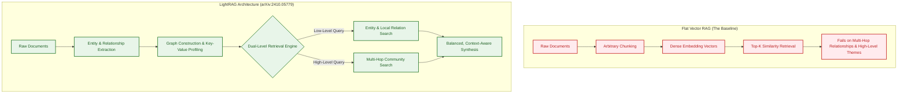
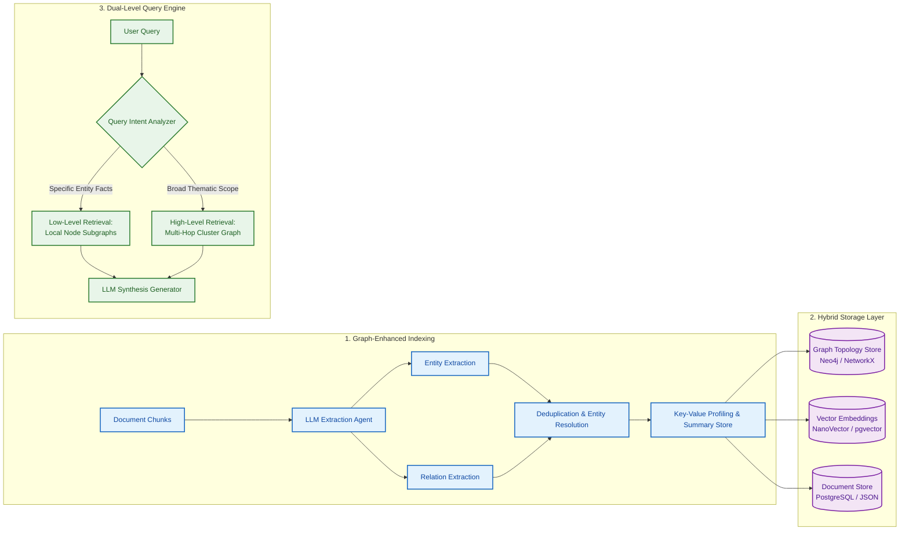
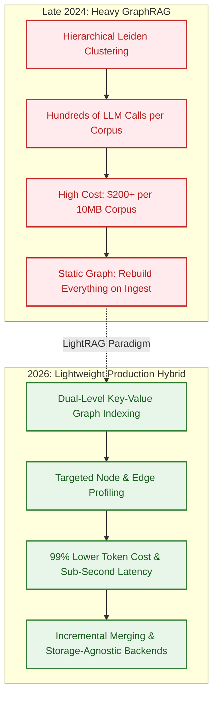

## The Structural Blind Spot of Flat Vector Retrieval

Traditional Retrieval-Augmented Generation (RAG) pipelines operate by shredding documents into fixed-size character chunks (typically 256 to 1,024 tokens), calculating dense mathematical representations via embedding models, and persisting those vectors inside vector databases. During query execution, the system retrieves the top-$k$ nearest chunks via cosine similarity and injects them into the language model's prompt.

While this flat vector approach excels at localized question-answering—such as retrieving an exact API parameter or a distinct customer invoice number—it exhibits a profound structural blind spot on relational and multi-hop reasoning. In complex document corpora, knowledge is inherently non-linear and relational:
1. **Multi-Hop Connection Loss**: Answering *"How does the data retention policy in Section 4 alter the audit logging requirements in Section 9?"* requires traversing dependencies between disparate paragraphs that do not share semantic embedding similarity.
2. **Context Fragmentation**: Splitting text at arbitrary token boundaries divorces entities from their qualifying relationships, producing isolated fragments that confuse model synthesis.
3. **Thematic Summarization Failure**: Inquiries that ask for high-level conceptual summaries across an entire corpus (*"What are the central architectural failure modes across all incident reports?"*) require global aggregation across thousands of chunks—a task where flat top-$k$ vector retrieval fails catastrophically.

In late 2024 and early 2025, researchers from the Data Intelligence Lab at the University of Hong Kong (HKUDS) introduced **LightRAG** in a paper titled *"LightRAG: Simple and Fast Retrieval-Augmented Generation"* ([arXiv:2410.05779](https://arxiv.org/abs/2410.05779)). LightRAG bridges the gap between fast vector search and complex graph traversals by introducing a lightweight, dual-level knowledge graph indexing and retrieval engine.



This source audit examines LightRAG's dual-level retrieval architecture, analyzes its incremental indexing mechanics, compares its operational economics against Microsoft GraphRAG, and explores practical engineering considerations for production knowledge bases.

{: .light .w-100 .shadow .rounded-10 w='760' h='435' }

## Technical Architecture: Dual-Level Retrieval and Entity-Relation Extraction

LightRAG models information as an interconnected network of nodes (entities) and edges (relationships), augmented with structured key-value profiles that enable low-latency traversal.



### 1. Graph-Enhanced Indexing and Entity Deduplication
When raw text is ingested, an extraction agent prompts an LLM to identify distinct semantic entities (people, modules, protocols, organizations) and explicit relationships between them. Crucially:
- **Node & Edge Profiling**: Each identified node and edge receives an automatically generated text summary capturing its operational attributes.
- **Entity Resolution & Deduplication**: If multiple chunks mention "Authentication Gateway" and "AuthGW," the indexing engine merges them into a canonical graph node, consolidating their edge connections and updating their combined description.

### 2. Dual-Level Retrieval Mechanics
Traditional GraphRAG systems struggle with query granularity: they are either too localized or too abstract. LightRAG solves this by routing queries through two complementary retrieval channels:
- **Low-Level Retrieval (Specific Facts)**: Targets granular, entity-specific inquiries. The system matches the query against node and edge profiles via vector similarity, retrieving the targeted entity and its 1-hop immediate neighborhood.
- **High-Level Retrieval (Abstract Themes)**: Targets broad, exploratory inquiries across the corpus. The system identifies broader interconnected subgraphs, pulling summaries of multi-hop entity clusters to provide thematic coverage without overwhelming the context window.
- **Hybrid Fusion**: For complex queries, LightRAG retrieves from both levels simultaneously, interleaving concrete entity facts with overarching structural context before generating the final answer.

### 3. Incremental Graph Updates
A critical limitation of earlier graph-based RAG architectures was the inability to handle dynamic corpora: inserting a single new document required rebuilding the entire global graph and recalculating all community summaries.

LightRAG was architected from the ground up for **incremental insertion**. When a new document arrives:
1. The model extracts new entities and relationships from the incoming text.
2. The engine checks for intersections with existing nodes in the graph store.
3. If an entity exists, its summary profile is updated incrementally, and new edges are attached.
4. If an entity is novel, a new node is created.

This design enables real-time ingestion for living documentation, continuous integration logs, and customer support tickets without expensive global recalculations.

## What Changed Since Late 2024 to 2026: From Heavy GraphRAG to Production Hybrid Systems

When Microsoft Research open-sourced GraphRAG in mid-2024, the AI community was captivated by its ability to answer complex, corpus-wide questions. However, production adoption was immediately stymied by extreme operational overhead:
- **Astronomical Indexing Costs**: Microsoft GraphRAG utilized hierarchical Leiden community detection, requiring hundreds of LLM calls per document cluster. Indexing a modest 10MB text corpus routinely cost between $100 and $500 in API tokens.
- **High Query Latency**: Generating community reports on the fly caused query response times to balloon into several seconds.

Between late 2024 and late 2026, the retrieval ecosystem experienced a decisive shift from heavy, academic graph pipelines toward lightweight, production-viable hybrid engines:



1. **LightRAG Reduced Token Costs by Over 99%**:
   By replacing hierarchical Leiden community summarization with dual-level key-value node profiling, LightRAG reduced the token overhead of graph construction by two orders of magnitude while matching or exceeding Microsoft GraphRAG's retrieval quality on standard benchmarks.

2. **Convergence with SQL and Relational Interceptors**:
   As explored in [Memori's SQL-native memory architecture](/posts/memori-sql-native-memory-for-llms/), systems engineering in 2026 moved away from proprietary, bespoke graph silos toward SQL-native and relational storage. Modern LightRAG implementations increasingly run on top of PostgreSQL using standard relational joins for graph edges and `pgvector` for node embeddings, eliminating the need to manage separate graph database clusters.

3. **High-Throughput Vector Acceleration**:
   Serving node and relationship embeddings at low latency relies on dedicated embedding runtimes. Leveraging optimized inference engines like those examined in the [Hugging Face Text Embeddings Inference deep dive](/posts/huggingface-text-embeddings-inference-deep-dive/) allows LightRAG pipelines to execute embedding similarities in sub-millisecond latencies during low-level retrieval passes.

4. **Integration with Autonomous Coding Agents**:
   As analyzed in [Deconstructing 17 Agentic Architectures](/posts/all-agentic-architectures-comprehensive-guide/), autonomous agents require structured world models to navigate complex environments. LightRAG's dual-level graph serves as a persistent memory and repository topology map for coding agents operating in terminal harnesses.

## Production Engineering Tradeoffs and Storage Engine Selection

Deploying LightRAG in high-throughput enterprise applications requires careful selection of backend storage engines and model tiering.

### Storage Engine Selection Matrix

| Storage Layer | Local Prototyping | Production Self-Hosted | Enterprise Managed |
| :--- | :--- | :--- | :--- |
| **Graph Topology (Edges)** | NetworkX (in-memory JSON) | PostgreSQL (relational joins) | Neo4j / AWS Neptune |
| **Vector Index (Node/Edge Embeddings)** | NanoVector / FAISS | PostgreSQL (`pgvector`) | Qdrant / Milvus |
| **Document & Summary KV Store** | Local JSONKV file | PostgreSQL JSONB | MongoDB / Redis |

For the majority of production web backends, consolidating all three storage layers into **PostgreSQL** (using relational foreign keys for graph edges, `pgvector` for node embeddings, and `JSONB` for key-value profiles) delivers the lowest operational complexity and ensures ACID transactional guarantees during incremental updates.

### Quick Start and Model Configuration

LightRAG provides a modular Python SDK that can be configured with any OpenAI-compatible API:

```python
import os
from lightrag import LightRAG, QueryParam
from lightrag.llm import openai_complete_if_cache, openai_embedding
from lightrag.utils import EmbeddingFunc

# Initialize LightRAG with working directory
WORKING_DIR = "./production_lightrag"
os.makedirs(WORKING_DIR, exist_ok=True)

rag = LightRAG(
    working_dir=WORKING_DIR,
    llm_model_func=openai_complete_if_cache,
    llm_model_name="claude-3-7-sonnet",
    llm_model_max_async=4,
    llm_model_max_token_size=32768,
    llm_model_kwargs={"api_key": os.environ["ANTHROPIC_API_KEY"]},
    embedding_func=EmbeddingFunc(
        embedding_dim=1536,
        max_token_size=8192,
        func=lambda texts: openai_embedding(texts, model="text-embedding-3-small"),
    ),
)

# Incremental insertion of documents
with open("system_architecture.txt", "r") as f:
    rag.insert(f.read())

# Dual-level query execution (hybrid mode)
response = rag.query(
    "How does the caching layer invalidate stale auth tokens across worker pods?",
    param=QueryParam(mode="hybrid") # Supports 'low_level', 'high_level', 'hybrid', 'naive'
)
print(response)
```

## Key Takeaways

1. **Flat Vector RAG Misses Relational Topologies**: Chunk-and-embed pipelines excel at localized keyword lookups but fail at multi-hop reasoning, relationship tracing, and global corpus summarization.
2. **Dual-Level Retrieval Delivers Balanced Coverage**: LightRAG routes queries through low-level entity subgraphs for specific facts and high-level community clusters for broad thematic concepts, fusing them during synthesis.
3. **99% Token Cost Reduction Over Heavy GraphRAG**: By utilizing key-value node profiles rather than recursive Leiden community generation, LightRAG eliminates the prohibitive expense of earlier graph-enhanced RAG frameworks.
4. **First-Class Incremental Ingestion**: LightRAG dynamically updates entity nodes and edges as new documents arrive, avoiding full graph re-indexing.
5. **PostgreSQL as the Unified Production Substrate**: Consolidating graph topology, vector embeddings (`pgvector`), and key-value summaries into PostgreSQL provides ACID safety and simplifies operational architecture.

## New Questions

1. **Can Entity Extraction Be Offloaded to Small Fine-Tuned Models?**: Can specialized 7B/14B parameter models execute the initial entity-relation extraction pass with zero quality loss compared to frontier models, cutting indexing costs further?
2. **How Does LightRAG Handle Contradictory Graph Assertions?**: When a newly ingested document directly contradicts an existing relationship in the knowledge graph, what temporal arbitration heuristics resolve the conflicting edges?
3. **What Are the Scaling Limits of Graph Density?**: As a graph expands to millions of edges, does high clustering coefficient density create dense subgraphs that degrade retrieval specificity?
4. **Can Dual-Level Graphs Guide Multi-Agent Code Generation Directly?**: How can coding agent harnesses query LightRAG's low-level entity graphs to verify function signatures while querying high-level graphs to maintain architectural consistency?

## References

- Guo, Zirui, et al. "LightRAG: Simple and Fast Retrieval-Augmented Generation." *HKUDS (University of Hong Kong Data Intelligence Lab)*, arXiv preprint arXiv:2410.05779v3, 2024–2025. URL: `https://arxiv.org/abs/2410.05779` (accessed 2026-10-18).
- HKUDS Team. "LightRAG: Official Open-Source Implementation." `HKUDS/LightRAG`, release v1.0+, 2025–2026. URL: `https://github.com/HKUDS/LightRAG` (accessed 2026-10-18).
- Edge, Darren, et al. "From Local to Global: A Graph RAG Approach to Query-Focused Summarization." *Microsoft Research*, arXiv preprint arXiv:2404.16130v1, 2024. URL: `https://arxiv.org/abs/2404.16130` (accessed 2026-10-18).
- LightRAG Documentation Team. "LightRAG System Architecture and Storage Backends." *LightRAG Documentation*, 2025–2026. URL: `https://lightrag.github.io/` (accessed 2026-10-18).
