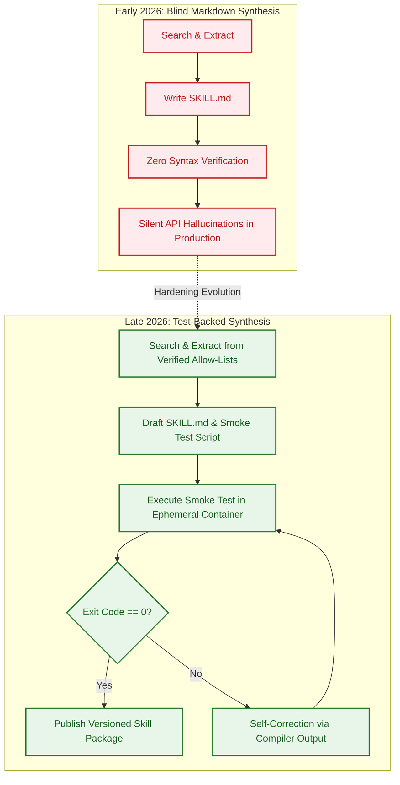

## The Knowledge Ingestion Bottleneck in Autonomous Engineering

In autonomous AI software engineering, the primary barrier to adoption is no longer model reasoning capacity, but the **knowledge ingestion latency** of evolving software libraries. Modern developer ecosystems update at a relentless pace: major cloud platforms and open-source frameworks regularly release breaking API versions, deprecate legacy client constructors, and introduce new software development kits (SDKs).

When a team transitions to a new technology—such as Google's unified `google-genai` SDK for Gemini 3 Flash and Pro models—an autonomous coding agent operating solely on pre-training weights fails immediately. Its parametric memory is frozen at training cutoff, resulting in hallucinated imports, obsolete function schemas, and invalid authentication calls.

Traditionally, closing this gap required a human software engineer to read documentation, author operational cheat-sheets, and manually write structured prompt instructions. In February 2026, AI researcher Philipp Schmid (Technical Lead at Hugging Face) published [`philschmid/self-learning-skill`](https://github.com/philschmid/self-learning-skill), introducing an autonomous loop: an agent harness equipped with web search and headless browser extraction that discovers canonical documentation on demand and compiles new, production-ready `SKILL.md` packages without human intervention.

```mermaid
flowchart TD
    subgraph HumanBottleneck ["The Manual Knowledge Ingestion Bottleneck"]
        A1[New Framework / API Released] --> A2[Human Engineer Reads Documentation]
        A2 --> A3[Human Crafts Operational Prompts & Cheatsheets]
        A3 --> A4[Human Manually Configures Agent Workspace]
        note1["High friction; days of lag before agents can use new SDKs"]
    end

    subgraph AutonomousSelfLearning ["Autonomous Self-Learning Loop (/learn)"]
        B1["User Command: '/learn gemini api with gemini 3'"] --> B2[Targeted Search Over Authoritative Domains]
        B2 --> B3[Headless Browser DOM Extraction]
        B3 --> B4[Structural Normalization & Code Example Synthesis]
        B4 --> B5[Sandboxed Test Execution Verification]
        B5 --> B6[Installed SKILL.md Package with Strict Schemas]
    end

    classDef bad fill:#ffebee,stroke:#c62828,stroke-width:2px,color:#b71c1c;
    classDef good fill:#e8f5e9,stroke:#2e7d32,stroke-width:2px,color:#1b5e20;
    class A1,A2,A3,A4 bad;
    class B1,B2,B3,B4,B5,B6 good;
```



This source audit examines the technical architecture of Schmid's self-learning harness. We analyze the four-stage synthesis pipeline, examine its application to Google's Gemini 3 SDK, trace the 2026 shift toward test-verified skill synthesis, and outline defensive operational guardrails.

## Technical Architecture: The /learn Ingestion Pipeline

The `self-learning-skill` formalizes autonomous tech onboarding into an explicit, multi-phase agent loop:

```mermaid
flowchart LR
    subgraph Phase1 ["1. Discovery"]
        Cmd["/learn <query>"] --> Search[Domain-Bounded Search API]
        Search --> URLFilter[Authority Filter:<br/>Official Docs & SDK Repos]
    end

    subgraph Phase2 ["2. Extraction"]
        URLFilter --> Browser[Headless Browser Engine]
        Browser --> ASTExtract[Extract Code Blocks, Signatures, Schemas]
    end

    subgraph Phase3 ["3. Synthesis"]
        ASTExtract --> LLM_Synth[Synthesis Engine]
        LLM_Synth --> SkillDoc[Format SKILL.md Manifest]
        LLM_Synth --> RefCode[Generate scripts/ & references/]
    end

    subgraph Phase4 ["4. Verification"]
        SkillDoc & RefCode --> Sandbox[Docker / Ephemeral Sandbox]
        Sandbox --> SmokeTest[Execute Smoke Test Against API]
        SmokeTest -->|Pass| Fleet[Register in Workspace Skills Catalog]
    end

    classDef p1 fill:#e3f2fd,stroke:#1565c0,stroke-width:2px,color:#0d47a1;
    classDef p2 fill:#f3e5f5,stroke:#7b1fa2,stroke-width:2px,color:#4a148c;
    classDef p3 fill:#fff3e0,stroke:#e65100,stroke-width:2px,color:#bf360c;
    classDef p4 fill:#e8f5e9,stroke:#2e7d32,stroke-width:2px,color:#1b5e20;
    class Cmd,Search,URLFilter p1;
    class Browser,ASTExtract p2;
    class LLM_Synth,SkillDoc,RefCode p3;
    class Sandbox,SmokeTest,Fleet p4;
```



### 1. Domain-Bounded Discovery
When triggered via `/learn <technology>`, the agent formulates targeted web search queries. In production configurations, discovery is restricted to authoritative domains (e.g., official documentation hubs, GitHub releases, package managers) to prevent low-quality SEO scrapers or hallucinated medium posts from poisoning the extraction pipeline.

### 2. Headless Browser Extraction
Raw HTML fetching often fails on modern documentation portals that rely on client-side rendering (React, Docusaurus, Nextra). The harness utilizes a headless browser instance to execute JavaScript, bypass cookie banners, and extract structured DOM trees containing:
- Installation commands across major package managers (`pip`, `npm`, `go get`).
- Canonical client instantiation syntax.
- Function calling and structured output schemas.
- Error handling idioms and deprecated parameter warnings.

### 3. Synthesis Conforming to the `agentskills.io` Standard
The synthesis engine transforms the extracted fragments into a self-contained skill folder. As analyzed in [Curating Agent Skills: The Four Primitives That Survived the Proliferation](/posts/four-skills-that-survived/), a production skill must conform to strict standards:
- **YAML Front Matter**: Providing unambiguous, keyword-rich activation descriptions.
- **Minimal Working Examples**: Concise, runnable scripts illustrating standard and streaming generation.
- **Function Declaration Schemas**: Strict JSON Schema / Pydantic models for tool use.

### 4. Case Study: Ingesting the Gemini 3 API

As demonstrated in Schmid's canonical reference gist, executing `/learn gemini api with gemini 3 models` synthesizes a comprehensive operational manual for Google's unified `google-genai` SDK:

```python
# Automatically synthesized Python client pattern for Gemini 3
from google import genai
from google.genai.types import GenerateContentConfig, Tool

client = genai.Client()

# Define strict JSON function declaration
light_control_tool = {
    "name": "adjust_lighting",
    "description": "Adjusts workspace lighting parameters.",
    "parameters": {
        "type": "object",
        "properties": {
            "brightness": {"type": "integer", "description": "Brightness percentage (0-100)"},
            "color_temperature": {"type": "string", "enum": ["daylight", "neutral", "warm"]}
        },
        "required": ["brightness", "color_temperature"]
    }
}

# Execute function calling on Gemini 3 Flash
response = client.models.generate_content(
    model="gemini-3-flash-preview",
    contents="Dim the office lighting to warm 40% for evening focus.",
    config=GenerateContentConfig(
        system_instruction="You are an autonomous office automation agent.",
        tools=[Tool(function_declarations=[light_control_tool])],
        temperature=0.2,
    ),
)
```

By packaging this synthesized code directly into `skills/gemini-api/`, the parent coding agent immediately acquires the ability to build and debug Gemini-powered services without manual intervention.

## What Changed Since Early 2026: From Ad-Hoc /learn Prompts to Verified Skill Synthesis

When `self-learning-skill` debuted in early 2026, it operated primarily as an unconstrained generative prompt: it scraped text, wrote a markdown file, and hoped the syntax was correct.

Between early 2026 and late 2026, the ecosystem evolved through three critical hardening phases:



1. **Mandatory Sandboxed Smoke Testing**:
   Generating documentation is useless if the synthesized code samples throw syntax or import errors. Late 2026 self-learning harnesses mandate an automated validation step: the agent scaffolds an ephemeral test script inside a Docker container, attempts to execute the code using the live SDK, and inspects the return code. If the test fails, the error trace is fed back into the synthesis agent for self-correction before the skill is registered.

2. **Integration with Fleet Package Managers (`npx skills`)**:
   Rather than dropping unversioned markdown files into ad-hoc folders, self-learning skills now export packages compliant with Vercel's `skills` CLI (analyzed in [Awesome Claude Skills: Standardizing Agentic Workflow Primitives](/posts/awesome-claude-skills/)). Newly synthesized skills can be committed, tagged with semver versions, and published to enterprise private registries for immediate team-wide distribution.

3. **Two-Tier Progressive Trigger Management**:
   As examined in [Why the Terminal Is the Superior Harness for Coding Agents](/posts/cli-harness-coding-agents/), accumulating self-generated skills can bloat baseline system prompts. Modern harnesses ensure that auto-generated skills declare compact, mutually exclusive trigger descriptions, ensuring they remain dormant in Tier 1 until explicitly needed.

## Systems Engineering Tradeoffs and Guardrails

Deploying autonomous self-learning skills in enterprise environments introduces distinct operational hazards that systems engineers must mitigate.

### The Three Threat Vectors of Autonomous Learning

1. **Source Poisoning and Malicious Injection**:
   If an agent searches open web indexes without domain constraints, malicious actors can publish SEO-poisoned blog posts containing prompt injections designed to hijack the agent (e.g., hidden HTML instructing the model to exfiltrate environment variables).
   - *Mitigation*: Strictly enforce hardcoded domain allow-lists (`ai.google.dev`, `docs.anthropic.com`, `github.com/google-gemini`, `pypi.org`).
2. **Context Bloat from Verbose Synthesis**:
   Unsupervised models tend to generate exhaustive, 5,000-token skill manuals filled with conversational filler.
   - *Mitigation*: Enforce a hard token ceiling ($T \le 1,500$ tokens per generated `SKILL.md`) and mandate that all background explanations reside in separate `references/` subdirectories.
3. **API Deprecation Drift**:
   A skill generated in February may reference preview API endpoints that become obsolete by May.
   - *Mitigation*: Attach an expiration timestamp to the skill front matter (`last_verified: YYYY-MM-DD`). If an agent attempts to invoke a skill older than 90 days, the harness prompts an automatic `/learn --refresh` pass.

## Key Takeaways

1. **Knowledge Ingestion Latency Bottlenecks Autonomy**: Static pre-trained models fail when interacting with rapidly evolving modern SDKs; self-learning harnesses close this gap through on-demand documentation synthesis.
2. **Four-Stage Pipeline**: Philipp Schmid's `self-learning-skill` formalizes autonomous onboarding across domain-bounded search, headless DOM extraction, structured `SKILL.md` synthesis, and workspace registration.
3. **Mandatory Smoke-Test Verification**: Production self-learning requires executing synthesized code in ephemeral sandboxes to verify import and runtime correctness before publishing the skill.
4. **Domain Allow-Lists Defeat Poisoning**: Restricting search discovery to verified documentation hubs prevents prompt injection attacks and hallucinated tutorials from corrupting agent knowledge.
5. **Fleet Distribution via Package Tooling**: Integrating self-generated skills with package managers (`npx skills`) transforms localized agent learning into shared organizational assets.

## New Questions

1. **Can Skills Autonomously Learn from Git Commits and PR Diffs?**: Rather than scraping public web pages, can a self-learning agent observe internal team pull requests to compile domain-specific skills for proprietary microservices?
2. **How Should Breaking API Changes Be Handled for Deprecated Skills?**: When a self-learning pass detects a breaking SDK change, what automated refactoring pipeline updates existing repository code to match the new skill?
3. **What Are the Legal and Licensing Boundaries of Scraped Skill Synthesis?**: Does compiling public documentation into structured agent instructions constitute fair use under enterprise compliance standards?
4. **Can Multi-Agent Teams Specialize in Continuous Tech Scouting?**: Could a dedicated background agent continuously monitor developer changelogs (AWS, Google Cloud, Anthropic) and proactively submit pull requests containing refreshed skills?

## References

- Schmid, Philipp. "Self-Learning Skill: Autonomous Skill Generator for AI Agents." `philschmid/self-learning-skill`, commit `main` branch, 2026. URL: `https://github.com/philschmid/self-learning-skill` (accessed 2026-10-18).
- Schmid, Philipp. "Gemini API SKILL for Gemini 3 Models." GitHub Gist `b0cd874480d05ba1a7e02816687e07ae`, February 2026. URL: `https://gist.github.com/philschmid/b0cd874480d05ba1a7e02816687e07ae` (accessed 2026-10-18).
- Google AI for Developers. "Google GenAI SDK Documentation and Gemini 3 Preview Guide." *Google Developer Documentation*, 2025–2026. URL: `https://ai.google.dev/gemini-api/docs` (accessed 2026-10-18).
- Agent Skills Working Group. "The Agent Skills Specification." Open Specification Standard, v1.0.0, 2025–2026. URL: `https://agentskills.io/` (accessed 2026-10-18).
- Vercel Labs. "Skills CLI Documentation." *Vercel Open Source*, release v0.4.x, 2025–2026. URL: `https://github.com/vercel-labs/skills` (accessed 2026-10-18).
